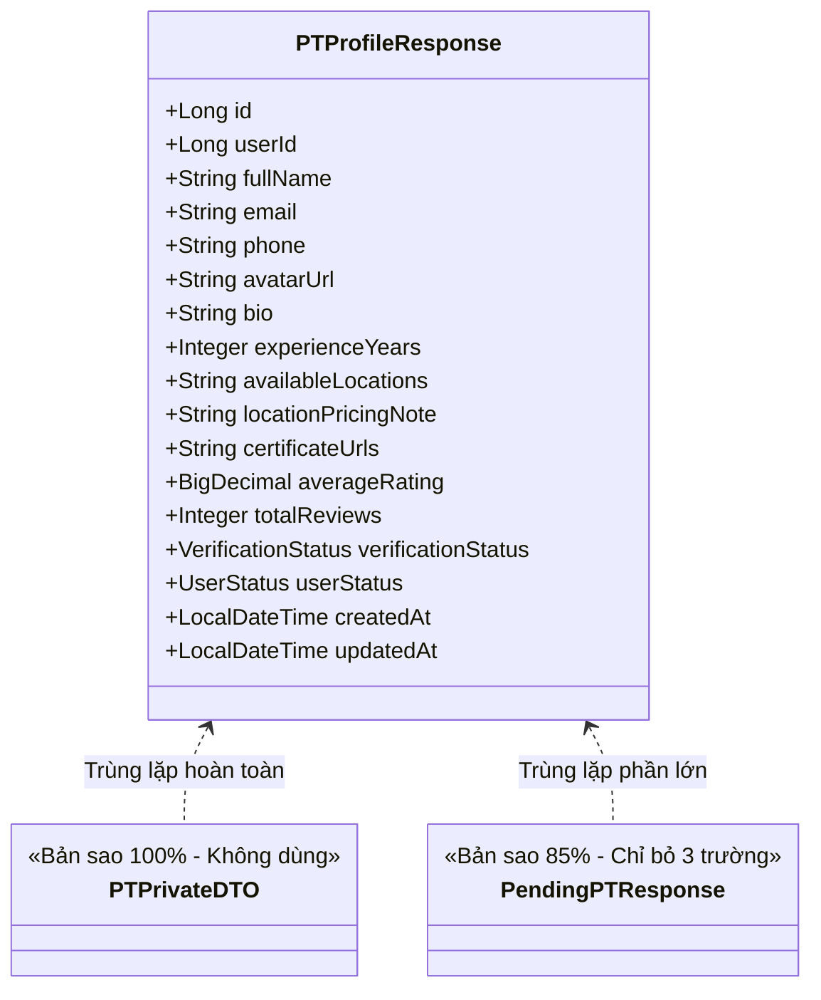

# BÁO CÁO REVIEW TOÀN DIỆN BACKEND PT-CONNECT
**Dự án:** Hệ thống Sàn giao dịch & Kết nối Huấn luyện viên cá nhân (PT Marketplace)  
**Ngày thực hiện:** 28/10/2026  
**Công nghệ:** Java 17, Spring Boot 4.0.8, Spring Data JPA, Spring Security (JWT), MySQL 8.0, OpenPDF  
**Trạng thái kiểm thử:** 67/67 Tests Passed  

---

## MỤC LỤC
1. [TỔNG QUAN HIỆN TRẠNG KIẾN TRÚC](#1-tổng-quan-hiện-trạng-kiến-trúc)
2. [PHẦN I: CODE THỪA & KHÔNG ĐƯỢC SỬ DỤNG (DEAD CODE)](#phần-i-code-thừa--không-được-sử-dụng-dead-code)
3. [PHẦN II: SỰ TRÙNG LẶP MÃ NGUỒN (CODE DUPLICATION / DRY VIOLATIONS)](#phần-ii-sự-trùng-lặp-mã-nguồn-code-duplication--dry-violations)
4. [PHẦN III: SỰ RỐI RẮM VỀ KIẾN TRÚC & PHÂN QUYỀN (ARCHITECTURAL TANGLE & INCONSISTENCIES)](#phần-iii-sự-rối-rắm-về-kiến-trúc--phân-quyền-architectural-tangle--inconsistencies)
5. [PHẦN IV: CÁC NGUY CƠ TIỀM ẨN VỀ HIỆU NĂNG (PERFORMANCE BOTTLENECK & N+1 QUERIES)](#phần-iv-các-nguy-cơ-tiềm-ẩn-về-hiệu-năng-performance-bottleneck--n1-queries)
6. [PHẦN V: BẢNG TỔNG HỢP & LỘ TRÌNH TỐI ƯU HÓA (REFACTORING ROADMAP)](#phần-v-bảng-tổng-hợp--lộ-trình-tối-ưu-hóa-refactoring-roadmap)

---

## 1. TỔNG QUAN HIỆN TRẠNG KIẾN TRÚC

Backend PT-Connect được thiết kế theo mô hình **Layered Architecture (Controller - Service - Repository - Entity)** kết hợp với một số Pattern nổi bật:
- **Strategy Pattern & Factory Pattern:** Quản lý chính sách hủy lịch (`CancellationPolicy`, `CancellationPolicyFactory`).
- **Encapsulation trong Domain Model:** Logic trừ/hoàn buổi tập nằm trong `Enrollment.consumeSession()`, `Enrollment.restoreSession()`, logic ví trong `Wallet.credit()`, `Wallet.debit()`.
- **Đa hình kế thừa Single-Table:** `User` là abstract class với các lớp con `Student`, `PT`, `Admin`.
- **Khóa bi quan (Pessimistic Lock):** Áp dụng trên `AvailabilitySlot`, `Enrollment`, `Booking` để chống đặt trùng lịch ca tập khi có tải đồng thời cao.

### Thống kê tài nguyên Codebase:
- **Controllers:** 13 lớp (`Admin`, `Attendance`, `Auth`, `Booking`, `Enrollment`, `PT`, `PTProfile`, `Public`, `Review`, `Student`, `User`, `Wallet`, `WorkoutPlan`).
- **Services & Impls:** 12 interfaces và 12 implementations.
- **Repositories:** 13 JPA Repositories.
- **Entities & Enums:** 16 Entity classes, 15 Enum types.
- **DTOs:** 17 Request DTOs, 22 Response DTOs.
- **Unit & Integration Tests:** 67 test cases đang chạy thành công 100%.

> **Nhận xét tổng quan:**  
> Mã nguồn đã hoàn thiện đầy đủ các tính năng qua 7 Milestone. Tuy nhiên, do phát triển nhanh và chuyển giao qua nhiều thành viên phụ trách theo từng Milestone, dự án đang xuất hiện nhiều **code thừa không dùng đến**, **sao chép mã nguồn lặp lại giữa các controller/service**, **nhầm lẫn khái niệm khóa ngoại giữa PT và PTProfile**, cùng với **nguy cơ thắt cổ chai hiệu năng (N+1 Query & In-memory Sorting)** khi lượng dữ liệu lớn dần.

---

## PHẦN I: CODE THỪA & KHÔNG ĐƯỢC SỬ DỤNG (DEAD CODE)

Dưới đây là danh sách chi tiết các thành phần đã được định nghĩa nhưng thực tế không hề được gọi hoặc không tham gia vào luồng chạy của ứng dụng.

### 1.1. DTOs "mồ côi" (Hoàn toàn không được sử dụng)
1. **`PTDetailResponse.java`** (`com.PTconnect.backend.dto.response.PTDetailResponse`):
   - **Hiện trạng:** Định nghĩa chứa 3 trường: `PTPublicDTO profile`, `List<CourseResponse> courses`, `List<SlotResponse> availableSlots`.
   - **Vấn đề:** Không có bất kỳ Controller hay Service nào sử dụng DTO này. Khi frontend cần lấy thông tin PT, hệ thống gọi riêng 3 endpoint trong `PTProfileController` (`/`, `/{id}/courses`, `/{id}/slots`).
   - **Đánh giá:** 100% Dead Code, nên xóa hoặc tích hợp vào 1 endpoint tổng hợp nếu frontend cần giảm số lượt request.

2. **`PTPrivateDTO.java`** (`com.PTconnect.backend.dto.response.PTPrivateDTO`):
   - **Hiện trạng:** Tệp mã nguồn dài 82 dòng với đầy đủ trường dữ liệu và phương thức `fromEntity(PTProfile)`.
   - **Vấn đề:** Không có bất kỳ class nào trong toàn bộ dự án import hay gọi đến class này. Nội dung và chức năng của nó giống hệt 100% với `PTProfileResponse.java`.
   - **Đánh giá:** 100% Dead Code & Duplicate Code.

---

### 1.2. Thuộc tính Entity thừa (@Transient không sử dụng)
1. **Trong `Attendance.java`:**
   ```java
   @Transient
   private String otpCode;

   @Transient
   private LocalDateTime otpExpiresAt;
   ```
   - **Vấn đề:** Hai trường này được đánh dấu `@Transient` với ghi chú lưu OTP tạm thời. Tuy nhiên, toàn bộ logic sinh, kiểm tra và dọn dẹp OTP đã được chuyển sang `OtpUtil` (quản lý trong `ConcurrentHashMap`). Thực tế trong code, 2 trường này không bao giờ được gán giá trị hay đọc ra từ `Attendance`.
   - **Đánh giá:** Rác dữ liệu trong Entity, gây hiểu lầm cho người đọc code.

---

### 1.3. Phương thức Repository khai báo thừa (Never Invoked)
Qua rà soát toàn bộ các Service và Controller, các hàm JPA sau đây được khai báo nhưng không có bất kỳ dòng code nào gọi đến:

| Repository | Tên phương thức | Lý do dư thừa |
| :--- | :--- | :--- |
| `AvailabilitySlotRepository` | `findByPtIdAndStatusOrderByStartTimeAsc(Long ptId, SlotStatus status)` | Service đang dùng hàm `findByPtIdAndStatusAndStartTimeAfterOrderByStartTimeAsc` (có lọc thời gian hiện tại). |
| `AvailabilitySlotRepository` | `existsByPtIdAndStartTime(Long ptId, LocalDateTime startTime)` | Không dùng; việc kiểm tra trùng giờ đã dùng `findOverlapping` hoặc Unique Constraint trong CSDL. |
| `EnrollmentRepository` | `findByStudentIdAndCourseId(Long studentId, Long courseId)` | Không có nơi nào gọi; hệ thống dùng `findByStudentIdAndCourseIdAndStatus`. |
| `EnrollmentRepository` | `findByStatus(EnrollmentStatus status)` | Không có Service nào lọc toàn bộ hợp đồng chỉ theo status. |
| `PaymentRepository` | `findByTransactionRef(String transactionRef)` | Hệ thống lưu transactionRef nhưng chưa có tính năng tra cứu giao dịch theo mã tham chiếu. |
| `PaymentRepository` | `findByWalletIdAndStatus(Long walletId, PaymentStatus status)` | Service chỉ gọi `findByWalletId(walletId)` rồi tự xử lý trong RAM. |
| `PaymentRepository` | `findByStatus(PaymentStatus status)` | Không dùng. |
| `WorkoutRepository` | `findByPlanId(Long planId)` | Không dùng; `WorkoutPlan` đã mapping `@OneToMany List<Workout> workouts` nên truy cập trực tiếp qua relation. |

---

### 1.4. Phương thức Service được định nghĩa nhưng không có Controller gọi
1. **`IBookingService.canBookSlot(Long slotId, Long studentId)` & `BookingServiceImpl.canBookSlot`:**
   - Được viết ra nhằm mục đích kiểm tra xem học viên có thể đặt slot hay không.
   - Không có API Controller nào expose hàm này ra bên ngoài.
2. **`IBookingService.validateBookingRequest(Long slotId, Long studentId, Long enrollmentId)`:**
   - Chỉ được gọi nội bộ bởi hàm `canBookSlot` nói trên.
   - Trong khi đó, hàm chính `createBooking` lại **tự viết lại từ đầu toàn bộ logic kiểm tra** này (dẫn đến vừa thừa method, vừa trùng lặp code).

---

### 1.5. Custom Exceptions được tạo nhưng KHÔNG BAO GIỜ ĐƯỢC NÉM (Never Thrown)
1. **`InvalidBookingException.java`**:
   - Được định nghĩa trong package `exception` và đăng ký `@ExceptionHandler(InvalidBookingException.class)` trong `GlobalExceptionHandler`.
   - **Thực tế:** Trong `BookingServiceImpl`, toàn bộ các lỗi đặt lịch không hợp lệ đều ném `BadRequestException` hoặc `BookingConflictException`. `InvalidBookingException` không bao giờ được `throw`.
2. **`InsufficientBalanceException.java`**:
   - Được định nghĩa và khai báo handler trong `GlobalExceptionHandler`.
   - **Thực tế:** Trong `EnrollmentServiceImpl` (dòng 84), khi số dư ví không đủ, code lại ném:
     ```java
     throw new BadRequestException("Số dư ví không đủ để thanh toán khóa học. Vui lòng nạp thêm tiền!");
     ```
   - Trong `Wallet.java` (dòng 61), khi trừ tiền không đủ, Entity ném `IllegalStateException` chứ không ném `InsufficientBalanceException`.

---

### 1.6. Các Enum Constants không có logic xử lý trong hệ thống
Các giá trị Enum sau được định nghĩa sẵn trong Java (và DB enum), nhưng không có bất kỳ luồng nghiệp vụ nào xử lý hoặc chuyển trạng thái:
- **`VerificationMethod`:** Có `QR_CODE`, `OTP`, `GEO_LOCATION`. Thực tế chỉ có luồng `OTP` là có logic chạy được; `QR_CODE` và `GEO_LOCATION` chỉ là placeholder.
- **`CancellationStatus`:** Có `PROCESSED`, `DISPUTED`, `RESOLVED`. Toàn bộ các ca hủy lịch đều được gán cứng `PROCESSED`; chưa hề có tính năng khiếu nại (`DISPUTED`) hay giải quyết tranh chấp (`RESOLVED`).
- **`PaymentMethod`:** Có `CREDIT_CARD`, `CASH`. Thực tế hệ thống chỉ thanh toán qua `WALLET` và nạp tiền `BANK_TRANSFER`.
- **`PaymentStatus`:** Có `FAILED`, `REFUNDED`. Khi hoàn tiền hoặc phạt, hệ thống tạo bản ghi thanh toán mới với `status = SUCCESS` và `paymentType = COMPENSATION / REFUND`. Trạng thái `FAILED` và `REFUNDED` chưa từng được gán cho bản ghi nào.

---

### 1.7. Hàm tiện ích thừa
- **`JwtUtil.extractUserId(String token)`:** Được cài đặt sẵn nhưng không được sử dụng ở bất cứ đâu (các controller đều lấy email qua SecurityContext rồi tra cứu User).
- **`OtpUtil.generateOtp(Long bookingId)`:** Overload 1 tham số (mặc định 30 phút) không bao giờ được gọi; `AttendanceServiceImpl` luôn gọi overload 2 tham số `generateOtp(bookingId, 30)`.

---

## PHẦN II: SỰ TRÙNG LẶP MÃ NGUỒN (CODE DUPLICATION / DRY VIOLATIONS)

### 2.1. Sao chép hàm trích xuất Email người dùng qua 8 Controllers khác nhau
Khối mã sau đây bị **copy-paste nguyên văn 100%** tại 8 controllers:
`UserController`, `PTController`, `BookingController`, `AttendanceController`, `ReviewController`, `EnrollmentController`, `WalletController`, `WorkoutPlanController` (và một biến thể tương tự trong `AuthController`):

```java
// Bị lặp lại 8 lần!
private String getCurrentUserEmail(Authentication auth) {
    if (auth == null || !auth.isAuthenticated()) {
        throw new UnauthorizedException("Chưa đăng nhập");
    }
    Object principal = auth.getPrincipal();
    if (principal instanceof User user) {
        return user.getEmail();
    }
    if (principal instanceof String email) {
        return email;
    }
    return auth.getName();
}
```
**Hậu quả:** 
- Gây lãng phí hơn 100 dòng code vô nghĩa.
- Khi muốn thay đổi cách lấy thông tin người dùng (ví dụ: lấy thẳng `User` entity hoặc `userId` từ token), phải sửa tay tại 8-9 files khác nhau.
- **Giải pháp:** Tạo một lớp tiện ích tĩnh `SecurityUtils.getCurrentUserEmail()` hoặc tạo custom annotation `@CurrentUser` / sử dụng `@AuthenticationPrincipal`.

---

### 2.2. Trùng lặp giữa các DTO phản hồi Huấn luyện viên
Có 3 DTO gần như là bản sao của nhau:
1. `PTPrivateDTO`: 18 trường.
2. `PTProfileResponse`: 18 trường (giống hệt `PTPrivateDTO` từ tên trường, kiểu dữ liệu đến hàm `fromEntity`).
3. `PendingPTResponse`: 14 trường (sao chép 13 trường của `PTProfileResponse`, chỉ bỏ đi `averageRating`, `totalReviews`, `updatedAt`).


- **Giải pháp:** Xóa bỏ `PTPrivateDTO`. Cân nhắc sử dụng chung `PTProfileResponse` cho màn hình Admin duyệt PT thay vì duy trì riêng `PendingPTResponse`.

---

### 2.3. Trùng lặp Endpoint giữa `UserController` và `AdminController`
Xem xét hai endpoint sau:
- **`UserController.java` (dòng 39-46):**
  ```java
  @GetMapping
  public ResponseEntity<ApiResponse<List<UserDTO>>> getUsers(@RequestParam(required = false) Role role) {
      List<UserDTO> users = (role != null) ? userService.getUsersByRole(role) : userService.getAllUsers();
      return ResponseEntity.ok(ApiResponse.success(users));
  }
  ```
- **`AdminController.java` (dòng 26-33):**
  ```java
  @GetMapping("/users")
  public ResponseEntity<ApiResponse<List<UserDTO>>> getUsers(@RequestParam(required = false) Role role) {
      List<UserDTO> users = (role != null) ? userService.getUsersByRole(role) : userService.getAllUsers();
      return ResponseEntity.ok(ApiResponse.success("Lấy danh sách người dùng thành công", users));
  }
  ```
**Vấn đề:** Hai endpoint làm chính xác cùng một việc, gọi cùng một Service method. Đáng nghiêm trọng hơn: endpoint trong `AdminController` yêu cầu quyền `hasRole('ADMIN')`, trong khi endpoint trong `UserController` lại vô tình bị mở public do cấu hình Security (xem chi tiết ở Phần III).

---

### 2.4. Trùng lặp logic xác thực đơn đặt lịch trong `BookingServiceImpl`
Toàn bộ đoạn code kiểm tra tính hợp lệ của việc đặt lịch:
- Kiểm tra slot `AVAILABLE`
- Kiểm tra slot không nằm trong quá khứ
- Kiểm tra học viên không bị trùng ca tập khác
- Kiểm tra hợp đồng khóa học: thuộc về học viên, đúng PT, trạng thái `ACTIVE`, còn buổi tập, chưa hết hạn...
Đoạn code này xuất hiện tại **`validateBookingRequest` (dòng 67-110)** và lại được viết lại **lần thứ hai trong `createBooking` (dòng 123-178)**.
- **Giải pháp:** Tái sử dụng: để `createBooking` gọi trực tiếp `validateBookingRequest` hoặc gom chung vào một Validator chuyên trách.

---

### 2.5. Trùng lặp luồng xử lý hủy lịch giữa Học viên và PT
Trong `BookingServiceImpl`:
- `cancelBookingByStudent` (dòng 380 - 445)
- `cancelBookingByPT` (dòng 473 - 558)
Cả hai hàm đều thực hiện chuỗi logic:
1. `booking.cancel()`
2. `slot.release(); slotRepository.save(slot)`
3. `enrollment.restoreSession(); enrollmentRepository.save(enrollment)`
4. Xử lý ví tiền & lưu bản ghi `Payment` (đền bù / phạt)
5. Xây dựng thực thể `Cancellation` và `cancellationRepository.save(cancellation)`
6. `bookingRepository.save(booking)`

Khoảng 70 dòng code được viết hai lần gần như y hệt, chỉ khác nhau biến số người hủy và chiều chuyển tiền. Cần trích xuất thành hàm dùng chung `executeCancellationProcess(...)`.

---

## PHẦN III: SỰ RỐI RẮM VỀ KIẾN TRÚC & PHÂN QUYỀN (ARCHITECTURAL TANGLE & INCONSISTENCIES)

### 3.1. Rối rắm & nhầm lẫn khái niệm giữa `pt_id` (PTProfile ID) và `user_id` (User ID của PT)
Đây là "bẫy nhận thức" (Cognitive Trap) lớn nhất trong toàn bộ hệ thống:

```
[ Bảng users ] (Chứa tài khoản, email, mật khẩu)
      ▲ id = 3 (Role = PT)
      │
      │ 1 - 1 (pt_profiles.user_id trỏ users.id)
      ▼
[ Bảng pt_profiles ] (Chứa bio, rating, chứng chỉ)
      ▲ id = 1
      │
      ├─── bookings.pt_id ------------> trỏ pt_profiles.id (KHÔNG PHẢI users.id!)
      ├─── courses.pt_id -------------> trỏ pt_profiles.id
      ├─── enrollments.pt_id ---------> trỏ pt_profiles.id
      ├─── availability_slots.pt_id --> trỏ pt_profiles.id
      └─── reviews.pt_id -------------> trỏ pt_profiles.id
```

**Sự bất nhất trong Code:**
1. Trong `Booking.java`, `Course.java`, `Enrollment.java`, `Review.java`, `WorkoutPlan.java`:
   - Biến được đặt tên là `private PTProfile pt;` nhưng tên DB column là `pt_id`. Khi nhìn vào `booking.getPt()`, lập trình viên dễ tưởng nó trả về thực thể `PT` (User), nhưng thực chất nó lại là `PTProfile`.
2. Muốn lấy thông tin User của PT từ Booking, code phải viết:
   `booking.getPt().getPt().getId()` hoặc `booking.getPt().getPt().getFullName()`.
3. Trong `PTProfileRepository.java`:
   - Hàm `findByPtId(Long userId)`: Tham số đặt tên là `userId` nhưng tên hàm lại là `findByPtId`.
4. Trong `BookingRepository.java`:
   - Hàm `findByPtIdOrderByCreatedAtDesc(Long ptId)`: Tham số `ptId` ở đây lại chính là `pt_profiles.id`!
5. Trong `ReviewController.java`:
   - `@GetMapping("/pt/{ptId}")`: `ptId` ở đây thực chất là `ptProfileId`.

**Hậu quả:** Rất dễ gây lỗi truy vấn nhầm ID, lỗi `NullPointerException`, và làm lập trình viên mới rất khó nắm bắt logic quan hệ.

---

### 3.2. Lỗ hổng và xung đột cấu hình trong `SecurityConfig`
Quan sát đoạn mã phân quyền trong `SecurityConfig.java`:

```java
// Dòng 78:
.requestMatchers(
        "/auth/register",
        "/auth/login",
        "/api/v1/auth/register",
        "/api/v1/auth/login",
        "/api/public/**",
        "/api/v1/public/**",
        "/api/v1/users/**",    // <-- MỞ CÔNG KHAI TẤT CẢ /api/v1/users/**
        "/error"
).permitAll()

// Dòng 102:
.requestMatchers("/api/v1/pt-profiles/**", "/api/pt-profiles/**").authenticated()

// Dòng 103:
.requestMatchers("/api/v1/users/**", "/api/users/**").authenticated() // <-- BỊ VÔ HIỆU HÓA!
```

**Phân tích 2 vấn đề bảo mật / kiến trúc:**
1. **Xung đột Rule (Shadowing Rule):**
   - Do Spring Security tuân theo nguyên tắc **First-Match-Wins** (rule nào khớp trước sẽ nhận rule đó), nên `/api/v1/users/**` đã được `permitAll()` ở dòng 78.
   - Dòng 103 cấu hình yêu cầu đăng nhập cho `/api/v1/users/**` hoàn toàn bị vô hiệu hóa!
   - **Hậu quả:** Endpoint `GET /api/v1/users` (xem danh sách toàn bộ người dùng, số điện thoại, email) và `GET /api/v1/users/{id}` đang bị **mở toang cho bất kỳ ai trên Internet truy cập mà không cần Token**.
2. **Nghịch lý ở PTProfile:**
   - Dòng 102 yêu cầu `.requestMatchers("/api/v1/pt-profiles/**").authenticated()`.
   - Nhưng mục đích của `PTProfileController` là cho học viên/khách vãng lai xem danh sách HLV, thông tin giới thiệu, các gói tập công khai (`getPublicPTList`, `getPublicPTProfile`). Việc bắt buộc login mới xem được profile HLV đi ngược lại logic của một sàn thương mại điện tử / marketplace.

---

### 3.3. Vi phạm ranh giới trách nhiệm (Single Responsibility Principle)
1. **`WorkoutPlanController` & `IWorkoutPlanService` kiêm nhiệm quản lý hợp đồng:**
   - Endpoint `GET /api/v1/pt/enrollments` (lấy danh sách hợp đồng của PT) được khai báo trong `WorkoutPlanController` và cài đặt trong `WorkoutPlanServiceImpl`.
   - Trong khi đó, toàn bộ nghiệp vụ hợp đồng khác (`purchaseCourse`, `getMyEnrollments`, `getEnrollmentById`, `getContractPdf`) lại nằm ở `EnrollmentController` và `EnrollmentServiceImpl`.
   - Đây là sự "đi lạc" trách nhiệm, cần chuyển `getPtEnrollments` về đúng `EnrollmentController`.
2. **`StudentController` bị bỏ ngỏ:**
   - `StudentController` chỉ có đúng một endpoint mang tính chất mock:
     ```java
     @GetMapping("/dashboard")
     public ResponseEntity<Map<String, String>> dashboard(Authentication auth) { ... }
     ```
   - Trả về `Map<String, String>` thay vì chuẩn `ApiResponse`. Các hành động cốt lõi của Học viên lại bị phân tán khắp nơi (`/api/v1/bookings`, `/api/v1/enrollments`, `/api/v1/wallet`).

---

### 3.4. Thiếu sót trong xử lý ngoại lệ (`GlobalExceptionHandler`)
1. **Bỏ sót `IllegalStateException`:**
   - Trong Entity: `Wallet.debit()` ném `IllegalStateException("Số dư khả dụng không đủ")` hoặc `("Ví đang bị đóng băng")`.
   - Trong `Enrollment.consumeSession()` ném `IllegalStateException("Hợp đồng đã sử dụng hết số buổi tập khả dụng")`.
   - Tuy nhiên, `GlobalExceptionHandler` không hề đăng ký bắt `IllegalStateException`!
   - **Hậu quả:** Khi xảy ra các lỗi nghiệp vụ này, Spring Boot sẽ đẩy về `Exception.class` (dòng 73) và trả về client mã **HTTP 500 Internal Server Error** kèm stack trace thay vì mã **HTTP 400 Bad Request**.
2. **Bỏ sót `AccessDeniedException`:**
   - Khi người dùng không đủ quyền truy cập ở mức method security (`@PreAuthorize`), nếu không được map rõ ràng, client có thể nhận response lỗi mặc định thay vì định dạng chuẩn `ApiResponse`.

---

## PHẦN IV: CÁC NGUY CƠ TIỀM ẨN VỀ HIỆU NĂNG (PERFORMANCE BOTTLENECK & N+1 QUERIES)

### 4.1. Vấn nạn N+1 Queries khi lấy danh sách Bookings
Trong `BookingServiceImpl.java`:
```java
private BookingResponse mapBookingToResponse(Booking booking) {
    Cancellation cancellation = null;
    if (booking.getStatus() == BookingStatus.CANCELLED) {
        cancellation = cancellationRepository.findByBookingId(booking.getId()).orElse(null);
    }
    return BookingResponse.fromEntity(booking, cancellation);
}
```
Khi gọi `getMyBookings` hoặc `getPTBookings`:
1. Spring Data JPA thực hiện 1 câu query lấy danh sách Bookings.
2. Với mỗi booking có status `CANCELLED`, code lại gọi thêm 1 query: `cancellationRepository.findByBookingId(...)`.
3. Đồng thời, các quan hệ `@ManyToOne(fetch = FetchType.LAZY)` trên `Booking` (`student`, `pt`, `slot`, `enrollment`, `course`) không được nạp sẵn (`JOIN FETCH`). Khi `BookingResponse.fromEntity` đọc `booking.getStudent().getFullName()`, `booking.getSlot().getStartTime()`, `booking.getPt().getPt().getFullName()`, JPA sẽ bắn thêm hàng loạt câu `SELECT` phụ vào database.
- **Hậu quả:** Với một danh sách 20 booking bị hủy, hệ thống có thể bắn tới **60 - 100 câu query** xuống MySQL cho chỉ 1 request của người dùng!

---

### 4.2. Vấn nạn N+1 Queries khi lấy danh sách Huấn luyện viên công khai
Trong `PTProfileServiceImpl.java` (dòng 96-105):
```java
private PTPublicDTO mapToPublicDTO(PTProfile profile) {
    // Với MỖI profile trong danh sách, lại query bảng courses 1 lần!
    List<Course> activeCourses = courseRepository.findByPtIdAndStatus(profile.getId(), CourseStatus.ACTIVE);
    BigDecimal lowestPrice = activeCourses.stream()
            .map(Course::getBasePrice)
            .filter(p -> p != null && p.compareTo(BigDecimal.ZERO) > 0)
            .min(BigDecimal::compareTo)
            .orElse(null);

    return PTPublicDTO.fromEntity(profile, lowestPrice);
}
```
- Khi người dùng vào trang chủ xem danh sách 50 PT: Hệ thống thực hiện 1 query lấy 50 PT, sau đó chạy **50 câu query riêng biệt** để lấy khóa học và tính giá thấp nhất cho từng PT.
- **Giải pháp:** Viết một câu truy vấn tổng hợp (Projection hoặc DTO aggregation với `LEFT JOIN courses c GROUP BY p.id`) để tính `MIN(c.basePrice)` ngay trong câu SQL duy nhất.

---

### 4.3. Lạm dụng tính toán và sắp xếp trên RAM (In-Memory Processing) thay vì SQL
Các thao tác xử lý dữ liệu sau đây đang làm trên bộ nhớ ứng dụng (JVM Heap) thay vì tận dụng sức mạnh của Database Engine:

1. **Tính tổng doanh thu hệ thống (`AdminStatisticsServiceImpl.java:42-49`):**
   ```java
   List<Payment> packagePayments = paymentRepository.findByPaymentTypeAndStatus(
           PaymentType.PURCHASE_PACKAGE, PaymentStatus.SUCCESS
   );
   BigDecimal totalRevenue = packagePayments.stream()
           .map(Payment::getAmount)
           .reduce(BigDecimal.ZERO, BigDecimal::add);
   ```
   - Thay vì chạy `SELECT COALESCE(SUM(amount), 0) FROM payments WHERE ...`, hệ thống kéo **toàn bộ các dòng payment** về JVM, cấp phát hàng nghìn object trên Heap, rồi lặp qua Stream để cộng dồn. Khi có 100.000 giao dịch, đoạn code này sẽ gây nghẽn RAM và tràn bộ nhớ (OutOfMemoryError).
2. **Kéo toàn bộ bảng Cancellations lên RAM (`AdminStatisticsServiceImpl.java:61-64`):**
   ```java
   Map<Long, Cancellation> cancelMap = cancellationRepository.findAll().stream()
           .filter(c -> c.getBooking() != null)
           .collect(Collectors.toMap(c -> c.getBooking().getId(), c -> c, (c1, c2) -> c1));
   ```
   - Gọi `cancellationRepository.findAll()` để load toàn bộ bảng `cancellations` vào bộ nhớ tạo Map.
3. **Sắp xếp lịch sử ví và hợp đồng trên RAM:**
   - Trong `WalletServiceImpl`: `payments.stream().sorted(...)` thay vì viết `findByWalletIdOrderByCreatedAtDesc`.
   - Trong `WorkoutPlanServiceImpl`: `enrollmentRepository.findByPtId(...).stream().sorted(...)` thay vì dùng SQL `ORDER BY created_at DESC`.

---

### 4.4. Rủi ro lưu trữ mã OTP trong RAM của ứng dụng (`ConcurrentHashMap`)
Trong `OtpUtil.java`:
```java
private final Map<Long, OtpEntry> otpStorage = new ConcurrentHashMap<>();
```
- **Rủi ro 1 - Mất dữ liệu khi restart:** Khi server restart hoặc deploy phiên bản mới, toàn bộ mã OTP đang mở cho các ca tập sẽ biến mất, học viên không thể điểm danh được.
- **Rủi ro 2 - Không hỗ trợ Scale đa cụm (Clustering):** Nếu hệ thống chạy từ 2 container/node trở lên sau Load Balancer, học viên gửi OTP tới Node B trong khi PT mở điểm danh ở Node A thì sẽ luôn bị báo "Mã OTP không chính xác".
- **Rủi ro 3 - Rò rỉ bộ nhớ (Memory Leak):** Các OTP hết hạn nhưng học viên không bao giờ nhập sẽ nằm lại trong Map mãi mãi vì không có luồng Scheduled dọn dẹp định kỳ (chỉ dọn khi có ai đó tra cứu lại chính booking đó).

---

## PHẦN V: BẢNG TỔNG HỢP & LỘ TRÌNH TỐI ƯU HÓA (REFACTORING ROADMAP)

### 5.1. Bảng phân loại mức độ nghiêm trọng

| Nhóm vấn đề | Vị trí cụ thể | Chi tiết | Mức độ |
| :--- | :--- | :--- | :---: |
| **Bảo mật** | `SecurityConfig.java` (dòng 78) | Rule `/api/v1/users/**` để `permitAll()` làm lộ endpoint lấy toàn bộ user. | **CAO (P1)** |
| **Bảo mật** | `SecurityConfig.java` (dòng 102) | Chặn xem hồ sơ HLV công khai (`/api/v1/pt-profiles/**`) bắt buộc phải đăng nhập. | **CAO (P1)** |
| **Ổn định** | `GlobalExceptionHandler.java` | Chưa bắt `IllegalStateException` khiến lỗi hết tiền/hết buổi bị trả về HTTP 500. | **CAO (P1)** |
| **Hiệu năng** | `PTProfileServiceImpl.mapToPublicDTO` | N+1 Query tính `lowestPrice` của PT. | **TRUNG BÌNH (P2)** |
| **Hiệu năng** | `BookingServiceImpl.mapBookingToResponse` | N+1 Query lấy `Cancellation` và quan hệ Lazy của `Booking`. | **TRUNG BÌNH (P2)** |
| **Hiệu năng** | `AdminStatisticsServiceImpl` | `findAll()` toàn bộ bảng và tính SUM tiền thanh toán bằng Java Stream trên RAM. | **TRUNG BÌNH (P2)** |
| **Trùng lặp** | 8 Controllers | Hàm `getCurrentUserEmail()` bị copy-paste 8 lần. | **TRUNG BÌNH (P2)** |
| **Trùng lặp** | `BookingServiceImpl` | Trùng lặp logic xác thực và luồng hủy giữa Student và PT. | **TRUNG BÌNH (P2)** |
| **Kiến trúc** | `WorkoutPlanController` | Chứa API lấy hợp đồng (`/pt/enrollments`) sai phạm vi trách nhiệm. | **TRUNG BÌNH (P2)** |
| **Code thừa** | `PTPrivateDTO`, `PTDetailResponse` | DTO không có bất kỳ nơi nào sử dụng; trùng lặp với `PTProfileResponse`. | **THẤP (P3)** |
| **Code thừa** | `Attendance.java` | Hai trường `@Transient` `otpCode` và `otpExpiresAt` không dùng. | **THẤP (P3)** |
| **Code thừa** | 8 Repository methods | Các method không có lời gọi trong code. | **THẤP (P3)** |
| **Code thừa** | `InvalidBookingException`, `InsufficientBalanceException` | Exception tạo ra nhưng không service nào ném. | **THẤP (P3)** |
| **Hạ tầng** | `OtpUtil.java` | OTP lưu trong `ConcurrentHashMap` in-memory chưa có cơ chế dọn dẹp định kỳ. | **THẤP (P3)** |

---

### 5.2. Lộ trình tối ưu hóa khuyến nghị (Action Plan)

#### Bước 1: Khắc phục sự cố Phân quyền & Lỗ hổng bảo mật (Quick Wins - Ưu tiên hàng đầu)
1. **Sửa `SecurityConfig.java`:**
   - Bỏ `/api/v1/users/**` khỏi danh sách `permitAll()`. Chỉ cho phép công khai các route đăng ký, đăng nhập và health check.
   - Chuyển `GET /api/v1/pt-profiles/**` sang `permitAll()` để học viên chưa đăng nhập vẫn duyệt được danh sách HLV và khóa học.
2. **Cập nhật `GlobalExceptionHandler.java`:**
   - Thêm `@ExceptionHandler(IllegalStateException.class)` trả về `HttpStatus.BAD_REQUEST`.
   - Kết nối `InsufficientBalanceException` vào `Wallet.debit()` và `EnrollmentServiceImpl` để mã nguồn đồng nhất.

#### Bước 2: Dọn dẹp Code thừa & Khử trùng lặp (Refactoring Code Quality)
1. **Khử trùng lặp `getCurrentUserEmail`:**
   - Tạo class tiện ích `com.PTconnect.backend.util.SecurityUtils`:
     ```java
     public final class SecurityUtils {
         public static String getCurrentUserEmail() {
             Authentication auth = SecurityContextHolder.getContext().getAuthentication();
             if (auth == null || !auth.isAuthenticated()) {
                 throw new UnauthorizedException("Chưa đăng nhập");
             }
             if (auth.getPrincipal() instanceof User user) return user.getEmail();
             if (auth.getPrincipal() instanceof String email) return email;
             return auth.getName();
         }
     }
     ```
   - Thay thế toàn bộ 8 hàm private trong các controllers bằng `SecurityUtils.getCurrentUserEmail()`.
2. **Xóa bỏ các class Dead Code:**
   - Xóa `PTPrivateDTO.java` và `PTDetailResponse.java`.
   - Xóa 2 trường `@Transient` trong `Attendance.java`.
   - Dọn dẹp các method không dùng trong các Repository (`AvailabilitySlotRepository`, `PaymentRepository`, `WorkoutRepository`...).
3. **Chuyển API hợp đồng về đúng vị trí:**
   - Chuyển endpoint `/api/v1/pt/enrollments` từ `WorkoutPlanController` sang `EnrollmentController` và `EnrollmentServiceImpl`.

#### Bước 3: Tối ưu hóa hiệu năng cơ sở dữ liệu (Performance Optimization)
1. **Khắc phục N+1 Query trong Booking:**
   - Thêm `@EntityGraph(attributePaths = {"student", "pt.pt", "slot", "enrollment.course"})` hoặc `JOIN FETCH` trong `BookingRepository` cho các hàm lấy danh sách ca tập.
   - Thêm phương thức `findCancellationsByBookingIds(List<Long> bookingIds)` để lấy toàn bộ bản ghi hủy lịch trong 1 query duy nhất thay vì query từng dòng.
2. **Khắc phục N+1 Query trong PT Profile:**
   - Viết query tính giá thấp nhất trực tiếp trong SQL:
     ```sql
     SELECT p.id, MIN(c.base_price) FROM pt_profiles p LEFT JOIN courses c ON c.pt_id = p.id AND c.status = 'ACTIVE' GROUP BY p.id;
     ```
3. **Đẩy các phép tính thống kê xuống CSDL:**
   - Viết `@Query("SELECT COALESCE(SUM(p.amount), 0) FROM Payment p WHERE p.paymentType = :type AND p.status = :status")` để tính doanh thu tức thì mà không cần load danh sách entity lên bộ nhớ.
   - Thêm `Pageable` (phân trang) cho các API thống kê và lịch sử giao dịch để sẵn sàng cho môi trường Production thực tế.
