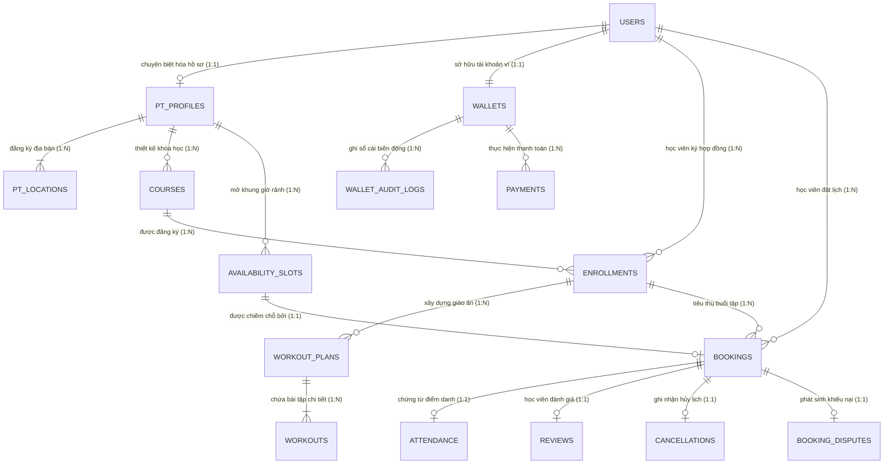

# BÁO CÁO BÀI TẬP LỚN MÔN CƠ SỞ DỮ LIỆU

**ĐỀ TÀI: THIẾT KẾ VÀ TỐI ƯU HÓA CƠ SỞ DỮ LIỆU CHO HỆ THỐNG NỀN TẢNG KẾT NỐI HUẤN LUYỆN VIÊN CÁ NHÂN (PT CONNECT)**

---

## MỤC LỤC TỔNG QUAN

- **Chương 1: Phân tích kịch bản thế giới thực và yêu cầu hệ thống**
  - 1.1. Mô tả tổng quan ứng dụng và bối cảnh thực tế
  - 1.2. Phân tích yêu cầu dữ liệu lưu trữ
  - 1.3. Các thao tác nghiệp vụ trên cơ sở dữ liệu
  - 1.4. Hệ thống các quy tắc và điều kiện ràng buộc toàn vẹn
- **Chương 2: Thiết kế mức khái niệm (Lược đồ E-R)**
  - 2.1. Mô tả chi tiết các thành phần trên lược đồ E-R
  - 2.2. Sơ đồ E-R tổng thể
  - 2.3. Diễn giải các ràng buộc ngoài khả năng biểu diễn của sơ đồ E-R
- **Chương 3: Thiết kế mức logic và chuẩn hóa cơ sở dữ liệu**
  - 3.1. Quy tắc ánh xạ từ mô hình E-R sang mô hình quan hệ
  - 3.2. Sơ đồ Lược đồ Quan hệ Mức Logic (Logical Relational Schema)
  - 3.3. Phân tích và chứng minh chuẩn hóa cho toàn bộ 16 bảng trong hệ thống
  - 3.4. Các điều chỉnh kỹ thuật giữa thiết kế khái niệm và bảng vật lý
- **Chương 4: Xử lý logic nghiệp vụ tại tầng Cơ sở dữ liệu (Database-Level Business Logic)**
  - 4.1. Hệ thống Triggers tự động hóa và bảo vệ tính toàn vẹn
  - 4.2. Hệ thống Stored Procedures & Functions xử lý nghiệp vụ và giao dịch
  - 4.3. Hệ thống Views cung cấp góc nhìn và đối soát dữ liệu
  - 4.4. Hệ thống ràng buộc toàn vẹn nâng cao và quy tắc xóa/sửa
  - 4.5. Kịch bản xử lý các tình huống nghiệp vụ đặc thù tại tầng Cơ sở dữ liệu
- **Chương 5: Cài đặt hệ thống, truy vấn nghiệp vụ và thực nghiệm tối ưu truy vấn**
  - 5.1. Quá trình cài đặt môi trường và khởi tạo dữ liệu mẫu
  - 5.2. Hệ thống các câu truy vấn nghiệp vụ phức tạp
  - 5.3. Thực nghiệm đo lường và tối ưu hóa truy vấn (Query Optimization)

---

# CHƯƠNG 1: PHÂN TÍCH KỊCH BẢN THẾ GIỚI THỰC VÀ YÊU CẦU HỆ THỐNG

## 1.1. Mô tả tổng quan ứng dụng và bối cảnh thực tế

### 1.1.1. Bối cảnh thị trường và vấn đề thực tiễn
Trong lĩnh vực thể dục thể hình (Fitness & Personal Training), nhu cầu thuê Huấn luyện viên cá nhân (Personal Trainer - PT) ngày càng tăng cao. Tuy nhiên, mô hình vận hành truyền thống bộc lộ nhiều bất cập nghiêm trọng:
1. **Thiếu minh bạch về năng lực và chứng chỉ**: Người tập (Học viên) khó kiểm chứng bằng cấp chuyên môn, kinh nghiệm thực tế và đánh giá thật của PT, dễ gặp phải huấn luyện viên tự xưng.
2. **Rủi ro tài chính và bùng lịch (No-show)**: Thỏa thuận trả tiền trước tiềm ẩn rủi ro học viên bị PT hủy ca đột ngột mà không được bồi hoàn, hoặc PT bị học viên hủy ca sát giờ gây lãng phí khung giờ làm việc mà không có cơ chế đền bù thỏa đáng.
3. **Tranh chấp không có cơ chế phân xử khách quan**: Khi xảy ra sự cố (chất lượng phục vụ kém, PT hoặc học viên vắng mặt nhưng vẫn báo có mặt, yêu cầu chấm dứt hợp đồng giữa chừng), hai bên thường rơi vào bế tắc do không có chứng cứ điểm danh và hợp đồng số minh bạch.

### 1.1.2. Mục tiêu hệ thống PT Connect
PT Connect là nền tảng số trung gian kết nối 3 bên: **Học viên (Student)**, **Huấn luyện viên cá nhân (PT)** và **Quản trị viên sàn (Admin)**. Hệ thống giải quyết triệt để các bài toán trên thông qua các mục tiêu cốt lõi:
- **Chuẩn hóa hồ sơ và địa bàn hoạt động**: Quản lý chứng chỉ, kinh nghiệm, rating và khu vực nhận dạy của PT.
- **Ký quỹ thanh toán (Escrow Wallet)**: Toàn bộ tiền mua gói tập được bảo chứng qua ví điện tử nội bộ, tiền chỉ được thanh toán hoặc quyết toán từng ca dựa trên kết quả điểm danh thực tế.
- **Vòng đời ca tập tự động và chính sách hủy lịch (SLA)**: Kiểm soát chặt chẽ trạng thái khung giờ rảnh, tự động phạt và bồi thường theo các mốc thời gian hủy ca (trước 24h, 12h, 2h).
- **Hậu kiểm và xử lý tranh chấp số**: Hỗ trợ điểm danh 2 chiều (QR Code, OTP, Geolocation) và quy trình mở đơn khiếu nại có thời hạn xử lý SLA 48h.

### 1.1.3. Các nhóm người dùng và luồng nghiệp vụ chính
1. **Học viên (Student)**:
   - Tìm kiếm, lọc hồ sơ PT theo khu vực tập luyện và điểm đánh giá trung bình.
   - Nạp tiền vào ví điện tử cá nhân (`wallets`).
   - Mua khóa học (`courses`) để tạo hợp đồng đào tạo (`enrollments`).
   - Xem khung giờ rảnh của PT (`availability_slots`) và đặt ca tập (`bookings`).
   - Thực hiện xác nhận điểm danh (`attendance`) sau ca tập, viết đánh giá và chấm điểm sao (`reviews`).
   - Hủy ca tập khi có việc đột xuất (`cancellations`) hoặc khiếu nại ca tập vi phạm (`booking_disputes`).
2. **Huấn luyện viên cá nhân (PT)**:
   - Đăng ký hồ sơ chuyên môn (`pt_profiles`), đính kèm link chứng chỉ bằng cấp (`certificate_url`) và khai báo danh sách quận/huyện nhận dạy (`pt_locations`).
   - Thiết lập các gói khóa học (`courses`) với số buổi và thời hạn hiệu lực cụ thể.
   - Mở các khung giờ rảnh (`availability_slots`) theo tuần/tháng.
   - Thiết kế giáo án (`workout_plans`) và các bài tập chi tiết (`workouts`) cho từng hợp đồng học viên.
   - Duyệt ca tập, điểm danh ca dạy, nhận tiền thù lao buổi tập vào ví và theo dõi bảng kê thu nhập.
3. **Quản trị viên (Admin)**:
   - Duyệt hồ sơ và chứng minh thư/chứng chỉ hành nghề của PT (`verification_status`).
   - Theo dõi dashboard doanh thu sàn, phí hoa hồng nền tảng (`PLATFORM_FEE`).
   - Giám sát đối soát số dư ví toàn sàn thông qua sổ cái biến động tài chính bất biến (`wallet_audit_logs`).
   - Tiếp nhận và ra quyết định phán quyết hoàn tiền hoặc bác bỏ các đơn tranh chấp (`booking_disputes`) đảm bảo đúng SLA.

---

## 1.2. Phân tích yêu cầu dữ liệu lưu trữ

Hệ thống quản lý 6 phân hệ dữ liệu tập trung gồm 16 thực thể quan hệ:

### 1.2.1. Phân hệ Định danh và Hồ sơ người dùng
- **users**: Lưu thông tin đăng nhập và định danh cơ bản của tất cả các tác nhân (Học viên, PT, Admin) bao gồm họ tên, email, mật khẩu mã hóa (bcrypt), số điện thoại, vai trò (`role`) và trạng thái hoạt động (`status`).
- **pt_profiles**: Lưu hồ sơ chuyên môn mở rộng của PT gồm giới thiệu bản thân (`bio`), số năm kinh nghiệm (`experience_years`), link chứng chỉ (`certificate_url`), điểm rating trung bình (`average_rating`), tổng số lượt đánh giá (`total_reviews`), trạng thái kiểm duyệt (`verification_status`).
- **pt_locations**: Lưu danh mục địa bàn/khu vực quận huyện mà PT có thể đến dạy. Đây là thuộc tính đa trị được tách bảng để đảm bảo chuẩn hóa.

### 1.2.2. Phân hệ Tài chính và Sổ cái Kiểm toán
- **wallets**: Lưu thông tin ví điện tử của từng người dùng, gồm số dư khả dụng (`balance`), số dư đóng băng tạm giữ (`locked_balance`), loại tiền tệ (`currency`) và trạng thái ví (`status`).
- **wallet_audit_logs**: Sổ cái kiểm toán biến động số dư ví (Append-Only Ledger), lưu lại số dư cũ, số dư mới, số dư đóng băng cũ/mới, loại thao tác (`action_type`), lý do biến động và thời điểm ghi nhận. Bảng này nghiêm cấm sửa/xóa.
- **payments**: Lưu nhật ký các giao dịch phát sinh qua cổng thanh toán hoặc giao dịch trừ tiền nội bộ (Nạp tiền `TOPUP`, Mua gói `PURCHASE_PACKAGE`, Bồi thường `COMPENSATION`, Hoàn tiền `REFUND`, Phạt vi phạm `PENALTY`, Phí sàn `PLATFORM_FEE`, Rút tiền `WITHDRAWAL`).

### 1.2.3. Phân hệ Khóa học và Hợp đồng đào tạo
- **courses**: Lưu danh mục các gói tập do PT thiết kế gồm tiêu đề, mô tả, tổng số buổi (`total_sessions`), số ngày hiệu lực (`validity_days`), giá niêm yết (`base_price`) và trạng thái mở bán.
- **enrollments**: Lưu hợp đồng gói tập cụ thể khi học viên ký kết với PT dựa trên một khóa học, gồm địa điểm tập luyện thỏa thuận (`training_location`), giá chốt hợp đồng (`final_price`), tổng số buổi, số buổi tập còn lại chưa dùng (`remaining_sessions`), ngày bắt đầu, ngày kết thúc, hợp đồng số (`contract_url`) và trạng thái hợp đồng.

### 1.2.4. Phân hệ Vận hành Khung giờ và Đặt lịch tập
- **availability_slots**: Lưu lịch làm việc các ca rảnh của PT gồm thời điểm bắt đầu (`start_time`), kết thúc (`end_time`), trạng thái (`status`: AVAILABLE, BOOKED, LOCKED).
- **bookings**: Lưu thông tin từng buổi hẹn tập cụ thể của học viên, gồm loại ca tập (`booking_type`: TRIAL hoặc PACKAGE), liên kết hợp đồng (`enrollment_id`), học viên (`student_id`), khung giờ (`slot_id`), giá trị buổi tập (`session_fee`), trạng thái ca tập (`status`: PENDING, CONFIRMED, COMPLETED, CANCELLED) và cột sinh duy nhất `active_slot_id`.

### 1.2.5. Phân hệ Giáo án và Bài tập thể hình
- **workout_plans**: Lưu kế hoạch giáo án tập luyện gắn với một hợp đồng học viên, gồm tiêu đề giáo án, mục tiêu tập luyện (`goal`), ngày bắt đầu và kết thúc kế hoạch.
- **workouts**: Lưu chi tiết từng bài tập cụ thể trong một giáo án gồm thứ tự thực hiện (`exercise_order`), tên bài tập (`exercise_name`), nhóm cơ đích (`target_muscle`), số hiệp (`sets`), số lần lặp (`reps`), mức tạ (`weight_kg`), thời gian nghỉ (`rest_seconds`) và video hướng dẫn mẫu (`video_demo_url`).

### 1.2.6. Phân hệ Hậu kiểm, Đánh giá, Hủy lịch và Tranh chấp
- **attendance**: Lưu nhật ký điểm danh buổi tập gồm giờ check-in, giờ check-out, phương thức xác thực (`verification_method`: QR_CODE, OTP, GEO_LOCATION), cờ xác nhận của học viên và PT, trạng thái điểm danh (`status`: PRESENT, ABSENT, LATE).
- **reviews**: Lưu đánh giá chất lượng ca dạy của học viên gồm số sao đánh giá (`rating` từ 1 đến 5 sao), nhận xét (`comment`) và thời điểm đánh giá.
- **cancellations**: Lưu hồ sơ chi tiết khi một ca tập bị hủy gồm người thực hiện hủy (`cancelled_by_id`, `cancelled_by_role`), lý do, thời điểm hủy, số giờ hủy trước ca tập (`hours_before_session`), số tiền hoàn trả cho học viên (`refund_amount`), số tiền bồi thường (`compensation_amount`), số tiền phạt (`penalty_amount`), nợ phạt ghi nhận (`penalty_shortfall`) và bằng chứng đính kèm.
- **booking_disputes**: Lưu các đơn khiếu nại tranh chấp khi một bên không đồng tình với kết quả điểm danh hoặc hủy lịch, gồm người gửi đơn, loại vi phạm (`dispute_type`), lý do, bằng chứng của bên nguyên, bằng chứng phản biện của bên bị (`counter_evidence_url`), ghi chú của admin, hạn chót xử lý SLA (`deadline_at`), thời điểm giải quyết và trạng thái khiếu nại.

---

## 1.3. Các thao tác nghiệp vụ trên Cơ sở dữ liệu

### 1.3.1. Nhóm thao tác Cập nhật dữ liệu theo quy trình (State Machine)
- **Ký hợp đồng gói tập**: Tạo bản ghi `enrollments`, trừ tiền ví của học viên và ghi nhận giao dịch `payments` thành công.
- **Đặt lịch ca tập (`sp_book_session`)**: Kiểm tra slot còn rảnh (`AVAILABLE`), giữ chỗ buổi tập trên hợp đồng (`remaining_sessions`), tạo bản ghi `bookings` ở trạng thái `PENDING` hoặc `CONFIRMED`, tự động chuyển trạng thái slot sang `BOOKED`.
- **Hủy lịch ca tập có tính phạt và bồi thường (`sp_cancel_booking`)**:
  - Tính số giờ hủy trước buổi tập (`hours_before_session`).
  - Áp dụng ma trận chính sách: Hủy trước >24h (hoàn 100% buổi tập, không phạt); Hủy từ 12h - 24h (mất 50% tiền buổi tập); Hủy <12h hoặc No-show (mất 100% tiền buổi tập). Nếu PT hủy sát giờ, PT bị phạt tiền ví chuyển thẳng làm tiền bồi thường cho học viên.
  - Tự động hoàn lại trạng thái khung giờ `availability_slots` về `AVAILABLE`.
- **Điểm danh và hoàn thành ca tập**: Xác nhận check-in/check-out hai chiều, chuyển trạng thái booking sang `COMPLETED`, tự động giải phóng tiền thù lao ca dạy cho PT và kiểm tra kết thúc hợp đồng nếu số buổi còn lại bằng 0.
- **Phán quyết tranh chấp (`sp_resolve_booking_dispute`)**: Admin phê duyệt hoàn tiền (`RESOLVED_REFUND`) hoặc bác bỏ đơn khiếu nại (`REJECTED`), tự động cập nhật số dư ví thông qua thủ tục thanh toán `sp_wallet_settle`.

### 1.3.2. Nhóm thao tác Tra cứu và Tìm kiếm
- Lọc danh sách PT theo quận huyện hoạt động và sắp xếp giảm dần theo điểm rating trung bình.
- Lấy thời khóa biểu tuần/tháng của PT kèm trạng thái slot và tên học viên đã đặt.
- Phân trang sâu lịch sử ca tập của học viên theo thứ tự thời gian giảm dần.
- Tra cứu giáo án chi tiết và danh mục bài tập tương ứng cho buổi tập hôm nay.

### 1.3.3. Nhóm thao tác Báo cáo và Đối soát định kỳ
- **Đối soát số dư ví (`v_wallet_reconciliation`)**: Tính toán tổng đại số tất cả các giao dịch thanh toán thành công trong bảng `payments` để so sánh với số dư hiện tại của `wallets`, cảnh báo sai lệch tài chính ngay lập tức nếu phát hiện chênh lệch.
- **Thống kê tính nhất quán rating PT (`v_pt_rating_statistics`)**: Kiểm tra đối chiếu điểm `average_rating` lưu trữ trong bảng `pt_profiles` với điểm trung bình tính toán động từ bảng `reviews`.
- **Báo cáo doanh thu sàn**: Tổng hợp doanh thu phí nền tảng (`PLATFORM_FEE`), tiền bồi thường và tiền phạt vi phạm theo từng tháng.
- **Quản lý hàng đợi khiếu nại SLA**: Lọc các đơn tranh chấp chưa giải quyết (`PENDING`, `EVIDENCE_REQUESTED`) sắp xếp theo hạn chót SLA 48h.

---

## 1.4. Hệ thống các quy tắc và điều kiện ràng buộc toàn vẹn

### 1.4.1. Ràng buộc toàn vẹn chung
- **Toàn vẹn thực thể (Entity Integrity)**: Toàn bộ 16 bảng đều có Khóa chính (`PRIMARY KEY`) là trường `id` định dạng số nguyên lớn `BIGINT AUTO_INCREMENT` (ngoại trừ các bảng liên kết thuộc tính đa trị có thêm ràng buộc khóa tổ hợp). Giá trị khóa chính là duy nhất và không bao giờ mang giá trị `NULL`.
- **Toàn vẹn tham chiếu (Referential Integrity)**: Tất cả các quan hệ giữa các bảng đều được cài đặt thông qua khóa ngoại (`FOREIGN KEY`) chỉ đến khóa chính hoặc khóa duy nhất của bảng cha. Hành vi toàn vẹn được chỉ định nghiêm ngặt:
  - Dùng `ON DELETE CASCADE` cho các thực thể phụ thuộc hoàn toàn: `pt_locations` gắn với `pt_profiles`, `workouts` gắn với `workout_plans`.
  - Dùng `ON DELETE RESTRICT` (mặc định) cho các thực thể kế toán và nghiệp vụ trọng yếu: `wallet_audit_logs`, `payments`, `bookings`, `enrollments` nhằm ngăn chặn tuyệt đối việc xóa dữ liệu cha làm thất thoát lịch sử kế toán.
- **Toàn vẹn miền giá trị (Domain Integrity)**:
  - Kiểu dữ liệu tiền tệ được chuẩn hóa toàn hệ thống bằng `DECIMAL(14,2)` hoặc `DECIMAL(12,2)` nhằm tránh triệt để lỗi làm tròn dấu phẩy động (floating point round-off error) của kiểu `FLOAT/DOUBLE`.
  - Toàn bộ trạng thái nghiệp vụ được chuẩn hóa qua kiểu liệt kê `ENUM` (ví dụ `role`: 'STUDENT', 'PT', 'ADMIN'; `status`: 'ACTIVE', 'PENDING', 'SUSPENDED').
  - Ràng buộc chặn giá trị âm: `experience_years >= 0`, `balance >= 0`, `locked_balance >= 0`, `amount > 0`, `total_sessions > 0`.
  - Ràng buộc thang điểm đánh giá: `average_rating BETWEEN 0 AND 5`, `rating BETWEEN 1 AND 5`.

### 1.4.2. Ràng buộc toàn vẹn riêng (Quy tắc nghiệp vụ đặc thù)
1. **Ràng buộc tương quan số dư ví (`chk_wallet_locked_le_balance`)**:
   Số dư bị đóng băng tạm giữ (`locked_balance`) tại mọi thời điểm không được vượt quá tổng số dư thực tế của ví (`balance`):
   $$\text{locked\_balance} \le \text{balance}$$
2. **Ràng buộc tương quan loại đặt chỗ và hợp đồng (`chk_booking_type_enroll`)**:
   Một ca tập thử (`TRIAL`) không được gắn với hợp đồng gói tập nào (`enrollment_id IS NULL`). Ngược lại, ca tập gói (`PACKAGE`) bắt buộc phải gắn với một hợp đồng đã ký kết (`enrollment_id IS NOT NULL`):
   $$((\text{booking\_type} = \text{'TRIAL'}) \land (\text{enrollment\_id IS NULL})) \lor ((\text{booking\_type} = \text{'PACKAGE'}) \land (\text{enrollment\_id IS NOT NULL}))$$
3. **Ràng buộc độc quyền khung giờ rảnh có điều kiện (`uq_active_slot`)**:
   Một khung giờ (`slot_id`) chỉ có thể được đặt bởi tối đa 1 ca tập đang trong quá trình xử lý hoặc đã hoàn tất (`PENDING`, `CONFIRMED`, `COMPLETED`). Nếu ca tập bị hủy (`CANCELLED`), khung giờ đó phải được giải phóng. Ràng buộc này được cài đặt thông qua cột sinh lưu trữ (`STORED GENERATED COLUMN`) kết hợp khóa `UNIQUE`:
   $$\text{active\_slot\_id} = \text{IF}(\text{status} \in \{\text{'PENDING'}, \text{'CONFIRMED'}, \text{'COMPLETED'}\}, \text{slot\_id}, \text{NULL})$$
4. **Ràng buộc vai trò tác nhân hủy lịch (`chk_cancel_actor`)**:
   Nếu hệ thống tự động hủy do hết hạn chờ (`cancelled_by_role = 'SYSTEM'`), trường định danh người hủy (`cancelled_by_id`) phải là `NULL`. Nếu tác nhân hủy là con người (`STUDENT`, `PT`, `ADMIN`), trường `cancelled_by_id` bắt buộc phải khác `NULL`.
5. **Ràng buộc tính hợp lệ thời gian**:
   - Khung giờ làm việc: $\text{end\_time} > \text{start\_time}$.
   - Hợp đồng đào tạo: $\text{end\_date} \ge \text{start\_date}$.
   - Điểm danh: $\text{check\_out\_time} \ge \text{check\_in\_time}$.

---

# CHƯƠNG 2: THIẾT KẾ MỨC KHÁI NIỆM (LƯỢC ĐỒ E-R)

## 2.1. Mô tả chi tiết các thành phần trên lược đồ E-R

### 2.1.1. Phân loại các tập thực thể

| Tên Tập Thực Thể | Phân Loại | Khóa Chính / Khóa Bộ Phận | Ý Nghĩa Nghiệp Vụ Trong Mô Hình |
| :--- | :--- | :--- | :--- |
| **USERS** | Thực thể mạnh | `id` | Thực thể người dùng gốc đại diện cho mọi cá nhân tương tác với hệ thống. |
| **WALLETS** | Thực thể mạnh | `id` | Tài khoản ví điện tử định danh 1:1 với người dùng để phục vụ thanh toán. |
| **COURSES** | Thực thể mạnh | `id` | Danh mục khóa học/gói dịch vụ do PT chào bán trên nền tảng. |
| **AVAILABILITY_SLOTS** | Thực thể mạnh | `id` | Lịch biểu khung giờ làm việc theo thời gian thực của PT. |
| **ENROLLMENTS** | Thực thể mạnh | `id` | Hợp đồng đào tạo có ràng buộc pháp lý giữa 1 Học viên và 1 Khóa học của PT. |
| **WORKOUT_PLANS** | Thực thể mạnh | `id` | Kế hoạch giáo án tập luyện dài hạn gắn với một hợp đồng học viên. |
| **BOOKINGS** | Thực thể mạnh | `id` | Thực thể giao dịch cốt lõi ghi nhận cuộc hẹn tập luyện giữa học viên và khung giờ PT. |
| **PT_PROFILES** | Thực thể yếu | `id` (phụ thuộc `user_id`) | Mở rộng chi tiết năng lực chuyên môn của thực thể cha `USERS` có vai trò PT. |
| **PT_LOCATIONS** | Thực thể yếu | `id` + (`pt_id`, `location_name`) | Phân rã thuộc tính đa trị khu vực hoạt động của huấn luyện viên. |
| **WALLET_AUDIT_LOGS** | Thực thể yếu | `id` (phụ thuộc `wallet_id`) | Sổ cái kiểm toán biến động số dư, phụ thuộc tồn tại vào ví `WALLETS`. |
| **PAYMENTS** | Thực thể yếu | `id` (phụ thuộc `wallet_id`) | Chứng từ giao dịch dòng tiền gắn liền với tài khoản ví. |
| **WORKOUTS** | Thực thể yếu | `id` + (`plan_id`, `exercise_order`) | Các bài tập chi tiết thuộc về một giáo án `WORKOUT_PLANS`. |
| **ATTENDANCE** | Thực thể yếu | `id` (phụ thuộc `booking_id`) | Chứng từ điểm danh xác thực sự hiện diện của ca tập `BOOKINGS`. |
| **REVIEWS** | Thực thể yếu | `id` (phụ thuộc `booking_id`) | Phiếu đánh giá chất lượng dịch vụ của ca tập đã hoàn thành. |
| **CANCELLATIONS** | Thực thể yếu | `id` (phụ thuộc `booking_id`) | Hồ sơ biên bản bồi thường và hoàn tiền khi ca tập bị hủy. |
| **BOOKING_DISPUTES** | Thực thể yếu | `id` (phụ thuộc `booking_id`) | Hồ sơ khiếu nại tranh chấp phát sinh cần quản trị viên phân xử. |

### 2.1.2. Phân tích các thuộc tính đặc biệt và quan hệ phân cấp (ISA)
- **Thuộc tính đa trị (Multi-valued Attributes)**: Địa bàn hoạt động của huấn luyện viên. Một PT có thể nhận dạy tại nhiều quận huyện khác nhau (ví dụ: Quận 1, Quận 3, Bình Thạnh). Trên lược đồ E-R, thuộc tính này được tách thành tập thực thể yếu `PT_LOCATIONS` liên kết với `PT_PROFILES` để triệt tiêu vi phạm dạng chuẩn 1NF.
- **Thuộc tính suy dẫn (Derived Attributes)**:
  - `remaining_sessions` trong `ENROLLMENTS`: Giá trị được suy diễn từ tổng số buổi trừ đi các ca tập đã hoàn thành.
  - `average_rating` và `total_reviews` trong `PT_PROFILES`: Giá trị được suy diễn từ phép toán gộp `AVG(rating)` và `COUNT(id)` trên tập thực thể `REVIEWS`.
  - `active_slot_id` trong `BOOKINGS`: Giá trị logic suy diễn từ trạng thái ca tập để phục vụ kiểm soát xung đột khung giờ.
- **Quan hệ phân cấp vai trò (Specialization / Generalization - ISA)**:
  Thực thể cha `USERS` phân cấp chuyên biệt hóa thành 3 vai trò: `STUDENT`, `PT`, `ADMIN`.
  - Nếu `role = 'PT'`, cá nhân đó sở hữu duy nhất một hồ sơ năng lực mở rộng `PT_PROFILES`.
  - Mối quan hệ giữa `USERS` và `PT_PROFILES` là mối quan hệ chuyên biệt hóa $1:1$ có tính toàn phần từ phía `PT_PROFILES`.

### 2.1.3. Mô tả chi tiết ý nghĩa và bản số các mối liên kết (Relationships)



- **USERS - WALLETS (1:1)**: Mỗi người dùng khi tạo tài khoản được cấp phát duy nhất 1 ví điện tử, và 1 ví chỉ thuộc về 1 người dùng xác định.
- **PT_PROFILES - COURSES (1:N)**: Một PT có thể tạo nhiều khóa học/gói tập khác nhau, mỗi khóa học chỉ do 1 PT giảng dạy.
- **COURSES - ENROLLMENTS (1:N) & USERS - ENROLLMENTS (1:N)**: Mỗi hợp đồng đào tạo là kết quả ký kết giữa 1 Học viên và 1 Khóa học xác định. Một học viên có thể mua nhiều hợp đồng khác nhau theo thời gian.
- **ENROLLMENTS - WORKOUT_PLANS (1:N)**: Trong suốt thời hạn hợp đồng, PT có thể lập nhiều kế hoạch giáo án nối tiếp nhau (theo tuần hoặc theo giai đoạn siết mỡ/tăng cơ).
- **WORKOUT_PLANS - WORKOUTS (1:N)**: Một giáo án bao gồm nhiều bài tập chi tiết được sắp xếp theo thứ tự `exercise_order`.
- **AVAILABILITY_SLOTS - BOOKINGS (1:1 có điều kiện)**: Một khung giờ rảnh chỉ có thể gắn với tối đa 1 ca tập có hiệu lực.
- **BOOKINGS - ATTENDANCE (1:1)**: Mỗi ca tập có tối đa 1 bản ghi điểm danh xác nhận check-in/check-out.
- **BOOKINGS - REVIEWS (1:1)**: Mỗi ca tập hoàn thành chỉ được học viên đánh giá đúng 1 lần duy nhất.
- **BOOKINGS - CANCELLATIONS (1:1)**: Nếu ca tập bị hủy, hệ thống sinh ra duy nhất 1 bản ghi biên bản hủy lịch kèm số tiền phạt/bồi hoàn.
- **BOOKINGS - BOOKING_DISPUTES (1:1)**: Một ca tập có tranh chấp chỉ tạo ra duy nhất 1 hồ sơ khiếu nại để Admin xử lý tập trung.

---

## 2.2. Sơ đồ E-R tổng thể

`[CHÈN HÌNH ẢNH SƠ ĐỒ E-R NGUYÊN KHỐI: Sơ đồ ERD chuẩn BCNF thể hiện đầy đủ 16 thực thể, thuộc tính và liên kết trích xuất từ file ER.drawio.xml]`

---

## 2.3. Diễn giải các ràng buộc ngoài khả năng biểu diễn của sơ đồ E-R

Mô hình E-R chuẩn chỉ mô tả được cấu trúc thực thể, mối kết hợp và bản số cơ bản. Các quy tắc nghiệp vụ phức tạp dưới đây không thể thể hiện trọn vẹn trên biểu đồ E-R mà bắt buộc phải chuyển giao xuống tầng Logic/Vật lý để xử lý:
1. **Kiểm tra tính trùng lặp khung giờ (Temporal Non-overlapping)**: Hai ca làm việc của cùng một PT không được phép giao nhau về mặt thời gian.
2. **Quy tắc giải tỏa khung giờ khi hủy ca (Conditional Availability Release)**: Khung giờ chỉ trở về trạng thái rảnh (`AVAILABLE`) khi bản ghi `BOOKINGS` chuyển sang `CANCELLED`. Nếu booking ở trạng thái `PENDING` hoặc `CONFIRMED`, khung giờ phải bị khóa cứng.
3. **Chính sách phân tầng hoàn tiền và xử phạt động (Escrow SLA Matrix)**: Tỷ lệ hoàn trả tiền ($100\%, 50\%, 0\%$) và mức phạt đối với PT phụ thuộc động vào biến thời gian thực:
   $$\Delta t = \text{start\_time} - \text{cancelled\_at}$$
4. **Bảo toàn số dư đóng băng kế toán**: Nghiêm cấm mọi thao tác nghiệp vụ làm cho số tiền rút ra hoặc giải ngân vượt quá số dư khả dụng thực tế của ví.
5. **Khóa liên hợp học viên và hợp đồng (`fk_booking_enroll_student`)**: Đảm bảo học viên đặt ca tập gói (`PACKAGE`) chỉ được chọn mã hợp đồng (`enrollment_id`) do chính học viên đó đứng tên ký kết.

---

# CHƯƠNG 3: THIẾT KẾ MỨC LOGIC VÀ CHUẨN HÓA CƠ SỞ DỮ LIỆU

## 3.1. Quy tắc ánh xạ từ mô hình E-R sang mô hình quan hệ

1. **Ánh xạ thực thể thông thường**: Mỗi tập thực thể được chuyển đổi thành một quan hệ (bảng). Khóa chính được lựa chọn là khóa đại diện Surrogate Key `id` kiểu số nguyên lớn tự tăng (`BIGINT AUTO_INCREMENT`) nhằm tăng tốc độ đánh chỉ mục B-Tree và giảm dung lượng khóa ngoại.
2. **Ánh xạ mối quan hệ 1:1**: Đưa khóa chính của thực thể cha sang thực thể con làm Khóa ngoại, đồng thời áp đặt ràng buộc `UNIQUE` lên cột khóa ngoại đó (ví dụ: `wallets.user_id`, `pt_profiles.user_id`, `attendance.booking_id`, `reviews.booking_id`, `cancellations.booking_id`).
3. **Ánh xạ mối quan hệ 1:N**: Đưa khóa chính của bên "1" vào bảng phía bên "N" làm Khóa ngoại (ví dụ: `courses.pt_id`, `enrollments.student_id`, `bookings.slot_id`).
4. **Ánh xạ thuộc tính đa trị**: Tách riêng thuộc tính đa trị thành một bảng độc lập gồm Khóa ngoại tham chiếu đến bảng gốc và giá trị thuộc tính, đồng thời đặt khóa phức hợp hoặc `UNIQUE KEY` trên bộ (`parent_id`, `attribute_value`). Cụ thể: `pt_locations (id, pt_id, location_name)` với `UNIQUE KEY uq_pt_location (pt_id, location_name)`.

---

## 3.2. Sơ đồ Lược đồ Quan hệ Mức Logic (Logical Relational Schema)

### 3.2.1. Danh sách các quan hệ logic trong hệ thống
Sau khi áp dụng các quy tắc ánh xạ chuẩn từ mô hình E-R, toàn bộ 16 thực thể và mối liên kết trong hệ thống được chuyển đổi thành 16 quan hệ logic. Trong đó:
- Các thuộc tính **gạch chân** biểu thị Khóa chính (Primary Key - PK).
- Các thuộc tính *in nghiêng có dấu hoa thị `*`* biểu thị Khóa ngoại (Foreign Key - FK).

1. `users` (<u>id</u>, full_name, email, password_hash, phone, role, status, avatar_url, created_at, updated_at)
2. `pt_profiles` (<u>id</u>, *user_id*, bio, experience_years, location_pricing_note, certificate_url, average_rating, total_reviews, verification_status, created_at, updated_at)
3. `pt_locations` (<u>id</u>, *pt_id*, location_name)
4. `wallets` (<u>id</u>, *user_id*, balance, locked_balance, currency, status, updated_at)
5. `wallet_audit_logs` (<u>id</u>, *wallet_id*, old_balance, new_balance, old_locked_balance, new_locked_balance, action_type, reason, created_at)
6. `courses` (<u>id</u>, *pt_id*, title, description, total_sessions, validity_days, base_price, status, created_at)
7. `enrollments` (<u>id</u>, *student_id*, *course_id*, training_location, final_price, total_sessions, remaining_sessions, start_date, end_date, contract_url, status, created_at)
8. `availability_slots` (<u>id</u>, *pt_id*, start_time, end_time, status, created_at)
9. `bookings` (<u>id</u>, booking_type, *enrollment_id*, *student_id*, *slot_id*, session_fee, status, student_note, created_at, updated_at, active_slot_id)
10. `reviews` (<u>id</u>, *booking_id*, rating, comment, created_at)
11. `cancellations` (<u>id</u>, *booking_id*, *cancelled_by_id*, cancelled_by_role, reason, cancelled_at, hours_before_session, refund_amount, compensation_amount, penalty_amount, penalty_shortfall, evidence_url, status)
12. `workout_plans` (<u>id</u>, *enrollment_id*, title, goal, start_date, end_date, created_at)
13. `workouts` (<u>id</u>, *plan_id*, exercise_order, exercise_name, target_muscle, sets, reps, weight_kg, rest_seconds, video_demo_url)
14. `attendance` (<u>id</u>, *booking_id*, check_in_time, check_out_time, verification_method, student_confirmed, pt_confirmed, status)
15. `payments` (<u>id</u>, *wallet_id*, *enrollment_id*, amount, payment_type, payment_method, status, transaction_ref, created_at)
16. `booking_disputes` (<u>id</u>, *booking_id*, *sender_id*, dispute_type, reason, evidence_url, counter_evidence_url, counter_argument, status, admin_notes, deadline_at, resolved_at, created_at)

### 3.2.2. Sơ đồ Lược đồ quan hệ logic (Relational Schema Diagram)
Sơ đồ lược đồ quan hệ mức logic trực quan hóa toàn bộ 16 bảng, các trường dữ liệu, kiểu dữ liệu, các ràng buộc toàn vẹn và hệ thống đường liên kết Khóa chính (PK) – Khóa ngoại (FK) kết nối giữa các thực thể:

`[CHÈN HÌNH ẢNH SƠ ĐỒ LƯỢC ĐỒ QUAN HỆ MỨC LOGIC (LOGICAL RELATIONAL SCHEMA): database/Logical_Schema.png]`

---

## 3.3. Phân tích và chứng minh chuẩn hóa cho toàn bộ 16 bảng trong hệ thống

Một lược đồ quan hệ $R$ với tập phụ thuộc hàm $F$ đạt **Chuẩn Boyce-Codd (BCNF)** nếu với mọi phụ thuộc hàm không tầm thường $X \to Y \in F^+$, $X$ là một **siêu khóa (Superkey)** của $R$. 

Dưới góc nhìn toán học và kỹ thuật phần mềm khách quan, hệ thống PT Connect bao gồm 16 bảng dữ liệu với mức độ chuẩn hóa được phân loại minh bạch như sau:
- **14 bảng đạt chuẩn tuyệt đối Chuẩn Boyce-Codd (BCNF)**: Triệt tiêu hoàn toàn dư thừa dữ liệu và loại bỏ triệt để các dị thường thêm, xóa, sửa.
- **2 bảng chủ động dừng lại ở Dạng chuẩn 2 (2NF)**: Gồm bảng `bookings` và bảng `cancellations`. Cả hai bảng này đều vi phạm Dạng chuẩn 3 (3NF) do chứa các phụ thuộc hàm bắc cầu giữa các thuộc tính không khóa. Đây là quyết định **phi chuẩn hóa có chủ đích (Conscious Denormalization)** để phục vụ nghiệp vụ hệ thống (hỗ trợ ca học thử TRIAL, hệ thống tự động hủy SYSTEM, bảo vệ phân quyền chống IDOR và tối ưu hóa hiệu năng truy vấn).

Bảng tổng hợp mức độ chuẩn hóa của toàn bộ 16 bảng trong CSDL PT Connect:

| STT | Tên bảng | Khóa chính (PK) | Khóa dự tuyển (CK) | Mức chuẩn hóa | Phân loại & Ghi chú kiến trúc |
| :---: | :--- | :--- | :--- | :---: | :--- |
| **1** | `users` | `id` | `email`, `phone` | **BCNF** | Chuẩn hóa tuyệt đối (Mọi vế trái là siêu khóa) |
| **2** | `pt_profiles` | `id` | `user_id` | **BCNF** | 1:1 với `users`, các trường rating là aggregate cache |
| **3** | `pt_locations` | `id` | `{pt_id, location_name}` | **BCNF** | Mọi thuộc tính đều là thuộc tính khóa (All-prime) |
| **4** | `wallets` | `id` | `user_id` | **BCNF** | 1:1 với `users`, mọi vế xác định là siêu khóa |
| **5** | `wallet_audit_logs` | `id` | Không có | **BCNF** | Nhật ký kế toán bất biến (Append-only Ledger) |
| **6** | `courses` | `id` | Không có | **BCNF** | Không tồn tại phụ thuộc giữa thuộc tính không khóa |
| **7** | `enrollments` | `id` | Không có | **BCNF** | Thuộc tính số buổi/giá là Snapshot hợp đồng lịch sử |
| **8** | `availability_slots` | `id` | `{pt_id, start_time}` | **BCNF** | Khóa phức hợp đảm bảo PT không bị trùng lịch |
| **9** | `bookings` | `id` | `active_slot_id` (có ĐK) | **2NF** | **Vi phạm 3NF** do phụ thuộc bắc cầu `enrollment_id -> student_id` (Phi chuẩn hóa hỗ trợ TRIAL & chống IDOR) |
| **10** | `reviews` | `id` | `booking_id` | **BCNF** | 1:1 với ca tập hoàn thành |
| **11** | `cancellations` | `id` | `booking_id` | **2NF** | **Vi phạm 3NF** do phụ thuộc bắc cầu `cancelled_by_id -> cancelled_by_role` (Phi chuẩn hóa lưu vết kiểm toán và hỗ trợ SYSTEM hủy) |
| **12** | `workout_plans` | `id` | Không có | **BCNF** | 1:N từ `enrollments`, không lưu thừa thông tin |
| **13** | `workouts` | `id` | `{plan_id, exercise_order}` | **BCNF** | Thứ tự bài tập duy nhất trong giáo án (Nhóm cơ tự do) |
| **14** | `attendance` | `id` | `booking_id` | **BCNF** | 1:1 với ca tập, xác thực điểm danh |
| **15** | `payments` | `id` | `transaction_ref` | **BCNF** | Cổng thanh toán sinh mã giao dịch duy nhất |
| **16** | `booking_disputes` | `id` | `booking_id` | **BCNF** | 1:1 với ca tập có tranh chấp |

Dưới đây là phân tích và chứng minh toán học chi tiết cho từng bảng:

### 3.3.1. Bảng `users` (Quản lý người dùng)
- **Lược đồ quan hệ**: `users (id, full_name, email, password_hash, phone, role, status, avatar_url, created_at, updated_at)`
- **Khóa chính**: `id` | **Khóa dự tuyển**: `email`, `phone`
- **Tập phụ thuộc hàm $F$**:
  - $f_1: \text{id} \to \{\text{full\_name, email, password\_hash, phone, role, status, avatar\_url, created\_at, updated\_at}\}$
  - $f_2: \text{email} \to \{\text{id, full\_name, password\_hash, phone, role, status, avatar\_url, created\_at, updated\_at}\}$
  - $f_3: \text{phone} \to \{\text{id, full\_name, email, password\_hash, role, status, avatar\_url, created\_at, updated\_at}\}$
- **Chứng minh BCNF**: Vế trái của tất cả các phụ thuộc hàm ($X \in \{\text{id, email, phone}\}$) đều là các khóa dự tuyển (siêu khóa). Không tồn tại phụ thuộc bắc cầu hay phụ thuộc một phần. $\Rightarrow$ **Đạt chuẩn BCNF**.

### 3.3.2. Bảng `pt_profiles` (Hồ sơ huấn luyện viên)
- **Lược đồ quan hệ**: `pt_profiles (id, user_id, bio, experience_years, location_pricing_note, certificate_url, average_rating, total_reviews, verification_status, created_at, updated_at)`
- **Khóa chính**: `id` | **Khóa dự tuyển**: `user_id` (do có `UNIQUE NOT NULL`)
- **Tập phụ thuộc hàm $F$**:
  - $f_1: \text{id} \to \{\text{user\_id, bio, experience\_years, location\_pricing\_note, certificate\_url, average\_rating, total\_reviews, verification\_status, created\_at, updated\_at}\}$
  - $f_2: \text{user\_id} \to \{\text{id, bio, experience\_years, location\_pricing\_note, certificate\_url, average\_rating, total\_reviews, verification\_status, created\_at, updated\_at}\}$
- **Chứng minh BCNF**: Mọi vế trái ($\text{id}$ hoặc $\text{user\_id}$) đều là siêu khóa của quan hệ. $\Rightarrow$ **Đạt chuẩn BCNF**.

### 3.3.3. Bảng `pt_locations` (Khu vực hoạt động của PT)
- **Lược đồ quan hệ**: `pt_locations (id, pt_id, location_name)`
- **Khóa chính**: `id` | **Khóa dự tuyển**: `(pt_id, location_name)` (do có `UNIQUE KEY uq_pt_location`)
- **Tập phụ thuộc hàm $F$**:
  - $f_1: \text{id} \to \{\text{pt\_id, location\_name}\}$
  - $f_2: \{\text{pt\_id, location\_name}\} \to \text{id}$
- **Chứng minh BCNF**: Cả $\text{id}$ và cặp $\{\text{pt\_id, location\_name}\}$ đều là siêu khóa. Triệt tiêu hoàn toàn dư thừa dữ liệu địa bàn. $\Rightarrow$ **Đạt chuẩn BCNF**.

### 3.3.4. Bảng `wallets` (Tài khoản ví điện tử)
- **Lược đồ quan hệ**: `wallets (id, user_id, balance, locked_balance, currency, status, updated_at)`
- **Khóa chính**: `id` | **Khóa dự tuyển**: `user_id`
- **Tập phụ thuộc hàm $F$**:
  - $f_1: \text{id} \to \{\text{user\_id, balance, locked\_balance, currency, status, updated\_at}\}$
  - $f_2: \text{user\_id} \to \{\text{id, balance, locked\_balance, currency, status, updated\_at}\}$
- **Chứng minh BCNF**: Các vế trái đều là siêu khóa xác định duy nhất một tài khoản ví. $\Rightarrow$ **Đạt chuẩn BCNF**.

### 3.3.5. Bảng `wallet_audit_logs` (Sổ cái kiểm toán ví)
- **Lược đồ quan hệ**: `wallet_audit_logs (id, wallet_id, old_balance, new_balance, old_locked_balance, new_locked_balance, action_type, reason, created_at)`
- **Khóa chính**: `id`
- **Tập phụ thuộc hàm $F$**:
  - $f_1: \text{id} \to \{\text{wallet\_id, old\_balance, new\_balance, old\_locked\_balance, new\_locked\_balance, action\_type, reason, created\_at}\}$
- **Chứng minh BCNF**: Mỗi bản ghi nhật ký là một sự kiện lịch sử bất biến được xác định duy nhất bởi mã định danh `id`. Vế trái duy nhất là siêu khóa. $\Rightarrow$ **Đạt chuẩn BCNF**.

### 3.3.6. Bảng `courses` (Khóa học / Gói dịch vụ)
- **Lược đồ quan hệ**: `courses (id, pt_id, title, description, total_sessions, validity_days, base_price, status, created_at)`
- **Khóa chính**: `id`
- **Tập phụ thuộc hàm $F$**:
  - $f_1: \text{id} \to \{\text{pt\_id, title, description, total\_sessions, validity\_days, base\_price, status, created\_at}\}$
- **Chứng minh BCNF**: Không có sự phụ thuộc giữa các thuộc tính không khóa. Vế trái $\text{id}$ là siêu khóa duy nhất. $\Rightarrow$ **Đạt chuẩn BCNF**.

### 3.3.7. Bảng `enrollments` (Hợp đồng đào tạo học viên)
- **Lược đồ quan hệ**: `enrollments (id, student_id, course_id, training_location, final_price, total_sessions, remaining_sessions, start_date, end_date, contract_url, status, created_at)`
- **Khóa chính**: `id`
- **Tập phụ thuộc hàm $F$**:
  - $f_1: \text{id} \to \{\text{student\_id, course\_id, training\_location, final\_price, total\_sessions, remaining\_sessions, start\_date, end\_date, contract\_url, status, created\_at}\}$
- **Đánh giá mức độ chuẩn hóa**:
  - *Xét khóa dự tuyển*: Cặp `(id, student_id)` trong DDL chỉ là chỉ mục duy nhất kỹ thuật (`UNIQUE KEY uq_enroll_student`) nhằm hỗ trợ khóa ngoại kép từ bảng `bookings`. Do `id` độc lập đã có tính duy nhất nên khóa dự tuyển tối thiểu duy nhất của quan hệ là `id`.
  - *Giải trình về tính độc lập của `total_sessions` và `final_price`*: Trong bảng `courses` đã có `base_price` và `total_sessions`. Tuy nhiên, các trường `final_price` và `total_sessions` trong `enrollments` là **dữ liệu lịch sử hợp đồng (Contract Snapshot)** tại thời điểm giao kết. Khi PT thay đổi chính sách số buổi hoặc giá của khóa học gốc trong tương lai, các hợp đồng cũ đã ký tuyệt đối không bị thay đổi. Do đó, trong quan hệ `enrollments`, $\text{course\_id} \not\to \text{total\_sessions}$ và $\text{course\_id} \not\to \text{final\_price}$.
  - *Kết luận*: Không tồn tại phụ thuộc hàm giữa các thuộc tính không khóa. Vế xác định hàm $\text{id}$ là siêu khóa duy nhất. $\Rightarrow$ **Đạt chuẩn BCNF**.

### 3.3.8. Bảng `availability_slots` (Khung giờ rảnh của PT)
- **Lược đồ quan hệ**: `availability_slots (id, pt_id, start_time, end_time, status, created_at)`
- **Khóa chính**: `id` | **Khóa dự tuyển**: `(pt_id, start_time)` (do có `UNIQUE KEY uq_slot_pt_start`)
- **Tập phụ thuộc hàm $F$**:
  - $f_1: \text{id} \to \{\text{pt\_id, start\_time, end\_time, status, created\_at}\}$
  - $f_2: \{\text{pt\_id, start\_time}\} \to \{\text{id, end\_time, status, created\_at}\}$
- **Chứng minh BCNF**: Vế trái của mọi phụ thuộc hàm đều là siêu khóa. Không một PT nào có thể tạo 2 ca tập trùng cùng một thời điểm bắt đầu. $\Rightarrow$ **Đạt chuẩn BCNF**.

### 3.3.9. Bảng `bookings` (Ca hẹn tập luyện)
- **Lược đồ quan hệ**: `bookings (id, booking_type, enrollment_id, student_id, slot_id, session_fee, status, student_note, created_at, updated_at, active_slot_id)`
- **Khóa chính**: `id` | **Khóa duy nhất có điều kiện**: `active_slot_id` (với các ca PENDING, CONFIRMED, COMPLETED)
- **Tập phụ thuộc hàm $F$**:
  - $f_1: \text{id} \to \{\text{booking\_type, enrollment\_id, student\_id, slot\_id, session\_fee, status, student\_note, created\_at, updated\_at, active\_slot\_id}\}$
  - $f_2: \text{enrollment\_id} \to \text{student\_id}$ (với các ca theo gói `PACKAGE`)
  - $f_3: \text{enrollment\_id} \to \text{session\_fee}$ (với các ca theo gói `PACKAGE`, do $\text{session\_fee} = \frac{\text{final\_price}}{\text{total\_sessions}}$)
- **Chứng minh 2NF**:
  - Khóa chính $\text{id}$ là thuộc tính đơn (không phải khóa ghép). Theo định nghĩa 2NF, không tồn tại bất kỳ thuộc tính không khóa nào phụ thuộc bộ phận vào một phần của khóa chính $\Rightarrow$ **Đạt chuẩn 2NF tuyệt đối**.
  - **Lý do vi phạm 3NF và BCNF**: Xuất hiện 2 phụ thuộc hàm bắc cầu qua thuộc tính không khóa:
    1. $\text{id} \to \text{enrollment\_id} \to \text{student\_id}$ (Học viên phụ thuộc vào hợp đồng).
    2. $\text{id} \to \text{enrollment\_id} \to \text{session\_fee}$ (Giá buổi tập phụ thuộc vào đơn giá hợp đồng).
    Vì $\text{enrollment\_id}$ không phải là siêu khóa của quan hệ `bookings`, cả 2 phụ thuộc này đều vi phạm trực tiếp định nghĩa Dạng chuẩn 3 (3NF) và BCNF.
  - $\Rightarrow$ **Kết luận: Bảng `bookings` chỉ đạt Dạng chuẩn 2 (2NF)**.
- **Giải trình kỹ thuật về việc chủ động phi chuẩn hóa (Controlled Denormalization)**:
  - *Nghiệp vụ ca học thử (`TRIAL`)*: Ca học thử chưa có hợp đồng nên `enrollment_id = NULL`. Nếu xóa cột `student_id` và `session_fee` để ép bảng về chuẩn 3NF, ca học thử sẽ bị mất dấu không biết thuộc về học viên nào và chi phí bao nhiêu.
  - *Đóng băng giá trị buổi tập (Financial Snapshot)*: `session_fee` được chốt cứng tại thời điểm đặt ca để làm căn cứ tính phạt/bồi thường khi hủy ca, tránh sai số làm tròn số thực.
  - *Bảo mật toàn vẹn*: CSDL sử dụng khóa ngoại kép `FOREIGN KEY (enrollment_id, student_id) REFERENCES enrollments(id, student_id)` để kiểm soát chặt chẽ tính toàn vẹn dữ liệu ở tầng lưu trữ InnoDB.

### 3.3.10. Bảng `reviews` (Đánh giá ca tập)
- **Lược đồ quan hệ**: `reviews (id, booking_id, rating, comment, created_at)`
- **Khóa chính**: `id` | **Khóa dự tuyển**: `booking_id` (do có `UNIQUE`)
- **Tập phụ thuộc hàm $F$**:
  - $f_1: \text{id} \to \{\text{booking\_id, rating, comment, created\_at}\}$
  - $f_2: \text{booking\_id} \to \{\text{id, rating, comment, created\_at}\}$
- **Chứng minh BCNF**: Cả $\text{id}$ và $\text{booking\_id}$ đều là các siêu khóa xác định duy nhất đánh giá của buổi tập. $\Rightarrow$ **Đạt chuẩn BCNF**.

### 3.3.11. Bảng `cancellations` (Biên bản hủy lịch và bồi thường)
- **Lược đồ quan hệ**: `cancellations (id, booking_id, cancelled_by_id, cancelled_by_role, reason, cancelled_at, hours_before_session, refund_amount, compensation_amount, penalty_amount, penalty_shortfall, evidence_url, status)`
- **Khóa chính**: `id` | **Khóa dự tuyển**: `booking_id` (do có `UNIQUE NOT NULL`)
- **Tập phụ thuộc hàm $F$**:
  - $f_1: \text{id} \to \{\text{booking\_id, cancelled\_by\_id, cancelled\_by\_role, reason, cancelled\_at, hours\_before\_session, refund\_amount, compensation\_amount, penalty\_amount, penalty\_shortfall, evidence\_url, status}\}$
  - $f_2: \text{booking\_id} \to \{\text{id, cancelled\_by\_id, cancelled\_by\_role, reason, cancelled\_at, hours\_before\_session, refund\_amount, compensation\_amount, penalty\_amount, penalty\_shortfall, evidence\_url, status}\}$
  - $f_3: \text{cancelled\_by\_id} \to \{\text{cancelled\_by\_role}\}$ (với các trường hợp do người dùng hủy)
- **Đánh giá mức độ chuẩn hóa**:
  - **Xét 1NF**: Mọi trường dữ liệu đều nguyên tố. Đạt chuẩn 1NF.
  - **Xét 2NF**: Các khóa dự tuyển (`id` và `booking_id`) đều là khóa đơn. Không tồn tại phụ thuộc hàm bộ phận. Đạt chuẩn 2NF.
  - **Xét 3NF và BCNF**: Xuất hiện phụ thuộc bắc cầu thông qua thuộc tính không khóa: $\text{id} \to \text{cancelled\_by\_id} \to \text{cancelled\_by\_role}$ (do mỗi người dùng trong bảng `users` chỉ có một vai trò `role` duy nhất). Trong quan hệ `cancellations`, $\text{cancelled\_by\_id}$ không phải là siêu khóa (một người dùng có thể thực hiện nhiều lần hủy lịch), và $\text{cancelled\_by\_role}$ không phải là thuộc tính khóa. Điều này vi phạm điều kiện của Dạng chuẩn 3 (3NF) và BCNF.
  - $\Rightarrow$ **Kết luận: Bảng `cancellations` chỉ đạt Dạng chuẩn 2 (2NF)**.
- **Giải trình kỹ thuật về việc chủ động phi chuẩn hóa (Conscious Denormalization)**:
  - *Hỗ trợ tác vụ tự động của hệ thống (System Auto-Cancellation)*: Khi ca tập bị hủy tự động do quá hạn xác nhận (Cronjob hủy sau 24h), tác nhân hủy là `SYSTEM`. Khi đó `cancelled_by_role = 'SYSTEM'` và `cancelled_by_id = NULL`. Nếu không lưu trường `cancelled_by_role` mà chỉ dựa vào `users.role` qua `cancelled_by_id`, hệ thống sẽ không thể ghi nhận các ca hủy do máy chủ tự động xử lý.
  - *Lưu vết kiểm toán bất biến (Audit Snapshot)*: Vai trò của người thực hiện hủy được đóng băng vĩnh viễn tại thời điểm hủy, tránh trường hợp tài khoản người dùng sau này bị đổi vai trò hoặc bị xóa khỏi hệ thống làm sai lệch hồ sơ pháp lý tài chính.

### 3.3.12. Bảng `workout_plans` (Kế hoạch giáo án)
- **Lược đồ quan hệ**: `workout_plans (id, enrollment_id, title, goal, start_date, end_date, created_at)`
- **Khóa chính**: `id`
- **Tập phụ thuộc hàm $F$**:
  - $f_1: \text{id} \to \{\text{enrollment\_id, title, goal, start\_date, end\_date, created\_at}\}$
- **Chứng minh BCNF**: Khóa chính $\text{id}$ là siêu khóa duy nhất chi phối toàn bộ quan hệ. $\Rightarrow$ **Đạt chuẩn BCNF**.

### 3.3.13. Bảng `workouts` (Chi tiết bài tập thể hình)
- **Lược đồ quan hệ**: `workouts (id, plan_id, exercise_order, exercise_name, target_muscle, sets, reps, weight_kg, rest_seconds, video_demo_url)`
- **Khóa chính**: `id` | **Khóa dự tuyển**: `(plan_id, exercise_order)` (do có `UNIQUE KEY uq_plan_exercise_order`)
- **Tập phụ thuộc hàm $F$**:
  - $f_1: \text{id} \to \{\text{plan\_id, exercise\_order, exercise\_name, target\_muscle, sets, reps, weight\_kg, rest\_seconds, video\_demo\_url}\}$
  - $f_2: \{\text{plan\_id, exercise\_order}\} \to \{\text{id, exercise\_name, target\_muscle, sets, reps, weight\_kg, rest\_seconds, video\_demo\_url}\}$
- **Chứng minh BCNF**:
  - Cả $\text{id}$ và cặp $\{\text{plan\_id, exercise\_order}\}$ đều là siêu khóa. Trong cùng một giáo án, mỗi bài tập có đúng một vị trí thứ tự duy nhất.
  - *Lưu ý học thuật về nhóm cơ*: Trong ngữ nghĩa thế hình thực tế, nếu xem tên bài tập luôn xác định cứng một nhóm cơ duy nhất ($\text{exercise\_name} \to \text{target\_muscle}$) thì quan hệ sẽ vi phạm 3NF nếu không tách bảng danh mục `exercises`. Tuy nhiên, trong kiến trúc của PT Connect, huấn luyện viên có quyền linh hoạt tùy biến bài tập (cùng bài tập nhưng biến thể tác động nhóm cơ phụ khác nhau theo giáo án cá nhân hóa), do đó không có ràng buộc danh mục bài tập cứng trong DBMS. Không tồn tại phụ thuộc hàm toán học giữa các thuộc tính không khóa. $\Rightarrow$ **Đạt chuẩn BCNF**.

### 3.3.14. Bảng `attendance` (Xác thực điểm danh)
- **Lược đồ quan hệ**: `attendance (id, booking_id, check_in_time, check_out_time, verification_method, student_confirmed, pt_confirmed, status)`
- **Khóa chính**: `id` | **Khóa dự tuyển**: `booking_id` (do có `UNIQUE`)
- **Tập phụ thuộc hàm $F$**:
  - $f_1: \text{id} \to \{\text{booking\_id, check\_in\_time, check\_out\_time, verification\_method, student\_confirmed, pt\_confirmed, status}\}$
  - $f_2: \text{booking\_id} \to \{\text{id, check\_in\_time, ...}\}$
- **Chứng minh BCNF**: Mọi vế trái đều là siêu khóa của thực thể điểm danh. $\Rightarrow$ **Đạt chuẩn BCNF**.

### 3.3.15. Bảng `payments` (Nhật ký thanh toán kế toán)
- **Lược đồ quan hệ**: `payments (id, wallet_id, enrollment_id, amount, payment_type, payment_method, status, transaction_ref, created_at)`
- **Khóa chính**: `id` | **Khóa dự tuyển**: `transaction_ref` (mã giao dịch duy nhất do cổng thanh toán cấp)
- **Tập phụ thuộc hàm $F$**:
  - $f_1: \text{id} \to \{\text{wallet\_id, enrollment\_id, amount, payment\_type, payment\_method, status, transaction\_ref, created\_at}\}$
  - $f_2: \text{transaction\_ref} \to \{\text{id, wallet\_id, enrollment\_id, amount, payment\_type, payment\_method, status, created\_at}\}$
- **Chứng minh BCNF**: Các vế trái đều là siêu khóa. $\Rightarrow$ **Đạt chuẩn BCNF**.

### 3.3.16. Bảng `booking_disputes` (Đơn khiếu nại tranh chấp)
- **Lược đồ quan hệ**: `booking_disputes (id, booking_id, sender_id, dispute_type, reason, evidence_url, counter_evidence_url, counter_argument, status, admin_notes, deadline_at, resolved_at, created_at)`
- **Khóa chính**: `id` | **Khóa dự tuyển**: `booking_id` (do mỗi ca chỉ mở tối đa 1 tranh chấp)
- **Tập phụ thuộc hàm $F$**:
  - $f_1: \text{id} \to \{\text{booking\_id, sender\_id, dispute\_type, reason, evidence\_url, counter\_evidence\_url, counter\_argument, status, admin\_notes, deadline\_at, resolved\_at, created\_at}\}$
  - $f_2: \text{booking\_id} \to \{\text{id, sender\_id, ...}\}$
- **Chứng minh BCNF**: Toàn bộ vế trái là siêu khóa. $\Rightarrow$ **Đạt chuẩn BCNF**.

---

## 3.4. Các điều chỉnh giữa thiết kế khái niệm và bảng vật lý

Trong quá trình cài đặt cơ sở dữ liệu vật lý trên hệ quản trị MySQL 8.0, một số quyết định kỹ thuật chuyên sâu đã được đưa vào nhằm cân bằng giữa lý thuyết chuẩn hóa thuần túy và hiệu năng vận hành thực tế:
1. **Sử dụng Khóa đại diện (Surrogate Key)**:
   Thay vì dùng các khóa tự nhiên phức hợp lớn (ví dụ cặp `email` hay tổ hợp ngày giờ + PT), tất cả các bảng đều sử dụng khóa `id BIGINT AUTO_INCREMENT`. Điều này giúp các cây chỉ mục B-Tree thứ cấp (Secondary Indexes) có kích thước nhỏ gọn hơn rất nhiều, tiết kiệm bộ nhớ đệm Buffer Pool và tăng tốc độ phép nối JOIN.
2. **Cột sinh lưu trữ (Stored Generated Column) giải quyết bài toán Conditional Unique Constraint**:
   Hệ quản trị CSDL MySQL không hỗ trợ trực tiếp chỉ mục lọc điều kiện `WHERE` (Filtered/Partial Index như PostgreSQL). Do đó, bảng `bookings` áp dụng cột sinh:
   ```sql
   `active_slot_id` bigint GENERATED ALWAYS AS (
     IF(`status` IN ('PENDING', 'CONFIRMED', 'COMPLETED'), `slot_id`, NULL)
   ) STORED,
   UNIQUE KEY `uq_active_slot` (`active_slot_id`)
   ```
   *Cơ sở kỹ thuật*: Chuẩn SQL quy định nhiều giá trị `NULL` trong chỉ mục `UNIQUE` không bị coi là xung đột lẫn nhau. Khi một ca bị hủy (`status = 'CANCELLED'`), giá trị của `active_slot_id` trở thành `NULL`, cho phép một học viên khác đặt lại chính `slot_id` đó mà không hề vi phạm toàn vẹn dữ liệu.
3. **Phi chuẩn hóa có kiểm soát trường `average_rating` và `total_reviews`**:
   Lưu trữ trực tiếp 2 trường tổng hợp này tại bảng `pt_profiles` thay vì bắt hệ thống phải quét và tính trung bình từ bảng `reviews` mỗi khi người dùng tìm kiếm PT.
   *Cơ chế bảo toàn dữ liệu*: Tầng CSDL cài đặt 3 Trigger (`trg_reviews_after_insert`, `trg_reviews_after_update`, `trg_reviews_after_delete`) tự động gọi thủ tục `sp_recalc_pt_rating` để tính lại điểm số ngay khi có biến động, đảm bảo dữ liệu phi chuẩn hóa luôn nhất quán tuyệt đối 100%.

---

# CHƯƠNG 4: XỬ LÝ LOGIC NGHIỆP VỤ TẠI TẦNG CƠ SỞ DỮ LIỆU

Nhằm đảm bảo dữ liệu luôn toàn vẹn và bất biến trước mọi lỗi phần mềm ở tầng ứng dụng (Backend API), hệ thống chuyển giao các logic nghiệp vụ quan trọng xuống thực thi trực tiếp tại nhân của hệ quản trị CSDL MySQL.

## 4.1. Hệ thống Triggers

Hệ thống cài đặt 14 Trigger phân chia thành 4 nhóm nghiệp vụ:

### 4.1.1. Nhóm Đánh giá (Reviews)
1. `trg_reviews_before_insert`: Kiểm tra trạng thái ca tập. Chỉ cho phép chèn đánh giá nếu ca tập có trạng thái chính xác là `COMPLETED`. Nếu ca tập đang PENDING hoặc CANCELLED, phát tín hiệu lỗi `SIGNAL SQLSTATE '45000'`.
2. `trg_reviews_before_update`: Ngăn chặn việc sửa đổi trường `booking_id` của đánh giá sang một ca tập khác.
3. `trg_reviews_after_insert / update / delete`: Sau khi thêm, sửa điểm sao hoặc xóa đánh giá, trigger tự động truy vấn tìm `pt_id` tương ứng và gọi thủ tục `sp_recalc_pt_rating(v_pt_id)` để cập nhật lại `average_rating` và `total_reviews`.

### 4.1.2. Nhóm Ví điện tử và Sổ cái Kiểm toán (Wallets & Audit Logs)
4. `trg_wallets_audit_ledger`: Tự động kích hoạt sau mỗi câu lệnh cập nhật số dư trên bảng `wallets`. Nếu phát hiện `balance` hoặc `locked_balance` thay đổi, trigger tự động ghi một bản ghi mới vào `wallet_audit_logs` lưu trữ số dư cũ, số dư mới và phân loại hành vi (`TOPUP` hoặc `PAYMENT`).
5. `trg_wallet_logs_prevent_update`: Chặn đứng mọi câu lệnh `UPDATE` trên bảng `wallet_audit_logs`.
6. `trg_wallet_logs_prevent_delete`: Chặn đứng mọi câu lệnh `DELETE` trên bảng `wallet_audit_logs`. Hai trigger này biến bảng sổ cái thành cấu trúc Append-Only hoàn toàn chống gian lận tài chính.

### 4.1.3. Nhóm Vòng đời Ca tập (Bookings)
7. `trg_bookings_before_insert`: Kiểm tra khung giờ `availability_slots` có đang ở trạng thái `AVAILABLE` hay không trước khi cho phép đặt. Đồng thời xác thực nếu đặt ca theo gói (`PACKAGE`) thì huấn luyện viên của khóa học trong hợp đồng phải trùng khớp 100% với huấn luyện viên sở hữu khung giờ đó.
8. `trg_bookings_after_insert`: Tự động cập nhật trạng thái của khung giờ `availability_slots` từ `AVAILABLE` sang `BOOKED`.
9. `trg_bookings_before_update`: Kiểm soát cấm sửa đổi các trường cốt lõi (`slot_id`, `student_id`, `booking_type`, `enrollment_id`, `session_fee`). Đồng thời cài đặt Máy trạng thái (Finite State Machine) nghiêm ngặt: chỉ cho phép chuyển từ `PENDING` $\to$ `CONFIRMED`/`CANCELLED`, và từ `CONFIRMED` $\to$ `COMPLETED`/`CANCELLED`.
10. `trg_bookings_after_update`: Nếu ca tập chuyển sang `CANCELLED`, trigger tự động trả khung giờ về lại `AVAILABLE`. Nếu chuyển sang `COMPLETED` và hợp đồng đã hết buổi tập (`remaining_sessions = 0`) đồng thời không còn ca nào đang chờ duyệt, trigger tự động cập nhật trạng thái hợp đồng `enrollments` thành `COMPLETED`.

### 4.1.4. Nhóm Bảo vệ Giao dịch Thanh toán (Payments)
11. `trg_payments_before_update`: Đảm bảo bảng thanh toán là nhật ký bất biến. Chỉ cho phép duy nhất một lần chuyển trạng thái từ `PENDING` sang `SUCCESS` hoặc `FAILED` khi có kết quả cổng thanh toán; nghiêm cấm sửa số tiền, ví nhận, loại thanh toán hoặc mã giao dịch.
12. `trg_payments_prevent_delete`: Cấm tuyệt đối hành vi xóa bản ghi khỏi bảng `payments`.

---

## 4.2. Hệ thống Stored Procedures & Functions

Hệ thống xây dựng 2 hàm và 9 thủ tục lưu trữ hoàn chỉnh xử lý giao dịch:

### 4.2.1. Hàm chức năng (Functions)
1. `fn_hours_before(p_slot_start, p_at_time)`: Hàm tiền xử lý tính toán số giờ còn lại từ mốc hủy lịch đến thời điểm ca tập bắt đầu:
   $$\text{fn\_hours\_before} = \frac{\text{TIMESTAMPDIFF(MINUTE, } p\_at\_time, p\_slot\_start)}{60.0}$$
2. `fn_session_fee(p_enrollment_id)`: Tính toán đơn giá chính xác của 1 buổi tập theo hợp đồng bằng cách lấy giá trị thanh toán cuối cùng chia cho tổng số buổi:
   $$\text{fn\_session\_fee} = \text{ROUND}\left(\frac{\text{final\_price}}{\text{total\_sessions}}, 2\right)$$

### 4.2.2. Thủ tục xử lý nghiệp vụ (Procedures)
3. `sp_recalc_pt_rating(p_pt_id)`: Sử dụng cơ chế khóa chia sẻ `FOR SHARE OF r` và khóa bi quan `FOR UPDATE` trên dòng hồ sơ PT, thực hiện tính toán `COUNT()` và `AVG()` từ bảng `reviews` rồi cập nhật lại `pt_profiles`.
4. `sp_consume_session(p_enrollment_id)`: Trừ 1 buổi tập khả dụng (`remaining_sessions = remaining_sessions - 1`), đảm bảo không âm và tự động chuyển hợp đồng sang `COMPLETED` khi buổi tập bằng 0.
5. `sp_wallet_settle(p_user_id, p_amount, p_payment_type, ...)`: Thủ tục thanh toán nội bộ đa năng. Sử dụng khóa dòng `SELECT id, balance FROM wallets WHERE user_id = p_user_id FOR UPDATE;`. Thủ tục tự động tính toán số dư khả dụng thực tế, trừ tiền tối đa có thể để chống âm ví, ghi nhận nợ phạt (`shortfall`) nếu ví không đủ tiền, và tự động chèn bản ghi giao dịch kế toán vào bảng `payments`.
6. `sp_book_session(...)`: Thủ tục đặt lịch ca tập an toàn đa luồng (Thread-safe). Sử dụng mức cô lập giao dịch `START TRANSACTION`. Áp dụng `FOR UPDATE` trên cả dòng hợp đồng `enrollments` và khung giờ `availability_slots`. Nếu đặt ca theo gói, thủ tục kiểm tra hợp đồng còn hiệu lực và còn buổi rảnh không bị giữ chỗ, sau đó chèn ca tập và commit. Nếu có bất kỳ lỗi xung đột nào, thủ tục tự động `ROLLBACK`.
7. `sp_cancel_booking(p_booking_id, p_actor_id, p_actor_role, p_reason)`: Trọng tâm xử lý chính sách hủy lịch tự động (SLA Policy Engine):
   - Đọc dữ liệu ca tập với khóa `FOR UPDATE`.
   - Tính $\Delta t$ bằng hàm `fn_hours_before`.
   - Nếu Học viên hủy:
     - $\Delta t \ge 24\text{h}$: Hoàn 100% buổi tập/tiền ca tập, không phạt.
     - $12\text{h} \le \Delta t < 24\text{h}$: Hoàn trả $50\%$ tiền ca tập vào ví, trừ mất buổi tập.
     - $\Delta t < 12\text{h}$: Không hoàn tiền ($0\%$), xem như học viên bỏ ca.
   - Nếu PT hủy:
     - Hoàn trả ngay 100% ca tập cho học viên.
     - Nếu PT hủy sát giờ ($\Delta t < 24\text{h}$): Hệ thống phạt ví PT số tiền tương ứng $50\%$ hoặc $100\%$ giá trị ca tập và chuyển thẳng làm tiền bồi thường (`COMPENSATION`) vào ví của học viên.
   - Tạo biên bản `cancellations`, mở lại slot và commit giao dịch an toàn.
8. `sp_topup_wallet(p_user_id, p_amount, p_method, p_txn_ref)`: Nạp tiền vào ví điện tử thông qua giao dịch ACID an toàn.
9. `sp_expire_enrollments()`: Quét và cập nhật trạng thái các hợp đồng quá hạn (`end_date < CURDATE()`) sang `EXPIRED`.
10. `sp_auto_cancel_stale_bookings()`: Tự động hủy các ca tập treo ở trạng thái `PENDING` quá 24h mà PT không duyệt.
11. `sp_resolve_booking_dispute(p_dispute_id, p_admin_id, p_resolution, p_admin_notes)`: Thủ tục giải quyết tranh chấp của Admin. Nếu phê duyệt hoàn tiền (`RESOLVED_REFUND`), hệ thống tự động hoàn tiền cho bên khiếu nại qua `sp_wallet_settle` và chuyển trạng thái đơn sang đã giải quyết.

---

## 4.3. Hệ thống Views

Hệ thống cài đặt 5 khung nhìn (Views) logic hỗ trợ báo cáo và kiểm soát:
1. `v_wallet_reconciliation`: View đối soát kiểm toán kế toán. Thực hiện phép nối ngoài `LEFT JOIN` giữa bảng `wallets` và tổng đại số các giao dịch thành công trong `payments`. Cung cấp cột `discrepancy`:
   $$\text{discrepancy} = \text{current\_balance} - \text{calculated\_ledger\_balance}$$
   Nếu `discrepancy = 0.00`, hệ thống tài chính đạt chuẩn an toàn tuyệt đối.
2. `v_cancellations_detail`: View tổng hợp thông tin chi tiết các ca hủy tập, nối dữ liệu giữa `cancellations`, `bookings`, `availability_slots`, `pt_profiles` và `users`, cho phép theo dõi người hủy, số giờ báo trước, số tiền phạt và tiền bồi thường.
3. `v_pt_rating_statistics`: Khung nhìn kiểm tra tính toàn vẹn của dữ liệu phi chuẩn hóa. Đối chiếu trường `stored_average_rating` trong `pt_profiles` với `AVG(rating)` thực tế từ `reviews`, hiển thị cờ logic `is_consistent`.
4. `v_student_active_packages`: View tính toán số buổi tập khả dụng thực tế của học viên:
   $$\text{available\_sessions} = \text{remaining\_sessions} - \text{reserved\_sessions}$$
   Giúp ngăn chặn học viên đặt vượt quá số buổi tập đang có khi có nhiều ca đang chờ PT duyệt.
5. `v_wallet_audit_logs`: Khung nhìn sổ cái mở rộng, tự động tính toán cột `changed_amount` và `changed_locked_amount` kèm thông tin họ tên, email của chủ ví.

---

## 4.4. Hệ thống Ràng buộc toàn vẹn nâng cao

- **Ràng buộc CHECK đa cột**:
  - `chk_wallet_locked_le_balance`: Đảm bảo `locked_balance <= balance`.
  - `chk_booking_type_enroll`: Kiểm tra tính toàn vẹn giữa `booking_type` và `enrollment_id`.
  - `chk_cancel_actor`: Đảm bảo tính nhất quán giữa vai trò hủy `cancelled_by_role` và khóa ngoại `cancelled_by_id`.
  - `chk_enroll_sessions`: Đảm bảo $0 \le \text{remaining\_sessions} \le \text{total\_sessions}$.
- **Ràng buộc Khóa ngoại kép bảo vệ phân quyền dữ liệu**:
  ```sql
  CONSTRAINT `fk_booking_enroll_student` FOREIGN KEY (`enrollment_id`, `student_id`) 
  REFERENCES `enrollments` (`id`, `student_id`)
  ```
  Ràng buộc này ngăn chặn triệt để lỗ hổng bảo mật IDOR (Insecure Direct Object Reference) ở mức CSDL: Học viên A không bao giờ có thể đặt ca tập bằng mã hợp đồng thuộc về Học viên B.

---

## 4.5. Kịch bản xử lý các tình huống nghiệp vụ đặc thù tại tầng Cơ sở dữ liệu

Một trong những ưu điểm vượt trội của thiết kế cơ sở dữ liệu PT Connect là không chỉ đóng vai trò là kho lưu trữ dữ liệu tĩnh (Passive Data Store) mà còn đóng vai trò là **Hệ cơ sở dữ liệu chủ động (Active Database)** có khả năng tự động thực thi các quy tắc nghiệp vụ phức tạp, bảo vệ tính nhất quán dữ liệu trước các tình huống xung đột đồng thời và lỗi logic từ tầng ứng dụng. Dưới đây là phân tích chi tiết 6 nhóm kịch bản và 24 tình huống xử lý thực tế:

### 4.5.1. Nhóm Kịch bản Đặt lịch và Kiểm soát Xung đột Đồng thời (Booking Lifecycle & Concurrency Control)

#### Tình huống 1: Tranh chấp đồng thời cùng một khung giờ rảnh (Race Condition / Double Booking)
- **Bối cảnh thực tế**: Huấn luyện viên mở một khung giờ rảnh từ 18:00 đến 19:00. Tại cùng một thời điểm, cả Học viên A và Học viên B đều gửi yêu cầu đặt lịch cho khung giờ này.
- **Vấn đề**: Nếu chỉ kiểm tra trạng thái khung giờ ở tầng Backend bằng câu lệnh `SELECT status`, cả hai tiến trình đều đọc được trạng thái `AVAILABLE` và cùng thực hiện `INSERT`, dẫn đến tình trạng hai học viên cùng được xác nhận một ca tập (Double Booking).
- **Cơ chế xử lý tại tầng CSDL**:
  1. *Khóa bi quan (Pessimistic Row-level Locking)*: Trong thủ tục `sp_book_session`, giao dịch mở đầu bằng mức cô lập giao dịch và câu lệnh khóa dòng:
     ```sql
     SELECT pt_id, start_time, end_time, status
     INTO v_slot_pt_id, v_slot_start, v_slot_end, v_slot_status
     FROM availability_slots
     WHERE id = p_slot_id
     FOR UPDATE;
     ```
     Dòng khung giờ bị khóa độc quyền ngay lập tức. Giao dịch thứ hai buộc phải xếp hàng chờ trong hàng đợi khóa của InnoDB Engine.
  2. *Chốt chặn cột sinh duy nhất có điều kiện*: Ngay cả trong tình huống hy hữu có câu lệnh `INSERT` trực tiếp vượt qua thủ tục, ràng buộc duy nhất trên cột sinh lưu trữ:
     ```sql
     active_slot_id bigint GENERATED ALWAYS AS (
       IF(status IN ('PENDING', 'CONFIRMED', 'COMPLETED'), slot_id, NULL)
     ) STORED,
     UNIQUE KEY uq_active_slot (active_slot_id)
     ```
     sẽ lập tức kích hoạt bẫy lỗi `1062 Duplicate Entry`, bảo vệ tuyệt đối tính duy nhất của khung giờ rảnh.

#### Tình huống 2: Học viên tự trùng thời gian ca tập (Self-Overlapping Schedule)
- **Bối cảnh thực tế**: Học viên đã có một ca tập được xác nhận từ 18:00 đến 19:00 với Huấn luyện viên A, sau đó tiếp tục đặt một ca tập khác từ 18:30 đến 19:30 với Huấn luyện viên B.
- **Cơ chế xử lý tại tầng CSDL**:
  Trong thủ tục `sp_book_session`, CSDL thực hiện truy vấn kiểm tra giao thoa khoảng thời gian đối với toàn bộ các ca tập chưa hủy của chính học viên đó:
  ```sql
  SELECT COUNT(*) INTO v_overlap_count
  FROM bookings b
  JOIN availability_slots s ON b.slot_id = s.id
  WHERE b.student_id = p_student_id
    AND b.status IN ('PENDING', 'CONFIRMED')
    AND s.start_time < v_slot_end
    AND s.end_time > v_slot_start;
  ```
  Nếu `v_overlap_count > 0`, thủ tục lập tức `ROLLBACK` và phát thông báo: *Bạn đã có một ca tập khác trùng khung giờ này*.

#### Tình huống 3: Lợi dụng chính sách học thử miễn phí (Trial Abuse Prevention)
- **Bối cảnh thực tế**: Mỗi huấn luyện viên cung cấp chính sách 01 buổi tập thử miễn phí cho học viên mới. Một học viên cố tình tạo nhiều ca học thử liên tiếp với cùng một PT.
- **Cơ chế xử lý tại tầng CSDL**:
  Thủ tục `sp_book_session` kiểm tra lịch sử đặt lịch:
  ```sql
  SELECT COUNT(*) INTO v_trial_count
  FROM bookings b
  JOIN availability_slots s ON b.slot_id = s.id
  WHERE b.student_id = p_student_id
    AND s.pt_id = v_slot_pt_id
    AND b.booking_type = 'TRIAL'
    AND b.status <> 'CANCELLED';
  ```
  Nếu phát hiện đã từng có ca học thử thành công hoặc đang chờ, hệ thống từ chối cho phép đặt tiếp: *Mỗi học viên chỉ được học thử 1 lần với PT này*.

#### Tình huống 4: Chống đặt vượt số buổi khả dụng của hợp đồng (Overbooking / Hold Session)
- **Bối cảnh thực tế**: Hợp đồng của học viên chỉ còn đúng 01 buổi tập chưa sử dụng (`remaining_sessions = 1`). Học viên mở đồng thời 3 tab trình duyệt và gửi 3 yêu cầu đặt lịch khác nhau để giữ chỗ.
- **Cơ chế xử lý tại tầng CSDL**:
  CSDL áp dụng khóa dòng chia sẻ `FOR SHARE` và tính toán số buổi khả dụng thực tế sau khi đã trừ đi các ca tập đang ở trạng thái giữ chỗ (`PENDING` hoặc `CONFIRMED`):
  ```sql
  SELECT COUNT(*) INTO v_active_bookings_count
  FROM bookings
  WHERE enrollment_id = p_enrollment_id
    AND status IN ('PENDING', 'CONFIRMED')
  FOR SHARE;

  IF v_enroll_remaining - v_active_bookings_count < 1 THEN
      ROLLBACK;
      -- Trả về lỗi: Hợp đồng không còn đủ buổi khả dụng để đặt thêm ca
  END IF;
  ```

#### Tình huống 5: Đặt ca tập nằm ngoài thời hạn hiệu lực của hợp đồng
- **Bối cảnh thực tế**: Hợp đồng gói tập có thời hạn từ 01/10/2026 đến 30/11/2026. Học viên cố tình đặt khung giờ vào ngày 05/12/2026.
- **Cơ chế xử lý tại tầng CSDL**:
  CSDL so sánh ngày bắt đầu ca tập với dải hiệu lực của hợp đồng: `DATE(v_slot_start) < v_enroll_start_date OR DATE(v_slot_start) > v_enroll_end_date`. Nếu vi phạm, giao dịch lập tức bị hủy bỏ: *Ca tập nằm ngoài thời hạn hiệu lực của hợp đồng*.

#### Tình huống 6: Đồng bộ tự động trạng thái khung giờ làm việc (Slot State Synchronization)
- **Bối cảnh thực tế**: Đảm bảo trạng thái của bảng `availability_slots` luôn phản ánh chính xác trạng thái của `bookings` mà không phụ thuộc vào việc lập trình viên Backend có gọi câu lệnh cập nhật thứ hai hay không.
- **Cơ chế xử lý tại tầng CSDL**:
  - Khi chèn ca tập: Trigger `trg_bookings_after_insert` tự động chuyển trạng thái slot sang `BOOKED`.
  - Khi ca tập bị hủy: Trigger `trg_bookings_after_update` tự động phát hiện `NEW.status = 'CANCELLED'` và chuyển ngược lại trạng thái slot về `AVAILABLE`, sẵn sàng cho học viên khác đặt lại.

---

### 4.5.2. Nhóm Kịch bản Hủy lịch và Động cơ Tính phạt / Bồi thường Thời gian thực (Cancellation & Escrow SLA Policy)

Hệ thống tích hợp động cơ tính toán thời gian thực $\Delta t = \text{start\_time} - \text{NOW()}$ (thông qua hàm tiền xử lý `fn_hours_before`) và phân định rõ ràng trách nhiệm theo vai trò của tác nhân thực hiện hủy:

#### Tình huống 7: Học viên hủy ca tập có kế hoạch trước $\ge 24$ giờ
- **Nguyên tắc nghiệp vụ**: Học viên báo trước đủ sớm để PT kịp sắp xếp việc khác.
- **Cách xử lý tại tầng CSDL**:
  - Khôi phục lại 01 buổi tập vào hợp đồng gói tập của học viên (`remaining_sessions = remaining_sessions + 1`).
  - Để bù đắp một phần chi phí cơ hội giữ chỗ của PT, CSDL áp dụng mức phạt $50\%$ giá trị buổi tập: Trừ $50\%$ tiền buổi tập từ ví học viên và cộng thẳng $50\%$ số tiền đó làm tiền bồi thường (`COMPENSATION`) vào ví của Huấn luyện viên.

#### Tình huống 8: Học viên hủy ca sát giờ $< 24$ giờ hoặc vắng mặt (No-Show)
- **Nguyên tắc nghiệp vụ**: Học viên hủy ca đột xuất gây lãng phí khung giờ của huấn luyện viên mà không thể bù đắp được người khác vào tập.
- **Cách xử lý tại tầng CSDL**:
  - Học viên bị trừ mất luôn buổi tập đó (`restore_session = False`).
  - Tiền của buổi tập không hoàn trả. CSDL tự động phân phối thù lao ca dạy: Huấn luyện viên được hưởng $90\%$ tiền ca tập dưới dạng tiền bồi thường, và sàn thu $10\%$ tiền phí dịch vụ nền tảng (`PLATFORM_FEE`).

#### Tình huống 9: Huấn luyện viên hủy ca tập sát giờ $< 24$ giờ
- **Nguyên tắc nghiệp vụ**: Huấn luyện viên đơn phương hủy lịch sát giờ làm ảnh hưởng nghiêm trọng đến kế hoạch tập luyện của học viên.
- **Cách xử lý tại tầng CSDL**:
  - Học viên lập tức được hoàn trả lại $100\%$ buổi tập vào hợp đồng.
  - CSDL áp dụng chế tài phạt nghiêm khắc đối với PT: Kích hoạt thủ tục `sp_wallet_settle` trừ phạt $100\%$ giá trị ca tập từ ví của PT và chuyển thẳng số tiền này vào ví của học viên làm tiền bồi thường vi phạm hợp đồng (`COMPENSATION`).

#### Tình huống 10: Huấn luyện viên từ chối ca PENDING hoặc hủy trước $\ge 24$ giờ
- **Cách xử lý tại tầng CSDL**: Hoàn trả nguyên vẹn buổi tập cho học viên, giải phóng khung giờ rảnh, không áp dụng chế tài phạt đối với huấn luyện viên.

#### Tình huống 11: Quản trị viên hủy ca do sự cố bất khả kháng (Force Majeure)
- **Bối cảnh thực tế**: Phòng gym đóng cửa đột xuất do bảo trì, hỏa hoạn, thời tiết cực đoan hoặc dịch bệnh.
- **Cách xử lý tại tầng CSDL**: Thủ tục `sp_cancel_booking` ghi nhận vai trò `ADMIN`, tự động hoàn trả buổi tập cho học viên, mở lại khung giờ và miễn trừ toàn bộ tiền phạt và bồi thường cho cả hai bên.

#### Tình huống 12: Hệ thống tự động quét và hủy ca PENDING quá hạn 24 giờ
- **Bối cảnh thực tế**: Học viên đặt lịch nhưng Huấn luyện viên không phản hồi duyệt ca hoặc từ chối sau 24 giờ, khiến ca tập bị treo lơ lửng và chiếm mất buổi tập khả dụng của học viên.
- **Cách xử lý tại tầng CSDL**:
  Thủ tục định kỳ `sp_auto_cancel_stale_bookings` sử dụng con trỏ (Cursor) quét các ca `PENDING` có thời gian tạo quá 24 giờ:
  ```sql
  DECLARE cur_stale CURSOR FOR
      SELECT id FROM bookings
      WHERE status = 'PENDING'
        AND created_at < NOW() - INTERVAL 24 HOUR;
  ```
  Thủ tục tự động kích hoạt hủy ca dưới danh nghĩa `SYSTEM`, giải phóng khung giờ rảnh và hoàn lại buổi tập cho học viên.

---

### 4.5.3. Nhóm Kịch bản Toàn vẹn Tài chính, Chống âm ví và Sổ cái Bất biến (Financial Integrity & Ledger)

#### Tình huống 13: Xử lý ví không đủ tiền nộp phạt (Chống âm ví & Xử lý Nợ xấu - Penalty Shortfall)
- **Vấn đề thực tế**: Huấn luyện viên bị phạt 300,000 VND do hủy ca sát giờ, nhưng số dư ví hiện tại của PT chỉ còn 100,000 VND. Nếu trừ thẳng 300,000 VND thì ví sẽ bị âm số dư (`balance = -200,000 VND`), vi phạm nghiêm trọng tính toàn vẹn kế toán.
- **Cách xử lý tại tầng CSDL**:
  - Ràng buộc toàn vẹn `chk_wallet_balance CHECK (balance >= 0)` ngăn chặn tuyệt đối số dư âm.
  - Thủ tục thanh toán `sp_wallet_settle` tính toán trừ tối đa số tiền khả dụng hiện có (100,000 VND đưa số dư về 0.00), sau đó tự động tính toán phần tiền thiếu và ghi nhận nợ phạt vào trường `penalty_shortfall = 200,000 VND` trong bảng `cancellations`:
    ```sql
    SET v_shortfall = p_amount - v_applied;
    ```
    Khoản nợ phạt này sẽ được tự động khấu trừ khi huấn luyện viên nạp tiền hoặc có doanh thu từ các ca dạy tiếp theo.

#### Tình huống 14: Bảo vệ sổ cái kiểm toán kế toán bất biến (Append-Only Ledger)
- **Bối cảnh thực tế**: Ngăn chặn tuyệt đối mọi hành vi gian lận tài chính, kể cả người có quyền quản trị CSDL hoặc lỗ hổng SQL Injection cố tình chỉnh sửa lịch sử biến động số dư.
- **Cách xử lý tại tầng CSDL**:
  - Trigger `trg_wallets_audit_ledger` tự động chèn bản ghi vào `wallet_audit_logs` ngay khi có biến động số dư.
  - Hai trigger phòng thủ chủ động:
    ```sql
    CREATE TRIGGER trg_wallet_logs_prevent_update
    BEFORE UPDATE ON wallet_audit_logs FOR EACH ROW
    BEGIN
      SIGNAL SQLSTATE '45000' SET MESSAGE_TEXT = '[BẢO MẬT] wallet_audit_logs là sổ cái chỉ-thêm, nghiêm cấm sửa!';
    END;

    CREATE TRIGGER trg_wallet_logs_prevent_delete
    BEFORE DELETE ON wallet_audit_logs FOR EACH ROW
    BEGIN
      SIGNAL SQLSTATE '45000' SET MESSAGE_TEXT = '[BẢO MẬT] wallet_audit_logs là sổ cái chỉ-thêm, nghiêm cấm xóa!';
    END;
    ```

#### Tình huống 15: Bảo vệ nhật ký chứng từ thanh toán (Payments Immutability)
- **Cách xử lý tại tầng CSDL**: Trigger `trg_payments_before_update` chỉ cho phép cập nhật trạng thái từ `PENDING` sang `SUCCESS` hoặc `FAILED` đúng 01 lần duy nhất khi cổng thanh toán phản hồi kết quả; nghiêm cấm sửa đổi số tiền, mã ví, loại thanh toán, mã giao dịch; Trigger `trg_payments_prevent_delete` cấm hoàn toàn hành vi xóa giao dịch.

#### Tình huống 16: Tự động đối soát sai lệch tài chính toàn sàn (Wallet Reconciliation)
- **Cách xử lý tại tầng CSDL**:
  Khung nhìn `v_wallet_reconciliation` tính toán độc lập tổng số tiền theo sổ kế toán và so sánh với số dư thực tế của ví:
  $$\text{discrepancy} = \text{current\_balance} - \text{calculated\_ledger\_balance}$$
  Nếu xuất hiện bất kỳ dòng nào có $\text{discrepancy} \ne 0.00$, bộ phận kiểm toán lập tức phát hiện có sự can thiệp dữ liệu bất hợp pháp.

#### Tình huống 17: Ràng buộc số dư tạm giữ không vượt quá số dư thực tế
- **Cách xử lý tại tầng CSDL**: Ràng buộc `CONSTRAINT chk_wallet_locked_le_balance CHECK (locked_balance <= balance)` đảm bảo số tiền bị đóng băng ký quỹ của người dùng không bao giờ vượt quá tổng số tài sản đang có trong tài khoản ví.

---

### 4.5.4. Nhóm Kịch bản Điểm danh, Đóng hợp đồng và Phân xử Khiếu nại (Attendance & Dispute Resolution SLA 48h)

#### Tình huống 18: Tự động hoàn thành gói tập khi học viên dùng hết số buổi
- **Bối cảnh thực tế**: Học viên hoàn thành buổi tập cuối cùng trong gói (buổi thứ 20/20).
- **Cách xử lý tại tầng CSDL**:
  Trigger `trg_bookings_after_update` tự động kiểm tra: nếu ca tập chuyển sang `COMPLETED`, hợp đồng đang `ACTIVE`, số buổi còn lại `remaining_sessions = 0`, và không còn ca nào khác đang chờ duyệt (`NOT EXISTS PENDING/CONFIRMED`), trigger sẽ tự động cập nhật trạng thái hợp đồng `enrollments` thành `COMPLETED`.

#### Tình huống 19: Tự động quét và đóng các hợp đồng đào tạo quá hạn
- **Cách xử lý tại tầng CSDL**:
  Thủ tục `sp_expire_enrollments` tự động quét và chuyển trạng thái các hợp đồng có ngày kết thúc nhỏ hơn ngày hiện tại (`end_date < CURDATE()`) sang trạng thái `EXPIRED`.

#### Tình huống 20: Tiếp nhận và phân xử khiếu nại tranh chấp ca tập với hạn chót SLA 48 giờ
- **Bối cảnh thực tế**: Học viên có mặt tại phòng tập nhưng Huấn luyện viên không đến và tự ý đánh vắng mặt học viên (`ABSENT`). Học viên gửi đơn khiếu nại trong bảng `booking_disputes`.
- **Cách xử lý tại tầng CSDL**:
  Thủ tục `sp_resolve_booking_dispute` hỗ trợ Quản trị viên xử lý theo 3 nhánh quyết định chuẩn mực:
  1. *Yêu cầu bổ sung bằng chứng (`EVIDENCE_REQUESTED`)*: CSDL tự động thiết lập hạn chót giải quyết trong 48 giờ:
     ```sql
     UPDATE booking_disputes
     SET status = 'EVIDENCE_REQUESTED',
         admin_notes = p_admin_notes,
         deadline_at = NOW() + INTERVAL 48 HOUR
     WHERE id = p_dispute_id;
     ```
  2. *Chấp thuận khiếu nại (`RESOLVED_REFUND`)*:
     - Tự động cộng trả lại 01 buổi tập vào hợp đồng học viên: `remaining_sessions = remaining_sessions + 1`.
     - Tự động đính chính biên bản điểm danh từ vắng mặt (`ABSENT`) thành có mặt (`PRESENT`).
     - Đóng hồ sơ tranh chấp với trạng thái `RESOLVED_REFUND`.
  3. *Bác bỏ khiếu nại (`REJECTED`)*: Đóng hồ sơ khiếu nại, giữ nguyên kết quả điểm danh ban đầu.

---

### 4.5.5. Nhóm Kịch bản Quản trị Uy tín và Đánh giá Huấn luyện viên (Review Governance)

#### Tình huống 21: Chống đánh giá khống, đánh giá ảo và sửa đổi dữ liệu đánh giá
- **Bối cảnh thực tế**: Học viên chưa từng tập, hoặc ca tập đang bị hủy nhưng vẫn cố tình gửi đánh giá 1 sao nhằm hạ uy tín huấn luyện viên.
- **Cách xử lý tại tầng CSDL**:
  - Trigger `trg_reviews_before_insert` kiểm tra bảng `bookings`. Nếu ca tập chưa đạt trạng thái `COMPLETED`, trigger từ chối:
    ```sql
    IF v_status IS NULL OR v_status <> 'COMPLETED' THEN
      SIGNAL SQLSTATE '45000' SET MESSAGE_TEXT = 'Chỉ được đánh giá ca tập đã hoàn thành (COMPLETED).';
    END IF;
    ```
  - Trigger `trg_reviews_before_update` cấm sửa trường `booking_id` để ngăn chặn việc hoán đổi đánh giá giữa các ca tập khác nhau.

#### Tình huống 22: Tự động đồng bộ điểm Rating và số lượng Review tức thời
- **Cách xử lý tại tầng CSDL**:
  Mỗi khi có thao tác thêm, sửa điểm số hoặc xóa bài đánh giá, hệ thống Trigger tự động gọi thủ tục `sp_recalc_pt_rating(v_pt_id)`. Thủ tục sử dụng khóa chia sẻ `FOR SHARE OF r` và khóa dòng `FOR UPDATE` trên `pt_profiles`, tính toán lại hàm tổng hợp `AVG(rating)` và `COUNT(id)`, đảm bảo điểm uy tín của huấn luyện viên luôn phản ánh trung thực và đồng nhất 100% với dữ liệu thực tế.

---

### 4.5.6. Nhóm Kịch bản Bảo mật và Phân quyền Mức Dữ liệu (Database-Level Security)

#### Tình huống 23: Tấn công tráo đổi mã hợp đồng khi đặt ca (IDOR Attack Prevention)
- **Bối cảnh thực tế**: Học viên A đã hết buổi tập, cố tình gửi yêu cầu đặt lịch kèm theo mã hợp đồng `enrollment_id` của Học viên B (người vẫn còn nhiều buổi tập khả dụng).
- **Cách xử lý tại tầng CSDL**:
  Tầng CSDL cài đặt ràng buộc **Khóa ngoại hợp phần kép (Composite Foreign Key)**:
  ```sql
  CONSTRAINT fk_booking_enroll_student FOREIGN KEY (enrollment_id, student_id) 
  REFERENCES enrollments (id, student_id)
  ```
  Nhờ ràng buộc này, CSDL kiểm tra tính toàn vẹn đồng thời của cả cặp `(enrollment_id, student_id)`. Nếu mã hợp đồng không thuộc quyền sở hữu của chính học viên gửi yêu cầu, CSDL sẽ từ chối giao dịch ngay lập tức ở mức nhân lưu trữ mà không phụ thuộc vào tầng Backend API.

#### Tình huống 24: Chống đặt ca tập sai huấn luyện viên liên kết
- **Bối cảnh thực tế**: Học viên mua gói tập của Huấn luyện viên A, nhưng khi đặt ca lại chọn khung giờ rảnh của Huấn luyện viên B.
- **Cách xử lý tại tầng CSDL**:
  Trigger `trg_bookings_before_insert` và thủ tục `sp_book_session` thực hiện kiểm tra chéo: Huấn luyện viên sở hữu khóa học trong hợp đồng (`courses.pt_id`) bắt buộc phải trùng khớp với Huấn luyện viên sở hữu khung giờ rảnh (`availability_slots.pt_id`). Nếu phát hiện khác nhau, CSDL lập tức chặn thao tác với thông báo lỗi: *Hợp đồng không thuộc PT của khung giờ này*.

---

# CHƯƠNG 5: CÀI ĐẶT HỆ THỐNG, TRUY VẤN NGHIỆP VỤ VÀ THỰC NGHIỆM TỐI ƯU TRUY VẤN

## 5.1. Quá trình cài đặt hệ thống và khởi tạo dữ liệu mẫu

### 5.1.1. Môi trường triển khai
- **Hệ quản trị CSDL**: MySQL 8.0 Community Server triển khai trên nền tảng Docker Container (`ptconnect-mysql`).
- **Cấu hình phần cứng thử nghiệm**: Intel Core i7 / 16GB RAM / SSD NVMe.
- **Tập ký tự và đối chiếu mã**: `utf8mb4` và `utf8mb4_0900_ai_ci`.

### 5.1.2. Khởi tạo dữ liệu thử nghiệm quy mô lớn (>500.000 bản ghi)
Để phục vụ việc đo lường hiệu năng và kiểm thử tải tiệm cận với môi trường production thực tế, một kịch bản sinh dữ liệu mẫu tối ưu hóa bằng Python Batch Insert kết hợp `SET FOREIGN_KEY_CHECKS = 0;` đã được thực thi:

| Tên Bảng Dữ Liệu | Số Lượng Bản Ghi Nạp Thực Tế | Mục Đích Kiểm Thử Tải |
| :--- | :---: | :--- |
| `users` | 20,000 | Mô phỏng tập người dùng quy mô vừa của sàn giao dịch. |
| `wallets` | 20,000 | Tài khoản ví điện tử cho toàn bộ người dùng. |
| `pt_profiles` | 20,000 | Dữ liệu hồ sơ huấn luyện viên có chuỗi giới thiệu `bio` dài. |
| `pt_locations` | 42,505 | Danh sách quận huyện hoạt động phân tán của PT. |
| `availability_slots` | 165,150 | Lịch biểu khung giờ rảnh trong 12 tháng. |
| `bookings` | 150,000 | Giao dịch ca hẹn (chứa 60,000 ca của học viên ID 100 để test Deep Paging). |
| `payments` | 250,000 | Lịch sử thanh toán trải đều 12 tháng (chứa 30,000 giao dịch của ví ID 20). |
| `booking_disputes` | 50,000 | Hàng đợi khiếu nại tranh chấp phục vụ kiểm thử lọc SLA. |

`[CHÈN HÌNH ẢNH MINH HỌA: database/db_seed_verification.png - Ảnh chụp màn hình câu lệnh SHOW TABLES và thống kê số lượng bản ghi thực tế của 21 đối tượng (16 bảng vật lý + 5 khung nhìn Views) trên hệ quản trị MySQL ptconnect]`

---

## 5.2. Hệ thống các câu truy vấn nghiệp vụ phức tạp

### 5.2.1. Truy vấn 1: Đối soát tổng hợp doanh thu sàn phân loại theo tháng và phương thức thanh toán (Sử dụng Multi-table JOIN + Group By + Conditional Aggregation)
*Mục đích*: Giúp bộ phận kế toán và ban quản trị thống kê tổng dòng tiền nạp, tiền mua gói, tiền phạt vi phạm và tiền hoàn trả theo từng tháng.

```sql
SELECT 
    DATE_FORMAT(p.created_at, '%Y-%m') AS report_month,
    p.payment_method,
    COUNT(p.id) AS total_transactions,
    SUM(CASE WHEN p.payment_type = 'TOPUP' THEN p.amount ELSE 0 END) AS total_topup_amount,
    SUM(CASE WHEN p.payment_type = 'PURCHASE_PACKAGE' THEN p.amount ELSE 0 END) AS total_package_revenue,
    SUM(CASE WHEN p.payment_type = 'PENALTY' THEN p.amount ELSE 0 END) AS total_penalties_collected,
    SUM(CASE WHEN p.payment_type = 'REFUND' THEN p.amount ELSE 0 END) AS total_refunded_amount
FROM payments p
WHERE p.status = 'SUCCESS'
GROUP BY DATE_FORMAT(p.created_at, '%Y-%m'), p.payment_method
ORDER BY report_month DESC, total_package_revenue DESC;
```

`[CHÈN HÌNH ẢNH MINH HỌA: Ảnh chụp kết quả thực thi truy vấn đối soát doanh thu sàn]`

### 5.2.2. Truy vấn 2: Xếp hạng học viên chăm chỉ và phân tích mức độ cam kết tập luyện (Sử dụng Window Function `DENSE_RANK()`, `SUM() OVER()`)
*Mục đích*: Tìm ra top các học viên hoàn thành nhiều buổi tập nhất trong tháng và tính tỷ lệ đóng góp của từng học viên trên tổng số ca tập toàn hệ thống.

```sql
SELECT 
    u.id AS student_id,
    u.full_name AS student_name,
    COUNT(b.id) AS completed_sessions,
    SUM(b.session_fee) AS total_spent,
    DENSE_RANK() OVER (ORDER BY COUNT(b.id) DESC) AS rank_by_sessions,
    ROUND(
        COUNT(b.id) * 100.0 / SUM(COUNT(b.id)) OVER (), 2
    ) AS percentage_of_all_sessions
FROM users u
JOIN bookings b ON u.id = b.student_id
WHERE u.role = 'STUDENT'
  AND b.status = 'COMPLETED'
GROUP BY u.id, u.full_name
LIMIT 10;
```

`[CHÈN HÌNH ẢNH MINH HỌA: Ảnh chụp kết quả chạy truy vấn Window Function xếp hạng học viên]`

---

## 5.3. Thực nghiệm đo lường và tối ưu hóa truy vấn (Query Optimization)

Để chứng minh năng lực tối ưu hóa CSDL, hệ thống tiến hành kiểm thử thực nghiệm trên 6 kịch bản truy vấn thực tế có tải trọng nặng nhất trong hệ thống (2 chức năng cho Học viên, 2 chức năng cho PT, 2 chức năng cho Admin). Toàn bộ dữ liệu được đo đạc tự động bằng Python script, mỗi câu lệnh được đo lường 5 lần lặp độc lập sau khi warm-up bộ đệm để lấy thời gian trung bình (ms).

### Bảng tổng hợp kết quả thực nghiệm đo lường 6 chức năng

| STT | Vai trò | Tên chức năng nghiệp vụ kiểm thử | Kỹ thuật tối ưu cốt lõi | Chưa tối ưu (ms) | Đã tối ưu (ms) | Hệ số tăng tốc |
| :---: | :--- | :--- | :--- | :---: | :---: | :---: |
| **1** | **Học viên** | Tìm kiếm & lọc PT theo khu vực & điểm rating | Chuẩn hóa BCNF (`pt_locations`) + B-Tree Index | **28.58 ms** | **1.72 ms** | **16.6x** |
| **2** | **Học viên** | Phân trang sâu lịch sử ca tập (Deep Paging OFFSET 50,000) | Kỹ thuật Deferred Join (Late Row Lookup) | **83.46 ms** | **15.49 ms** | **5.4x** |
| **3** | **Huấn luyện viên** | Thời khóa biểu & lịch dạy theo tuần/tháng | Khôi phục tính SARGability (bỏ hàm `DATE`) + Range Scan | **3.67 ms** | **1.43 ms** | **2.6x** |
| **4** | **Huấn luyện viên** | Bảng kê thu nhập & quyết toán ca dạy theo tháng | Single-Pass `SUM CASE` thay thế Correlated Subqueries | **72.03 ms** | **34.30 ms** | **2.1x** |
| **5** | **Quản trị viên** | Dashboard doanh thu sàn & dòng tiền theo tháng | Bỏ hàm `YEAR/MONTH` + Covering Composite Index | **117.35 ms** | **37.09 ms** | **3.2x** |
| **6** | **Quản trị viên** | Hàng đợi xử lý tranh chấp khiếu nại SLA 48h | Composite Index có thứ tự triệt tiêu Filesort | **34.78 ms** | **1.38 ms** | **25.2x** |

`[CHÈN HÌNH ẢNH BIỂU ĐỒ 1: benchmark_charts/tong_quan_so_sanh_6_chuc_nang.png - So sánh thời gian thực thi trước và sau tối ưu]`

`[CHÈN HÌNH ẢNH BIỂU ĐỒ 2: benchmark_charts/he_so_tang_toc.png - Biểu đồ hệ số tăng tốc hiệu năng]`

---

### Phân tích chi tiết từng kịch bản thử nghiệm

#### Kịch bản 1 (Học viên): Tìm kiếm & Lọc Huấn luyện viên theo Khu vực và Điểm đánh giá
- **Vấn đề hiệu năng ban đầu**: Hệ thống lưu chuỗi tự do trong cột `bio` và lọc bằng toán tử `LIKE '%Quận 1%'`. Toán tử chứa ký tự đại diện `%` ở đầu chuỗi làm vô hiệu hóa hoàn toàn chỉ mục B-Tree, buộc MySQL phải quét toàn bộ bảng (Full Table Scan) 20,000 dòng `pt_profiles` và đọc từng chuỗi văn bản, sau đó dùng bộ nhớ RAM để sắp xếp lại (`Using filesort`).
- **Giải pháp tối ưu**: Tận dụng thiết kế chuẩn hóa BCNF phân rã thuộc tính đa trị thành bảng `pt_locations`. Tạo chỉ mục bao phủ `idx_opt_loc_name_pt ON pt_locations (location_name, pt_id)` và chỉ mục sắp xếp `idx_opt_pt_verified_rating ON pt_profiles (verification_status, average_rating DESC)`. Viết lại câu truy vấn bằng mệnh đề `EXISTS` để tận dụng B-Tree Index duyệt theo thứ tự rating và dừng ngay khi đủ 20 bản ghi.
- **Thời gian thực thi**: Giảm từ **28.58 ms** xuống **1.72 ms** (Duyệt từ 19,417 dòng xuống còn 9,710 dòng) $\Rightarrow$ **Nhanh hơn 16.6 lần**.
- **Kế hoạch thực thi (EXPLAIN)**:
  - *Chưa tối ưu*: `p (type=ALL, key=None, extra=Using where; Using filesort); u (type=eq_ref, key=PRIMARY)`
  - *Đã tối ưu*: `p (type=ref, key=idx_opt_pt_verified_rating, extra=Using index condition); loc (type=eq_ref, key=uq_pt_location, extra=Using index)`

```sql
-- Câu lệnh CHƯA tối ưu:
SELECT p.id, u.full_name, p.bio, p.average_rating, p.total_reviews
FROM pt_profiles p
JOIN users u ON p.user_id = u.id
WHERE p.verification_status = 'VERIFIED'
  AND p.bio LIKE '%Quận 1%'
ORDER BY p.average_rating DESC
LIMIT 20;

-- Câu lệnh ĐÃ tối ưu:
SELECT p.id, u.full_name, p.bio, p.average_rating, p.total_reviews
FROM pt_profiles p
JOIN users u ON p.user_id = u.id
WHERE p.verification_status = 'VERIFIED'
  AND EXISTS (
      SELECT 1 FROM pt_locations loc 
      WHERE loc.pt_id = p.id AND loc.location_name = 'Quận 1'
  )
ORDER BY p.average_rating DESC
LIMIT 20;
```

---

#### Kịch bản 2 (Học viên): Phân trang sâu Lịch sử Ca tập (Deep Paging OFFSET 50,000)
- **Vấn đề hiệu năng ban đầu**: Khi người dùng phân trang ở các trang rất xa (ví dụ trang thứ 2,500 với `LIMIT 20 OFFSET 50000`), MySQL phải thực hiện phép nối toàn bộ bảng `bookings` và `availability_slots` cho toàn bộ 50,020 bản ghi, đọc tất cả các trường dữ liệu nặng lên bộ nhớ rồi mới bỏ đi 50,000 dòng đầu tiên.
- **Giải pháp tối ưu**: Áp dụng kỹ thuật **Deferred Join (Late Row Lookup)** kết hợp chỉ mục `idx_opt_booking_student_id ON bookings (student_id, id DESC)`. Phép truy vấn con (Subquery) ban đầu chỉ duyệt duy nhất trên cây chỉ mục (Index-only scan) để lấy ra đúng 20 mã khóa chính `id`, sau đó mới JOIN ngược lại với bảng gốc để lấy chi tiết các cột dữ liệu.
- **Thời gian thực thi**: Giảm từ **83.46 ms** xuống **15.49 ms** $\Rightarrow$ **Nhanh hơn 5.4 lần**.
- **Kế hoạch thực thi (EXPLAIN)**:
  - *Chưa tối ưu*: `b (type=ref, key=idx_bookings_student, extra=Using filesort); s (type=eq_ref, key=PRIMARY)`
  - *Đã tối ưu*: `<derived2> (type=ALL); b (type=eq_ref, key=PRIMARY); s (type=eq_ref, key=PRIMARY); bookings (type=ref, key=idx_opt_booking_student_id, extra=Using index)`

```sql
-- Câu lệnh CHƯA tối ưu:
SELECT 
    b.id, b.status, b.session_fee, b.created_at,
    s.start_time, s.end_time
FROM bookings b
JOIN availability_slots s ON b.slot_id = s.id
WHERE b.student_id = 100
ORDER BY b.id DESC
LIMIT 20 OFFSET 50000;

-- Câu lệnh ĐÃ tối ưu (Deferred Join):
SELECT 
    b.id, b.status, b.session_fee, b.created_at,
    s.start_time, s.end_time
FROM (
    SELECT id FROM bookings
    WHERE student_id = 100
    ORDER BY id DESC
    LIMIT 20 OFFSET 50000
) AS page
JOIN bookings b ON b.id = page.id
JOIN availability_slots s ON b.slot_id = s.id;
```

---

#### Kịch bản 3 (Huấn luyện viên): Thời khóa biểu & Lịch dạy theo tuần của PT
- **Vấn đề hiệu năng ban đầu**: Câu lệnh sử dụng hàm `DATE(s.start_time)` trực tiếp lên cột thời gian trong mệnh đề `WHERE`. Đây là lỗi vi phạm nguyên tắc **SARGability** (Search Argument Able) điển hình. Khi áp dụng hàm lên cột, chỉ mục B-Tree trên cột `start_time` bị vô hiệu hóa hoàn toàn, buộc MySQL phải quét toàn bộ các ca làm việc của PT và tính toán hàm `DATE()` cho từng dòng.
- **Giải pháp tối ưu**: Viết lại truy vấn sử dụng phép so sánh khoảng nguyên bản (`Range Scan` từ `'2026-11-01 00:00:00'` đến `'2026-11-07 23:59:59'`) để MySQL tận dụng triệt để khóa phức hợp `uq_slot_pt_start (pt_id, start_time)`.
- **Thời gian thực thi**: Giảm từ **3.67 ms** xuống **1.43 ms** (Số dòng quét từ 30,782 dòng xuống đúng 36 dòng) $\Rightarrow$ **Nhanh hơn 2.6 lần**.
- **Kế hoạch thực thi (EXPLAIN)**:
  - *Chưa tối ưu*: `s (type=ref, key=uq_slot_pt_start, extra=Using index condition)`
  - *Đã tối ưu*: `s (type=range, key=uq_slot_pt_start, extra=Using index condition)`

```sql
-- Câu lệnh CHƯA tối ưu (Vi phạm SARGability):
SELECT 
    s.id AS slot_id, s.start_time, s.end_time,
    b.id AS booking_id, b.status AS booking_status,
    u.full_name AS student_name
FROM availability_slots s
LEFT JOIN bookings b ON b.slot_id = s.id
LEFT JOIN users u ON b.student_id = u.id
WHERE s.pt_id = 20
  AND DATE(s.start_time) >= '2026-11-01'
  AND DATE(s.start_time) <= '2026-11-07'
ORDER BY s.start_time ASC;

-- Câu lệnh ĐÃ tối ưu (Khôi phục SARGability):
SELECT 
    s.id AS slot_id, s.start_time, s.end_time,
    b.id AS booking_id, b.status AS booking_status,
    u.full_name AS student_name
FROM availability_slots s
LEFT JOIN bookings b ON b.slot_id = s.id
LEFT JOIN users u ON b.student_id = u.id
WHERE s.pt_id = 20
  AND s.start_time >= '2026-11-01 00:00:00'
  AND s.start_time <= '2026-11-07 23:59:59'
ORDER BY s.start_time ASC;
```

---

#### Kịch bản 4 (Huấn luyện viên): Bảng kê Thu nhập & Quyết toán ca dạy theo tháng
- **Vấn đề hiệu năng ban đầu**: Để tính riêng 3 khoản tiền (Bồi thường `COMPENSATION`, Phí sàn `PLATFORM_FEE`, Tiền phạt `PENALTY`), lập trình viên sử dụng 3 câu truy vấn con tương quan (`Correlated Subqueries`) trong mệnh đề `SELECT`. Cơ chế này khiến MySQL phải duyệt lặp lại bảng `payments` 3 lần riêng biệt (quét hơn 180,000 dòng dữ liệu).
- **Giải pháp tối ưu**: Sử dụng kỹ thuật **Single-Pass Conditional Aggregation (`SUM(CASE WHEN...)`)** kết hợp phép nối `JOIN` trực tiếp và chỉ mục `idx_opt_pay_wallet_filter ON payments (wallet_id, status, created_at, payment_type, amount)`. MySQL chỉ cần quét qua tập dữ liệu đúng 1 lần duy nhất để tổng hợp cả 3 chỉ số tài chính.
- **Thời gian thực thi**: Giảm từ **72.03 ms** xuống **34.30 ms** (Số dòng quét giảm từ 183,241 dòng xuống còn 61,081 dòng) $\Rightarrow$ **Nhanh hơn 2.1 lần**.

```sql
-- Câu lệnh CHƯA tối ưu (3 Correlated Subqueries):
SELECT 
    w.id AS wallet_id,
    (SELECT COALESCE(SUM(p1.amount), 0) FROM payments p1 
     WHERE p1.wallet_id = w.id AND p1.payment_type = 'COMPENSATION' 
       AND p1.status = 'SUCCESS' AND p1.created_at >= '2026-11-01 00:00:00') AS total_compensations,
    (SELECT COALESCE(SUM(p2.amount), 0) FROM payments p2 
     WHERE p2.wallet_id = w.id AND p2.payment_type = 'PLATFORM_FEE' 
       AND p2.status = 'SUCCESS' AND p2.created_at >= '2026-11-01 00:00:00') AS total_platform_fees,
    (SELECT COALESCE(SUM(p3.amount), 0) FROM payments p3 
     WHERE p3.wallet_id = w.id AND p3.payment_type = 'PENALTY' 
       AND p3.status = 'SUCCESS' AND p3.created_at >= '2026-11-01 00:00:00') AS total_penalties
FROM wallets w
WHERE w.user_id = 20;

-- Câu lệnh ĐÃ tối ưu (Single-Pass SUM CASE):
SELECT 
    w.id AS wallet_id,
    SUM(CASE WHEN p.payment_type = 'COMPENSATION' THEN p.amount ELSE 0 END) AS total_compensations,
    SUM(CASE WHEN p.payment_type = 'PLATFORM_FEE' THEN p.amount ELSE 0 END) AS total_platform_fees,
    SUM(CASE WHEN p.payment_type = 'PENALTY' THEN p.amount ELSE 0 END) AS total_penalties
FROM wallets w
JOIN payments p ON p.wallet_id = w.id
WHERE w.user_id = 20
  AND p.status = 'SUCCESS'
  AND p.created_at >= '2026-11-01 00:00:00'
GROUP BY w.id;
```

---

#### Kịch bản 5 (Quản trị viên): Dashboard Doanh thu sàn & Dòng tiền theo tháng
- **Vấn đề hiệu năng ban đầu**: Sử dụng hàm `YEAR(created_at) = 2026 AND MONTH(created_at) = 11`. Hàm toán học trên cột ngày giờ khiến chỉ mục bị vô hiệu hóa, ép MySQL phải quét toàn bộ bảng (Full Table Scan) 250,000 dòng giao dịch.
- **Giải pháp tối ưu**: Viết lại điều kiện thành truy vấn khoảng nửa mở: `created_at >= '2026-11-01 00:00:00' AND created_at < '2026-12-01 00:00:00'`. Đồng thời xây dựng Chỉ mục bao phủ (Covering Index) `idx_opt_payments_report ON payments (status, created_at, payment_type, amount)`. Tất cả các trường cần thiết đều nằm sẵn trên cây chỉ mục B-Tree, triệt tiêu 100% chi phí đọc dữ liệu từ đĩa (Table Heap Read).
- **Thời gian thực thi**: Giảm từ **117.35 ms** xuống **37.09 ms** (Số dòng quét giảm từ 249,326 dòng xuống còn 57,840 dòng) $\Rightarrow$ **Nhanh hơn 3.2 lần**.

```sql
-- Câu lệnh CHƯA tối ưu:
SELECT 
    payment_type,
    COUNT(*) AS total_txns,
    SUM(amount) AS total_amount
FROM payments
WHERE status = 'SUCCESS'
  AND YEAR(created_at) = 2026
  AND MONTH(created_at) = 11
GROUP BY payment_type;

-- Câu lệnh ĐÃ tối ưu (Covering Index + Range Query):
SELECT 
    payment_type,
    COUNT(*) AS total_txns,
    SUM(amount) AS total_amount
FROM payments
WHERE status = 'SUCCESS'
  AND created_at >= '2026-11-01 00:00:00'
  AND created_at < '2026-12-01 00:00:00'
GROUP BY payment_type;
```

---

#### Kịch bản 6 (Quản trị viên): Hàng đợi Xử lý Khiếu nại SLA 48h
- **Vấn đề hiệu năng ban đầu**: Khi admin tải hàng đợi tranh chấp cần xử lý gấp, câu lệnh có mệnh đề `WHERE status IN ('PENDING', 'EVIDENCE_REQUESTED') ORDER BY deadline_at ASC LIMIT 20`. Do thiếu chỉ mục có thứ tự phù hợp, MySQL phải quét toàn bộ 50,000 đơn tranh chấp, tải vào bộ nhớ đệm và thực hiện thuật toán QuickSort ngoài bộ nhớ (`Using filesort`), gây tiêu tốn tài nguyên CPU nghiêm trọng.
- **Giải pháp tối ưu**: Xây dựng Chỉ mục kết hợp có thứ tự (Ordered Composite Index) `idx_opt_dispute_sla ON booking_disputes (deadline_at ASC, status)`. MySQL duyệt trực tiếp theo thứ tự cây B-Tree của `deadline_at` (vốn đã được sắp xếp tăng dần sẵn), kiểm tra điều kiện `status` và lập tức dừng lại ngay khi thu thập đủ 20 dòng thỏa mãn (`Early Termination`), loại bỏ hoàn toàn `Using filesort`.
- **Thời gian thực thi**: Giảm từ **34.78 ms** xuống **1.38 ms** (Số dòng quét giảm từ 49,773 dòng xuống đúng **20 dòng**) $\Rightarrow$ **Nhanh hơn 25.2 lần**.
- **Kế hoạch thực thi (EXPLAIN)**:
  - *Chưa tối ưu*: `booking_disputes (type=ALL, key=None, extra=Using where; Using filesort)`
  - *Đã tối ưu*: `booking_disputes (type=index, key=idx_opt_dispute_sla, rows=20, extra=Using where)`

```sql
-- Câu lệnh CHƯA tối ưu (Full Table Scan + Filesort):
SELECT id, booking_id, sender_id, reason, status, deadline_at, created_at
FROM booking_disputes
WHERE status IN ('PENDING', 'EVIDENCE_REQUESTED')
ORDER BY deadline_at ASC
LIMIT 20;

-- Câu lệnh ĐÃ tối ưu (Triệt tiêu Filesort nhờ B-Tree Index):
SELECT id, booking_id, sender_id, reason, status, deadline_at, created_at
FROM booking_disputes
WHERE status IN ('PENDING', 'EVIDENCE_REQUESTED')
ORDER BY deadline_at ASC
LIMIT 20;
```

---

## 5.4. Kết luận và bài học kinh nghiệm rút ra cho thiết kế CSDL

1. **Chuẩn hóa BCNF là tiền đề để tối ưu hiệu năng**: Việc phân tách thuộc tính đa trị `pt_locations` thành bảng riêng chuẩn BCNF không chỉ loại bỏ dị thường cập nhật mà còn cho phép đánh chỉ mục B-Tree chuẩn xác, thay thế hoàn toàn phép quét chuỗi `LIKE '%...%'` chậm chạp.
2. **Kỹ thuật Deferred Join giải quyết triệt để Deep Paging**: Khi OFFSET lên tới hàng vạn dòng, chỉ nên quét qua khóa chính trên Index trước khi JOIN dữ liệu bảng thực tế.
3. **Luôn bảo toàn tính SARGability**: Tuyệt đối không bọc hàm xử lý thời gian (`YEAR()`, `MONTH()`, `DATE()`) quanh cột dữ liệu có chỉ mục. Luôn biến đổi biểu thức thành so sánh khoảng (`Range Query`).
4. **Tránh bẫy N+1 và Correlated Subqueries**: Kỹ thuật Single-Pass Conditional Aggregation (`SUM(CASE WHEN...)`) giúp giảm số lần duyệt dữ liệu đĩa từ $N$ lần xuống đúng $1$ lần duy nhất.
5. **Đánh chỉ mục phục vụ sắp xếp (Index for Sorting)**: Chỉ mục không chỉ dùng để tìm kiếm (`WHERE`) mà còn có vai trò cực kỳ quan trọng trong việc triệt tiêu chi phí sắp xếp `Filesort` trong mệnh đề `ORDER BY`.
