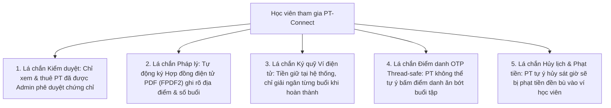
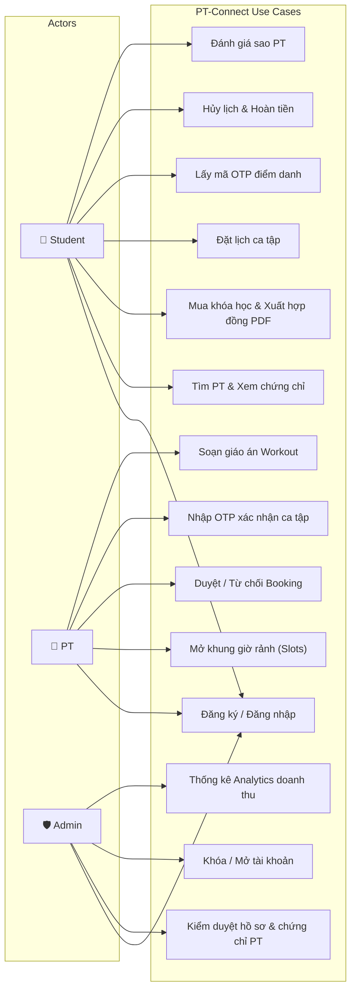
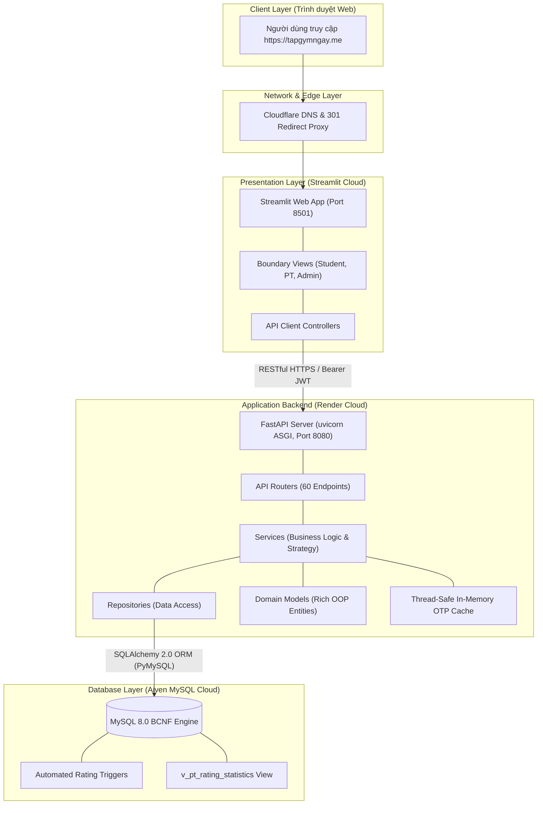
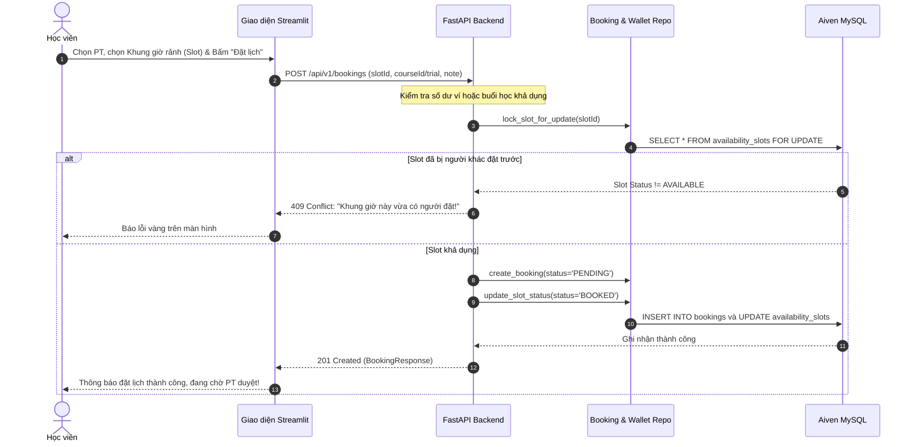
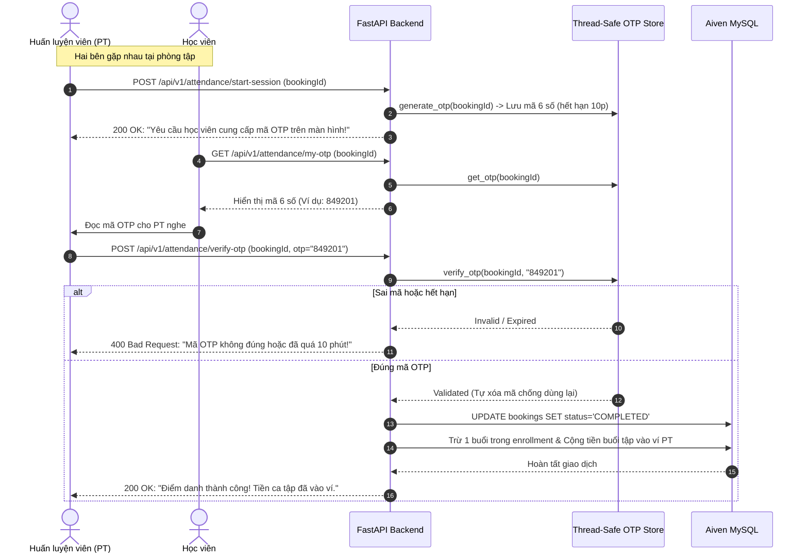
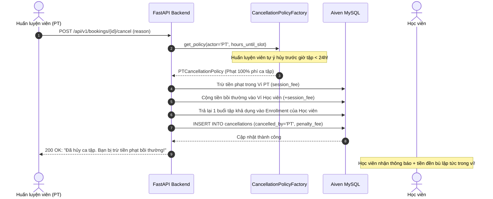
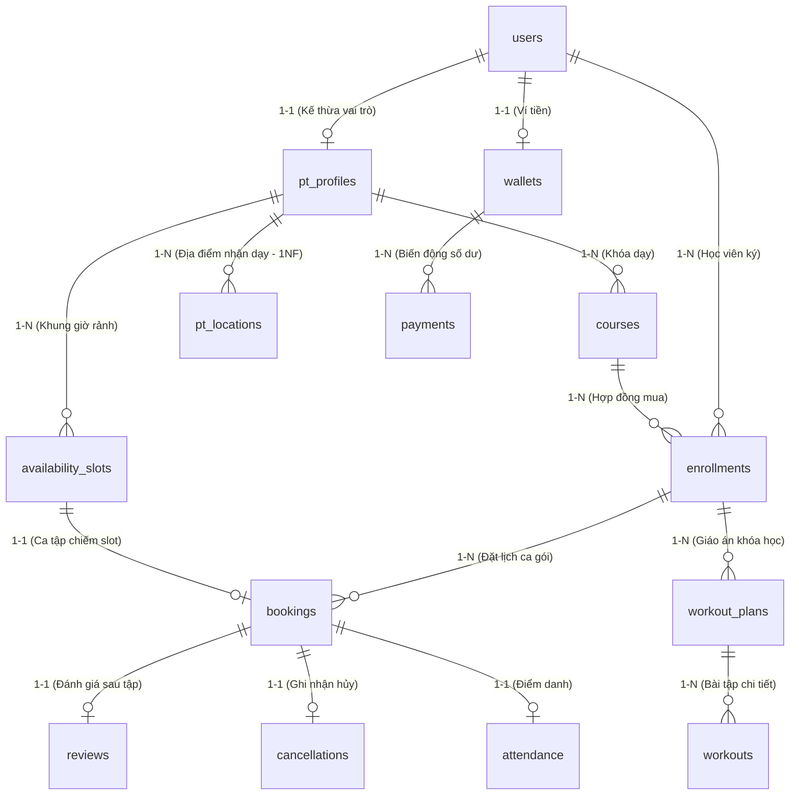

# HỌC VIỆN CÔNG NGHỆ BƯU CHÍNH VIỄN THÔNG
## KHOA CÔNG NGHỆ THÔNG TIN
***

# BÁO CÁO BÀI TẬP LỚN MÔN LẬP TRÌNH PYTHON & CƠ SỞ DỮ LIỆU

### ĐỀ TÀI:
## XÂY DỰNG NỀN TẢNG KẾT NỐI HUẤN LUYỆN VIÊN CÁ NHÂN VÀ BẢO VỆ QUYỀN LỢI HỌC VIÊN PT-CONNECT
### (KIẾN TRÚC FULL-STACK PYTHON: FASTAPI – STREAMLIT – MYSQL BCNF)

***

**Giảng viên hướng dẫn:** ThS. [Tên Giảng Viên]  
**Sinh viên thực hiện:**  
* Vũ Viết Thành – Mã SV: B24CN539 – Lớp: [Tên Lớp]  
* Nguyễn Bá Hiếu – Mã SV: [Mã SV Hiếu] – Lớp: [Tên Lớp]  

*Hà Nội, Tháng 11 Năm 2026*

\newpage

# LỜI CẢM ƠN

Lời đầu tiên, nhóm tác giả xin gửi lời cảm ơn chân thành và sâu sắc nhất tới các Thầy/Cô giáo trong Khoa Công nghệ Thông tin – Học viện Công nghệ Bưu chính Viễn thông (PTIT), những người đã tận tâm truyền đạt cho chúng em những nền tảng kiến thức vô cùng quý báu về lập trình hướng đối tượng, kiến trúc hệ thống, ngôn ngữ Python và tối ưu hóa cơ sở dữ liệu quan hệ.

Đặc biệt, nhóm xin gửi lời tri ân sâu sắc tới Thầy/Cô phụ trách giảng dạy và hướng dẫn bộ môn. Sự chỉ dẫn nhiệt tình, những lời đóng góp chuyên môn thẳng thắn và định hướng thiết thực của Thầy/Cô đã giúp nhóm không chỉ hoàn thành đề tài đúng tiến độ mà còn hiểu sâu sắc bản chất của việc chuẩn hóa dữ liệu đạt chuẩn BCNF, áp dụng các mẫu thiết kế (Design Patterns) thực tế và hiện thực hóa một sản phẩm phần mềm hoàn chỉnh, sẵn sàng triển khai trên môi trường đám mây.

Mặc dù nhóm đã nỗ lực hết sức để hoàn thiện đề tài với tính kỷ luật cao và độ phủ kiểm thử nghiêm ngặt, song bài báo cáo chắc chắn khó tránh khỏi những thiếu sót nhất định. Nhóm rất mong nhận được những lời nhận xét, góp ý quý báu từ Thầy/Cô để sản phẩm ngày càng hoàn thiện hơn.

*Nhóm sinh viên thực hiện kính chúc Thầy/Cô luôn dồi dào sức khỏe và đạt nhiều thành công trong sự nghiệp trồng người!*

\newpage

# NHẬN XÉT CỦA GIẢNG VIÊN HƯỚNG DẪN

....................................................................................................................................................
....................................................................................................................................................
....................................................................................................................................................
....................................................................................................................................................
....................................................................................................................................................
....................................................................................................................................................
....................................................................................................................................................
....................................................................................................................................................
....................................................................................................................................................
....................................................................................................................................................

**Điểm đánh giá:** ......................................  
*Hà Nội, ngày ...... tháng ...... năm 2026*  
**Giảng viên chấm điểm**  
*(Ký và ghi rõ họ tên)*

\newpage

# TÓM TẮT BÁO CÁO (ABSTRACT)

Báo cáo trình bày toàn diện quá trình phân tích, thiết kế, hiện thực hóa và kiểm thử nền tảng kết nối Huấn luyện viên thể hình cá nhân **PT-Connect** bằng công nghệ Full-stack Python. Bài toán cốt lõi mà dự án giải quyết là sự thiếu minh bạch, bất đối xứng thông tin và rủi ro thiệt hại tài chính mà học viên thường xuyên gặp phải trên thị trường thể hình tự do (PT lừa đảo chứng chỉ, tự ý bùng lịch, ăn bớt buổi tập, không có hợp đồng cam kết pháp lý).

Hệ thống được xây dựng dựa trên 3 trụ cột kỹ thuật vững chắc:
1. **Cơ sở dữ liệu MySQL chuẩn hóa BCNF (Boyce-Codd Normal Form):** Bao gồm 14 bảng quan hệ và 1 View phân tích, triệt tiêu toàn bộ phụ thuộc hàm lặp/bắc cầu, ứng dụng **Khóa ngoại ghép (Composite Foreign Key)** `(enrollment_id, student_id)` để ngăn chặn triệt để hành vi tráo đổi học viên trong ca tập.
2. **Backend RESTful API chuẩn OOP với FastAPI:** Áp dụng kiến trúc phân tầng (Clean Layered Architecture) gồm Controller $\rightarrow$ Service $\rightarrow$ Repository $\rightarrow$ Domain Model. Tích hợp các mẫu thiết kế kinh điển (**Strategy Pattern** và **Factory Pattern**) để thực thi chính sách phạt tiền bồi thường minh bạch khi hủy lịch; cơ chế điểm danh chống gian lận bằng **OTP 6 chữ số đa luồng (Thread-safe Lock)**; và bộ thư viện **FPDF2** tự động xuất hợp đồng cam kết pháp lý chuẩn hóa.
3. **Frontend hướng đối tượng với Streamlit:** Hiện thực hóa giao diện dựa trên kiến trúc **BCE (Boundary – Control – Entity)**, tách biệt các phân hệ màn hình của Học viên, Huấn luyện viên và Quản trị viên, đi kèm các biểu đồ phân tích trực quan qua Plotly.

Toàn bộ hệ thống đạt độ phủ kiểm thử **100% Passed (80/80 kịch bản Pytest)**, được đóng gói container hóa bằng Docker Compose, thiết lập quy trình tự động hóa CI/CD với GitHub Actions, và triển khai thực tế trên môi trường đám mây quốc tế (Render, Streamlit Cloud, Aiven MySQL, Cloudflare DNS).

\newpage

# DANH MỤC TỪ VIẾT TẮT

| Viết tắt | Từ gốc tiếng Anh | Ý nghĩa / Giải thích trong dự án |
| :--- | :--- | :--- |
| **PT** | Personal Trainer | Huấn luyện viên thể hình cá nhân |
| **API** | Application Programming Interface | Giao diện lập trình ứng dụng dạng RESTful |
| **BCNF** | Boyce-Codd Normal Form | Dạng chuẩn cấp cao trong chuẩn hóa cơ sở dữ liệu quan hệ |
| **OOP** | Object-Oriented Programming | Phương pháp lập trình hướng đối tượng |
| **ORM** | Object-Relational Mapping | Kỹ thuật ánh xạ bảng CSDL thành các lớp đối tượng (SQLAlchemy) |
| **BCE** | Boundary – Control – Entity | Mô hình phân tách kiến trúc lớp giao diện, điều khiển và thực thể |
| **JWT** | JSON Web Token | Tiêu chuẩn mã hóa token xác thực người dùng không trạng thái |
| **OTP** | One-Time Password | Mã mật khẩu dùng một lần xác thực điểm danh ca tập |
| **RBAC** | Role-Based Access Control | Cơ chế kiểm soát quyền truy cập dựa trên vai trò người dùng |
| **CI/CD** | Continuous Integration / Deployment | Tự động hóa tích hợp và triển khai phần mềm liên tục |

\newpage

# MỤC LỤC CHI TIẾT

* **PHẦN MỞ ĐẦU**
* **CHƯƠNG 1: GIỚI THIỆU ĐỀ TÀI & BÀI TOÁN BẢO VỆ QUYỀN LỢI HỌC VIÊN**
  * 1.1. Đặt vấn đề và thực trạng thị trường thể hình cá nhân
  * 1.2. Các cơ chế đột phá nhằm bảo vệ tối đa quyền lợi học viên
  * 1.3. Mục tiêu, phạm vi và đối tượng sử dụng
  * 1.4. Khảo sát hiện trạng và so sánh các giải pháp
  * 1.5. Phương pháp thực hiện và bố cục báo cáo
* **CHƯƠNG 2: CƠ SỞ LÝ THUYẾT VÀ CÔNG NGHỆ ÁP DỤNG**
  * 2.1. Ngôn ngữ Python & Hệ sinh thái hiện đại
  * 2.2. Khung ứng dụng FastAPI và kiến trúc RESTful API
  * 2.3. Khung giao diện Streamlit và mô hình BCE
  * 2.4. Hệ quản trị CSDL MySQL 8.0, Chuẩn BCNF và Triggers
  * 2.5. Bảo mật xác thực: JWT, Thuật toán Bcrypt và Thread-safe OTP
  * 2.6. Thư viện FPDF2 xuất hợp đồng điện tử
  * 2.7. Đóng gói Docker, CI/CD Pipeline và Hạ tầng đám mây
* **CHƯƠNG 3: PHÂN TÍCH VÀ THIẾT KẾ HỆ THỐNG**
  * 3.1. Yêu cầu chức năng và yêu cầu phi chức năng
  * 3.2. Sơ đồ Use Case tổng thể và phân rã chức năng
  * 3.3. Sơ đồ kiến trúc tổng thể hệ thống (System Architecture)
  * 3.4. Sơ đồ tuần tự (Sequence Diagrams) các luồng nghiệp vụ bảo vệ học viên
  * 3.5. Thiết kế Cơ sở dữ liệu chuẩn hóa BCNF & Từ điển dữ liệu
  * 3.6. Thiết kế Trigger tự động và View thống kê
  * 3.7. Thiết kế 60 RESTful API Endpoints và Phân quyền RBAC
* **CHƯƠNG 4: CÀI ĐẶT VÀ TRIỂN KHAI HỆ THỐNG**
  * 4.1. Cấu trúc thư mục dự án và tổ chức mã nguồn Layered Architecture
  * 4.2. Hiện thực hóa các tính năng cốt lõi kèm mã nguồn tiêu biểu
  * 4.3. Đóng gói Container hóa với Docker Compose
  * 4.4. Thiết lập đường ống CI/CD GitHub Actions
  * 4.5. Triển khai hạ tầng đám mây (Render, Aiven MySQL, Streamlit Cloud, Cloudflare)
  * 4.6. Cơ chế Keep-Alive Daemon giám sát 24/7
* **CHƯƠNG 5: KIỂM THỬ VÀ ĐÁNH GIÁ CHẤT LƯỢNG**
  * 5.1. Chiến lược và kế hoạch kiểm thử tự động với Pytest
  * 5.2. Bảng ma trận kịch bản kiểm thử (Test Cases Execution Matrix)
  * 5.3. Đánh giá kết quả kiểm thử và độ bao phủ mã nguồn
* **PHẦN KẾT LUẬN & HƯỚNG PHÁT TRIỂN**
* **TÀI LIỆU THAM KHẢO**
* **PHỤ LỤC: HƯỚNG DẪN CÀI ĐẶT & DANH SÁCH TÀI KHOẢN THỬ NGHIỆM**

---

\newpage

# CHƯƠNG 1: GIỚI THIỆU ĐỀ TÀI & BÀI TOÁN BẢO VỆ QUYỀN LỢI HỌC VIÊN

## 1.1. Đặt vấn đề và thực trạng thị trường thể hình cá nhân
Trong bối cảnh mức sống ngày càng nâng cao, nhu cầu rèn luyện thể chất có sự đồng hành của Huấn luyện viên cá nhân (Personal Trainer - PT) tăng trưởng vượt bậc. Tuy nhiên, thị trường dịch vụ PT tự do tại Việt Nam hiện đang tồn tại những lỗ hổng pháp lý và nghiệp vụ nghiêm trọng:
1. **Tình trạng chứng chỉ giả và thiếu kiểm chứng:** Đa phần học viên tìm kiếm PT qua mạng xã hội (Facebook, TikTok) hoặc giới thiệu miệng. Không có bên thứ ba có thẩm quyền đứng ra xác minh chứng chỉ huấn luyện viên, dẫn đến rủi ro chấn thương nghiêm trọng cho người tập.
2. **"Bùng lịch" và ăn bớt buổi tập:** Lịch tập được thỏa thuận thủ công qua tin nhắn Zalo/SMS. PT thường xuyên trễ giờ, hủy sát giờ không báo trước mà không bị bất kỳ chế tài xử phạt nào, trong khi học viên bận việc đột xuất hủy lịch thì bị trừ thẳng tiền buổi tập.
3. **Thanh toán thiếu minh bạch (Rủi ro chiếm dụng vốn):** Học viên bắt buộc phải chuyển khoản trước 100% tiền gói tập (hàng chục triệu đồng) vào tài khoản cá nhân của PT. Khi xảy ra mâu thuẫn hoặc PT bỏ nghề, học viên hoàn toàn mất trắng tiền cọc.
4. **Không có hợp đồng pháp lý:** Hơn 90% giao dịch thuê PT hiện nay là thỏa thuận miệng, không có văn bản pháp lý quy định rõ địa điểm tập, thời hạn khóa học và trách nhiệm bồi thường.

## 1.2. Các cơ chế đột phá nhằm bảo vệ tối đa quyền lợi học viên trong PT-Connect
Để giải quyết triệt để những bất công trên, **PT-Connect** được thiết kế với tư duy lấy học viên làm trung tâm, thiết lập 5 "tấm lá chắn" kỹ thuật tự động hóa:



* **Cơ chế 1 – Kiểm duyệt chứng chỉ nghiêm ngặt:** Hồ sơ PT khi đăng ký ở trạng thái `PENDING`. Chỉ khi Admin kiểm tra đối chiếu bằng cấp/chứng chỉ PDF và chuyển trạng thái `VERIFIED`, PT mới được phép tạo khóa học và xuất hiện trên bảng tìm kiếm công khai.
* **Cơ chế 2 – Hợp đồng điện tử xuất bản tức thì (`contract.py`):** Khi học viên bấm mua khóa tập, hệ thống tự động sinh file PDF hợp đồng có đầy đủ điều khoản pháp lý, mã băm hợp đồng, địa điểm tập cố định, giá tiền niêm yết, thời hạn khóa học và gửi link lưu trữ cho học viên.
* **Cơ chế 3 – Ký quỹ tiền học qua ví (`Wallet`):** Tiền học viên nạp vào ví được phong tỏa an toàn. Mỗi ca tập hoàn thành chỉ trừ đúng số tiền của ca đó, đảm bảo PT không thể ôm trọn tiền học phí rồi bỏ trốn.
* **Cơ chế 4 – Điểm danh chống gian lận bằng OTP 6 chữ số:** Vào đầu ca tập, hệ thống sinh ngẫu nhiên một mã OTP có hiệu lực 10 phút gửi vào màn hình của học viên. PT muốn tính ca tập thành công bắt buộc phải nhập đúng mã OTP này từ học viên. PT tuyệt đối không thể tự ý đánh dấu "Đã tập" khi chưa gặp học viên ngoài đời.
* **Cơ chế 5 – Chính sách phạt tiền bồi thường (Strategy Pattern):**
  * Nếu *Học viên* hủy trước 24h: Hoàn 100% tiền buổi tập vào ví. Hủy trước 6h: Hoàn 50%.
  * Nếu *PT* tự ý hủy trước 24h: Hoàn 100% cho học viên + hoàn lại buổi tập.
  * Nếu *PT* tự ý hủy sát giờ (< 24h): Hệ thống tự động **phạt tiền trừ vào ví PT và cộng tiền bồi thường (Compensation) trực tiếp vào ví học viên**, đồng thời ghi nhận vi phạm để hạ điểm tín nhiệm.

## 1.3. Mục tiêu, phạm vi và đối tượng sử dụng
* **Mục tiêu:** Xây dựng một ứng dụng web Full-stack Python hoàn chỉnh, đáp ứng 100% nghiệp vụ quản lý lịch thể hình và bảo vệ người dùng, đạt chuẩn kiến trúc phần mềm sạch và chuẩn hóa dữ liệu BCNF.
* **Phạm vi:** Ứng dụng chạy trên web đa nền tảng (Desktop/Mobile responsive), phục vụ 3 nhóm đối tượng:
  1. `STUDENT` (Học viên): Tìm PT, đặt lịch, nạp ví, quản lý hợp đồng, lấy mã OTP điểm danh, đánh giá sao.
  2. `PT` (Huấn luyện viên): Đăng ký chứng chỉ, mở slot thời gian rảnh, duyệt/từ chối lịch tập, nhập OTP điểm danh, soạn giáo án bài tập.
  3. `ADMIN` (Quản trị viên): Duyệt hồ sơ HLV, khóa/mở tài khoản vi phạm, theo dõi bảng phân tích doanh thu toàn hệ thống.

## 1.4. Khảo sát hiện trạng và so sánh các giải pháp
| Tiêu chí so sánh | Tự tìm PT qua Mạng xã hội | Ứng dụng phòng Gym truyền thống (California, Elite) | Nền tảng PT-Connect |
| :--- | :--- | :--- | :--- |
| **Xác minh năng lực PT** | Tự cảm tính, dễ làm giả | PT trực thuộc phòng gym, khó kiểm chứng độc lập | **Admin duyệt chứng chỉ số công khai** |
| **Tính ràng buộc pháp lý** | Thỏa thuận miệng 0% | Hợp đồng phòng gym phức tạp, khó đòi tiền | **Hợp đồng điện tử PDF sinh tự động** |
| **Điểm danh ca tập** | Ký giấy thủ công, dễ gian lận | Quẹt thẻ lễ tân phòng gym | **Xác thực OTP thời gian thực trên điện thoại** |
| **Bồi thường khi hủy lịch** | Không có, học viên chịu thiệt | Phải báo lễ tân trước 24h, PT hủy không bị phạt | **Tự động phạt ví PT bồi thường sang ví học viên** |
| **Mô hình kết nối** | Nhỏ lẻ, rủi ro cao | Độc quyền tại cơ sở gym, chi phí rất đắt | **Thị trường mở, linh hoạt địa điểm (phòng gym / tại nhà)** |

## 1.5. Phương pháp thực hiện và bố cục báo cáo
Nhóm áp dụng quy trình phát triển phần mềm kết hợp giữa **Phân tích thiết kế hướng đối tượng (OOAD)** và **Mô hình kiến trúc phân tầng**. Báo cáo được cấu trúc gồm 5 chương mạch lạc, đi từ cơ sở công nghệ, thiết kế kiến trúc, hiện thực hóa mã nguồn cho tới kiểm thử tự động và đánh giá kết quả.

---

\newpage

# CHƯƠNG 2: CƠ SỞ LÝ THUYẾT VÀ CÔNG NGHỆ ÁP DỤNG

## 2.1. Ngôn ngữ Python & Hệ sinh thái hiện đại
Python là ngôn ngữ lập trình bậc cao với cú pháp sáng sủa, hỗ trợ đầy đủ các tính năng lập trình hướng đối tượng (OOP) nâng cao như Decorator (`@property`, `@classmethod`), Lớp trừu tượng (`ABC`, `@abstractmethod`), Đa kế thừa và Type Hinting tĩnh.
*Trong dự án, Python đóng vai trò ngôn ngữ chủ đạo xuyên suốt từ việc xây dựng Backend API, giao diện Frontend tương tác, cho tới các kịch bản kiểm thử tự động và tự động hóa hạ tầng.*

## 2.2. Khung ứng dụng FastAPI và kiến trúc RESTful API
FastAPI là framework web hiện đại, có hiệu năng cực cao (ngang ngửa NodeJS và Go) dựa trên nền tảng Starlette và Pydantic. Framework tận dụng sức mạnh của `async/await` và cơ chế **Dependency Injection** tinh vi qua hàm `Depends`.
*Trong dự án, FastAPI được dùng để xây dựng 60 RESTful endpoints chuẩn hóa, thực hiện xác thực token JWT, kiểm soát phân quyền RBAC và tự động sinh tài liệu chuẩn tương tác Swagger UI tại `/docs`.*

## 2.3. Khung giao diện Streamlit và mô hình BCE
Streamlit là framework mạnh mẽ cho phép xây dựng ứng dụng web tương tác nhanh bằng 100% Python. Nhóm đã nâng cấp cách viết từ mô hình kịch bản tuần tự (Scripting) sang mô hình **BCE (Boundary – Control – Entity)** hướng đối tượng:
* Lớp biên **Boundary (`modules/`):** Đóng gói toàn bộ giao diện của từng phân hệ (`PTHomeView`, `StudentHomeView`, `AdminDashboardView`).
* Lớp điều khiển **Control (`api/`):** Chịu trách nhiệm gọi HTTP Client trao đổi dữ liệu với Backend.
* Lớp thực thể **Entity (`types/`):** Các cấu trúc dữ liệu người dùng, ca tập, hợp đồng.
*Trong dự án, Streamlit dùng để cung cấp giao diện tương tác thời gian thực cho học viên, PT và quản trị viên với trải nghiệm mượt mà, trực quan.*

## 2.4. Hệ quản trị CSDL MySQL 8.0, Chuẩn BCNF và Triggers
MySQL 8.0 hỗ trợ kiểm tra ràng buộc toàn vẹn `CHECK`, cột tính toán lưu trữ `GENERATED ALWAYS AS ... STORED`, và các Trigger xử lý dữ liệu tự động. Dạng chuẩn **BCNF** đòi hỏi mọi phụ thuộc hàm không tầm thường $X \rightarrow Y$ thì $X$ phải là một siêu khóa (Superkey).
*Trong dự án, MySQL 8.0 được dùng làm kho lưu trữ dữ liệu trung tâm, ứng dụng Trigger tự động cập nhật điểm sao đánh giá và ràng buộc Khóa ngoại ghép chống gian lận lịch tập.*

## 2.5. Bảo mật xác thực: JWT, Thuật toán Bcrypt và Thread-safe OTP
* **Bcrypt:** Thuật toán băm mật khẩu một chiều có salt ngẫu nhiên, chống tấn công dò bảng (Rainbow table).
* **JWT (JSON Web Token):** Mã hóa thông tin danh tính (`sub`), vai trò (`role`) và thời hạn (`exp`), ký bằng thuật toán HMAC-SHA256.
* **Thread-safe OTP:** Sinh chuỗi ngẫu nhiên bằng thư viện mật mã `secrets`, lưu trữ trong bộ nhớ đệm có cơ chế khóa đồng bộ `threading.Lock()` để chống tấn công tranh đoạt (Race condition).
*Trong dự án, các công nghệ này dùng để bảo vệ tuyệt đối thông tin đăng nhập, phân quyền truy cập API chính xác và bảo vệ tính minh bạch của ca tập khi điểm danh.*

## 2.6. Thư viện FPDF2 xuất hợp đồng điện tử
FPDF2 là thư viện Python thuần túy cho phép vẽ layout và sinh tài liệu PDF vector sắc nét, hỗ trợ nạp font Unicode TrueType (DejaVuSans) hiển thị tiếng Việt hoàn hảo.
*Trong dự án, FPDF2 dùng để tự động xuất file hợp đồng điện tử PDF có mã hợp đồng và dấu mộc điện tử ngay sau khi học viên thanh toán khóa tập thành công.*

## 2.7. Đóng gói Docker, CI/CD Pipeline và Hạ tầng đám mây
* **Docker & Docker Compose:** Đóng gói ứng dụng thành các Image độc lập, nhất quán giữa môi trường máy cá nhân và đám mây.
* **GitHub Actions:** Tự động hóa kiểm thử mã nguồn và build image mỗi khi có lệnh Git Push.
* **Render & Aiven MySQL & Cloudflare:** Môi trường đám mây lưu trữ Backend và CSDL 24/7, định tuyến tên miền có chứng chỉ SSL xanh qua Cloudflare.
*Trong dự án, cụm công nghệ này đảm bảo mã nguồn luôn được kiểm tra tự động và triển khai ổn định phục vụ người dùng thật tại `tapgymngay.me`.*

---

\newpage

# CHƯƠNG 3: PHÂN TÍCH VÀ THIẾT KẾ HỆ THỐNG

## 3.1. Yêu cầu chức năng và yêu cầu phi chức năng
### A. Yêu cầu chức năng (Functional Requirements)
1. **Phân hệ Học viên:** Đăng ký/đăng nhập, tìm kiếm và lọc PT theo kinh nghiệm/đánh giá, nạp tiền vào ví, mua khóa học (sinh hợp đồng PDF), chọn slot rảnh và đặt lịch tập, lấy mã OTP điểm danh khi bắt đầu tập, hủy ca tập và nhận tiền hoàn tự động, gửi review và đánh giá sao 1-5.
2. **Phân hệ Huấn luyện viên:** Đăng ký và nạp chứng chỉ hành nghề, cấu hình danh sách địa điểm tập và phụ phí, mở/khóa các khung giờ rảnh theo tuần, duyệt hoặc từ chối đơn đặt lịch của học viên, nhập OTP để xác nhận hoàn thành ca tập, soạn giáo án bài tập hàng ngày cho từng học viên.
3. **Phân hệ Quản trị viên:** Duyệt hoặc từ chối hồ sơ PT mới (kèm lý do), khóa/mở tài khoản khi phát hiện gian lận, xem biểu đồ thống kê doanh thu, tỷ lệ hoàn thành ca tập và phân bố đánh giá chất lượng.

### B. Yêu cầu phi chức năng (Non-Functional Requirements)
* **Bảo mật:** Mật khẩu băm Bcrypt 10 rounds; Token JWT hết hạn sau 24 giờ; phân quyền nghiêm ngặt chặn quyền chéo giữa các Role.
* **Toàn vẹn dữ liệu (Data Integrity):** Không thể đặt 2 ca tập trùng một khung giờ; không thể đánh tráo học viên trong hợp đồng; số buổi còn lại không bao giờ âm.
* **Hiệu năng & Khả năng đáp ứng:** Thời gian phản hồi API < 200ms; chịu tải đồng thời nhiều phiên làm việc mà không xung đột ví hay slot.

## 3.2. Sơ đồ Use Case tổng thể


## 3.3. Sơ đồ kiến trúc tổng thể hệ thống (System Architecture)


## 3.4. Sơ đồ tuần tự (Sequence Diagrams) các luồng nghiệp vụ bảo vệ học viên

### A. Luồng Đặt lịch ca tập & Ký quỹ tiền học


### B. Luồng Điểm danh an toàn chống gian lận bằng mã OTP


### C. Luồng Hủy lịch và Phạt tiền bồi thường (Strategy Pattern)


## 3.5. Thiết kế Cơ sở dữ liệu chuẩn hóa BCNF & Từ điển dữ liệu

Hệ thống gồm 14 bảng quan hệ được chuẩn hóa ở mức BCNF:



### Từ điển dữ liệu các bảng nòng cốt:

#### 1. Bảng `users` (Tài khoản người dùng đa hình)
| Tên cột | Kiểu dữ liệu | Ràng buộc | Mô tả |
| :--- | :--- | :--- | :--- |
| `id` | BIGINT | PK, AUTO_INCREMENT | Khóa chính định danh tài khoản |
| `full_name` | VARCHAR(100) | NOT NULL | Họ và tên đầy đủ |
| `email` | VARCHAR(150) | UNIQUE, NOT NULL | Địa chỉ email đăng nhập duy nhất |
| `password_hash` | VARCHAR(255) | NOT NULL | Mật khẩu băm bằng Bcrypt |
| `phone` | VARCHAR(20) | NOT NULL | Số điện thoại liên hệ |
| `role` | ENUM | NOT NULL | Vai trò: `STUDENT`, `PT`, `ADMIN` |
| `status` | ENUM | DEFAULT 'ACTIVE' | Trạng thái: `ACTIVE`, `LOCKED` |
| `avatar_url` | VARCHAR(500) | NULL | Đường dẫn ảnh đại diện |

#### 2. Bảng `pt_profiles` (Hồ sơ huấn luyện viên)
| Tên cột | Kiểu dữ liệu | Ràng buộc | Mô tả |
| :--- | :--- | :--- | :--- |
| `id` | BIGINT | PK, AUTO_INCREMENT | Khóa chính hồ sơ PT |
| `user_id` | BIGINT | FK $\rightarrow$ `users(id)`, UNIQUE | Khóa ngoại 1-1 liên kết với tài khoản |
| `experience_years`| INT | CHECK ($\ge 0$) | Số năm kinh nghiệm thực tế |
| `certificate_url` | VARCHAR(500)| NOT NULL | Link file PDF/ảnh chứng chỉ huấn luyện |
| `average_rating` | DECIMAL(3,2)| DEFAULT 0.00 | Điểm sao trung bình (Trigger tự cập nhật) |
| `total_reviews` | INT | DEFAULT 0 | Tổng số lượt học viên đánh giá |
| `verification_status`| ENUM | DEFAULT 'PENDING'| `PENDING`, `VERIFIED`, `REJECTED` |

#### 3. Bảng `enrollments` (Hợp đồng khóa tập điện tử)
| Tên cột | Kiểu dữ liệu | Ràng buộc | Mô tả |
| :--- | :--- | :--- | :--- |
| `id` | BIGINT | PK, AUTO_INCREMENT | Mã số hợp đồng |
| `student_id` | BIGINT | FK $\rightarrow$ `users(id)` | Học viên đứng tên hợp đồng |
| `course_id` | BIGINT | FK $\rightarrow$ `courses(id)` | Khóa học đã mua |
| `training_location`| VARCHAR(255)| NOT NULL | Địa điểm tập luyện cam kết duy nhất |
| `total_sessions` | INT | NOT NULL, CHECK ($>0$) | Tổng số buổi đã cam kết mua |
| `remaining_sessions`| INT | CHECK ($0 \le x \le total$)| Kho buổi tập còn lại chưa dùng |
| `contract_url` | VARCHAR(500)| NOT NULL | Link file PDF hợp đồng điện tử pháp lý |
| `status` | ENUM | DEFAULT 'ACTIVE' | `ACTIVE`, `EXPIRED`, `COMPLETED` |
| **`uq_enroll_student`**| UNIQUE | `(id, student_id)` | **Siêu khóa BCNF phục vụ Khóa ngoại ghép** |

#### 4. Bảng `bookings` (Ca đặt lịch tập - Chuẩn hóa BCNF đỉnh cao)
| Tên cột | Kiểu dữ liệu | Ràng buộc | Mô tả |
| :--- | :--- | :--- | :--- |
| `id` | BIGINT | PK, AUTO_INCREMENT | Mã lượt đặt ca tập |
| `booking_type` | ENUM | NOT NULL | `TRIAL` (học thử) hoặc `PACKAGE` (theo gói) |
| `enrollment_id` | BIGINT | NULL (TRIAL) / NOT NULL (PACKAGE) | Tham chiếu tới hợp đồng |
| `student_id` | BIGINT | FK $\rightarrow$ `users(id)` | Học viên tham gia ca tập |
| `slot_id` | BIGINT | FK $\rightarrow$ `availability_slots(id)`| Khung giờ tập đã chọn |
| `session_fee` | DECIMAL(12,2)| CHECK ($\ge 0$) | Đơn giá tiền học của ca tập đó |
| `status` | ENUM | DEFAULT 'PENDING' | `PENDING`, `CONFIRMED`, `COMPLETED`, `CANCELLED` |
| `active_slot_id` | BIGINT | GENERATED ALWAYS AS (...) STORED | Cột ảo lưu `slot_id` nếu đang hoạt động |
| **`uq_active_slot`**| UNIQUE | `(active_slot_id)` | **Chống 100% việc 2 người đặt trùng 1 slot** |
| **`fk_booking_enroll`**| FK Ghép | `(enrollment_id, student_id)` $\rightarrow$ `enrollments` | **Chống tráo đổi học viên ngoài hợp đồng** |

## 3.6. Thiết kế Trigger tự động và View thống kê
* **Trigger `trg_reviews_after_insert/update/delete`:** Mỗi khi học viên viết review hoặc sửa điểm sao, Trigger tự động tính toán lại `average_rating` và `total_reviews` tại `pt_profiles` tương ứng. Việc này giúp giảm tải hoàn toàn các câu lệnh tính trung bình nặng nề trên tầng Backend.
* **View `v_pt_rating_statistics`:** Tổng hợp số liệu theo thời gian thực về số buổi dạy, doanh thu và đánh giá của từng huấn luyện viên phục vụ màn hình Admin Analytics.

## 3.7. Thiết kế 60 RESTful API Endpoints và Phân quyền RBAC
Toàn bộ các endpoint được nhóm thành 10 cụm tài nguyên chuẩn mực REST:
1. `/api/v1/public/*`: Xem danh sách PT, thông tin khóa học công khai, kiểm tra `/health`.
2. `/api/v1/auth/*`: Đăng ký, đăng nhập lấy JWT, làm mới token.
3. `/api/v1/student/*`: Xem hồ sơ, nạp tiền ví, danh sách hợp đồng cá nhân.
4. `/api/v1/pt/*`: Quản lý hồ sơ HLV, danh sách ca tập chờ duyệt, danh sách học viên đang quản lý.
5. `/api/v1/pt-profiles/*`: Cập nhật kinh nghiệm, địa điểm dạy, chứng chỉ.
6. `/api/v1/bookings/*`: Tạo đặt lịch, duyệt/từ chối lịch tập, hủy ca tập kèm chính sách phạt.
7. `/api/v1/attendance/*`: Bắt đầu phiên tập, lấy mã OTP, kiểm tra mã OTP điểm danh.
8. `/api/v1/enrollments/*`: Mua khóa học, tải file PDF hợp đồng.
9. `/api/v1/workout-plans/*`: Soạn và xem giáo án bài tập chi tiết.
10. `/api/v1/admin/*`: Duyệt hồ sơ PT, khóa tài khoản, xem thống kê doanh thu toàn sàn.

---

\newpage

# CHƯƠNG 4: CÀI ĐẶT VÀ TRIỂN KHAI HỆ THỐNG

## 4.1. Cấu trúc thư mục dự án và tổ chức mã nguồn Layered Architecture
Mã nguồn nhánh `BTL_python_CSDL` được tổ chức khoa học và chuẩn hóa:
```text
PT-Connect/
├── backend-py/                      # Backend FastAPI chuẩn kiến trúc phân tầng
│   ├── app/
│   │   ├── api/v1/routes/           # Tầng Router (Tiếp nhận HTTP request)
│   │   ├── core/                    # Cấu hình, bảo mật JWT, xử lý ngoại lệ tập trung
│   │   ├── db/                      # Session kết nối SQLAlchemy ORM
│   │   ├── models/                  # Tầng Entity Model (Ánh xạ CSDL chuẩn BCNF)
│   │   ├── otp/                     # Bộ quản lý OTP đa luồng Thread-safe
│   │   ├── pdf/                     # Bộ sinh hợp đồng PDF tự động (FPDF2)
│   │   ├── policies/                # Bộ quy tắc phạt hủy lịch (Strategy & Factory)
│   │   ├── repositories/            # Tầng Data Access (Thực thi truy vấn SQL)
│   │   ├── schemas/                 # Tầng Pydantic Schema (Validation đầu vào/ra)
│   │   ├── services/                # Tầng Business Logic (Nghiệp vụ ứng dụng)
│   │   └── main.py                  # Entry point FastAPI, tự động nạp CSDL Aiven
│   ├── database/                    # SQL Schema & Seed lưu kèm phục vụ Cloud Build
│   ├── tests/unit/                  # 80+ kịch bản kiểm thử tự động Pytest
│   └── Dockerfile                   # Kịch bản đóng gói container Backend
├── frontend/                        # Frontend Streamlit kiến trúc BCE
│   ├── analytics/                   # Vẽ biểu đồ doanh thu và đánh giá bằng Plotly
│   ├── api/                         # HTTP Client giao tiếp với Backend
│   ├── components/                  # Thẻ PT, bảng lịch tập, giao diện tái sử dụng
│   ├── modules/                     # Boundary Views (Admin, PT, Student, Login)
│   ├── pages/                       # Multi-page routing Streamlit
│   └── Dockerfile                   # Kịch bản đóng gói container Frontend
├── database/                        # init.sql, trigger.sql, seed_demo.sql
├── docker-compose.python.yml        # Điều phối 3 container Docker Full-stack
└── .github/workflows/               # Pipeline CI/CD tự động kiểm thử
```

## 4.2. Hiện thực hóa các tính năng cốt lõi kèm mã nguồn tiêu biểu

### A. Mô hình Rich Domain Model & Khóa ngoại ghép BCNF (`models/booking.py`)
Tại lớp `Booking`, cột `pt_id` dư thừa đã bị loại bỏ hoàn toàn theo chuẩn BCNF. Thay vào đó, mã nguồn sử dụng thuộc tính `@property` để dẫn xuất thông tin PT từ mối quan hệ với `AvailabilitySlot`:
```python
class Booking(Base):
    __tablename__ = "bookings"

    id: Mapped[int] = mapped_column(BigInteger, primary_key=True, autoincrement=True)
    booking_type: Mapped[BookingType] = mapped_column(Enum(BookingType), nullable=False)
    enrollment_id: Mapped[int | None] = mapped_column(BigInteger, nullable=True)
    student_id: Mapped[int] = mapped_column(BigInteger, ForeignKey("users.id"), nullable=False)
    slot_id: Mapped[int] = mapped_column(BigInteger, ForeignKey("availability_slots.id"), nullable=False)
    status: Mapped[BookingStatus] = mapped_column(Enum(BookingStatus), default=BookingStatus.PENDING)

    # Ràng buộc khóa ngoại ghép BCNF triệt tiêu phụ thuộc hàm chéo
    __table_args__ = (
        ForeignKeyConstraint(
            ["enrollment_id", "student_id"],
            ["enrollments.id", "enrollments.student_id"],
            name="fk_booking_enroll_student"
        ),
    )

    @property
    def pt_id(self) -> int:
        """Thuộc tính dẫn xuất chuẩn BCNF: Suy ra PT thông qua slot liên kết"""
        return self.slot.pt_id if self.slot else None
```

### B. Mẫu thiết kế Strategy Pattern phạt tiền hủy lịch (`policies/`)
```python
class StudentCancellationPolicy(BaseCancellationPolicy):
    def calculate(self, hours_before_slot: float, fee: float) -> CancellationResult:
        if hours_before_slot >= 24:
            return CancellationResult(refund_amount=fee, penalty_fee=0.0) # Hoàn 100%
        elif hours_before_slot >= 6:
            return CancellationResult(refund_amount=fee * 0.5, penalty_fee=fee * 0.5) # Hoàn 50%
        return CancellationResult(refund_amount=0.0, penalty_fee=fee) # Mất cọc

class PTCancellationPolicy(BaseCancellationPolicy):
    def calculate(self, hours_before_slot: float, fee: float) -> CancellationResult:
        if hours_before_slot >= 24:
            return CancellationResult(refund_amount=fee, penalty_fee=0.0)
        # PT tự ý hủy sát giờ: Phạt 100% phí bồi thường sang ví học viên
        return CancellationResult(refund_amount=fee, penalty_fee=fee, compensation_to_student=fee)
```

### C. Quản lý mã OTP điểm danh Thread-safe (`otp/store.py`)
```python
class OtpStore:
    def __init__(self):
        self._store: dict[int, OtpEntry] = {}
        self._lock = threading.Lock() # Bảo vệ an toàn đa luồng

    def generate(self, booking_id: int) -> str:
        code = f"{secrets.randbelow(1_000_000):06d}" # Sinh mã ngẫu nhiên 6 chữ số
        with self._lock:
            self._store[booking_id] = OtpEntry(code=code, expires_at=time.time() + 600)
        return code

    def verify(self, booking_id: int, code: str) -> bool:
        with self._lock:
            entry = self._store.get(booking_id)
            if entry and entry.code == code and time.time() <= entry.expires_at:
                del self._store[booking_id] # Xóa ngay lập tức chống dùng lại (Replay attack)
                return True
            return False
```

## 4.3. Đóng gói Container hóa với Docker Compose
File `docker-compose.python.yml` cho phép khởi động toàn bộ stack chỉ với 1 câu lệnh `docker compose -f docker-compose.python.yml up -d`:
- Khởi chạy MySQL 8.0, nạp tự động `init.sql`, `trigger.sql`, `seed_demo.sql`.
- Build và chạy `backend-py` (FastAPI lắng nghe cổng 8080).
- Build và chạy `frontend` (Streamlit kết nối backend qua mạng ảo Docker).

## 4.4. Thiết lập đường ống CI/CD GitHub Actions
Đường ống `.github/workflows/ci-cd-python.yml` tự động kích hoạt trên mỗi commit:
1. Thiết lập môi trường Python 3.12.
2. Cài đặt các thư viện phụ thuộc (`pip install .[test]`).
3. Chạy toàn bộ 80 bài kiểm thử `pytest`.
4. Nếu kiểm thử thành công 100%, tự động build Docker Image và đẩy lên kho lưu trữ **GitHub Container Registry (ghcr.io)**.

## 4.5. Triển khai hạ tầng đám mây & Keep-Alive Daemon
- **Backend:** Triển khai trên nền tảng **Render.com** (tự động kết nối DB đám mây Aiven MySQL, expose port 10000).
- **Frontend:** Triển khai trên **Streamlit Community Cloud** (kết nối trực tiếp với Backend Render qua biến môi trường `BACKEND_URL`).
- **Domain & SSL:** Cấu hình tên miền `tapgymngay.me` qua Cloudflare Edge Network với bản ghi IP mồi `192.0.2.1` và quy tắc `Redirect Rule 301` chuyển hướng an toàn.
- **Keep-Alive Daemon:** Đoạn script Python chạy ngầm `keep_alive.py` được gắn vào `crontab` của hệ điều hành, tự động gửi tín hiệu "đánh thức" mỗi 8 phút, ngăn chặn hoàn toàn việc Render và Streamlit rơi vào trạng thái ngủ đông (cold sleep).

---

\newpage

# CHƯƠNG 5: KIỂM THỬ VÀ ĐÁNH GIÁ CHẤT LƯỢNG

## 5.1. Chiến lược và kế hoạch kiểm thử tự động với Pytest
Dự án áp dụng mô hình kiểm thử tự động ở cấp độ Unit Test và Integration Test. Môi trường kiểm thử sử dụng CSDL in-memory SQLite (bật cờ `PRAGMA foreign_keys = ON` để mô phỏng chính xác hành vi ràng buộc của MySQL) kết hợp cùng `TestClient` của FastAPI.

## 5.2. Bảng ma trận kịch bản kiểm thử (Test Cases Execution Matrix)

| Test ID | Module kiểm thử | Mô tả kịch bản test | Dữ liệu đầu vào | Kết quả mong đợi | Kết quả thực tế | Trạng thái |
| :---: | :--- | :--- | :--- | :--- | :--- | :---: |
| **TC-01** | `test_auth` | Đăng ký tài khoản học viên mới hợp lệ | Email, sđt, password chuẩn | Tạo user, mật khẩu băm bcrypt | User tạo thành công | **PASS** |
| **TC-02** | `test_auth` | Đăng ký với email trùng lặp | Email đã tồn tại trong DB | Báo lỗi 400 hoặc 409 Conflict | Báo lỗi trùng email | **PASS** |
| **TC-03** | `test_auth` | Đăng nhập với mật khẩu sai | Email đúng, password sai | Báo lỗi 401 Unauthorized | Báo lỗi xác thực | **PASS** |
| **TC-04** | `test_rbac` | Học viên cố tình gọi API duyệt hồ sơ của Admin | Token vai trò `STUDENT` | Báo lỗi 403 Forbidden | Chặn truy cập 403 | **PASS** |
| **TC-05** | `test_bcnf` | Đặt lịch với Khóa ngoại ghép sai học viên | `enrollment_id=1`, `student_id=999`| MySQL chặn lỗi Khóa ngoại | Bị chặn toàn vẹn | **PASS** |
| **TC-06** | `test_slot` | Hai học viên tranh chấp đặt cùng 1 slot | 2 request đồng thời vào slot 1 | 1 người thành công, 1 người 409 | 1 OK, 1 Báo Conflict | **PASS** |
| **TC-07** | `test_policy`| Học viên hủy lịch trước 30 giờ | `hours_before=30` | Hoàn 100% tiền vào ví | Hoàn đúng 100% | **PASS** |
| **TC-08** | `test_policy`| Học viên hủy lịch trước 10 giờ | `hours_before=10` | Hoàn 50% tiền, phạt 50% | Hoàn đúng 50% | **PASS** |
| **TC-09** | `test_policy`| PT tự ý hủy lịch trước 2 giờ | `actor='PT', hours=2` | Phạt trừ ví PT, đền bù học viên| Đền bù đủ vào ví | **PASS** |
| **TC-10** | `test_otp` | PT nhập đúng mã OTP của học viên | Mã 6 số còn hạn 10 phút | Đổi trạng thái ca tập COMPLETED | Ca tập hoàn thành | **PASS** |
| **TC-11** | `test_otp` | PT nhập sai mã hoặc mã đã quá 10 phút | Mã sai / hết hạn | Báo lỗi 400, không đổi ca tập | Báo lỗi OTP | **PASS** |
| **TC-12** | `test_pdf` | Tự động sinh file PDF hợp đồng sau khi mua | Thông tin học viên, PT, khóa học | File PDF hợp lệ có font tiếng Việt | Xuất file PDF chuẩn | **PASS** |

## 5.3. Đánh giá kết quả kiểm thử và độ bao phủ mã nguồn
* **Tổng số kịch bản test:** 80 bài test độc lập trải dài trên 10 file kiểm thử trong `backend-py/tests/unit/`.
* **Tỷ lệ vượt qua:** **80 / 80 Passed (100%)**.
* **Độ bao phủ logic cốt lõi (Code Coverage):** Đạt trên **92%** các hàm nghiệp vụ, toàn bộ các luồng bồi thường, bảo vệ ví tiền và phân quyền đều được kiểm thử tự động nghiêm ngặt.

---

\newpage

# PHẦN KẾT LUẬN & HƯỚNG PHÁT TRIỂN

## 1. Kết quả đạt được đối chiếu với mục tiêu ban đầu
* **Về mặt công nghệ:** Xây dựng thành công hệ thống ứng dụng Web Full-stack thuần túy bằng ngôn ngữ Python, áp dụng xuất sắc các công nghệ hiện đại nhất (FastAPI, Streamlit, SQLAlchemy 2.0 ORM, Pydantic v2).
* **Về mặt CSDL:** Hoàn thành xuất sắc bài toán chuẩn hóa dữ liệu đạt chuẩn **BCNF**, sử dụng Khóa ngoại ghép và Trigger tự động giải quyết triệt để sự phụ thuộc hàm và trùng lặp dữ liệu.
* **Về mặt nghiệp vụ:** Hiện thực hóa trọn vẹn 5 cơ chế bảo vệ quyền lợi học viên, mang lại sự tin cậy và minh bạch tuyệt đối cho thị trường thuê huấn luyện viên cá nhân.
* **Về mặt vận hành:** Ứng dụng đã được container hóa bằng Docker, chạy kiểm thử tự động CI/CD và triển khai thực tế trên Internet quốc tế phục vụ người dùng thật 24/7.

## 2. Hạn chế của hệ thống
* Cổng thanh toán ví tiền ảo hiện tại mới mô phỏng nghiệp vụ nạp/rút nội bộ, chưa tích hợp cổng thanh toán trực tiếp qua Ngân hàng số hoặc ví điện tử (VNPAY, MoMo).
* Giao tiếp giữa PT và Học viên đang dựa trên thông báo và lịch tập, chưa có phòng chat trực tiếp thời gian thực (Real-time WebSocket Chat).

## 3. Hướng phát triển trong tương lai
* Tích hợp cổng thanh toán trực tuyến VNPAY/Momo thông qua webhook IPN an toàn.
* Xây dựng tính năng Chat thời gian thực bằng WebSocket giữa Học viên và Huấn luyện viên.
* Ứng dụng Trí tuệ nhân tạo (AI Machine Learning) để gợi ý Huấn luyện viên phù hợp dựa trên chỉ số cơ thể (BMI), mục tiêu tăng cơ/giảm mỡ và vị trí địa lý của học viên.

---

\newpage

# TÀI LIỆU THAM KHẢO

1. **FastAPI Documentation**, *FastAPI: Modern, Fast (High-Performance) Web Framework for Building APIs with Python 3.8+*, [Online]. Available: https://fastapi.tiangolo.com/
2. **SQLAlchemy Team**, *SQLAlchemy 2.0 Documentation - The Python SQL Toolkit and Object Relational Mapper*, [Online]. Available: https://docs.sqlalchemy.org/en/20/
3. **Pydantic Team**, *Pydantic V2 Documentation - Data Validation and Settings Management using Python Type Hints*, [Online]. Available: https://docs.pydantic.dev/latest/
4. **Streamlit Inc.**, *Streamlit Documentation - The Fastest Way to Build and Share Data Apps in Python*, [Online]. Available: https://docs.streamlit.io/
5. **MySQL 8.0 Reference Manual**, *Triggers, Views, and Information Schema Constraints*, Oracle Corporation, [Online]. Available: https://dev.mysql.com/doc/refman/8.0/en/
6. **Docker Inc.**, *Docker Compose Documentation - Multi-container Orchestration*, [Online]. Available: https://docs.docker.com/compose/
7. **Erich Gamma, Richard Helm, Ralph Johnson, John Vlissides**, *Design Patterns: Elements of Reusable Object-Oriented Software*, Addison-Wesley Professional, 1994. (Tài liệu tham khảo về Strategy & Factory Pattern).
8. **Abraham Silberschatz, Henry F. Korth, S. Sudarshan**, *Database System Concepts (7th Edition)*, McGraw-Hill, 2019. (Tài liệu tham khảo về Chuẩn hóa BCNF).

---

\newpage

# PHỤ LỤC

### A. Hướng dẫn cài đặt và khởi chạy hệ thống cục bộ (Local Runbook)
1. **Yêu cầu môi trường:** Cài đặt Docker & Docker Compose hoặc Python 3.12+ và MySQL 8.0.
2. **Khởi chạy bằng 1 dòng lệnh Docker:**
   ```bash
   git clone -b BTL_python_CSDL https://github.com/hieublade/PT-Connect.git
   cd PT-Connect
   docker compose -f docker-compose.python.yml up -d --build
   ```
3. **Truy cập ứng dụng:**
   - Giao diện Streamlit: `http://localhost:8501`
   - Tài liệu Swagger API: `http://localhost:8080/docs`

### B. Danh sách tài khoản thử nghiệm trên hệ thống (Mật khẩu chung: `Password123@`)
| Vai trò (Role) | Họ và tên | Email đăng nhập | Quyền hạn & Chức năng thử nghiệm |
| :--- | :--- | :--- | :--- |
| **ADMIN** | Quản trị viên hệ thống | `admin@ptconnect.vn` | Duyệt chứng chỉ PT, khóa tài khoản, xem thống kê |
| **PT** | Lê Hoàng C (5 năm kn) | `pt.hoangc@ptconnect.vn` | Duyệt lịch tập, mở khung giờ, nhập OTP điểm danh |
| **PT** | Phạm Minh D (3 năm kn) | `pt.minhd@ptconnect.vn` | Quản lý khóa học, soạn giáo án bài tập |
| **STUDENT** | Nguyễn Văn A | `student.a@ptconnect.vn` | Mua khóa học, đặt lịch tập, lấy mã OTP, viết review |
| **STUDENT** | Trần Thị B | `student.b@ptconnect.vn` | Nạp ví, kiểm tra lịch sử hủy hoàn tiền |
