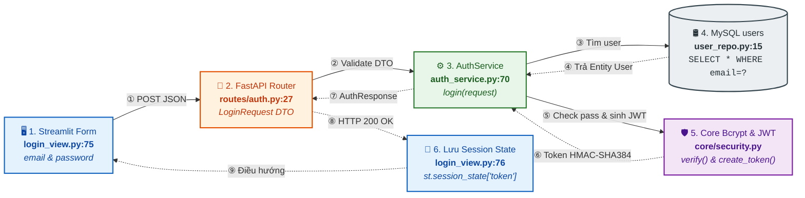
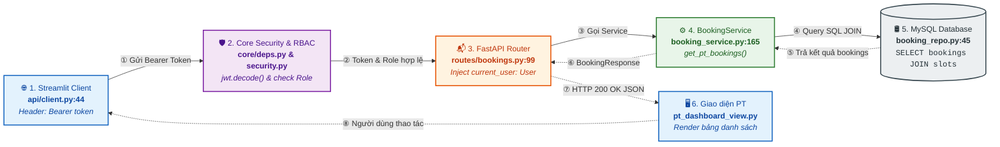
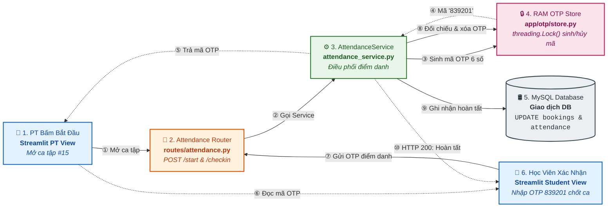

# BÁO CÁO CÁC LUỒNG DỮ LIỆU FULL-STACK DẠNG KHỐI NGANG (HORIZONTAL DIAGRAMS)
### PHÙ HỢP CHÈN BÁO CÁO WORD & SLIDE BẢO VỆ ĐỒ ÁN (TỶ LỆ KHUNG HÌNH CHỮ NHẬT NGANG)

Để thuận tiện nhất cho việc chèn vào báo cáo văn bản Word (khổ giấy A4 dọc) và trình chiếu slide thuyết trình mà **không bị dài thượt theo chiều dọc hay làm tràn trang giấy**, 3 luồng nghiệp vụ cốt lõi đã được thiết kế lại theo **khung hình chữ nhật ngang (Horizontal Landscape)**:
* Chiều rộng trải dài vừa khít bề ngang trang in (1300px - 1800px).
* Chiều cao gọn gàng (300px - 600px), chỉ chiếm 1/3 trang giấy, giữ nguyên font chữ to và rõ nét.
* Mỗi sơ đồ chỉ từ **5 đến 6 khối chính**, đánh số thứ tự mũi tên từ ① đến ⑩.

---

## 1. KHỐI LUỒNG 1: ĐĂNG NHẬP, XÁC THỰC BCRYPT & CẤP PHÁT JWT TOKEN

### 🖼️ Sơ đồ Khối Ngang (Tỷ lệ 1347 x 396 px):

---

## 2. KHỐI LUỒNG 2: GỬI REQUEST KÈM BEARER TOKEN & KIỂM TRA ĐA TẦNG

### 🎯 Tình huống:
Huấn luyện viên mở màn hình xem danh sách ca tập chờ duyệt (`GET /api/v1/pt/bookings?status=PENDING`).

### 🖼️ Sơ đồ Khối Ngang (Tỷ lệ 1841 x 318 px):

---

## 3. KHỐI LUỒNG 3: ĐIỂM DANH OTP CHỐNG GIAN LẬN & GIAO DỊCH CSDL

### 🎯 Tình huống:
Huấn luyện viên bấm bắt đầu ca tập $\rightarrow$ Bộ nhớ RAM Thread-safe sinh OTP $\rightarrow$ Học viên nhập OTP $\rightarrow$ Hoàn tất ca tập trong MySQL.

### 🖼️ Sơ đồ Khối Ngang (Tỷ lệ 1358 x 616 px):

