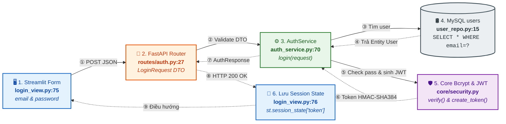
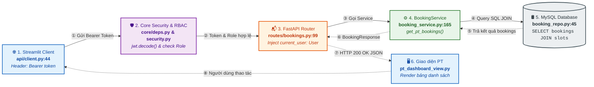
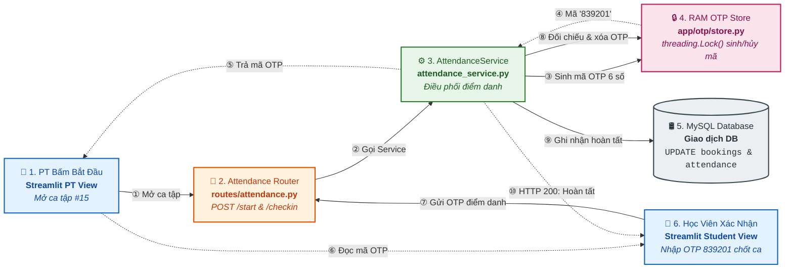

# BÁO CÁO CÁC LUỒNG DỮ LIỆU FULL-STACK DẠNG KHỐI NGANG (HORIZONTAL DIAGRAMS)
### PHÙ HỢP CHÈN BÁO CÁO WORD & SLIDE BẢO VỆ ĐỒ ÁN (TỶ LỆ KHUNG HÌNH CHỮ NHẬT NGANG)

Để thuận tiện nhất cho việc chèn vào báo cáo văn bản Word (khổ giấy A4 dọc) và trình chiếu slide thuyết trình mà **không bị dài thượt theo chiều dọc hay làm tràn trang giấy**, 3 luồng nghiệp vụ cốt lõi đã được thiết kế lại theo **khung hình chữ nhật ngang (Horizontal Landscape)**:
* Chiều rộng trải dài vừa khít bề ngang trang in (1300px - 1800px).
* Chiều cao gọn gàng (300px - 600px), chỉ chiếm 1/3 trang giấy, giữ nguyên font chữ to và rõ nét.
* Mỗi sơ đồ chỉ từ **5 đến 6 khối chính**, đánh số thứ tự mũi tên từ ① đến ⑩.

---

## 1. KHỐI LUỒNG 1: ĐĂNG NHẬP, XÁC THỰC BCRYPT & CẤP PHÁT JWT TOKEN

### 🖼️ Sơ đồ Khối Ngang (Tỷ lệ 1347 x 396 px):

---

## 2. KHỐI LUỒNG 2: GỬI REQUEST KÈM BEARER TOKEN & KIỂM TRA ĐA TẦNG

### 🎯 Tình huống:
Huấn luyện viên mở màn hình xem danh sách ca tập chờ duyệt (`GET /api/v1/pt/bookings?status=PENDING`).

### 🖼️ Sơ đồ Khối Ngang (Tỷ lệ 1841 x 318 px):

---

## 3. KHỐI LUỒNG 3: ĐIỂM DANH OTP CHỐNG GIAN LẬN & GIAO DỊCH CSDL

### 🎯 Tình huống:
Huấn luyện viên bấm bắt đầu ca tập $\rightarrow$ Bộ nhớ RAM Thread-safe sinh OTP $\rightarrow$ Học viên nhập OTP $\rightarrow$ Hoàn tất ca tập trong MySQL.

### 🖼️ Sơ đồ Khối Ngang (Tỷ lệ 1358 x 616 px):

---

## 4. KỊCH BẢN THUYẾT TRÌNH BẢO VỆ ĐỒ ÁN TRƯỚC HỘI ĐỒNG (PRESENTATION SCRIPT)

### 🎙️ LƯU Ý VỀ TÁC PHONG & PHONG CÁCH TRÌNH BÀY:
* **Khẩu khí:** Tự tin, gãy gọn, phong thái đĩnh đạc, xưng hô *"Em/Nhóm em xin phép báo cáo Thầy/Cô"*.
* **Tư duy trình bày:** Tuyệt đối không đọc lại slide hay đọc code từng dòng. Hãy dẫn dắt như một kỹ sư đang giải quyết một bài toán thực tế ngoài đời sống: **Bối cảnh & Nỗi đau thị trường $\rightarrow$ Giải pháp & Kiến trúc tổng thể $\rightarrow$ 4 Điểm sáng kỹ thuật $\rightarrow$ Demo thực tế $\rightarrow$ Kết luận**.
* **Thời lượng đề xuất:** 7 – 10 phút thuyết trình + 5 phút trả lời câu hỏi phản biện của Giảng viên.

---

### 🟢 PHẦN 1: MỞ ĐẦU & BỐI CẢNH ĐỀ TÀI (1.5 – 2 phút)
*(Nói tự nhiên, đánh trúng các lỗ hổng thực tế của thị trường để gây ấn tượng mạnh ngay từ 30 giây đầu)*

> **Lời thoại mẫu:**
> 
> *"Kính thưa Thầy/Cô trong Hội đồng chấm đồ án,*
> 
> *Hôm nay nhóm em xin phép được báo cáo đề tài Bài tập lớn: **PT-Connect – Nền tảng kết nối Huấn luyện viên thể hình cá nhân và bảo vệ quyền lợi học viên**, được hiện thực hóa hoàn toàn trên kiến trúc **Full-stack thuần Python (FastAPI – Streamlit – MySQL chuẩn BCNF)**.*
> 
> *Trước khi đi sâu vào các khía cạnh kỹ thuật, em xin phép chia sẻ một bối cảnh rất đời thực:*  
> *Hiện nay, phong trào tập gym, thể hình để nâng cao sức khỏe đang phát triển rất mạnh mẽ. Rất nhiều người sẵn sàng chi ra từ 10 đến 30 triệu đồng để thuê Huấn luyện viên cá nhân (Freelance PT). Tuy nhiên, trên thị trường tự do hiện nay đang tồn tại một **lỗ hổng niềm tin rất lớn** giữa người dạy và người tập:*
> 
> 1. * **Nạn bùng lịch và ăn bớt buổi tập:** *Học viên chuyển tiền một cục cho cả gói tập 30 buổi. Nhưng sau đó PT thường xuyên báo bận, hủy lịch sát giờ, hoặc hẹn tập nhưng tự ý ghi nhận 'đã tập' để trừ khống buổi của học viên mà học viên không có bằng chứng đối chất.*
> 2. * **Bất đối xứng thông tin và chứng chỉ ảo:** *Học viên không có công cụ nào để kiểm chứng xem bằng cấp, chứng chỉ thể hình của PT đó là thật hay photoshop, kinh nghiệm 5 năm hay chỉ mới tập vài tháng.*
> 3. * **Thiếu cam kết pháp lý ràng buộc:** *Mọi thỏa thuận trước nay đều giao dịch 'miệng' qua Zalo, không có hợp đồng có giá trị pháp lý, khi xảy ra tranh chấp học viên luôn là bên chịu thiệt thòi về tiền bạc.*
> 
> *Nhận thấy những nhức nhối đó, nhóm em xác định rõ: **PT-Connect không chỉ là một ứng dụng đặt lịch (booking) thông thường như các đồ án quản lý phòng gym trên thị trường. Trọng tâm cốt lõi của hệ thống là ứng dụng công nghệ phần mềm và chuẩn hóa dữ liệu để bảo vệ tối đa quyền lợi tài chính, thời gian của học viên**, đồng thời xây dựng một môi trường chuyên nghiệp, minh bạch cho các huấn luyện viên uy tín."*

---

### 🟢 PHẦN 2: TỔNG QUAN HỆ THỐNG & KIẾN TRÚC MẠCH LẠC (2 – 2.5 phút)
*(Chuyển slide sang sơ đồ tổng thể và các khối luồng dữ liệu ngang, nói mạch lạc từ tổng quan đến chi tiết)*

> **Lời thoại mẫu:**
> 
> *"Để giải quyết triệt để bài toán trên, nhóm em đã thiết kế hệ thống theo **mô hình 3 tầng độc lập (Clean 3-Tier Architecture)** sử dụng 100% hệ sinh thái Python hiện đại:*
> 
> * **1. Tầng Giao diện (Frontend - Streamlit theo mô hình BCE):**  
>   *Thay vì code giao diện tùy tiện, nhóm áp dụng kiến trúc Boundary – Control – Entity để chia tách rành mạch 3 phân hệ người dùng:*
>   * *Phân hệ Học viên:* Tìm kiếm PT đã xác thực, nạp tiền ví điện tử, ký hợp đồng điện tử và nhập OTP điểm danh.
>   * *Phân hệ Huấn luyện viên:* Đăng ký hồ sơ chuyên môn, mở khung giờ rảnh, duyệt ca tập và soạn giáo án bài tập.
>   * *Phân hệ Quản trị viên (Admin):* Hậu kiểm bằng cấp, phê duyệt hồ sơ PT, khóa tài khoản vi phạm và theo dõi dòng tiền hệ thống qua biểu đồ Plotly.
> 
> * **2. Tầng Nghiệp vụ (Backend API - FastAPI & Clean Layered Architecture):**  
>   *Áp dụng chặt chẽ mô hình phân tầng: **Router $\rightarrow$ Service $\rightarrow$ Repository $\rightarrow$ Domain Entity**. Toàn bộ logic nghiệp vụ (tính phí, phạt hủy lịch, sinh OTP) nằm trọn vẹn ở tầng Service, hoàn toàn độc lập với HTTP Request, giúp mã nguồn có tính đóng gói cao, cực kỳ dễ bảo trì và mở rộng.*
> 
> * **3. Tầng Cơ sở dữ liệu (Database - MySQL 8.0 chuẩn hóa BCNF):**  
>   *CSDL gồm 14 bảng quan hệ và 1 View phân tích. Nhóm đã thực hiện chuẩn hóa nghiêm ngặt lên **Dạng chuẩn Boyce-Codd (BCNF)**, loại bỏ toàn bộ phụ thuộc hàm lặp và bắc cầu. Đặc biệt, nhóm thiết kế kỹ thuật **Khóa ngoại ghép (Composite Foreign Key)** `(enrollment_id, student_id)` – một chốt chặn cực kỳ quan trọng ở tầng cơ sở dữ liệu để ngăn chặn triệt để lỗ hổng tráo đổi học viên trong ca tập."*

---

### 🟢 PHẦN 3: 4 ĐIỂM SÁNG KỸ THUẬT NỔI BẬT ("CÁI HAY & CHẤT XÁM CỦA ĐỒ ÁN") (3 phút)
*(Phần ghi điểm tuyệt đối với Thầy/Cô – nhấn mạnh vào chiều sâu tư duy kỹ thuật và tính thực tế)*

> **Lời thoại mẫu:**
> 
> *"Thưa Thầy/Cô, sự khác biệt và giá trị thực sự của PT-Connect được thể hiện qua **4 cơ chế kỹ thuật đột phá** mà nhóm em đã dày công nghiên cứu:*
> 
> 🌟 **Điểm sáng 1: Cơ chế Điểm danh OTP 6 số chống gian lận (Thread-safe In-Memory Store)**
> * *Nỗi đau thực tế:* Làm sao ngăn PT ngồi nhà tự ý bấm 'Hoàn tất ca tập' để trừ tiền học viên?
> * *Giải pháp kỹ thuật:* Khi đến giờ tập, PT bấm 'Bắt đầu ca tập' trên ứng dụng. Backend sẽ sử dụng cấu trúc `threading.Lock()` trong bộ nhớ RAM để sinh ra một mã OTP 6 số ngẫu nhiên với thời hạn tồn tại 15 phút, mã này chỉ hiển thị trên màn hình của PT.
> * *Cơ chế vận hành:* Học viên bắt buộc phải có mặt trực tiếp tại phòng tập, nhìn thấy mã OTP từ máy của PT và tự tay nhập mã vào ứng dụng của mình để chốt ca. Khi mã khớp, hệ thống mới ghi nhận ca tập `COMPLETED`, tự động trừ 1 buổi trong gói tập và giải ngân tiền cho PT. Không có mặt $\rightarrow$ không có OTP $\rightarrow$ triệt tiêu hoàn toàn nạn ăn bớt buổi tập!
> 
> 🌟 **Điểm sáng 2: Chính sách Phạt hủy lịch tự động ứng dụng Strategy Pattern**
> * *Nỗi đau thực tế:* PT hoặc Học viên hay có thói quen hủy lịch sát giờ, gây lãng phí thời gian và công sức di chuyển của nhau.
> * *Giải pháp kỹ thuật:* Nhóm cài đặt mẫu thiết kế **Strategy Pattern** và **Factory Pattern** cho chính sách bồi thường:
>   * *Nếu PT tự ý hủy sát giờ (< 12 tiếng):* Hệ thống kích hoạt chiến lược phạt `PTCancellationPenaltyStrategy`, tự động khấu trừ tiền ví của PT để bồi thường thẳng vào ví học viên (từ 100.000đ – 200.000đ).
>   * *Nếu Học viên hủy sát giờ (< 2 tiếng):* Kích hoạt `StudentCancellationPenaltyStrategy`, học viên bị trừ một phần phí buổi tập để bù đắp công di chuyển của PT.
>   * Toàn bộ tiền phạt và hoàn tiền đều thực thi tự động trong một Database Transaction an toàn, không có sự can thiệp cảm tính.
> 
> 🌟 **Điểm sáng 3: Tự động kết xuất Hợp đồng cam kết điện tử (Automated PDF Contract)**
> * Ngay thời điểm học viên thanh toán gói tập thành công, hệ thống sử dụng thư viện **FPDF2** truy vấn dữ liệu từ các bảng BCNF để kết xuất ra một bản **Hợp đồng điện tử (PDF)** hoàn chỉnh có số hợp đồng duy nhất, quy định rõ quyền lợi, nghĩa vụ, điều khoản bồi thường và chính sách hoàn tiền. Học viên có thể tải về máy bất cứ lúc nào làm cơ sở pháp lý vững chắc.
> 
> 🌟 **Điểm sáng 4: Đạt chuẩn công nghiệp & Triển khai thực tế trên Cloud (Production-Ready)**
> * Đồ án không dừng lại ở mức mô phỏng cục bộ. Nhóm đã xây dựng bộ kiểm thử tự động với **100% tỷ lệ đỗ (80/80 kịch bản Pytest)** bao phủ toàn bộ các tầng Repository, Service và Logic phạt.
> * Hệ thống được container hóa hoàn chỉnh bằng Docker Compose, thiết lập pipeline tự động hóa kiểm thử CI/CD bằng GitHub Actions và đã được deploy thực tế lên hạ tầng Cloud quốc tế (Aiven Cloud MySQL, Render Backend và Streamlit Cloud) sẵn sàng phục vụ người dùng thật."*

---

### 🟢 PHẦN 4: KỊCH BẢN THAO TÁC DEMO TRỰC TIẾP (LIVE DEMO) (2 phút)
*(Chuyển sang màn hình ứng dụng đang chạy thật, vừa click chuột vừa thuyết minh ngắn gọn, tự tin)*

> **Lời thoại mẫu khi thao tác Live Demo:**
> 
> *"Sau đây, em xin phép kính mời Thầy/Cô cùng theo dõi luồng trải nghiệm thực tế trên hệ thống:*
> 
> 1. * **Bước 1 (Học viên tìm & mua gói):** Em đăng nhập bằng tài khoản Học viên Nguyễn Văn A $\rightarrow$ Vào tab 'Khám phá PT' $\rightarrow$ Thầy/Cô có thể thấy hồ sơ PT Phạm Minh Dũng đã có huy hiệu 'VERIFIED' do Admin phê duyệt bằng cấp $\rightarrow$ Em chọn gói 'Giảm mỡ 12 tuần' và bấm Mua $\rightarrow$ Số dư ví của em bị trừ, đồng thời hệ thống tự động sinh file PDF Hợp đồng điện tử có đầy đủ điều khoản pháp lý.*
> 2. * **Bước 2 (Đặt lịch hẹn ca tập):** Em chọn ca tập 18h00 tối nay trên lịch rảnh của PT Dũng và gửi yêu cầu.*
> 3. * **Bước 3 (PT xác nhận & Mở ca):** Em mở tab trình duyệt của PT Dũng $\rightarrow$ Bấm 'Duyệt ca' $\rightarrow$ Khi đến giờ tập, PT bấm 'Bắt đầu ca tập'. Lúc này màn hình PT xuất hiện mã OTP 6 số: `839201`.*
> 4. * **Bước 4 (Học viên chốt ca an toàn):** Em quay lại máy của Học viên A $\rightarrow$ Nhập đúng mã `839201` $\rightarrow$ Ngay lập tức hệ thống báo 'Điểm danh thành công!'. Ca tập chuyển sang trạng thái COMPLETED và số buổi còn lại của gói tập tự động giảm từ 36 xuống 35 buổi.*
> 
> *Toàn bộ quy trình diễn ra trơn tru, tức thì và bảo đảm tính minh bạch tuyệt đối giữa hai bên."*

---

### 🟢 PHẦN 5: LỜI KẾT & MỜI THẦY/CÔ ĐẶT CÂU HỎI (30 giây)

> **Lời thoại mẫu:**
> 
> *"Kính thưa Thầy/Cô, thông qua đề tài PT-Connect, nhóm em không chỉ rèn luyện kỹ năng lập trình Full-stack thuần thục với ngôn ngữ Python, mà quan trọng hơn là học được tư duy giải quyết một bài toán nghiệp vụ nhức nhối ngoài đời sống thực tế bằng kiến trúc phần mềm chuẩn mực và cơ sở dữ liệu tối ưu.*
> 
> *Nhóm em xin chân thành cảm ơn Thầy/Cô đã lắng nghe phần trình bày của nhóm. Em xin kính mời Thầy/Cô đưa ra những câu hỏi và lời nhận xét quý báu để nhóm em được học hỏi và hoàn thiện sản phẩm tốt hơn nữa ạ!"*
