# Thiết Kế Biểu Đồ Lớp (Classes Diagram Design)
## Phân Tích Luồng Nghiệp Vụ `PTPendingApprovalView` Đến Thực Thể (Entity)

> **Tham chiếu học thuật:** Mô hình thiết kế hướng đối tượng theo bài giảng *"Hotel Reservation Management Application - Classes Diagram (Design)"* của TS. Nguyễn Mạnh Hùng ([softwaredesign.home.blog](https://softwaredesign.home.blog/tutorials/hotel-reservation-management-application/classes-diagram-design/)).

---

## 1. Tổng Quan & Cơ Sở Lý Thuyết

Trong bài giảng thiết kế biểu đồ lớp (Design-level Class Diagram) của TS. Nguyễn Mạnh Hùng, hệ thống được chuẩn hóa theo kiến trúc **MVC kết hợp DAO (hoặc Boundary - Control - Entity / 3-Tier Layered Architecture)**:

```
[ TẦNG BIÊN (VIEW / BOUNDARY) ]
               │
               ▼
[ TẦNG ĐIỀU KHIỂN & DỊCH VỤ (CONTROLLER / SERVICE) ]
               │
               ▼
[ TẦNG TRUY XUẤT CƠ SỞ DỮ LIỆU (DAO / REPOSITORY) ]
               │
               ▼
[ TẦNG THỰC THỂ DOANH NGHIỆP (ENTITY / DOMAIN MODEL) ]
```

- **Tầng View (Biên - UI Forms):** Chịu trách nhiệm hiển thị dữ liệu và tiếp nhận tương tác người dùng (các nút bấm, bộ lọc, bảng dữ liệu). Trong bài giảng của thầy Hùng là các form như `ManageRoomFrm`, `EditRoomFrm`. Trong dự án PT-Connect, tương ứng là `AdminDashboardView` và `PTPendingApprovalView`.
- **Tầng Control & Service (Xử lý nghiệp vụ):** Tiếp nhận thông điệp từ View, kiểm tra ràng buộc nghiệp vụ (validation, authorization, transaction) và điều phối các DAO/Repository.
- **Tầng DAO / Repository (Data Access Objects):** Kế thừa lớp cơ sở dữ liệu chung (`DAO` hoặc `JpaRepository`), trực tiếp thực thi các câu truy vấn SQL/HQL/JPA xuống cơ sở dữ liệu để tìm kiếm, lưu trữ hoặc xóa thực thể.
- **Tầng Entity (Domain Model):** Đại diện cho các đối tượng nghiệp vụ cốt lõi (Domain Entities). Lưu trữ thuộc tính dữ liệu và đóng gói (Encapsulation) các phương thức thay đổi trạng thái nội tại (Rich Domain Model).

---

## 2. Phân Tích Luồng Đi Của `PTPendingApprovalView` Xuống Tầng Thực Thể (Entity)

Xét màn hình **Sơ đồ 15: Phê duyệt hồ sơ Huấn luyện viên (Admin)** trong file `frontend/modules/admin_dashboard_view.py`. Có 3 luồng đi chính xuyên suốt từ giao diện xuống cơ sở dữ liệu:

```mermaid
flowchart TD
    subgraph ViewLayer["1. Tầng Giao Diện (View / Boundary)"]
        ADV["AdminDashboardView<br/>(Bảng điều khiển Admin)"]
        PAV["PTPendingApprovalView<br/>(Tab Phê duyệt HLV)"]
    end

    subgraph ClientAPILayer["2. Tầng Client API (HTTP Proxy)"]
        API["AdminApi<br/>(api/admin_api.py)"]
    end

    subgraph BackendControllerLayer["3. Tầng Điều Khiển REST (Controller)"]
        AC["AdminController<br/>(com.PTconnect.backend.controller)"]
    end

    subgraph ServiceLayer["4. Tầng Dịch Vụ Nghiệp Vụ (Service)"]
        IPS["«interface» IAdminPTService"]
        PS["AdminPTServiceImpl<br/>(com.PTconnect.backend.service.impl)"]
    end

    subgraph DAOLayer["5. Tầng Truy Xuất Dữ Liệu (DAO / Repository)"]
        PR["«interface» PTProfileRepository"]
        UR["«interface» UserRepository"]
    end

    subgraph EntityLayer["6. Tầng Thực Thể Nghiệp Vụ (Domain Entity)"]
        PTP["PTProfile<br/>(Hồ sơ PT)"]
        PT_ENT["PT<br/>(Huấn luyện viên)"]
        USER_ENT["User<br/>(«abstract» Người dùng)"]
        VS["«enum» VerificationStatus"]
        US["«enum» UserStatus"]
    end

    ADV --> PAV
    ADV -.->|"1. get_pending_pts()"| API
    PAV -.->|"2. approve_pt(id)<br/>3. reject_pt(id)"| API

    API ==>|"HTTP GET /api/v1/admin/pt/pending<br/>HTTP PUT /api/v1/admin/pt/{id}/approve<br/>HTTP PUT /api/v1/admin/pt/{id}/reject"| AC

    AC -->|"Ủy quyền nghiệp vụ"| IPS
    IPS <|.. PS

    PS -->|"findByVerificationStatus(PENDING)<br/>findById(id)<br/>save(profile)"| PR
    PS -->|"save(ptUser)"| UR

    PR -.->|"Truy xuất & Cập nhật"| PTP
    UR -.->|"Cập nhật trạng thái"| USER_ENT
    PTP "1" *-- "1" PT_ENT : "pt"
    PT_ENT --|> USER_ENT : "extends"
    PTP ..> VS : "status"
    USER_ENT ..> US : "status"
```

---

### Chi Tiết Từng Luồng Đi Cụ Thể

#### Luồng 1: Tải danh sách hồ sơ PT đang chờ duyệt (Load Pending List)
1. **View:** Khi Admin truy cập trang Dashboard, `AdminDashboardView._load_initial_data()` được kích hoạt, gọi hàm `AdminApi.get_pending_pts()`.
2. **API Client:** `AdminApi` gửi yêu cầu HTTP `GET /api/v1/admin/pt/pending`.
3. **Controller:** `AdminController.getPendingPTs()` tiếp nhận request và gọi `adminPTService.getPendingPTs()`.
4. **Service:** `AdminPTServiceImpl.getPendingPTs()` gọi `ptProfileRepository.findByVerificationStatus(VerificationStatus.PENDING)`.
5. **DAO / Repository:** `PTProfileRepository` thực thi truy vấn JPA lấy danh sách các bản ghi thực thể `PTProfile` có trạng thái `PENDING`.
6. **Data Mapping:** Service chuyển đổi danh sách thực thể `PTProfile` thành danh sách `PendingPTResponse` (DTO) và trả về Frontend.
7. **View Render:** `PTPendingApprovalView.render()` duyệt danh sách `self.parent.pending_pts`, hiển thị chi tiết (Tên, SĐT, Bio, Năm KN, Khu vực dạy, Bằng cấp) kèm 2 nút bấm thao tác.

---

#### Luồng 2: Admin phê duyệt hồ sơ (Approve PT Profile)
1. **View:** Admin nhấn nút **"Phê Duyệt Hồ Sơ"** (`btn_approve_{p_id}`).
   - `PTPendingApprovalView` gọi `AdminApi.approve_pt(p_id)`.
2. **API Client:** Gửi yêu cầu HTTP `PUT /api/v1/admin/pt/{id}/approve`.
3. **Controller:** `AdminController.approvePT(id)` nhận request và gọi `adminPTService.approvePT(id)`.
4. **Service:** `AdminPTServiceImpl.approvePT(id)` bắt đầu Transaction `@Transactional`:
   - Bước 4.1: Gọi `ptProfileRepository.findById(ptProfileId)` lấy đối tượng thực thể `PTProfile`.
   - Bước 4.2: **Thực thi nghiệp vụ trên Entity:** Gọi `profile.approve()`.
     - Trong thực thể `PTProfile`: Gán `this.verificationStatus = VerificationStatus.VERIFIED`.
     - Kích hoạt thực thể `PT` liên kết: Gọi `this.pt.activate()`.
     - Trong thực thể cha `User`: Gán `this.status = UserStatus.ACTIVE`.
   - Bước 4.3: Gọi `userRepository.save(profile.getPt())` để đồng bộ trạng thái tài khoản User thành `ACTIVE`.
   - Bước 4.4: Gọi `ptProfileRepository.save(profile)` để lưu hồ sơ đã duyệt vào database.
5. **Phản hồi:** Trả về `PTProfileResponse`. View hiển thị thông báo thành công xanh và gọi `st.rerun()` để cập nhật lại danh sách.

---

#### Luồng 3: Admin từ chối hồ sơ (Reject PT Profile)
1. **View:** Admin nhấn nút **"Từ Chối Hồ Sơ"** (`btn_reject_{p_id}`).
   - `PTPendingApprovalView` gọi `AdminApi.reject_pt(p_id)`.
2. **API Client:** Gửi yêu cầu HTTP `PUT /api/v1/admin/pt/{id}/reject`.
3. **Controller:** `AdminController.rejectPT(id)` nhận request và gọi `adminPTService.rejectPT(id)`.
4. **Service:** `AdminPTServiceImpl.rejectPT(id)` xử lý trong Transaction:
   - Bước 4.1: Tìm thực thể `PTProfile` qua `ptProfileRepository.findById(ptProfileId)`.
   - Bước 4.2: **Thực thi nghiệp vụ trên Entity:** Gọi `profile.reject()`.
     - Trong `PTProfile`: Gán `this.verificationStatus = VerificationStatus.REJECTED`.
     - Đặt trạng thái thực thể `PT`: Gọi `this.pt.pending()`.
   - Bước 4.3: Lưu lại thông qua `userRepository.save(...)` và `ptProfileRepository.save(...)`.
5. **Phản hồi:** Trả về `PTProfileResponse`. Giao diện cảnh báo màu cam và reload lại danh sách.

---

## 3. Bảng Phân Tích Chi Tiết Các Lớp Tham Gia (Theo Chuẩn Bài Giảng Thầy Hùng)

| STT | Tên Lớp (Class Name) | Phân Loại Tầng (Layer) | Thuộc Tính Cốt Lõi (Key Attributes) | Phương Thức Quan Trọng (Key Methods) |
| :---: | :--- | :--- | :--- | :--- |
| **1** | `AdminDashboardView` | **View (Boundary)** | `- user: Dict`<br/>`- stats_data: Dict`<br/>`- pending_pts: List[Dict]`<br/>`- approval_view: PTPendingApprovalView` | `+ __init__(user: Dict)`<br/>`+ _load_initial_data(): void`<br/>`+ render(): void` |
| **2** | `PTPendingApprovalView` | **View (Boundary)** | `- parent: AdminDashboardView` | `+ __init__(parent: AdminDashboardView)`<br/>`+ render(): void` |
| **3** | `AdminApi` | **Client API / Control** | *(Không có state, là helper tĩnh)* | `+ get_pending_pts(): List[Dict]`<br/>`+ approve_pt(pt_profile_id: int): Dict`<br/>`+ reject_pt(pt_profile_id: int): Dict` |
| **4** | `AdminController` | **Backend Controller** | `- userService: IUserService`<br/>`- adminPTService: IAdminPTService`<br/>`- adminStatisticsService: IAdminStatisticsService` | `+ getPendingPTs(): ResponseEntity`<br/>`+ approvePT(id: Long): ResponseEntity`<br/>`+ rejectPT(id: Long): ResponseEntity` |
| **5** | `«interface» IAdminPTService` | **Service Interface** | *(Interface định nghĩa hợp đồng)* | `+ getPendingPTs(): List<PendingPTResponse>`<br/>`+ approvePT(ptProfileId: Long): PTProfileResponse`<br/>`+ rejectPT(ptProfileId: Long): PTProfileResponse` |
| **6** | `AdminPTServiceImpl` | **Service Implementation** | `- ptProfileRepository: PTProfileRepository`<br/>`- userRepository: UserRepository` | `+ getPendingPTs(): List<PendingPTResponse>`<br/>`+ approvePT(ptProfileId: Long): PTProfileResponse`<br/>`+ rejectPT(ptProfileId: Long): PTProfileResponse` |
| **7** | `«interface» PTProfileRepository` | **DAO / Repository** | *(Kế thừa JpaRepository)* | `+ findByVerificationStatus(status: VerificationStatus): List<PTProfile>`<br/>`+ findById(id: Long): Optional<PTProfile>`<br/>`+ save(profile: PTProfile): PTProfile` |
| **8** | `«interface» UserRepository` | **DAO / Repository** | *(Kế thừa JpaRepository)* | `+ save(user: User): User`<br/>`+ findById(id: Long): Optional<User>` |
| **9** | `«abstract» User` | **Domain Entity** | `- id: Long`<br/>`- fullName: String`<br/>`- email: String`<br/>`- phone: String`<br/>`- role: Role`<br/>`- status: UserStatus` | `+ activate(): void`<br/>`+ suspend(): void`<br/>`+ pending(): void`<br/>`+ getHomePage(): String`<br/>`+ getDisplayRole(): String` |
| **10** | `PT` | **Domain Entity** | `- profile: PTProfile` | `+ getHomePage(): String`<br/>`+ getDisplayRole(): String` |
| **11** | `PTProfile` | **Domain Entity** | `- id: Long`<br/>`- pt: PT`<br/>`- bio: String`<br/>`- experienceYears: Integer`<br/>`- availableLocations: String`<br/>`- locationPricingNote: String`<br/>`- certificateUrls: String`<br/>`- verificationStatus: VerificationStatus`<br/>`- averageRating: BigDecimal`<br/>`- totalReviews: Integer` | `+ approve(): void`<br/>`+ reject(): void` |
| **12** | `PendingPTResponse` | **DTO (Data Transfer Object)** | `- id: Long`<br/>`- userId: Long`<br/>`- fullName: String`<br/>`- email: String`<br/>`- phone: String`<br/>`- verificationStatus: VerificationStatus` | `+ fromEntity(profile: PTProfile): PendingPTResponse` |

---

## 4. Biểu Đồ Lớp Thiết Kế Hoàn Chỉnh (Design Class Diagram)

Dưới đây là mã nguồn biểu đồ lớp hoàn chỉnh bằng cú pháp **Mermaid UML Class Diagram**. Biểu đồ này thể hiện đầy đủ 4 tầng kiến trúc cùng các mối quan hệ (Kế thừa, Thực thi giao diện, Kết hợp, Phụ thuộc):

```mermaid
classDiagram
    direction TB

    %% ==========================================
    %% TẦNG 1: GIAO DIỆN NGƯỜI DÙNG (VIEW LAYER)
    %% ==========================================
    class AdminDashboardView {
        -Dict user
        -String full_name
        -String current_user_email
        -Dict stats_data
        -List~Dict~ pending_pts
        -PTPendingApprovalView approval_view
        +__init__(user: Dict)
        +_load_initial_data() void
        +render() void
    }

    class PTPendingApprovalView {
        -AdminDashboardView parent
        +__init__(parent: AdminDashboardView)
        +render() void
    }

    class AdminApi {
        <<boundary / proxy>>
        +get_pending_pts()$ List~Dict~
        +approve_pt(pt_profile_id: int)$ Dict
        +reject_pt(pt_profile_id: int)$ Dict
        +get_users(role: str)$ List~Dict~
        +update_user_status(user_id: int, status: str)$ Dict
    }

    %% ==========================================
    %% TẦNG 2: ĐIỀU KHIỂN & DỊCH VỤ (CONTROL / SERVICE)
    %% ==========================================
    class AdminController {
        <<control>>
        -IUserService userService
        -IAdminPTService adminPTService
        -IAdminStatisticsService adminStatisticsService
        +getPendingPTs() ResponseEntity
        +approvePT(id: Long) ResponseEntity
        +rejectPT(id: Long) ResponseEntity
    }

    class IAdminPTService {
        <<interface>>
        +getPendingPTs() List~PendingPTResponse~
        +approvePT(ptProfileId: Long) PTProfileResponse
        +rejectPT(ptProfileId: Long) PTProfileResponse
    }

    class AdminPTServiceImpl {
        <<service>>
        -PTProfileRepository ptProfileRepository
        -UserRepository userRepository
        +getPendingPTs() List~PendingPTResponse~
        +approvePT(ptProfileId: Long) PTProfileResponse
        +rejectPT(ptProfileId: Long) PTProfileResponse
    }

    class PendingPTResponse {
        <<dto>>
        +Long id
        +Long userId
        +String fullName
        +String email
        +String phone
        +String bio
        +Integer experienceYears
        +String availableLocations
        +String certificateUrls
        +VerificationStatus verificationStatus
        +UserStatus userStatus
        +fromEntity(profile: PTProfile)$ PendingPTResponse
    }

    %% ==========================================
    %% TẦNG 3: TRUY XUẤT CƠ SỞ DỮ LIỆU (DAO / REPOSITORY)
    %% ==========================================
    class JpaRepository~T, ID~ {
        <<interface>>
        +findById(id: ID) Optional~T~
        +save(entity: T) T
        +findAll() List~T~
        +deleteById(id: ID) void
    }

    class PTProfileRepository {
        <<DAO / Repository>>
        +findByVerificationStatus(status: VerificationStatus) List~PTProfile~
        +findByPtId(userId: Long) Optional~PTProfile~
        +findVerifiedAndActivePTs(vStatus: VerificationStatus, uStatus: UserStatus) List~PTProfile~
    }

    class UserRepository {
        <<DAO / Repository>>
        +findByEmail(email: String) Optional~User~
        +findByRole(role: Role) List~User~
        +existsByEmail(email: String) boolean
    }

    %% ==========================================
    %% TẦNG 4: THỰC THỂ DOANH NGHIỆP (ENTITY LAYER)
    %% ==========================================
    class User {
        <<abstract>>
        -Long id
        -String fullName
        -String email
        -String passwordHash
        -String phone
        -Role role
        -UserStatus status
        -String avatarUrl
        -LocalDateTime createdAt
        -LocalDateTime updatedAt
        +activate() void
        +suspend() void
        +pending() void
        +getHomePage()* String
        +getDisplayRole()* String
    }

    class PT {
        -PTProfile profile
        +getHomePage() String
        +getDisplayRole() String
    }

    class PTProfile {
        -Long id
        -PT pt
        -String bio
        -Integer experienceYears
        -String availableLocations
        -String locationPricingNote
        -String certificateUrls
        -BigDecimal averageRating
        -Integer totalReviews
        -VerificationStatus verificationStatus
        -LocalDateTime createdAt
        -LocalDateTime updatedAt
        +approve() void
        +reject() void
    }

    class VerificationStatus {
        <<enumeration>>
        PENDING
        VERIFIED
        REJECTED
    }

    class UserStatus {
        <<enumeration>>
        ACTIVE
        PENDING
        SUSPENDED
    }

    %% ==========================================
    %% CÁC QUAN HỆ (RELATIONSHIPS)
    %% ==========================================
    %% Quan hệ giữa các View
    AdminDashboardView "1" *-- "1" PTPendingApprovalView : chứa (contains)
    AdminDashboardView ..> AdminApi : gọi API ban đầu
    PTPendingApprovalView ..> AdminApi : gửi lệnh approve/reject

    %% Quan hệ View -> Backend Controller
    AdminApi ..> AdminController : gọi HTTP RESTful

    %% Quan hệ Controller -> Service
    AdminController --> IAdminPTService : ủy quyền nghiệp vụ
    IAdminPTService <|.. AdminPTServiceImpl : hiện thực hóa (realizes)

    %% Quan hệ Service -> DAO / Repository
    AdminPTServiceImpl --> PTProfileRepository : truy xuất PTProfile
    AdminPTServiceImpl --> UserRepository : cập nhật trạng thái User

    %% Quan hệ kế thừa Repository
    JpaRepository <|-- PTProfileRepository : kế thừa (extends)
    JpaRepository <|-- UserRepository : kế thừa (extends)

    %% Quan hệ Service/DAO -> DTO & Entity
    AdminPTServiceImpl ..> PendingPTResponse : sinh dữ liệu DTO
    PendingPTResponse ..> PTProfile : ánh xạ từ Entity
    PTProfileRepository ..> PTProfile : quản lý thực thể
    UserRepository ..> User : quản lý thực thể

    %% Quan hệ giữa các Entity (Mô hình miền)
    User <|-- PT : kế thừa (Generalization)
    PT "1" <--> "1" PTProfile : quan hệ 1-1 (pt - profile)
    PTProfile --> VerificationStatus : sở hữu trạng thái
    User --> UserStatus : sở hữu trạng thái
```



---

## 5. Hướng Dẫn Từng Bước Cách Vẽ Biểu Đồ Lớp Này (Step-by-Step Guide)

Khi vẽ biểu đồ lớp thiết kế cho báo cáo đồ án, luận văn hoặc bài tập lớn theo chuẩn giảng dạy của TS. Nguyễn Mạnh Hùng, bạn nên tuân theo **5 bước tuần tự** dưới đây:

---

### Bước 1: Xác định phạm vi Use Case & Liệt kê các lớp tham gia (BCE / MVC Extraction)
Từ kịch bản ca sử dụng **"Phê duyệt hồ sơ Huấn luyện viên"**, bóc tách các danh từ và hành vi thành 3 nhóm cơ bản:
1. **Lớp Biên (Boundary / View):**
   - Màn hình nào người dùng tương tác? Màn hình chính `AdminDashboardView` và phân hệ con `PTPendingApprovalView`.
   - Lớp nào làm nhiệm vụ trung gian gọi mạng từ giao diện sang máy chủ? Lớp `AdminApi`.
2. **Lớp Điều khiển & Dịch vụ (Control / Service):**
   - Endpoint nhận request phía server: `AdminController`.
   - Xử lý logic và nghiệp vụ: `IAdminPTService` và `AdminPTServiceImpl`.
3. **Lớp Truy xuất dữ liệu (DAO / Repository):**
   - Cần thao tác với bảng nào? Bảng `pt_profiles` -> `PTProfileRepository`, bảng `users` -> `UserRepository`.
4. **Lớp Thực thể (Entity):**
   - Đối tượng nghiệp vụ trung tâm bị tác động: `PTProfile`, `PT`, `User`, cùng 2 bảng danh mục trạng thái `VerificationStatus` và `UserStatus`.

---

### Bước 2: Thiết kế chi tiết cấu trúc bên trong của từng lớp (Attributes & Methods)
Áp dụng nguyên lý đóng gói (Encapsulation):
- **Phạm vi truy cập (Visibility):**
  - Dấu `-` (private): Áp dụng cho toàn bộ các thuộc tính của Entity, Service, Controller để đảm bảo tính an toàn dữ liệu.
  - Dấu `+` (public): Áp dụng cho các phương thức API, phương thức nghiệp vụ, và hàm render.
  - Dấu `#` (protected): Áp dụng cho các thuộc tính/hàm ở lớp cha chia sẻ cho lớp con kế thừa.
- **Quy tắc thiết kế Entity giàu nghiệp vụ (Rich Domain Model):**
  - Không để Entity rỗng (Anemic Domain Model) chỉ chứa getter/setter.
  - Thực thể `PTProfile` phải có hàm `+approve(): void` và `+reject(): void`.
  - Thực thể `User` phải có hàm `+activate(): void`, `+pending(): void`.
  - Khi `profile.approve()` chạy, nó sẽ tự động gọi `this.pt.activate()`. Đây chính là điểm cộng lớn trong chấm điểm thiết kế hướng đối tượng!

---

### Bước 3: Xác định chính xác 5 loại quan hệ UML chuẩn

| Loại Quan Hệ | Ký Hiệu UML | Cú Pháp Mermaid | Vị Trí Áp Dụng Trong Sơ Đồ Này |
| :--- | :---: | :---: | :--- |
| **Kế thừa (Generalization)** | Đường nét liền, mũi tên rỗng `──▷` | `<|--` | `PT` kế thừa từ `User`<br/>`PTProfileRepository` kế thừa `JpaRepository` |
| **Hiện thực hóa (Realization)** | Đường nét đứt, mũi tên rỗng `┄┄▷` | `<|..` | `AdminPTServiceImpl` thực thi giao diện `IAdminPTService` |
| **Hợp thành / Kết tập (Composition / Aggregation)** | Đường nét liền, hình thoi đặc `◆──` | `*--` | `AdminDashboardView` sở hữu `PTPendingApprovalView` |
| **Kết hợp (Association)** | Đường nét liền, có hoặc không có mũi tên `──>` | `-->` hoặc `<-->` | Quan hệ 1-1 giữa `PT` và `PTProfile`<br/>`AdminController` liên kết với `IAdminPTService` |
| **Phụ thuộc (Dependency)** | Đường nét đứt, mũi tên mở `┄┄>` | `..>` | View phụ thuộc `AdminApi`<br/>Service phụ thuộc `PendingPTResponse`<br/>Repository thao tác với `PTProfile` |

---

### Bước 4: Sắp xếp bố cục trực quan (Layouting)
Để biểu đồ dễ đọc, không bị rối mắt và cắt chéo dây:
- **Nguyên tắc phân tầng từ trên xuống dưới (`direction TB`):**
  - Hàng 1 (Trên cùng): Tầng View (`AdminDashboardView`, `PTPendingApprovalView`, `AdminApi`).
  - Hàng 2 (Ở giữa phía trên): Tầng Controller & Service (`AdminController`, `IAdminPTService`, `AdminPTServiceImpl`, `PendingPTResponse`).
  - Hàng 3 (Ở giữa phía dưới): Tầng DAO/Repository (`JpaRepository`, `PTProfileRepository`, `UserRepository`).
  - Hàng 4 (Dưới cùng): Tầng Entity Model (`User`, `PT`, `PTProfile`, `VerificationStatus`, `UserStatus`).
- **Ghi chú bội số (Multiplicity):**
  - Thể hiện rõ số lượng đối tượng tham gia liên kết, ví dụ: `PT "1" <--> "1" PTProfile`.

---

### Bước 5: Kiểm tra tính truy vết (Traceability Check)
Kiểm tra chéo giữa luồng chạy và sơ đồ:
- Khi bấm nút Duyệt trên `PTPendingApprovalView`, đường đi có thông suốt đến hàm `profile.approve()` của `PTProfile` không?
- Lớp `AdminPTServiceImpl` có đủ cả 2 Repository (`PTProfileRepository` và `UserRepository`) để lưu dữ liệu hay không?
- Kiểu dữ liệu trả về giữa các tầng có khớp với DTO `PendingPTResponse` và `PTProfileResponse` không?

---

## 6. So Sánh Đối Chiếu Với Bài Giảng Của TS. Nguyễn Mạnh Hùng

Dưới đây là bảng đối chiếu trực quan giúp bạn hiểu sâu sự tương đồng về tư duy thiết kế giữa bài toán mẫu của Thầy Hùng và bài toán PT-Connect:

| Thành Phần Kiến Trúc | Bài Giảng Của Thầy Hùng (Quản Lý Phòng Khách Sạn) | Đồ Án PT-Connect (`PTPendingApprovalView`) |
| :--- | :--- | :--- |
| **Mục tiêu Use Case** | Quản lý & Cập nhật thông tin phòng (`EditRoom`) | Quản trị viên duyệt hồ sơ HLV (`PTPendingApproval`) |
| **Lớp Biên Chính (Main View)** | `ManagerHomeFrm` (Màn hình chính của Quản lý) | `AdminDashboardView` (Dashboard chính của Quản trị viên) |
| **Lớp Biên Thành Phần (Sub-View)** | `ManageRoomFrm` / `EditRoomFrm` | `PTPendingApprovalView` (Tab duyệt hồ sơ HLV) |
| **Thành phần gọi API / Mạng** | Tích hợp trong Form hoặc gọi qua Remote Client | `AdminApi` (Module client kết nối HTTP REST) |
| **Bộ Điều Khiển Backend (Controller)** | `RoomController` hoặc Servlet điều phối | `AdminController` (`@RestController`) |
| **Bộ Xử Lý Nghiệp Vụ (Service)** | Logic nằm trong Controller hoặc `RoomService` | `IAdminPTService` và `AdminPTServiceImpl` |
| **Lớp DAO Cơ Sở (Base DAO)** | Lớp `DAO` (Mở kết nối JDBC MySQL dùng chung) | Lớp `JpaRepository<T, ID>` của Spring Data |
| **Lớp DAO Cụ Thể (Specific DAO)** | `RoomDAO`, `UserDAO` | `PTProfileRepository`, `UserRepository` |
| **Thực Thể Cha (Generalization)** | `User` (Cha của Manager, Receptionist, Client) | `User` (Cha của Admin, PT, Student) |
| **Thực Thể Con Kế Thừa** | `Manager`, `Client` extends `User` | `PT` extends `User` |
| **Thực Thể Nghiệp Vụ Chính** | `Room` (Mã phòng, loại phòng, giá, trạng thái) | `PTProfile` (Bio, kinh nghiệm, bằng cấp, trạng thái duyệt) |
| **Bảng Trạng Thái (Enum / Lookup)** | `RoomStatus` (Trống, Đang thuê, Bảo trì) | `VerificationStatus` (PENDING, VERIFIED, REJECTED) |

---

## 7. Kết Luận

1. **Tính nhất quán kiến trúc:** Luồng đi từ `PTPendingApprovalView` xuống `PTProfile` và `User` hoàn toàn tuân thủ mô hình phân tầng **MVC - DAO (hoặc BCE)** chuẩn mực như phương pháp giảng dạy của TS. Nguyễn Mạnh Hùng.
2. **Đóng gói nghiệp vụ xuất sắc (Rich Domain Model):** Thay vì thao tác gán cờ trạng thái trực tiếp trong Service, Service chỉ đóng vai trò điều phối (`profile.approve()`), còn bản thân thực thể `PTProfile` và `User` tự chịu trách nhiệm biến đổi trạng thái của chính mình.
3. **Tính ứng dụng cao:** File Markdown này có thể được render trực tiếp trong bất kỳ trình đọc Markdown hiện đại nào (Visual Studio Code, GitHub, GitLab, Notion, Obsidian) để hiển thị sơ đồ trực quan sinh động.

