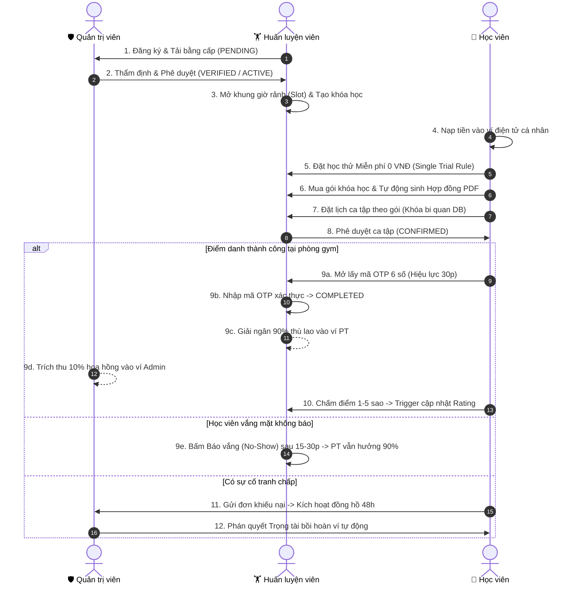

# PT-Connect - Nền tảng kết nối Huấn luyện viên cá nhân & Học viên thể hình

[](https://spring.io/projects/spring-boot)
[](https://react.dev/)
[](https://www.typescriptlang.org/)
[](https://www.mysql.com/)
[](https://www.docker.com/)

**PT-Connect** là nền tảng thương mại dịch vụ kết nối trực tuyến giữa **Học viên thể hình (Student)** có nhu cầu tập luyện cá nhân hóa và **Huấn luyện viên cá nhân (Personal Trainer - PT)**. Hệ thống giải quyết triệt để các bài toán nhức nhối trong vận hành thể hình truyền thống:
* 🛡️ **Bảo vệ dòng tiền minh bạch (Ký quỹ buổi tập)**: Tiền học phí được lưu giữ an toàn trên hệ thống. Nền tảng **không giải ngân toàn bộ một lần**, mà tự động chia sẻ doanh thu và mở khóa thù lao từng buổi (90% cho PT, 10% hoa hồng sàn) sau khi học viên xác nhận hoàn thành ca tập.
* 📜 **Hợp đồng điện tử PDF có giá trị cam kết**: Tự động sinh hợp đồng pháp lý có mã đối soát ngân quỹ ngay khi mua gói, cam kết cố định địa điểm tập luyện và thời hạn hợp đồng.
* ⏰ **Quy tắc Vàng đối soát Hủy lịch mốc 24 giờ**: Tự động phạt, đền bù và xử lý kho buổi học công bằng, văn minh dựa trên thời điểm hủy ca trước hay sát giờ tập.
* 🔐 **Điểm danh hai chiều bằng mã OTP linh hoạt (Tại phòng hoặc Tự tập tại nhà)**: Quyền sinh mã OTP 6 số ngẫu nhiên do Học viên nắm giữ độc quyền. Học viên và PT có thể đối soát trực tiếp hoặc trao đổi mã OTP qua Chatbox nội bộ của hệ thống sau khi buổi tập đạt yêu cầu. Cơ chế này loại bỏ hoàn toàn hành vi "chấm công khống" ăn chặn tiền của PT.
* ⚖️ **Trung tâm Phân xử Trọng tài với Quy chế 48 giờ**: Ban Quản Trị làm chủ tọa độc lập, bảo vệ quyền lợi đôi bên với điều khoản chống phán quyết độc đoán (phải chờ đối chứng 48 giờ) và cơ chế tự động thực thi 5 loại phán quyết bồi hoàn ví.
* 📋 **Giáo án luyện tập cá nhân hóa theo Hợp đồng**: PT biên soạn bài tập, sets, reps, khối lượng tạ và video kỹ thuật gắn liền với hợp đồng của từng học viên.

---

## 🧭 TÀI LIỆU NGHIỆP VỤ HỆ THỐNG CHI TIẾT (DOCUMENTATION)

Bộ tài liệu nghiệp vụ chi tiết đã được biên soạn và chuẩn hóa toàn diện theo từng chủ thể trong thư mục [`docs/`](docs/):

| Tài liệu | Đối tượng | Mô tả nội dung |
| :--- | :--- | :--- |
| 🌐 **[he_thong.md](he_thong.md)** (hoặc [docs/nghiepvu.md](docs/nghiepvu.md)) | **Toàn hệ thống** | Tổng hợp toàn bộ 14 chương nghiệp vụ: kiến trúc 3 vai trò, cơ chế dòng tiền 90/10, ma trận vòng đời thực thể, cơ chế khóa bi quan database và trigger rating tự động. |
| 🏃 **[student.md](student.md)** (hoặc [docs/student.md](docs/student.md)) | **Học viên (Student)** | Hành trình từ A-Z của học viên: Nạp/rút ví, học thử 0đ (`Single Trial Rule`), mua gói ký hợp đồng PDF, đặt lịch chống tranh chấp, hủy ca mốc 24h, điểm danh OTP, đánh giá sao, theo dõi giáo án và khiếu nại. |
| 🏋️ **[pt.md](pt.md)** (hoặc [docs/pt.md](docs/pt.md)) | **Huấn luyện viên (PT)** | Quy trình đăng ký chờ duyệt (`PENDING`), quản lý khóa học/khung giờ rảnh, duyệt ca, hủy ca, điểm danh OTP & báo vắng (No-Show), biên soạn giáo án, nhận 90% thù lao và phản biện 48h. |
| 🛡️ **[admin.md](admin.md)** (hoặc [docs/admin.md](docs/admin.md)) | **Quản trị viên (Admin)** | Quy trình thẩm định cấp phép PT, quản lý tài khoản & khóa người dùng vi phạm (`SUSPENDED`), Trung tâm Trọng tài 48 giờ với 5 phán quyết tự động, giám sát dòng tiền và trích thu 10% hoa hồng nền tảng. |
| 📜 **[QUY_TAC_HOAT_DONG_PT_STUDENT.md](QUY_TAC_HOAT_DONG_PT_STUDENT.md)** | **Quy chế sàn** | Quy chuẩn ứng xử, mốc thời gian đối soát 24h và các điều cấm kỵ (cấm giao dịch ngầm ngoài sàn, cấm gian lận OTP). |

---

## 💻 CÔNG NGHỆ SỬ DỤNG (TECH STACK)

| Thành phần | Công nghệ | Chi tiết kiến trúc |
| :--- | :--- | :--- |
| **Backend** | Java 17 / Spring Boot 3.3.4 | Spring Data JPA, Spring Security, JJWT, OpenPDF (xuất hợp đồng), Pessimistic Locking (`SELECT FOR UPDATE`), Transactional Rollback, RESTful API |
| **Frontend Chính** | **React 18 + Vite + TypeScript** | Tailwind CSS, Lucide Icons, Axios, kiến trúc SPA hiện đại (cổng `:3000` / `:5173`) |
| **Frontend Phân tích** | Python 3.11 / Streamlit 1.38 | Giao diện phân tích phụ trợ, biểu đồ Plotly & Pandas (cổng `:8501`) |
| **Database** | MySQL 8.0 | Bảng mã `utf8mb4_unicode_ci`, Ràng buộc toàn vẹn dữ liệu (CHECK, FK, UNIQUE), Triggers tính sao tự động, Views |
| **DevOps** | Docker & Docker Compose | Multi-stage build, container hóa toàn bộ dịch vụ, Healthcheck & Volume đồng bộ |

---

## 📂 CẤU TRÚC THƯ MỤC DỰ ÁN

```text
PT-Connect/
├── backend/                       # Mã nguồn Spring Boot REST API
│   ├── src/main/java/com/PTconnect/backend/
│   │   ├── controller/            # REST Controllers (Auth, Student, PT, Admin, Booking, Dispute, Chat...)
│   │   ├── service/               # Interface & Service Implementations xử lý nghiệp vụ
│   │   ├── entity/                # JPA Entities (User, PTProfile, Course, Enrollment, Booking, DisputeCase...)
│   │   ├── repository/            # Spring Data JPA Repositories (với Pessimistic Lock)
│   │   ├── dto/                   # Data Transfer Objects (Requests & Responses)
│   │   └── exception/             # Xử lý ngoại lệ tập trung (GlobalExceptionHandler)
│   ├── Dockerfile                 # Multi-stage build (Maven compile -> JRE 17 runtime)
│   └── pom.xml                    # Quản lý dependencies Java
├── frontend-react/                # Giao diện chính React + TypeScript (Vite)
│   ├── src/
│   │   ├── pages/                 # Giao diện vai trò: StudentPage, PtPage, AdminPage, LoginPage
│   │   ├── components/            # Components tái sử dụng (BookingTable, SlotCard, ReviewModal, ChatWidget...)
│   │   ├── lib/                   # API client (Axios), helpers, auth utils
│   │   └── types/                 # TypeScript interfaces đồng bộ với DTO backend
│   ├── package.json               # Dependencies Node.js
│   └── vite.config.ts             # Cấu hình Vite dev server
├── frontend/                      # Giao diện phụ trợ Streamlit & Phân tích Python
├── database/                      # Cơ sở dữ liệu MySQL
│   ├── init.sql                   # Khởi tạo Schema DDL, bảng, khóa ngoại, chỉ mục
│   ├── trigger.sql                # Trigger tự động tính rating trung bình và tổng review
│   └── seed_demo.sql              # Dữ liệu mẫu demo đã sinh sẵn chuẩn tiếng Việt
├── docs/                          # Kho tài liệu nghiệp vụ chi tiết
│   ├── nghiepvu.md                # Tài liệu tổng thể toàn bộ nghiệp vụ hệ thống
│   ├── student.md                 # Nghiệp vụ chi tiết dành cho Học viên
│   ├── pt.md                      # Nghiệp vụ chi tiết dành cho Huấn luyện viên
│   ├── admin.md                   # Nghiệp vụ chi tiết dành cho Quản trị viên & Trọng tài
│   └── BACKEND_STUDY_GUIDE.md     # Hướng dẫn ôn tập kiến trúc Backend
├── docker-compose.yml             # Điều phối các container Docker
├── run_backend.bat                # Script chạy nhanh Backend Spring Boot cục bộ
├── run_frontend.bat               # Script chạy nhanh Frontend React Vite cục bộ
├── start_all.bat                  # Script khởi động đồng thời cả Backend & Frontend
└── README.md                      # Hướng dẫn vận hành dự án
```

---

## ⚡ HƯỚNG DẪN KHỞI CHẠY HỆ THỐNG

Bạn có thể lựa chọn 1 trong 2 phương pháp khởi chạy dưới đây tùy vào môi trường máy tính của mình:

### CÁCH 1: Khởi chạy nhanh bằng Batch Script (Khuyên dùng khi Dev trên Windows)

1. **Khởi động Cơ sở dữ liệu MySQL**:
   * Khởi động dịch vụ MySQL trên máy (cổng `3306` hoặc `3307`).
   * Chạy script thiết lập database nếu cần: `setup_database.bat` hoặc import file `database/init.sql` và `database/trigger.sql`.
2. **Khởi chạy cả Backend & Frontend cùng lúc**:
   * Nhấp đúp chuột vào file **`start_all.bat`** tại thư mục gốc.
   * Hệ thống sẽ tự động mở 2 cửa sổ console riêng biệt:
     - 🚀 **Backend Spring Boot**: Khởi chạy trên cổng `http://localhost:8080`.
     - 💻 **Frontend React Vite**: Khởi chạy trên cổng `http://localhost:3000` (hoặc `http://localhost:5173`).
3. Mở trình duyệt và truy cập vào giao diện web tại **`http://localhost:3000`**.

---

### CÁCH 2: Khởi chạy khép kín bằng Docker & Docker Compose

Dự án đã được container hóa 100%. Bạn không cần cài trước Java, Maven hay Python:

1. **Khởi động Docker Desktop** trên máy tính (đảm bảo biểu tượng hiển thị *Engine running*).
2. Mở Terminal / PowerShell tại thư mục dự án và chạy:
   ```bash
   docker compose up -d --build
   ```
3. Kiểm tra trạng thái các container đang chạy:
   ```bash
   docker compose ps
   ```
4. **Cổng truy cập các dịch vụ trong Docker**:
   * **Backend Spring Boot API**: `http://localhost:8080`
   * **Giao diện Web Streamlit**: `http://localhost:8501`
   * **MySQL Database**: `localhost:3307` (Tài khoản: `root` / `root123` hoặc `ptuser` / `ptpassword`)

---

## 🔑 TÀI KHOẢN KIỂM THỬ MẪU (DEMO CREDENTIALS)

Hệ thống đã tạo sẵn các tài khoản demo đầy đủ dữ liệu để kiểm thử toàn diện mọi luồng nghiệp vụ:

> 🔐 **Mật khẩu dùng chung cho tất cả tài khoản mẫu:** **`Password123@`**

| Vai trò | Email đăng nhập | Tên hiển thị | Tính năng kiểm thử trọng tâm |
| :--- | :--- | :--- | :--- |
| 🛡️ **Quản trị viên** | `admin@ptconnect.vn` | Quản Trị Viên Hệ Thống | Duyệt hồ sơ PT chờ duyệt, phân xử trọng tài 48h, theo dõi doanh thu sàn & trích thu 10% hoa hồng, khóa tài khoản vi phạm. |
| 🏋️ **Huấn luyện viên** | `pt.hoangc@ptconnect.vn` | Lê Hoàng Cường | PT đã duyệt (`VERIFIED`), mở khung giờ rảnh, duyệt ca tập, nhập OTP điểm danh, báo vắng No-Show, soạn giáo án cá nhân hóa. |
| ⏳ **Huấn luyện viên** | `pt.hoangnam@ptconnect.vn` | Vũ Hoàng Nam | PT đang ở trạng thái chờ duyệt (`PENDING`), dùng để test luồng Admin thẩm định bằng cấp và duyệt hồ sơ. |
| 🏃 **Học viên** | `student.a@ptconnect.vn` | Nguyễn Văn A | Học viên đã có số dư ví, hợp đồng PDF, lịch tập; test đặt lịch, hủy lịch đối soát 24h, mở mã OTP điểm danh, đánh giá sao, khiếu nại. |

---

## 🔄 QUY TRÌNH NGHIỆP VỤ CHUẨN CỦA HỆ THỐNG (12 BƯỚC HOÀN CHỈNH)

Dưới đây là luồng vận hành thực tế đã được chuẩn hóa và triển khai chính xác trong mã nguồn Backend và Frontend:



### Chi tiết 12 bước vận hành nghiệp vụ:

1. **Đăng ký & Thẩm định Hồ sơ Huấn luyện viên**:
   * PT đăng ký tài khoản với bằng cấp, chứng chỉ thể hình, số năm kinh nghiệm và khu vực nhận dạy. Hồ sơ khởi tạo ở trạng thái `PENDING`.
   * Admin kiểm tra tính xác thực của chứng chỉ chuyên môn và thực hiện duyệt (`APPROVE` $\rightarrow$ tài khoản `ACTIVE`, hồ sơ `VERIFIED`). PT chính thức xuất hiện trên sàn.
2. **Thiết lập Khung giờ rảnh & Danh mục Gói tập**:
   * PT mở các khung giờ rảnh trong tuần (`AvailabilitySlot`). Hệ thống kiểm tra chống chồng lấn thời gian.
   * PT tạo các gói khóa học (số buổi, học phí, thời hạn). **Ràng buộc an toàn**: Khóa học đã có học viên đăng ký hợp đồng thì **nghiêm cấm xóa cứng**, chỉ được phép chuyển sang `INACTIVE`.
3. **Tìm kiếm Huấn luyện viên & Đăng ký Học thử (`Single Trial Rule`)**:
   * Học viên tìm kiếm PT theo khu vực quận huyện, chuyên môn thể hình và điểm sao đánh giá.
   * Học viên có thể đặt lịch học thử miễn phí (`sessionFee = 0 VNĐ`). Áp dụng quy tắc: **Mỗi học viên chỉ được học thử tối đa 1 lần duy nhất với mỗi PT**.
4. **Nạp tiền Ví & Mua Khóa học**:
   * Học viên nạp tiền vào ví điện tử cá nhân (`PaymentType.TOPUP`).
   * Học viên chọn gói tập và thực hiện thanh toán. **Điều kiện kiểm tra**:
     - Số dư khả dụng $\ge Giá\_khóa\_học$.
     - **Chống mua chồng gói**: Không được mua cùng gói khi hợp đồng cũ vẫn còn buổi tập chưa học xong (`remainingSessions > 0`).
     - **Cam kết địa điểm tập cố định**: Học viên bắt buộc chọn địa điểm tập cụ thể để in vào hợp đồng pháp lý, tránh tranh chấp phát sinh chi phí di chuyển.
5. **Ký kết Hợp đồng điện tử PDF tự động**:
   * Giao dịch mua gói thành công tự động sinh một bản Hợp đồng điện tử PDF chuẩn pháp lý có mã đối soát ngân quỹ (`transactionRef`).
   * Hệ thống khởi tạo kho buổi tập khả dụng (`remainingSessions = totalSessions`) và tính thời hạn hợp đồng ($endDate = startDate + validityDays$). Cả hai bên có thể tải và xem PDF bất kỳ lúc nào.
6. **Đặt Lịch tập theo Gói với Cơ chế Khóa bi quan (`Pessimistic Locking`)**:
   * Học viên chọn khung giờ rảnh của PT để đặt lịch tập theo gói (`BookingType.PACKAGE`).
   * Câu lệnh SQL áp dụng `SELECT ... FOR UPDATE` khóa chặt dòng dữ liệu khung giờ, triệt tiêu hoàn toàn lỗi Race Condition khi nhiều người cùng bấm một lúc.
   * Hệ thống tự động **tạm trừ 1 buổi tập** trong kho hợp đồng ($remaining\_sessions = remaining\_sessions - 1$). Ca tập được tạo ở trạng thái `PENDING`.
7. **Phê duyệt hoặc Từ chối Ca tập**:
   * PT chấp thuận (`APPROVE`) $\rightarrow$ ca chuyển sang `CONFIRMED`.
   * Nếu PT bận việc đột xuất và từ chối (`REJECT`) $\rightarrow$ ca chuyển sang `CANCELLED`, khung giờ trả về `AVAILABLE`, kho buổi học của học viên được **hoàn trả ngay 1 buổi**, không áp dụng phạt tiền đôi bên.
8. **Quy tắc Vàng đối soát Hủy lịch mốc 24 giờ**:
   * Áp dụng công thức đối soát tự động: $\Delta t = \text{Giờ bắt đầu ca} - \text{Thời điểm bấm Hủy}$.
   * **Học viên hủy $\ge 24h$**: Được hoàn 1 buổi vào hợp đồng; bị phạt 50% tiền buổi học từ ví để đền bù tổn thất cho PT.
   * **Học viên hủy $< 24h$ (sát giờ)**: Bị mất buổi tập; 100% tiền buổi học được giải ngân thanh toán cho PT (sàn trích 10% phí).
   * **PT hủy sát giờ $< 24h$**: Học viên nhận lại 1 buổi tập + nhận thêm **100% tiền buổi học đền bù** vào ví; PT bị hệ thống **phạt trừ trực tiếp 100% tiền buổi học** từ ví.
9. **Quy chuẩn Điểm danh hai chiều qua OTP & Nghiệp vụ No-Show**:
   * **Quyền kiểm soát thuộc về Học viên**: Hệ thống trao độc quyền tạo mã OTP cho học viên trong khung giờ vàng (trước tối đa 15 phút so với giờ bắt đầu ca tập, mã ngẫu nhiên 6 số, hiệu lực 30 phút).
   * **Linh hoạt hình thức tập luyện (Tại phòng gym hoặc Tự tập tại nhà)**:
     - *Tập trực tiếp tại phòng gym / tại nhà*: Học viên đọc trực tiếp mã OTP cho PT nhập xác thực khi gặp mặt.
     - *Tự tập tại nhà có PT kèm cặp online/từ xa*: Sau khi hoàn thành bài tập theo giáo án dưới sự hướng dẫn của PT, học viên có thể gửi mã OTP cho PT qua **Chatbox nội bộ 1-1** tích hợp trên sàn để PT nhập đối soát.
   * **Triệt tiêu gian lận chấm công khống**: PT không bao giờ có thể tự ý bấm hoàn thành ca tập để rút tiền nếu học viên không chủ động cấp mã OTP.
   * Khi PT nhập mã khớp:
     - Ca tập chuyển trạng thái sang `COMPLETED`.
     - Hệ thống **tự động giải ngân 90% thù lao** vào ví của PT.
     - Hệ thống **tự động trích thu 10% hoa hồng sàn** vào Ví Doanh Thu của Admin.
   * **Học viên vắng mặt (No-Show)**: Nếu quá 15-30 phút học viên không đến và không xin dời lịch, PT bấm `Đánh dấu vắng mặt (ABSENT)` kèm giải trình $\rightarrow$ Ca chuyển `COMPLETED`, học viên bị mất buổi tập, PT vẫn nhận đủ 90% thù lao buổi dạy để bù đắp thời gian chờ đợi.
10. **Đánh giá Sao & Kích hoạt Database Trigger tự động**:
    * Học viên chỉ được đánh giá các ca tập đã `COMPLETED` (mỗi ca tập chỉ được đánh giá đúng 1 lần duy nhất).
    * Khi học viên gửi điểm (1 đến 5 sao) và nhận xét, **MySQL Trigger** lập tức tự động tính toán lại điểm trung bình cộng (`average_rating`) và tổng số đánh giá (`total_reviews`) trên hồ sơ PT.
11. **Giáo án luyện tập cá nhân hóa theo Hợp đồng (`WorkoutPlan`)**:
    * PT thiết kế giáo án gắn chặt với mã hợp đồng của học viên.
    * Thêm chi tiết từng bài tập: nhóm cơ tác động, số sets, số reps, mức tạ gợi ý, thời gian nghỉ và video clip kỹ thuật thị phạm chuẩn form động tác.
12. **Trung tâm Phân xử Trọng tài & Cơ chế Bảo vệ 48 giờ**:
    * Khi phát sinh tranh chấp hoặc yêu cầu thanh lý hợp đồng, các bên gửi đơn khiếu nại lên Ban Quản Trị.
    * **Quy chế 48 giờ chống độc đoán**: Admin bị hệ thống chặn quyền phán quyết trong 48h đầu nếu bên bị khiếu nại chưa gửi bản phản biện đối chứng (`counter_statement`).
    * Admin có quyền gửi trát yêu cầu bổ sung bằng chứng (`Request Evidence`).
    * **Thực thi 5 loại Phán quyết trọng tài tự động**:
      - `REFUND_STUDENT`: Hoàn 100% tiền buổi vào ví học viên, khôi phục 1 buổi vào hợp đồng, cảnh cáo PT.
      - `PAID_PT`: Giải ngân 90% thù lao cho PT, khấu trừ buổi học của học viên.
      - `RESOLVED_FORCE_MAJEURE`: Sự cố bất khả kháng, khôi phục buổi tập cho học viên, không phạt tiền đôi bên.
      - `CANCEL_CONTRACT_REFUND_STUDENT`: Hủy hợp đồng, hoàn tiền các buổi chưa học vào ví học viên, tự động hủy các ca tập tương lai.
      - `CANCEL_CONTRACT_PAID_PT`: Hủy hợp đồng, quyết toán toàn bộ số tiền các buổi còn lại chi trả cho PT khi học viên bỏ tập dài ngày hoặc vi phạm nghiêm trọng.

---

## 🛠️ CÁC LỆNH VẬN HÀNH & NẠP DỮ LIỆU DEMO

### 1. Nạp dữ liệu mẫu Demo (Seed Demo Data)
Dữ liệu mẫu demo đã được chuẩn hóa font tiếng Việt có dấu và mã hóa BCrypt an toàn:
```bash
# Nạp trực tiếp vào container MySQL:
docker cp database/seed_demo.sql ptconnect-mysql:/tmp/seed_demo.sql
docker exec ptconnect-mysql mysql -uroot -proot123 --default-character-set=utf8mb4 ptconnect -e "source /tmp/seed_demo.sql;"
```

### 2. Quản lý Docker Containers
```bash
# Xem log toàn bộ hệ thống theo thời gian thực:
docker compose logs -f

# Xem riêng log Backend Spring Boot:
docker compose logs -f backend

# Tắt và dọn dẹp hệ thống:
docker compose down

# Xóa sạch dữ liệu và khởi động lại từ đầu:
docker compose down -v
docker compose up -d --build
```

---

## 📞 HỖ TRỢ & BẢN QUYỀN

* **Dự án:** PT-Connect - Hệ thống Quản trị & Kết nối Huấn luyện viên Thể hình Cá nhân
* **Môn học:** Bài tập lớn Lập trình Java / Công nghệ Phần mềm
* **Phiên bản:** 2.0 (Đồng bộ hóa 100% giữa Spring Boot 3.3.4, React Vite và MySQL 8.0)