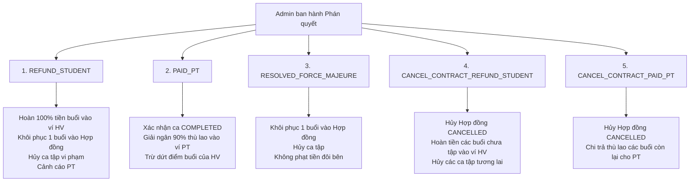

# 🛡️ TÀI LIỆU NGHIỆP VỤ CHI TIẾT DÀNH CHO QUẢN TRỊ VIÊN (ADMIN)
> **Hệ thống:** Nền tảng kết nối Huấn luyện viên cá nhân & Học viên (PT-Connect)  
> **Vai trò:** Quản trị viên hệ thống & Chủ tọa Hội đồng Trọng tài (System Administrator & Arbitration Council)  
> **Mục tiêu tài liệu:** Cung cấp tài liệu nghiệp vụ chi tiết, đầy đủ 100% về toàn bộ quy trình thẩm định hồ sơ HLV, quản lý người dùng, cơ chế phân xử tranh chấp 48 giờ, giám sát dòng tiền toàn sàn, trích thu hoa hồng 10% và phân tích dữ liệu vận hành.

---

## 📌 MỤC LỤC

1. [Tổng quan vai trò Quản trị viên & Trách nhiệm vận hành sàn](#1-tổng-quan-vai-trò-quản-trị-viên--trách-nhiệm-vận-hành-sàn)
2. [Nghiệp vụ Thẩm định & Phê duyệt Hồ sơ Năng lực PT (PT Verification)](#2-nghiệp-vụ-thẩm-định--phê-duyệt-hồ-sơ-năng-lực-pt)
3. [Nghiệp vụ Quản lý Người dùng & Cơ chế Khóa tài khoản (User Management)](#3-nghiệp-vụ-quản-lý-người-dùng--cơ-chế-khóa-tài-khoản)
4. [Trung tâm Phân xử Trọng tài & Quy chế Chống phán quyết độc đoán 48 giờ](#4-trung-tâm-phân-xử-trọng-tài--quy-chế-chống-phán-quyết-độc-đoán-48-giờ)
5. [Chi tiết 5 Loại Phán quyết Trọng tài & Cơ chế Thực thi Giao dịch tự động](#5-chi-tiết-5-loại-phán-quyết-trọng-tài--cơ-chế-thực-thi-giao-dịch-tự-động)
6. [Nghiệp vụ Hủy ca tập do Sự cố Bất khả kháng (Admin Force Majeure Override)](#6-nghiệp-vụ-hủy-ca-tập-do-sự-cố-bất-khả-kháng)
7. [Giám sát Dòng tiền Toàn sàn & Quỹ Doanh thu Hoa hồng 10% (Financial Oversight)](#7-giám-sát-dòng-tiền-toàn-sàn--quỹ-doanh-thu-hoa-hồng-10)
8. [Bảng điều khiển Phân tích Vận hành & Giám sát Tỷ lệ Hủy ca (Analytics Dashboard)](#8-bảng-điều-khiển-phân-tích-vận-hành--giám-sát-tỷ-lệ-hủy-ca)
9. [Bảo mật Dữ liệu, Kiểm toán Toàn vẹn & Chống gian lận (Security & Audit)](#9-bảo-mật-dữ-liệu-kiểm-toán-toàn-vẹn--chống-gian-lận)

---

## 1. TỔNG QUAN VAI TRÒ QUẢN TRỊ VIÊN & TRÁCH NHIỆM VẬN HÀNH SÀN

### 1.1. Vị thế và Thẩm quyền Tối cao của Quản trị viên
Trong hệ sinh thái PT-Connect, Quản trị viên (`ADMIN`) đóng vai trò là "Nhà điều phối thị trường", "Cơ quan bảo an" và "Hội đồng Trọng tài độc lập". Khác với các mô hình sàn mở không kiểm soát, Admin tại PT-Connect chịu trách nhiệm:
1. **Kiểm soát chất lượng đầu vào**: Thẩm định bằng cấp, chứng chỉ nghề nghiệp của Huấn luyện viên trước khi cho phép xuất hiện trên sàn.
2. **Bảo vệ tính toàn vẹn của dòng tiền**: Giám sát ví ký quỹ, lưu giữ tiền khóa học an toàn, giải ngân thù lao từng buổi chính xác theo tỷ lệ 90/10.
3. **Chủ tọa phân xử tranh chấp công bằng**: Thụ lý và ban hành phán quyết đối với các khiếu nại phát sinh giữa Học viên và Huấn luyện viên, loại bỏ tình trạng phán quyết độc đoán nhờ quy chế bảo vệ 48 giờ.
4. **Giữ gìn kỷ cương nền tảng**: Xử lý nghiêm minh các hành vi vi phạm đạo đức, gian lận điểm danh OTP, bùng lịch hàng loạt bằng chế tài khóa tài khoản (`SUSPENDED`).

### 1.2. Sơ đồ Luồng Trách nhiệm của Admin (Admin Responsibilities Workflow)

```mermaid
flowchart TD
    subgraph KiemDuyet [1. Kiểm duyệt & Cấp phép]
        A[PT Đăng ký mới PENDING] --> B{Admin thẩm định bằng cấp}
        B -->|Hợp lệ| C[Duyệt APPROVE: User ACTIVE / PT VERIFIED]
        B -->|Gian lận/Thiếu| D[Từ chối REJECT: User SUSPENDED / PT REJECTED]
    end

    subgraph PhanXu [2. Hội đồng Trọng tài 48 Giờ]
        E[Khiếu nại phát sinh] --> F[Kích hoạt đồng hồ đếm ngược 48h]
        F --> G{Bị đơn gửi phản biện / Hết 48h?}
        G -->|Đủ điều kiện| H[Admin ban hành 1 trong 5 Phán quyết]
        H --> I[Hệ thống tự động thực thi bồi hoàn & Trừ tiền ví]
    end

    subgraph TaiChinh [3. Giám sát Tài chính & Hoa hồng]
        J[Buổi học hoàn tất OTP] --> K[Trích 10% hoa hồng chuyển Ví Doanh Thu Admin]
        L[Theo dõi Nạp/Rút/Doanh thu toàn sàn] --> M[Đối soát mã TXN với Ngân hàng]
    end

    subgraph GiamSat [4. Điều tra & Kỷ luật]
        N[Phân tích tỷ lệ hủy ca] --> O{Phát hiện bất thường}
        O -->|Vi phạm| P[Đổi trạng thái User sang SUSPENDED]
    end
```

---

## 2. NGHIỆP VỤ THẨM ĐỊNH & PHÊ DUYỆT HỒ SƠ NĂNG LỰC PT (PT VERIFICATION)

Để đảm bảo học viên được hướng dẫn bởi những huấn luyện viên có trình độ thật và bằng cấp thật, mọi tài khoản PT đăng ký mới đều phải qua khâu thẩm duyệt của Admin.

### 2.1. Tiếp nhận Danh sách PT chờ duyệt (`PENDING`)
* Admin truy cập màn hình **"Quản lý Huấn luyện viên"** $\rightarrow$ chọn tab **"Chờ xét duyệt"**.
* Hệ thống hiển thị danh sách các PT có hồ sơ ở trạng thái `VerificationStatus.PENDING`.
* Thông tin hồ sơ hiển thị đầy đủ:
  * Họ tên, Email, Số điện thoại của PT.
  * Tiểu sử giới thiệu năng lực (Bio).
  * Số năm kinh nghiệm làm việc thực tế.
  * Danh sách các quận huyện, phòng tập nhận dạy.
  * Chính sách phụ thu di chuyển.
  * Đường dẫn xem bằng cấp, chứng chỉ thể hình (`certificateUrl`).

### 2.2. Quy trình Thẩm định Chuyên môn
Admin kiểm tra tính hợp pháp của hồ sơ:
1. **Kiểm tra chứng chỉ bằng cấp**: Bằng cấp có phải do các tổ chức uy tín cấp hay không (ví dụ: NASM, ACE, ISSA, Bằng Cử nhân TDTT, Chứng nhận HLV Thể hình Quốc gia...).
2. **Kiểm tra kinh nghiệm và khu vực**: Đánh giá sự trung thực và hợp lý của địa điểm dạy.

### 2.3. Ban hành Quyết định Phê duyệt / Từ chối
* **Trường hợp Phê duyệt (`APPROVE`)**:
  * Admin nhấn nút **"Phê duyệt hồ sơ"**.
  * **Hệ thống tự động cập nhật**:
    * Trạng thái hồ sơ PT: `PTProfile.status = VERIFIED`.
    * Trạng thái tài khoản người dùng: `User.status = ACTIVE`.
  * **Hiệu lực**: PT ngay lập tức xuất hiện công khai trên giao diện "Khám Phá PT" của học viên, được phép tạo gói khóa học và mở khung giờ rảnh đón học viên.
* **Trường hợp Từ chối (`REJECT`)**:
  * Áp dụng khi phát hiện bằng cấp giả mạo, thông tin sai lệch hoặc không đạt chuẩn.
  * Admin nhấn nút **"Từ chối hồ sơ"** kèm lý do giải trình.
  * **Hệ thống tự động cập nhật**:
    * Trạng thái hồ sơ PT: `PTProfile.status = REJECTED`.
    * Trạng thái tài khoản người dùng: `User.status = SUSPENDED`.
  * **Hiệu lực**: Tài khoản bị khóa, vĩnh viễn không hiển thị trên sàn.

---

## 3. NGHIỆP VỤ QUẢN LÝ NGƯỜI DÙNG & CƠ CHẾ KHÓA TÀI KHOẢN (USER MANAGEMENT)

Admin sở hữu quyền kiểm soát danh tính và trạng thái tài khoản của toàn bộ các chủ thể trong hệ thống.

### 3.1. Tra cứu & Phân loại Danh sách Người dùng
* Admin có màn hình chuyên biệt tra cứu danh sách toàn bộ người dùng (`User`).
* **Bộ lọc và Tìm kiếm**:
  * Lọc theo Vai trò (`Role`): `STUDENT`, `PT`, `ADMIN`.
  * Lọc theo Trạng thái (`UserStatus`): `ACTIVE` (Đang hoạt động), `PENDING` (Chờ duyệt), `SUSPENDED` (Bị khóa/đình chỉ).
  * Tìm kiếm theo từ khóa: Họ tên, Email, Số điện thoại.
* Hiển thị chi tiết ngày khởi tạo, số dư ví hiện tại và lịch sử hoạt động.

### 3.2. Cơ chế Khóa tài khoản Vi phạm (`Update User Status -> SUSPENDED`)
Khi phát hiện người dùng có hành vi vi phạm nghiêm trọng (gian lận điểm danh OTP, bùng lịch hàng loạt, có lời lẽ xúc phạm danh dự, nhận phán quyết thua kiện từ trọng tài):
* Admin thực hiện cập nhật trạng thái người dùng sang **`SUSPENDED`**.
* **Hệ quả của trạng thái `SUSPENDED`**:
  * Chặn tức thì quyền đăng nhập ở lần tiếp theo.
  * Toàn bộ các giao dịch đặt lịch, mở slot, mua gói, nạp rút tiền của người dùng đó lập tức bị đóng băng.
  * Nếu là PT: Hồ sơ tự động bị ẩn khỏi giao diện tìm kiếm của học viên.
* **Mở khóa tài khoản (`ACTIVE`)**: Sau khi người dùng đã chấp hành xong thời hạn phạt hoặc nộp phạt bồi thường đầy đủ, Admin có quyền đổi trạng thái lại thành `ACTIVE` để phục hồi quyền truy cập.

---

## 4. TRUNG TÂM PHÂN XỬ TRỌNG TÀI & QUY CHẾ CHỐNG PHÁN QUYẾT ĐỘC ĐOÁN 48 GIỜ

PT-Connect xây dựng Trung tâm Phân xử Trọng tài (Arbitration Dispute Center) do Ban Quản Trị làm chủ tọa nhằm giải quyết dứt điểm các tranh chấp giữa PT và Học viên.

### 4.1. Quy chế Chống phán quyết Độc đoán (48-Hour Anti-Arbitrary Clause)
Để đảm bảo tính khách quan và dân chủ tuyệt đối, ngăn ngừa việc Admin thiên vị hoặc đưa ra phán quyết vội vàng khi mới chỉ nghe một bên trình bày:
* **Đồng hồ đếm ngược 48 giờ**:
  * Khi Học viên hoặc PT tạo đơn khiếu nại (`DisputeCase`), hệ thống tự động kích hoạt mốc thời hạn 48 giờ đối với bên bị khiếu nại (Bị đơn) để nộp bản phản biện đối chứng (`counter_statement`).
* **Hạn chế Thẩm quyền của Admin trong 48 giờ đầu**:
  * Trong vòng **48 giờ** kể từ thời điểm tạo vụ việc, nếu bên bị khiếu nại **chưa gửi bản phản biện**, hệ thống **chặn tuyệt đối quyền ban hành phán quyết của Admin**.
  * Admin **chỉ được phép phân xử** khi thỏa mãn một trong các điều kiện sau:
    1. Bên bị khiếu nại đã gửi thành công bản phản biện đối chứng; **HOẶC**
    2. Đã quá thời hạn 48 giờ mà bên bị khiếu nại vẫn im lặng bỏ quyền phản biện; **HOẶC**
    3. Admin sử dụng quyền ghi đè khẩn cấp có giải trình đặc biệt (Bypass 48h Emergency Clause).

### 4.2. Thẩm quyền Yêu cầu Bổ sung Bằng chứng (Additional Evidence Request)
Trong quá trình thụ lý hồ sơ tranh chấp, nếu chứng cứ hiện tại chưa đủ rõ ràng:
* Admin có quyền gửi trát yêu cầu bổ sung bằng chứng (`Request Evidence`) chỉ định tới:
  * Học viên (`STUDENT`), hoặc
  * Huấn luyện viên (`PT`), hoặc
  * Cả hai bên (`BOTH`).
* Hệ thống chuyển trạng thái vụ việc sang **`AWAITING_ADDITIONAL_EVIDENCE`**.
* Hai bên có thể tải lên hình ảnh biên bản làm việc của ban quản lý phòng gym, ảnh chụp camera đối chiếu thời gian, hoặc sao kê cuộc gọi để làm căn cứ phán quyết.

---

## 5. CHI TIẾT 5 LOẠI PHÁN QUYẾT TRỌNG TÀI & CƠ CHẾ THỰC THI GIAO DỊCH TỰ ĐỘNG

Khi Admin đưa ra phán quyết, hệ thống tự động chạy các giao dịch tài chính (`@Transactional`) trên ví để giải quyết dứt điểm vụ việc mà không cần thao tác thủ công.

### 5.1. Phán quyết 1: Xử thắng cho Học viên (`REFUND_STUDENT`)
* **Trường hợp áp dụng**: PT vắng mặt không báo trước (No-Show), PT đến muộn quá 15 phút, ép điểm danh sai quy trình, hoặc có hành vi quấy rối, thiếu tôn trọng học viên.
* **Cơ chế thực thi tự động**:
  1. Ca tập chuyển trạng thái sang `CANCELLED`.
  2. Hệ thống hoàn trả **100% giá trị buổi học** ($sessionFee$) vào ví của học viên (`PaymentType.COMPENSATION`, mã `TXN_COMP_...`).
  3. Hệ thống **khôi phục lại 1 buổi tập** vào kho hợp đồng của học viên ($remaining\_sessions = remaining\_sessions + 1$).
  4. Trạng thái vụ việc chuyển thành `RESOLVED_REFUND_STUDENT`.
  5. Admin ghi nhận cảnh cáo vào hồ sơ PT.

### 5.2. Phán quyết 2: Xử thắng cho Huấn luyện viên (`PAID_PT`)
* **Trường hợp áp dụng**: Học viên khiếu nại vô căn cứ, vu khống PT; PT đã chứng minh có mặt đúng giờ và thực hiện đầy đủ nghĩa vụ; hoặc học viên cố tình không xác nhận OTP sau khi đã tập xong.
* **Cơ chế thực thi tự động**:
  1. Ca tập được xác nhận hợp lệ và chuyển trạng thái sang **`COMPLETED`**.
  2. Hệ thống kích hoạt giải ngân thù lao buổi dạy: chuyển **90% thù lao** vào ví của PT (`PaymentType.EARNING`).
  3. Trích 10% hoa hồng vào Ví Doanh Thu Admin.
  4. Kho buổi tập của học viên bị khấu trừ dứt điểm (không hoàn lại).
  5. Trạng thái vụ việc chuyển thành `RESOLVED_PAID_PT`.

### 5.3. Phán quyết 3: Hòa giải Sự cố Bất khả kháng (`RESOLVED_FORCE_MAJEURE`)
* **Trường hợp áp dụng**: Cả hai bên đều gặp sự cố khách quan xác minh hợp lệ (phòng gym đột xuất đóng cửa sửa chữa, ngập lụt, thiên tai, sự cố y tế đột xuất có xác nhận).
* **Cơ chế thực thi tự động**:
  1. Ca tập chuyển trạng thái sang `CANCELLED`. Khung giờ giải phóng về `AVAILABLE`.
  2. Hệ thống khôi phục lại 1 buổi tập vào hợp đồng cho học viên ($remaining\_sessions = remaining\_sessions + 1$).
  3. **Không áp dụng bất kỳ khoản phạt hay đền bù tiền** nào đối với cả hai bên.
  4. Trạng thái vụ việc chuyển thành `RESOLVED_FORCE_MAJEURE`.

### 5.4. Phán quyết 4: Thanh lý Toàn bộ Hợp đồng - Hoàn tiền Học viên (`CANCEL_CONTRACT_REFUND_STUDENT`)
* **Trường hợp áp dụng**: PT vi phạm cam kết nghiêm trọng, liên tục không xếp được lịch dạy làm trôi hạn hợp đồng, hoặc học viên gặp chấn thương nặng không thể tiếp tục tập thể hình dài hạn (có hồ sơ bệnh viện).
* **Cơ chế thực thi tự động**:
  1. Hợp đồng (`Enrollment`) chính thức chuyển trạng thái sang **`CANCELLED`**.
  2. Hệ thống tự động tính toán số tiền hoàn trả cho học viên theo tỷ lệ các buổi chưa học:  
     $$Tiền\_hoàn = Giá\_gói\_hợp\_đồng \times \frac{Số\_buổi\_chưa\_tập}{Tổng\_số\_buổi}$$
  3. Số tiền hoàn được cộng trực tiếp vào ví của học viên (`PaymentType.COMPENSATION`).
  4. Hệ thống **tự động hủy bỏ toàn bộ các ca tập trong tương lai** thuộc hợp đồng này đang ở trạng thái `PENDING` hoặc `CONFIRMED` để giải phóng lịch cho cả đôi bên.
  5. Trạng thái vụ việc chuyển thành `RESOLVED_CONTRACT_TERMINATION`.

### 5.5. Phán quyết 5: Thanh lý Toàn bộ Hợp đồng - Thanh toán thù lao PT (`CANCEL_CONTRACT_PAID_PT`)
* **Trường hợp áp dụng**: Học viên vi phạm kỷ luật nghiêm trọng, có hành vi bạo lực/quấy rối PT, hoặc học viên bùng lịch bỏ tập kéo dài và mất liên lạc hoàn toàn quá 14 ngày (Ghosting) khiến PT bị giam giữ lịch dạy vô thời hạn.
* **Cơ chế thực thi tự động**:
  1. Hợp đồng (`Enrollment`) chuyển trạng thái sang **`CANCELLED`**.
  2. Hệ thống tính toán toàn bộ giá trị các buổi còn lại chưa tập trong hợp đồng:  
     $$Tiền\_quyết\_toán = Giá\_gói\_hợp\_đồng \times \frac{Số\_buổi\_chưa\_tập}{Tổng\_số\_buổi}$$
  3. Hệ thống giải ngân toàn bộ số tiền này vào ví của Huấn luyện viên (`PaymentType.EARNING`) để bảo vệ công sức và thời gian người lao động đã cam kết.
  4. Hủy toàn bộ các ca tập tương lai thuộc hợp đồng này.
  5. Trạng thái vụ việc chuyển thành `RESOLVED_CONTRACT_TERMINATION`.

---

## 6. NGHIỆP VỤ HỦY CA TẬP DO SỰ CỐ BẤT KHẢ KHÁNG (ADMIN FORCE MAJEURE OVERRIDE)

Ngoài quy trình hòa giải tranh chấp, Admin có quyền can thiệp trực tiếp để hủy một ca tập đang tồn tại nếu nhận được thông báo sự cố khẩn cấp:
* **Thao tác**: Admin vào danh sách ca tập $\rightarrow$ chọn ca cần can thiệp $\rightarrow$ chọn lý do "Bất khả kháng" (Force Majeure).
* **Quy tắc thực thi**:
  * Ca tập chuyển sang `CANCELLED`.
  * Khôi phục 1 buổi tập vào kho hợp đồng của học viên.
  * Khung giờ rảnh được trả về `AVAILABLE`.
  * Không phạt tiền hay đền bù đối với cả học viên lẫn PT.

---

## 7. GIÁM SÁT DÒNG TIỀN TOÀN SÀN & QUỸ DOANH THU HOA HỒNG 10% (FINANCIAL OVERSIGHT)

Hệ thống cung cấp màn hình quản trị tài chính chuyên sâu giúp Admin giám sát từng biến động của dòng tiền lưu chuyển trên sàn.

### 7.1. Bảng Tổng hợp Chỉ số Tài chính Toàn diện
Admin theo dõi 4 luồng tiền cốt lõi:
1. **Tổng tiền Nạp vào hệ thống (`TOPUP`)**: Toàn bộ số tiền học viên đã nạp vào ví thành công.
2. **Tổng doanh thu Bán khóa học (`PURCHASE_PACKAGE`)**: Tổng giá trị các hợp đồng đã được thanh toán và kích hoạt.
3. **Tổng tiền Thù lao đã chi trả (`EARNING`)**: Số tiền thực tế đã mở khóa chuyển vào ví của các PT sau các buổi dạy hoàn tất.
4. **Tổng tiền đã Rút về Ngân hàng (`WITHDRAW`)**: Toàn bộ số tiền học viên và PT đã rút khỏi hệ thống về tài khoản ngân hàng.

### 7.2. Cơ chế Thu Quỹ Hoa hồng Nền tảng 10% (`Platform Commission`)
* PT-Connect vận hành theo cơ chế tự động trích thu hoa hồng dịch vụ:
  * Tại mỗi ca tập hoàn thành (`COMPLETED`), hệ thống tự động tính:
    $$Phí\_sàn\_10\% = 10\% \times \frac{Giá\_gói}{Tổng\_số\_buổi}$$
  * Khoản tiền 10% này được tự động cộng vào **Ví Doanh Thu của Quản trị viên** (`PaymentType.EARNING`, sinh mã tham chiếu duy nhất: `TXN_COMMISSION_YYYYMMDD_XXXXXXXX`).
* **Mục đích sử dụng của Quỹ Hoa hồng**:
  * Chi trả hạ tầng máy chủ, băng thông và dịch vụ gửi tin nhắn OTP.
  * Ngân sách tiếp thị quảng bá thu hút học viên mới cho các PT trên sàn.
  * Quỹ bảo hiểm và hòa giải trọng tài bồi hoàn sự cố bất khả kháng.

### 7.3. Đối soát Giao dịch với Hệ thống Ngân hàng
* Mọi giao dịch tiền tệ trên sàn đều có mã tham chiếu duy nhất dạng định danh chuẩn:
  * Nạp tiền: `TXN_TOPUP_...`
  * Mua gói: `TXN_BUY_...`
  * Thù lao PT: `TXN_EARN_...`
  * Hoa hồng sàn: `TXN_COMMISSION_...`
  * Phạt vi phạm: `TXN_PENALTY_...`
  * Đền bù thiệt hại: `TXN_COMP_...`
  * Rút tiền ngân hàng: `TXN_WD_...`
* Admin sử dụng mã `transactionRef` này để đối chiếu trực tiếp với sao kê tài khoản ngân hàng của doanh nghiệp, đảm bảo không có bất kỳ sự thất thoát hay sai lệch nào.

---

## 8. BẢNG ĐIỀU KHIỂN PHÂN TÍCH VẬN HÀNH & GIÁM SÁT TỶ LỆ HỦY CA (ANALYTICS DASHBOARD)

Admin theo dõi bức tranh vận hành thời gian thực thông qua các báo cáo thống kê chuyên sâu:

### 8.1. Thống kê Cơ bản Toàn sàn (Platform Statistics KPI)
* Tổng số lượng Học viên đang hoạt động (`totalStudents`).
* Tổng số lượng Huấn luyện viên đã được phê duyệt (`totalPts`).
* Tổng số lượng ca tập đã phát sinh trên hệ thống (`totalBookings`).
* Tổng doanh thu bán gói tích lũy toàn sàn (`totalRevenue`).

### 8.2. Phân tích Dữ liệu Ca tập & Điều tra Hành vi Hủy ca (Booking Analytics)
Bảng phân tích ca tập cung cấp góc nhìn sâu về chất lượng dịch vụ và tính kỷ luật của người dùng:
1. **Phân bố trạng thái ca tập**:
   * Tỷ lệ hoàn thành (`COMPLETED`).
   * Tỷ lệ chờ duyệt (`PENDING`).
   * Tỷ lệ đã xác nhận (`CONFIRMED`).
   * Tỷ lệ bị hủy (`CANCELLED`).
2. **Đối tượng khởi xướng hủy ca**:
   * So sánh tỷ lệ hủy ca do **Học viên khởi xướng** vs do **Huấn luyện viên khởi xướng**.
   * Chi tiết lý do hủy ca khai báo (`reason`).
   * Số giờ báo trước khi hủy ($\Delta t = hoursBeforeSession$).
   * Số tiền phạt và bồi thường đã tự động thực thi.
3. **Phát hiện Dấu hiệu Vi phạm Bất thường**:
   * PT có tỷ lệ hủy ca sát giờ $< 24h$ cao bất thường: Cảnh báo nguy cơ làm việc thiếu trách nhiệm $\rightarrow$ Admin tiến hành gửi cảnh cáo hoặc đình chỉ tài khoản.
   * Học viên liên tục đặt ca rồi hủy sát giờ: Cảnh báo hành vi phá hoại lịch của HLV.
   * Các ca điểm danh có thời gian check-in bất thường (quá nhanh hoặc nghi vấn điểm danh từ xa) để đưa vào diện kiểm tra log định vị.

---

## 9. BẢO MẬT DỮ LIỆU, KIỂM TOÁN TOÀN VẸN & CHỐNG GIAN LẬN (SECURITY & AUDIT)

Để nền tảng vận hành bền vững và an toàn tuyệt đối, hệ sinh thái PT-Connect được thiết kế với các tầng bảo vệ kỹ thuật nghiêm ngặt:

### 9.1. Toàn vẹn Dữ liệu ở Tầng Cơ sở Dữ liệu (MySQL Constraints & Triggers)
* **Khóa bi quan (`SELECT ... FOR UPDATE`)**: Ngăn chặn tuyệt đối tình trạng Race Condition khi nhiều học viên cùng bấm đặt 1 khung giờ rảnh tại cùng 1 mili-giây.
* **Database Triggers**: Tự động tính toán điểm sao trung bình (`average_rating`) và tổng lượt đánh giá (`total_reviews`) ngay tại tầng database khi có review mới, triệt tiêu nguy cơ sai lệch dữ liệu do ứng dụng bị gián đoạn.
* **Ràng buộc khóa ngoại và toàn vẹn hợp đồng**: Nghiêm cấm xóa cứng khóa học đã có học viên đăng ký, bảo toàn lịch sử pháp lý của các bản hợp đồng điện tử PDF.

### 9.2. Kiểm toán Tài chính & Tính toán Không sai số (`BigDecimal`)
* Tuyệt đối không sử dụng kiểu dữ liệu số thực trôi nổi (`float`, `double`) trong các phép tính tiền tệ.
* Mọi phép toán chia tỷ lệ, tính hoa hồng 10%, phạt 50%, đền bù 100% đều áp dụng kiểu dữ liệu `BigDecimal` với quy tắc làm tròn chuẩn (`RoundingMode.HALF_UP`), loại bỏ hoàn toàn hiện tượng thất thoát hoặc sai lệch cent lẻ.

### 9.3. Nhật ký Vết Giao dịch Toàn diện (Audit Trail)
* Mọi hành động hủy ca đều được lưu bản ghi chi tiết tại bảng `cancellations` (người hủy, vai trò, lý do, số tiền hoàn, số tiền phạt, đường dẫn bằng chứng).
* Mọi biến động số dư ví đều sinh bản ghi `payments` có vết thời gian và mã giao dịch đối soát ngân quỹ, phục vụ công tác thanh tra và kiểm toán độc lập bất kỳ lúc nào.

---
*Tài liệu nghiệp vụ chuẩn hóa dành cho Quản trị viên hệ thống PT-Connect. Được ban hành và kiểm soát bởi Ban Quản Trị nền tảng.*
