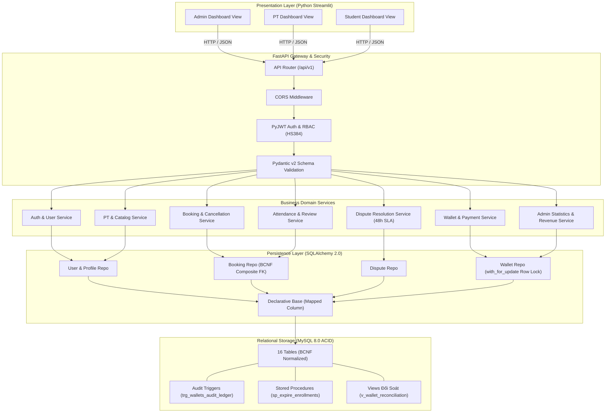
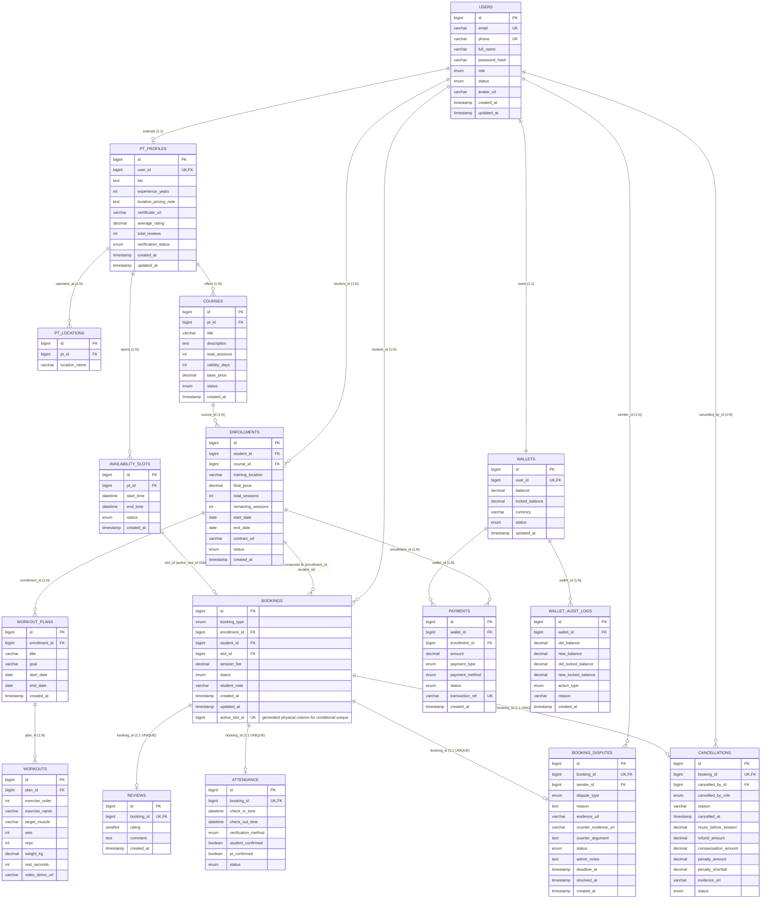

# PT-Connect Backend (Python FastAPI)

Hệ thống Backend nền tảng kết nối Huấn luyện viên cá nhân và Học viên (PT Connect), xây dựng hoàn toàn bằng **Python 3.12** kết hợp **FastAPI** và **SQLAlchemy 2.0 ORM**, tuân thủ nghiêm ngặt kiến trúc phân tầng (Clean / Layered Architecture) và chuẩn hóa CSDL đạt dạng chuẩn Boyce-Codd (BCNF).

---

## 1. Sơ Đồ Kiến Trúc Hệ Thống (System Architecture)



---

## 2. Sơ Đồ Thực Thể - Quan Hệ CSDL (ERD Chuẩn BCNF)

Hệ thống gồm 16 bảng dữ liệu đã được chứng minh đạt chuẩn **Boyce-Codd (BCNF)**, triệt tiêu hoàn toàn thuộc tính đa trị (1NF), phụ thuộc một phần (2NF) và phụ thuộc bắc cầu (3NF & BCNF):



---

## 3. Đặc Điểm Chuẩn Hóa BCNF Trọng Tâm

1. **Khử phụ thuộc bắc cầu `pt_id`:** Các bảng `bookings`, `enrollments`, `workout_plans` hoàn toàn không lưu `pt_id`. Thông tin Huấn luyện viên được suy diễn qua quan hệ BCNF: `bookings -> availability_slots -> pt_profiles`.
2. **Khóa ngoại ghép bảo toàn phụ thuộc hàm:** Ràng buộc `fk_booking_enroll_student` trên `(enrollment_id, student_id) REFERENCES enrollments(id, student_id)` đảm bảo tính toàn vẹn học viên trong hợp đồng mà không vi phạm 3NF/BCNF.
3. **Phân rã dọc (Vertical Partitioning) 1:1:** Bốn bảng `reviews`, `attendance`, `cancellations`, `booking_disputes` mở rộng ca tập qua khóa ngoại `booking_id UNIQUE NOT NULL`, giữ kích thước bản ghi `bookings` tinh gọn và đạt BCNF tuyệt đối.
4. **Không lưu cột dẫn xuất `sender_role`:** Vai trò bên khiếu nại (STUDENT hay PT) được suy diễn động ở tầng ứng dụng bằng Python property, triệt tiêu mọi nguy cơ phụ thuộc hàm vi phạm chuẩn hóa.

---

## 4. Danh Mục Đầy Đủ 68 API Endpoints

### 1. Xác thực & Hồ sơ cá nhân (Auth & Profile - 6 endpoints)
* `POST /api/v1/auth/register` - Đăng ký tài khoản (Học viên / PT)
* `POST /api/v1/auth/login` - Đăng nhập nhận JWT Token
* `GET /api/v1/auth/me` - Lấy thông tin tài khoản đang đăng nhập
* `GET /api/v1/users/{id}` - Lấy thông tin người dùng theo ID
* `PUT /api/v1/users/avatar` - Cập nhật ảnh đại diện người dùng
* `GET /api/v1/public/health` - Health check hệ thống

### 2. Danh mục Khóa học & Lịch PT (Catalogue - 14 endpoints)
* `GET /api/v1/student/dashboard` - Dữ liệu tổng quan màn hình Học viên
* `GET /api/v1/pt-profiles` - Khám phá danh sách Huấn luyện viên
* `GET /api/v1/pt-profiles/{id}` - Chi tiết hồ sơ Huấn luyện viên
* `GET /api/v1/pt-profiles/{id}/courses` - Khóa học của một Huấn luyện viên
* `GET /api/v1/pt-profiles/{id}/slots` - Khung giờ khả dụng của một Huấn luyện viên
* `GET /api/v1/pt/profile` - PT xem hồ sơ cá nhân
* `PUT /api/v1/pt/profile` - PT cập nhật bio, kinh nghiệm, địa điểm
* `POST /api/v1/pt/courses` - PT tạo khóa học mới
* `GET /api/v1/pt/courses` - PT xem danh sách khóa học của mình
* `PUT /api/v1/pt/courses/{id}` - PT chỉnh sửa khóa học
* `DELETE /api/v1/pt/courses/{id}` - PT vô hiệu hóa khóa học
* `POST /api/v1/pt/slots` - PT tạo khung giờ tập mới
* `GET /api/v1/pt/slots` - PT xem danh sách khung giờ tập
* `DELETE /api/v1/pt/slots/{id}` - PT xóa khung giờ trống

### 3. Đặt lịch & Hủy ca tập (Bookings - 9 endpoints)
* `POST /api/v1/bookings` - Học viên đặt lịch ca tập (PACKAGE hoặc TRIAL)
* `GET /api/v1/bookings/my` - Học viên xem danh sách ca tập của mình
* `GET /api/v1/bookings/{id}` - Xem chi tiết một ca tập
* `PUT /api/v1/bookings/{id}/cancel` - Học viên hủy ca tập theo chính sách bồi thường
* `GET /api/v1/bookings/{id}/cancel-preview` - Xem trước hoàn tiền / phạt khi hủy
* `GET /api/v1/pt/bookings` - PT xem danh sách ca tập học viên đặt
* `PUT /api/v1/pt/bookings/{id}/confirm` - PT phê duyệt ca tập
* `PUT /api/v1/pt/bookings/{id}/reject` - PT từ chối ca tập kèm lý do
* `PUT /api/v1/pt/bookings/{id}/cancel` - PT hủy ca tập đã duyệt

### 4. Ví điện tử & Hợp đồng (Wallet & Enrollments - 7 endpoints)
* `GET /api/v1/wallet` - Xem số dư và lịch sử biến động ví
* `POST /api/v1/wallet/topup` - Nạp tiền vào ví điện tử
* `POST /api/v1/enrollments` - Mua khóa học & ký kết hợp đồng điện tử
* `GET /api/v1/enrollments/my` - Học viên xem danh sách hợp đồng
* `GET /api/v1/enrollments/{id}` - Xem chi tiết một hợp đồng
* `GET /api/v1/enrollments/{id}/contract` - Tải văn bản PDF hợp đồng đào tạo
* `GET /api/v1/pt/enrollments` - PT xem danh sách hợp đồng phụ trách

### 5. Giáo án tập luyện (Workout Plans - 6 endpoints)
* `POST /api/v1/pt/workout-plans` - PT tạo giáo án cho hợp đồng
* `POST /api/v1/pt/workout-plans/{id}/workouts` - PT thêm bài tập vào giáo án
* `GET /api/v1/enrollments/{id}/workout-plans` - Học viên xem giáo án của khóa
* `GET /api/v1/pt/workout-plans` - PT xem danh sách giáo án
* `DELETE /api/v1/pt/workout-plans/{id}` - PT xóa giáo án
* `DELETE /api/v1/pt/workout-plans/{planId}/workouts/{workoutId}` - PT xóa bài tập

### 6. Điểm danh & Đánh giá (Attendance & Reviews - 9 endpoints)
* `POST /api/v1/attendance/{bookingId}/start` - PT mở ca tập & phát mã OTP
* `POST /api/v1/attendance/{bookingId}/student-checkin` - Học viên nhập OTP điểm danh
* `POST /api/v1/attendance/{bookingId}/pt-confirm` - PT xác nhận hoàn thành buổi tập
* `POST /api/v1/attendance/{bookingId}/absent` - Điểm danh vắng mặt ca tập
* `GET /api/v1/attendance/{bookingId}` - Xem thông tin điểm danh của ca tập
* `POST /api/v1/reviews` - Học viên đánh giá sao và nhận xét buổi tập
* `GET /api/v1/reviews/pt/{ptId}` - Xem danh sách đánh giá của PT
* `GET /api/v1/reviews/my` - Xem các đánh giá của bản thân
* `GET /api/v1/reviews/booking/{bookingId}` - Xem đánh giá của một ca tập

### 7. Quản trị & Ví Doanh thu Sàn (Admin Management - 11 endpoints)
* `GET /api/v1/admin/users` - Danh sách người dùng hệ thống
* `PUT /api/v1/admin/users/{id}/status` - Khóa / Mở khóa tài khoản người dùng
* `GET /api/v1/admin/pt/pending` - Danh sách hồ sơ PT chờ duyệt
* `PUT /api/v1/admin/pt/{id}/approve` - Phê duyệt hồ sơ PT
* `PUT /api/v1/admin/pt/{id}/reject` - Từ chối hồ sơ PT kèm lý do
* `GET /api/v1/admin/statistics` - Thống kê doanh thu và tỷ lệ hoạt động
* `GET /api/v1/admin/bookings` - Danh sách booking toàn hệ thống
* `GET /api/v1/admin/bookings/page` - Phân trang booking toàn sàn
* `GET /api/v1/admin/payments` - Danh sách giao dịch toàn hệ thống
* `GET /api/v1/admin/payments/page` - Phân trang giao dịch thanh toán
* `GET /api/v1/admin/wallet` - Xem số dư ví doanh thu sàn Admin
* `POST /api/v1/admin/wallet/withdraw` - Admin rút doanh thu về tài khoản ngân hàng (0đ số dư tối thiểu)

### 8. Giải quyết tranh chấp & Khiếu nại (Dispute Resolution - 6 endpoints)
* `POST /api/v1/disputes` - Tạo đơn khiếu nại ca tập (Hạn 48h từ khi hủy, tối đa 1 lần/ca)
* `GET /api/v1/disputes` - Xem danh sách tranh chấp (theo quyền người dùng/Admin)
* `GET /api/v1/disputes/{id}` - Xem chi tiết hồ sơ khiếu nại và phản biện
* `POST /api/v1/disputes/{id}/counter` - Bên bị khiếu nại nộp văn bản & ảnh phản biện (48h)
* `POST /api/v1/disputes/{id}/request-evidence` - Admin yêu cầu bổ sung bằng chứng
* `POST /api/v1/disputes/{id}/resolve` - Admin ra phán quyết phân xử cuối cùng

---

## 5. Khởi Chạy & Kiểm Thử

### Chạy hệ thống với Docker Compose
```bash
docker compose -f docker-compose.python.yml up -d --build
```

### Chạy kiểm thử tự động (Pytest)
```bash
pytest -v
```

### Kiểm tra cú pháp và chất lượng mã nguồn (Ruff)
```bash
ruff check .
```
