# KẾ HOẠCH CHUẨN HÓA CSDL BCNF ĐỢT 2 & KHẮC PHỤC LỖI TIỀM ẨN
## HƯỚNG DẪN TỐI ƯU TOÀN VẸN CSDL VỚI CHI PHÍ SỬA CODE TỐI THIỂU (ZERO-BREAKING)
*(DỰ ÁN: NỀN TẢNG PT-CONNECT)*

---

* **Tài liệu tham chiếu đợt 1:** [KE_HOACH_REFACTOR_BCNF_TOI_THIEU_CODE.md](file:///d:/PT-Connect/KE_HOACH_REFACTOR_BCNF_TOI_THIEU_CODE.md) & [BCNF_REFACTORING_CHANGE_REPORT.md](file:///d:/PT-Connect/BCNF_REFACTORING_CHANGE_REPORT.md)
* **Tài liệu lý thuyết nền tảng:** [BCNF_CHUAN_HOA_DATABASE.md](file:///d:/PT-Connect/BCNF_CHUAN_HOA_DATABASE.md)
* **Mục tiêu đợt 2:**
  1. **Khử triệt để vi phạm BCNF còn sót lại** tại bảng `bookings` và `cancellations`.
  2. **Áp dụng giải pháp "Khóa ngoại ghép" (Composite Foreign Key):** Loại bỏ phụ thuộc hàm dư thừa và ngăn chặn Anomaly ở cấp độ Database Engine mà **KHÔNG CẦN TÁCH BẢNG**, giúp **Backend (Entity, Repo, Service, DTO) và Frontend giữ nguyên 100% không bị vỡ**.
  3. **Khắc phục 4 lỗi thực tế (Critical Bugs & Data Inconsistency):** Sửa lỗi cú pháp Trigger MySQL, lỗi logic điểm danh khi vắng mặt, thiếu ràng buộc trùng lặp địa điểm và dữ liệu mẫu không khớp với View thống kê.
  4. **Chuẩn bị kịch bản bảo vệ đồ án:** Lý giải rõ ràng ranh giới giữa chuẩn BCNF thuần túy và kỹ thuật Denormalization có chủ đích phục vụ hiệu năng.

---

## 📑 MỤC LỤC
1. [Tổng quan các vấn đề cần giải quyết trong Đợt 2](#1-tổng-quan-các-vấn-đề-cần-giải-quyết-trong-đợt-2)
2. [Chi tiết Chuẩn hóa BCNF: Bảng `bookings` (Kỹ thuật FK Ghép)](#2-chi-tiết-chuẩn-hóa-bcnf-bảng-bookings-kỹ-thuật-fk-ghép)
3. [Chi tiết Chuẩn hóa BCNF: Bảng `cancellations` (Role Audit vs FK Ghép)](#3-chi-tiết-chuẩn-hóa-bcnf-bảng-cancellations-role-audit-vs-fk-ghép)
4. [Khắc phục 4 lỗi thực tế (Syntax, Logic & Data)](#4-khắc-phục-4-lỗi-thực-tế-syntax-logic--data)
5. [Lý giải Dữ liệu dẫn xuất (Denormalization) khi bảo vệ đồ án](#5-lý-giải-dữ-liệu-dẫn-xuất-denormalization-khi-bảo-vệ-đồ-án)
6. [Hướng dẫn triển khai chi tiết từng tệp tin (Ít sửa nhất)](#6-hướng-dẫn-triển-khai-chi-tiết-từng-tệp-tin-ít-sửa-nhất)
7. [Kịch bản vấn đáp bảo vệ đồ án (Defense Cheat-Sheet)](#7-kịch-bản-vấn-đáp-bảo-vệ-đồ-án-defense-cheat-sheet)

---

## 1. TỔNG QUAN CÁC VẤN ĐỀ CẦN GIẢI QUYẾT TRONG ĐỢT 2

Qua đợt rà soát chuyên sâu sau đợt refactor 1, hệ thống còn 2 điểm vi phạm lý thuyết BCNF và 4 lỗi kỹ thuật/nghiệp vụ cụ thể như sau:

| STT | Vị trí | Hiện trạng / Vấn đề | Đánh giá lý thuyết BCNF & Vận hành | Hướng sửa ít đụng code nhất |
| :---: | :--- | :--- | :--- | :--- |
| **1** | `bookings` | Có cả `enrollment_id` và `student_id`. Tồn tại phụ thuộc hàm `enrollment_id → student_id`. | `enrollment_id` không phải siêu khóa trong `bookings` $\rightarrow$ **Vi phạm BCNF**. Đang phải dùng Trigger để vá. | Dùng **Khóa ngoại ghép (Composite FK)** trỏ tới `enrollments(id, student_id)`. Xóa luôn Trigger vá. Giữ nguyên 100% code Java. |
| **2** | `cancellations` | Có cả `cancelled_by_id` và `cancelled_by_role`. Tồn tại phụ thuộc hàm `cancelled_by_id → cancelled_by_role`. | `users.id → users.role`, lặp lại role trong `cancellations`. Nếu dùng FK ghép sẽ bị **MySQL 8 báo lỗi 3780** do 2 kiểu ENUM khác nhau. | Dùng **FK đơn** `cancelled_by_id` kết hợp ràng buộc **CHECK** logic, coi role là **Audit Role Snapshot**. Giữ vững 100% tính năng hủy lịch trên Web. |
| **3** | `database/init.sql` (Trigger) | Lệnh `DECLARE` đặt bên trong khối `IF` của `trg_bookings_check_student_integrity`. | **Bug cú pháp MySQL nghiêm trọng (Error 1064)**. MySQL chỉ cho `DECLARE` ở đầu khối `BEGIN...END`. | Xóa luôn Trigger này vì đã được kiểm soát bằng FK ghép ở mục 1. |
| **4** | `attendance` | Cột `check_in_time` đặt `NOT NULL`, trong khi `status` có giá trị `'ABSENT'`. | **Lỗi logic nghiệp vụ**. Vắng mặt không thể có giờ check-in thực tế. | Đổi `check_in_time` thành `NULL` trong DDL. |
| **5** | `pt_locations` | Chưa có ràng buộc `UNIQUE(pt_id, location_name)`. | Nguy cơ chèn lặp cùng một địa điểm nhiều lần cho cùng 1 PT. | Thêm `UNIQUE KEY uq_pt_location (pt_id, location_name)` trong DDL. |
| **6** | Dữ liệu mẫu (Seed) | `pt_profiles` ghi sẵn 10 reviews và 4.90 sao, nhưng bảng `reviews` không có dữ liệu mẫu. | View `v_pt_rating_statistics` và Trigger tính ra 0 review, gây lệch số liệu với trang cá nhân. | Bổ sung dữ liệu mẫu cho `reviews` khớp đúng 10 review và điểm 4.90. |

---

## 2. CHI TIẾT CHUẨN HÓA BCNF: BẢNG `bookings` (KỸ THUẬT FK GHÉP)

### 2.1. Phân tích nguyên nhân vi phạm BCNF
* Trong bảng `enrollments`, ta có: `id → student_id` (mỗi hợp đồng gắn liền cố định với 1 học viên duy nhất).
* Trong bảng `bookings`, ta lưu cả `enrollment_id` và `student_id`:
  $$\text{enrollment\_id} \rightarrow \text{student\_id}$$
* Định thức $\text{enrollment\_id}$ **không phải là siêu khóa** của bảng `bookings` (vì một hợp đồng có thể đặt nhiều ca tập, quan hệ 1-N).
* $\rightarrow$ **Vi phạm chuẩn BCNF (và cả 3NF)**. Nguy cơ: Một ca tập thuộc `enrollment_id = 1` (của học viên A) lại bị ghi nhầm `student_id = 2` (học viên B).

> [!IMPORTANT]
> **Về mặt học thuật (Academic Rigor) & Lưu ý trong Báo cáo:** 
> Định nghĩa chặt của BCNF đòi hỏi **mọi định thức phải là siêu khóa**. Trong bảng `bookings`, định thức $\text{enrollment\_id}$ không phải siêu khóa. Việc thêm Khóa ngoại ghép $\text{FK}(\text{enrollment\_id}, \text{student\_id})$ là một giải pháp toàn vẹn dữ liệu (Referential Integrity Constraint) ngăn chặn triệt để dị thường (anomalies), nhưng **không làm biến mất phụ thuộc hàm đó về mặt toán học quan hệ**.
> Do đó, trong báo cáo học thuật, nên trình bày chuẩn xác là: **"Thiết kế chuẩn hóa thực tế: Kiểm soát phụ thuộc hàm bằng Khóa ngoại ghép (Controlled Redundancy via Composite FK)"**, tránh tự nhận là "BCNF thuần túy" để không bị hội đồng bắt bẻ câu chữ lý thuyết.
> Nếu thầy/cô yêu cầu BCNF thuần túy 100%, giải pháp duy nhất là phân rã thành 2 bảng riêng biệt: `package_bookings` (không có `student_id`) và `trial_bookings` (không có `enrollment_id`).

### 2.2. So sánh 2 phương án giải quyết

```mermaid
flowchart TD
    subgraph PA1["Phương án 1: Tách bảng (BCNF thuần túy)"]
        direction TB
        T1["Tách bookings thành 2 bảng:"]
        T2["package_bookings (không có student_id)"]
        T3["trial_bookings (có student_id, không có enrollment_id)"]
        T4["❌ HỆ QUẢ: Phải đập đi viết lại toàn bộ Booking Entity, Repository, BookingService, DTO, Controller và Giao diện"]
    end

    subgraph PA2["Phương án 2: Khóa ngoại ghép Composite FK (TỐI ƯU NHẤT)"]
        direction TB
        K1["Giữ nguyên bảng bookings"]
        K2["Tạo UNIQUE KEY uq_enroll_student (id, student_id) trên enrollments"]
        K3["Tạo FOREIGN KEY ghép (enrollment_id, student_id) trên bookings"]
        K4["DROP Trigger vá lỗi trg_bookings_check_student_integrity"]
        K5["✅ HỆ QUẢ: Đạt toàn vẹn CSDL tuyệt đối, Backend & Frontend KHÔNG PHẢI SỬA BẤT KỲ DÒNG CODE NÀO!"]
    end
```



### 2.3. Cơ chế hoạt động của Khóa ngoại ghép trong MySQL InnoDB
Theo tiêu chuẩn SQL và cơ chế của MySQL InnoDB:
1. **Đối với ca tập theo gói (`booking_type = 'PACKAGE'`):** `enrollment_id` có giá trị. MySQL bắt buộc cặp `(enrollment_id, student_id)` phải tồn tại chính xác trong bảng `enrollments`. Nếu ai cố tình gán học viên khác vào hợp đồng này, CSDL sẽ chặn ngay lập tức.
2. **Đối với ca tập thử (`booking_type = 'TRIAL'`):** `enrollment_id` là `NULL`. Trong MySQL, khi một thành phần của Foreign Key ghép mang giá trị `NULL` (chế độ `MATCH SIMPLE` mặc định), ràng buộc khóa ngoại sẽ được **tự động bỏ qua**. Do đó học viên tập thử vẫn được ghi nhận `student_id` bình thường mà không bị chặn.

### 2.4. Câu lệnh SQL áp dụng (DDL sạch)

```sql
-- 1. Thêm Unique key ghép trên bảng enrollments
ALTER TABLE `enrollments` 
  ADD UNIQUE KEY `uq_enroll_student` (`id`, `student_id`);

-- 2. Thêm Foreign key ghép trên bảng bookings
ALTER TABLE `bookings` 
  ADD CONSTRAINT `fk_booking_enroll_student` 
  FOREIGN KEY (`enrollment_id`, `student_id`) 
  REFERENCES `enrollments` (`id`, `student_id`);

-- 3. Xóa bỏ trigger kiểm tra thủ công vì CSDL đã tự đảm bảo
DROP TRIGGER IF EXISTS `trg_bookings_check_student_integrity`;
```

---

## 3. CHI TIẾT CHUẨN HÓA BCNF: BẢNG `cancellations` (ROLE AUDIT VS FK GHÉP)

### 3.1. Phân tích vi phạm BCNF
* Bảng `cancellations` có các cột: `booking_id`, `cancelled_by_id`, `cancelled_by_role`, ...
* Trong bảng `users`, ta có: `id → role`.
* Khi đưa `cancelled_by_role` vào `cancellations`, ta có phụ thuộc hàm:
  $$\text{cancelled\_by\_id} \rightarrow \text{cancelled\_by\_role}$$
* Định thức $\text{cancelled\_by\_id}$ không phải siêu khóa của `cancellations` $\rightarrow$ Vi phạm lý thuyết BCNF.

### 3.2. Cảnh báo lỗi nghiêm trọng khi dùng FK ghép trong MySQL 8 (Error 3780)
Một ý tưởng thường gặp là tạo Khóa ngoại ghép `(cancelled_by_id, cancelled_by_role) REFERENCES users(id, role)` để ép buộc tính nhất quán. **Tuy nhiên, giải pháp này sẽ bị MySQL 8 từ chối ngay lập tức:**
* `cancellations.cancelled_by_role` được định nghĩa với 4 giá trị: `ENUM('STUDENT', 'PT', 'ADMIN', 'SYSTEM')`.
* `users.role` chỉ có 3 giá trị: `ENUM('STUDENT', 'PT', 'ADMIN')` (trong hệ thống không có user nào mang role SYSTEM).
* **Cơ chế MySQL InnoDB:** Hai cột `ENUM` có số lượng phần tử hoặc danh sách giá trị khác nhau bị coi là **không tương thích kiểu dữ liệu (incompatible data types)**. Khi chạy lệnh `ALTER TABLE ... ADD CONSTRAINT` sẽ bị văng lỗi:
  > `ERROR 3780 (HY000): Referencing column 'cancelled_by_role' and referenced column 'role' in foreign key constraint are incompatible.`

### 3.3. Hậu quả thực tế trên giao diện Web nếu xảy ra lỗi này
Nếu cố tình áp dụng FK ghép hoặc nếu câu lệnh `INSERT INTO cancellations` bị lỗi CSDL:
1. **Phía Học viên (Student Portal - [`student_home_view.py`](file:///d:/PT-Connect/frontend/modules/student_home_view.py)):**
   - Trong bảng danh sách lịch tập ([`booking_table.py`](file:///d:/PT-Connect/frontend/components/booking_table.py)), khi học viên bấm nút **"Hủy ca tập"** $\rightarrow$ Điền lý do $\rightarrow$ Bấm **"Xác nhận hủy"**.
   - API `PUT /api/v1/bookings/{id}/cancel` gọi xuống Backend, `cancellationRepository.save()` bị lỗi CSDL văng ra HTTP 500.
   - Giao diện Web hiện cảnh báo đỏ: `❌ Lỗi hủy lịch: Lỗi hệ thống khi xử lý yêu cầu`. Ca tập bị kẹt ở trạng thái `CONFIRMED`, tiền cọc hoặc buổi tập không được hoàn lại!
2. **Phía PT (PT Portal - [`pt_home_view.py`](file:///d:/PT-Connect/frontend/modules/pt_home_view.py)):**
   - PT bấm **"Hủy ca dạy"** khi bận việc đột xuất cũng bị báo lỗi tương tự, không thể giải phóng slot.
3. **Phía Hệ thống & Admin ([`admin_dashboard_view.py`](file:///d:/PT-Connect/frontend/modules/admin_dashboard_view.py)):**
   - Khi hệ thống tự động hủy ca quá hạn (`cancelled_by_role = 'SYSTEM'`), do `users` không có giá trị `SYSTEM`, tiến trình ngầm (Scheduler) sẽ bị crash hoặc treo luồng xử lý tranh chấp của Admin.

### 3.4. Giải pháp kiến trúc an toàn tuyệt đối (Chuẩn công nghiệp)
Thay vì dùng FK ghép lên kiểu dữ liệu `ENUM` không tương thích, ta áp dụng kiến trúc chuẩn công nghiệp:
1. **Dùng Khóa ngoại đơn tiêu chuẩn:** 
   `FOREIGN KEY (cancelled_by_id) REFERENCES users(id)` (cho phép `NULL` khi `SYSTEM` tự động hủy).
2. **Kiểm soát tính toàn vẹn bằng CHECK Constraint logic:**
   ```sql
   CONSTRAINT `chk_cancel_actor` CHECK (
     (`cancelled_by_role` = 'SYSTEM' AND `cancelled_by_id` IS NULL) OR
     (`cancelled_by_role` IN ('STUDENT', 'PT', 'ADMIN') AND `cancelled_by_id` IS NOT NULL)
   )
   ```
3. **Bản chất kiến trúc: Audit Role Snapshot:**
   - Cột `cancelled_by_role` không phải là dư thừa dữ liệu ngẫu nhiên, mà là **Snapshot lịch sử kiểm toán (Audit Log)** ghi nhận chính xác quyền hạn của đối tượng tại thời điểm sự kiện hủy xảy ra (phòng trường hợp sau này tài khoản bị đổi role, hoặc bị xóa).
   - Giải pháp này **100% tương thích với MySQL 8**, giữ cho toàn bộ luồng Hủy lịch trên Web hoạt động trơn tru.

---

## 4. KHẮC PHỤC 4 LỖI THỰC TẾ (SYNTAX, LOGIC & DATA)

### 4.1. Sửa lỗi cú pháp MySQL trong Trigger `trg_bookings_check_student_integrity`
* **Vị trí lỗi:** Dòng 384–387 trong [`database/init.sql`](file:///d:/PT-Connect/database/init.sql#L384-L387).
* **Lỗi:** Khai báo biến `DECLARE v_enroll_student_id BIGINT;` nằm sau câu lệnh `IF`.
* **Quy tắc MySQL:** Lệnh `DECLARE` bắt buộc phải nằm ở đầu khối `BEGIN...END`, trước mọi câu lệnh thực thi khác. Đặt sau `IF` sẽ gây lỗi cú pháp nghiêm trọng `ERROR 1064 (42000)`.
* **Cách xử lý triệt để:** Vì ở Mục 2 ta đã dùng **Khóa ngoại ghép `fk_booking_enroll_student`**, CSDL đã tự động kiểm tra tính toàn vẹn này ở cấp độ engine. Ta **XÓA BỎ HOÀN TOÀN TRIGGER NÀY** khỏi `database/init.sql`!

### 4.2. Sửa bảng `attendance`: Cho phép `check_in_time NULL` khi Vắng mặt
* **Vị trí lỗi:** Cột `check_in_time datetime NOT NULL`.
* **Phân tích:** Khi học viên vắng mặt (`status = 'ABSENT'`), họ không đến phòng tập nên không có hành vi quét mã/check-in. Việc ép buộc `NOT NULL` khiến ứng dụng phải sinh ra giờ giả (dummy timestamp), sai lệch bản chất dữ liệu kiểm toán.
* **Cách xử lý:** Đổi thành `check_in_time datetime NULL`.
* **Ảnh hưởng Backend:** Entity Java [`Attendance.java`](file:///d:/PT-Connect/backend/src/main/java/com/PTconnect/backend/entity/Attendance.java) vốn sử dụng kiểu đối tượng `LocalDateTime checkInTime` (hỗ trợ `null` sẵn), nên tầng Java **không cần sửa đổi**.

### 4.3. Bổ sung ràng buộc chống trùng địa điểm trên `pt_locations`
* **Vấn đề:** Bảng `pt_locations` mới tạo ở đợt 1 chỉ có khóa chính `id` và khóa ngoại `pt_id`. Nếu PT ấn lưu nhiều lần, một địa điểm có thể bị chèn trùng lặp (ví dụ 2 dòng cùng là `"Phòng Cali Cầu Giấy"` cho `pt_id = 1`).
* **Cách xử lý:** Bổ sung `UNIQUE KEY uq_pt_location (pt_id, location_name)` ngay trong câu lệnh `CREATE TABLE pt_locations`.

### 4.4. Khớp dữ liệu mẫu giữa `pt_profiles` và `reviews`
* **Vấn đề:** `pt_profiles` lưu `average_rating = 4.90, total_reviews = 10`, nhưng bảng `reviews` không hề có dữ liệu mẫu nào. Khi gọi View `v_pt_rating_statistics` để đối chiếu, kết quả trả về `0 review` và `0.00 sao`.
* **Cách xử lý:** Bổ sung các dòng `INSERT INTO reviews` tương ứng cho các ca tập đã hoàn thành trong [`database/init.sql`](file:///d:/PT-Connect/database/init.sql) và [`database/seed_demo.sql`](file:///d:/PT-Connect/database/seed_demo.sql), đảm bảo số lượng review và điểm trung bình khớp 100%.

---

## 5. LÝ GIẢI DỮ LIỆU DẪN XUẤT (DENORMALIZATION) KHI BẢO VỆ ĐỒ ÁN

Khi bảo vệ đồ án trước hội đồng hoặc thầy cô chấm bài, một câu hỏi kinh điển về chuẩn hóa là:
> *"Tại sao bảng `pt_profiles` lại lưu `average_rating` và `total_reviews`? Bảng `enrollments` sao lại lưu `remaining_sessions`? Bảng `wallets` sao lại lưu `balance`? Đây chẳng phải là dư thừa dữ liệu (redundancy) sao?"*

Dưới đây là cơ sở lý thuyết và câu trả lời chuẩn công nghiệp giúp bạn đạt điểm tối đa:

### 5.1. Phân biệt rõ: Vi phạm BCNF vs. Dữ liệu dẫn xuất (Derived Data)
* **Vi phạm BCNF:** Xảy ra khi có phụ thuộc hàm giữa các thuộc tính độc lập (ví dụ `enrollment_id → student_id`). Đây là lỗi thiết kế cấu trúc quan hệ.
* **Dữ liệu dẫn xuất (Denormalization có chủ đích):** Là các trường thông tin được tổng hợp (aggregated) từ nhiều bản ghi của bảng khác (ví dụ: điểm trung bình từ hàng ngàn đánh giá, số dư từ hàng trăm giao dịch).
  - Không coi là vi phạm BCNF vì đây là quyết định kiến trúc cân bằng giữa **Chuẩn hóa (Normalization)** và **Hiệu năng thực thi (Performance Trade-off)**.

### 5.2. Luận cứ bảo vệ chi tiết

1. **Về `pt_profiles.average_rating` và `total_reviews`:**
   - *Lý do giữ:* Trang chủ và danh sách tìm kiếm có hàng ngàn lượt xem mỗi phút. Nếu mỗi lần xem danh sách PT lại phải chạy truy vấn `AVG(rating)` và `COUNT(*)` từ bảng `reviews` (thông qua 3 bảng `JOIN` gồm `pt_profiles` $\rightarrow$ `availability_slots` $\rightarrow$ `bookings` $\rightarrow$ `reviews`), cơ sở dữ liệu sẽ bị nghẽn cổ chai (I/O Bottleneck).
   - *Biện pháp kiểm soát nhất quán:* Duy trì tự động bằng 3 Trigger (`trg_reviews_after_insert`, `trg_reviews_after_update`, `trg_reviews_after_delete`) và được đối chiếu kiểm toán định kỳ qua View `v_pt_rating_statistics`.

2. **Về `enrollments.final_price` và `total_sessions`:**
   - *Lý do giữ:* Đây là **Snapshot giá trị tại thời điểm ký kết hợp đồng (Contractual Snapshot)**. Khóa học gốc (`courses.base_price`) có thể tăng/giảm giá theo thời gian, hoặc học viên được cấp mã giảm giá cá nhân. Do đó `final_price` thuộc về hợp đồng chứ không phụ thuộc hàm vào `course_id`.

3. **Về `enrollments.remaining_sessions`:**
   - *Lý do giữ:* Được sử dụng trong các giao dịch đặt lịch có tính cạnh tranh cao (high concurrency). Việc trừ số buổi khả dụng bằng câu lệnh nguyên tử (`UPDATE enrollments SET remaining_sessions = remaining_sessions - 1 WHERE id = ? AND remaining_sessions > 0`) nhanh hơn và an toàn hơn việc đếm lại tất cả các buổi đã học.

4. **Về `bookings.active_slot_id`:**
   - *Lý do giữ:* Đây là **Cột ảo lưu trữ (Generated Stored Column)** sinh ra nhằm phục vụ ràng buộc `UNIQUE KEY uq_active_slot`. Nó giúp ngăn chặn tình trạng "Double-booking" (hai người cùng đặt một slot) ở cấp độ CSDL mà vẫn cho phép giữ lại lịch sử các booking đã bị hủy (`CANCELLED`).

---

## 6. HƯỚNG DẪN TRIỂN KHAI CHI TIẾT TỪNG TỆP TIN (ÍT SỬA NHẤT)

### 6.1. File 1: [`database/init.sql`](file:///d:/PT-Connect/database/init.sql)

#### a. Cập nhật bảng `pt_locations`:
Thêm ràng buộc `UNIQUE KEY`:
```sql
CREATE TABLE `pt_locations` (
  `id` bigint PRIMARY KEY AUTO_INCREMENT,
  `pt_id` bigint NOT NULL,
  `location_name` varchar(255) NOT NULL,
  UNIQUE KEY `uq_pt_location` (`pt_id`, `location_name`),
  CONSTRAINT `fk_pt_locations_profile` FOREIGN KEY (`pt_id`) 
      REFERENCES `pt_profiles` (`id`) ON DELETE CASCADE
) ENGINE=InnoDB DEFAULT CHARSET=utf8mb4 COMMENT='Danh sách địa điểm nhận dạy của PT (Chuẩn 1NF)';
```

#### b. Cập nhật bảng `enrollments`:
Thêm `UNIQUE KEY` cho cặp `(id, student_id)` để làm đích cho Khóa ngoại ghép:
```sql
CREATE TABLE `enrollments` (
  `id` bigint PRIMARY KEY AUTO_INCREMENT,
  `student_id` bigint NOT NULL,
  ...
  UNIQUE KEY `uq_enroll_student` (`id`, `student_id`),
  ...
```

#### c. Cập nhật bảng `attendance`:
Đổi `check_in_time` thành `NULL`:
```sql
CREATE TABLE `attendance` (
  `id` bigint PRIMARY KEY AUTO_INCREMENT,
  `booking_id` bigint UNIQUE NOT NULL,
  `check_in_time` datetime NULL,
  `check_out_time` datetime,
  ...
```

#### d. Cập nhật bảng `cancellations`:
Thêm ràng buộc `CHECK` toàn vẹn logic cho người hủy:
```sql
CREATE TABLE `cancellations` (
  `id` bigint PRIMARY KEY AUTO_INCREMENT,
  `booking_id` bigint UNIQUE NOT NULL,
  `cancelled_by_id` bigint NULL COMMENT 'Có thể NULL nếu do hệ thống tự động hủy',
  `cancelled_by_role` ENUM ('STUDENT', 'PT', 'ADMIN', 'SYSTEM') NOT NULL DEFAULT 'STUDENT',
  ...
  CONSTRAINT `chk_cancel_actor` CHECK (
    (`cancelled_by_role` = 'SYSTEM' AND `cancelled_by_id` IS NULL) OR
    (`cancelled_by_role` IN ('STUDENT', 'PT', 'ADMIN') AND `cancelled_by_id` IS NOT NULL)
  )
);
```

#### e. Cập nhật phần FOREIGN KEYS ở cuối file:
Thêm Khóa ngoại ghép cho `bookings` và Khóa ngoại đơn an toàn cho `cancellations`:
```sql
-- Ràng buộc toàn vẹn BCNF: Học viên trong booking phải trùng với học viên trong hợp đồng
ALTER TABLE `bookings` ADD CONSTRAINT `fk_booking_enroll_student` 
    FOREIGN KEY (`enrollment_id`, `student_id`) REFERENCES `enrollments` (`id`, `student_id`);

-- Khóa ngoại đơn: Tham chiếu tới tài khoản người hủy (cho phép NULL khi SYSTEM tự động hủy)
ALTER TABLE `cancellations` ADD FOREIGN KEY (`cancelled_by_id`) REFERENCES `users` (`id`);
```

#### f. Xóa bỏ hoàn toàn Trigger lỗi cú pháp:
Xóa bỏ đoạn code sau trong mục `5. TRIGGERS`:
```sql
-- XÓA BỎ HOÀN TOÀN:
-- CREATE TRIGGER `trg_bookings_check_student_integrity` ...
```

---

### 6.2. File 2: [`database/seed_demo.sql`](file:///d:/PT-Connect/database/seed_demo.sql)
Đồng bộ các cập nhật DDL và bổ sung dữ liệu mẫu cho `reviews` (nếu có).

---

### 6.3. Tầng Backend & Frontend: Minh chứng "Zero-Breaking"

Nhờ chiến lược sử dụng **Khóa ngoại ghép (Composite Foreign Key)** ở tầng Database:
1. **Các Entity Java (`Booking.java`, `Enrollment.java`, `Cancellation.java`, `Attendance.java`):**
   - Vẫn giữ nguyên tên thuộc tính và kiểu dữ liệu.
   - Không bị mất cột, không phải thêm cột.
2. **Các Repository Spring Data JPA:**
   - Các phương thức tìm kiếm (`findByStudentId`, `findByEnrollmentId`, ...) hoạt động bình thường 100%.
3. **Các Service & Controller:**
   - Luồng nghiệp vụ tạo booking, hủy lịch không bị ảnh hưởng.
4. **Frontend (Streamlit):**
   - Không cần thay đổi bất kỳ trường hiển thị hoặc API payload nào.

---

## 7. KỊCH BẢN VẤN ĐÁP BẢO VỆ ĐỒ ÁN (DEFENSE CHEAT-SHEET)

| Câu hỏi của Thầy/Cô | Câu trả lời chuẩn & thuyết phục nhất |
| :--- | :--- |
| **"Tại sao bảng `bookings` lại có cả `enrollment_id` và `student_id`, có vi phạm BCNF không?"** | *"Dạ thưa thầy/cô, về lý thuyết toán học thuần túy, phụ thuộc hàm `enrollment_id → student_id` vẫn tồn tại và `enrollment_id` không phải siêu khóa của `bookings`, nên theo định nghĩa chặt chẽ thì bảng này chưa đạt BCNF thuần túy. Để đạt BCNF thuần túy lý thuyết thì bắt buộc phải phân rã thành 2 bảng (`package_bookings` và `trial_bookings`). Tuy nhiên, trong thực tế phát triển phần mềm (Engineering Trade-off), việc tách bảng làm phát sinh chi phí JOIN và làm phân mảnh mã nguồn tầng ứng dụng. Do đó, em đã áp dụng giải pháp **Kiểm soát phụ thuộc hàm bằng Khóa ngoại ghép (Composite FK)** `(enrollment_id, student_id) REFERENCES enrollments(id, student_id)`. Khi học theo gói, CSDL bắt buộc 100% sinh viên phải đúng với hợp đồng; khi học thử (`enrollment_id IS NULL`), khóa ngoại tự động pass. Giải pháp này giúp CSDL đạt tính toàn vẹn tuyệt đối, ngăn chặn mọi dị thường dữ liệu (anomalies) mà vẫn tối ưu hiệu năng."* |
| **"Bảng `pt_profiles` có `average_rating` và `total_reviews`, tại sao không tính động từ `reviews`?"** | *"Dạ, đây là kỹ thuật **Denormalization có chủ đích vì hiệu năng**. Danh sách PT được người dùng truy cập liên tục, việc tính toán `AVG()` và `COUNT(*)` qua 4 bảng `JOIN` mỗi khi xem trang sẽ gây quá tải CSDL. Do đó, em lưu sẵn kết quả và duy trì tính nhất quán bằng **3 Trigger đồng bộ** khi có thêm/sửa/xóa review, đồng thời tạo một **View đối chiếu (`v_pt_rating_statistics`)** để kiểm toán dữ liệu định kỳ."* |
| **"Tại sao `attendance` có trường `check_in_time` lại để `NULL`?"** | *"Dạ, ban đầu cột này là `NOT NULL`, nhưng sau khi rà soát nghiệp vụ, khi học viên vắng mặt (`status = 'ABSENT'`) thì thực tế không hề có sự kiện check-in. Nếu để `NOT NULL` sẽ phải lưu giá trị rác hoặc giờ giả định, làm sai lệch báo cáo kiểm toán. Do đó em đã chuẩn hóa lại cho phép `NULL` khi học viên vắng mặt."* |
| **"Bảng `cancellations` có `cancelled_by_role`, tại sao không lấy từ `users.role` và sao không dùng FK ghép?"** | *"Dạ, một mặt trường này là **Audit Role Snapshot** ghi nhận vai trò quyền hạn tại thời điểm hủy (phòng khi tài khoản đổi role hoặc bị xóa sau này). Mặt khác, `users.role` chỉ có 3 giá trị (`STUDENT`, `PT`, `ADMIN`), còn `cancelled_by_role` có thêm `SYSTEM` (khi cronjob tự động hủy). Trong MySQL 8, hai kiểu ENUM lệch nhau sẽ bị từ chối tạo FK ghép (`ERROR 3780`). Do đó em sử dụng **Khóa ngoại đơn `cancelled_by_id REFERENCES users(id)`** kết hợp ràng buộc **CHECK Constraint `chk_cancel_actor`**. Cách này vừa chuẩn kiến trúc Audit, vừa đảm bảo 100% chức năng hủy lịch trên Web không bị lỗi."* |

---

### 🏁 KẾT LUẬN
Bản kế hoạch Chuẩn hóa Đợt 2 này giúp CSDL của dự án **PT-Connect**:
- Khắc phục triệt để các góc khuất BCNF cuối cùng.
- Sửa sạch các lỗi cú pháp ẩn và lỗi logic thực tế.
- Đảm bảo tính toàn vẹn CSDL bằng chính cơ chế của Database Engine.
- **Quan trọng nhất:** Giữ cho toàn bộ mã nguồn Backend Java và Frontend Streamlit ổn định tuyệt đối, không phát sinh chi phí refactor code.

