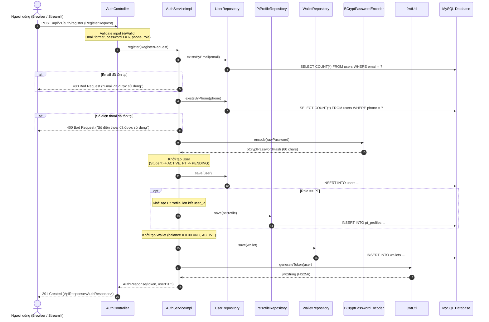
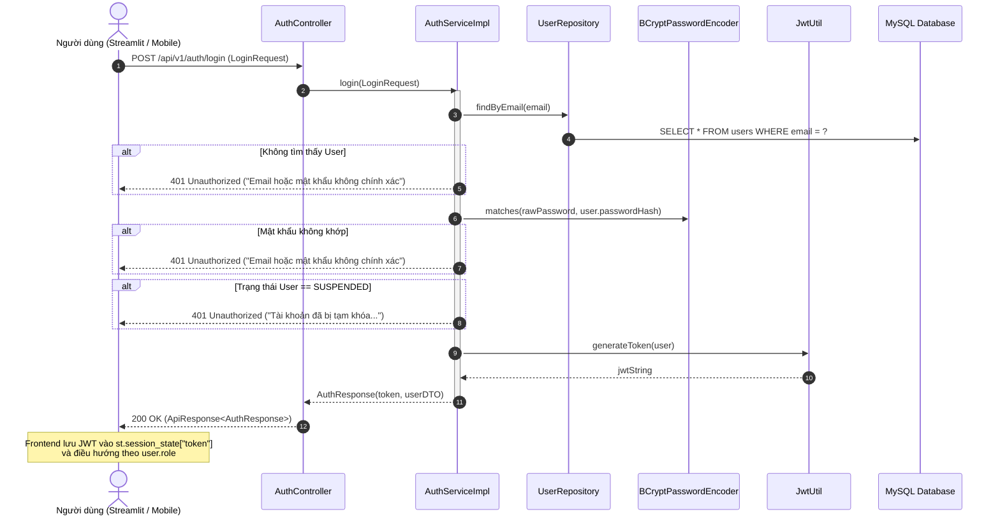
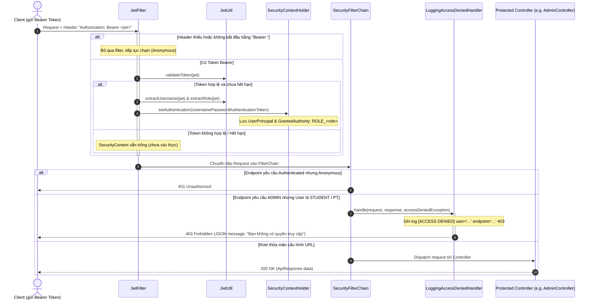

# Tài Liệu Đặc Tả Kiến Trúc & Luồng Xác Thực (Authentication & RBAC) - Milestone 3

**Dự án:** PT-Connect  
**Tác giả phụ trách:** Thành  
**Phạm vi:** Milestone 3 - Xác thực người dùng, Phân quyền theo vai trò (RBAC), Quản lý JWT Token và Sơ đồ tuần tự hệ thống.

---

## 1. Tổng Quan Kiến Trúc Xác Thực (Authentication Architecture)

Hệ thống **PT-Connect** áp dụng cơ chế xác thực **Stateless** dựa trên **JWT (JSON Web Token)** kết hợp với **Spring Security Filter Chain** ở Backend và lưu trữ Session ở Frontend Streamlit:

1. **Mã hóa mật khẩu:** Sử dụng thuật toán `BCryptPasswordEncoder` với cost factor 10, đảm bảo không bao giờ lưu trữ mật khẩu dưới dạng văn bản thô (plaintext).
2. **Cơ chế Token (JWT):** Token được ký bằng thuật toán HMAC-SHA256 (`HS256`) với khóa bí mật `jwt.secret`. Thời gian hết hạn là 24 giờ (`86400000 ms`). Payload chứa định danh người dùng (`sub`), ID (`userId`) và vai trò (`role`).
3. **Phân quyền vai trò (RBAC):** Gồm 3 vai trò chính:
   - `STUDENT`: Học viên tìm kiếm PT, đăng ký khóa học, đặt lịch, thanh toán ví.
   - `PT`: Huấn luyện viên tạo khóa học, quản lý slot lịch rảnh, xác nhận buổi tập.
   - `ADMIN`: Quản trị viên duyệt hồ sơ PT, xem báo cáo, quản lý người dùng.
4. **Xử lý giao dịch nguyên tử (`@Transactional`):** Khi đăng ký, tài khoản `users`, hồ sơ `pt_profiles` (nếu là PT) và ví `wallets` (số dư 0 VND) được khởi tạo đồng thời trong 1 transaction. Nếu bất kỳ bước nào lỗi, toàn bộ quá trình sẽ được rollback tự động.

---

## 2. Sơ Đồ Tuần Tự (Sequence Diagrams)

### 2.1. Sơ đồ tuần tự: Luồng Đăng ký Tài khoản (Registration Flow)



---

### 2.2. Sơ đồ tuần tự: Luồng Đăng nhập (Login Flow)



---

### 2.3. Sơ đồ tuần tự: Xác thực JWT & Phân quyền RBAC (Request Authorization Flow)



---

## 3. Đặc Tả Chi Tiết API (API Specifications)

### 3.1. Đăng ký tài khoản (Register)
* **URL:** `POST /api/v1/auth/register` (hoặc alias `POST /auth/register`)
* **Headers:** `Content-Type: application/json`
* **Quyền hạn:** Public (Không yêu cầu Token)

#### Request Body:
```json
{
  "fullName": "Nguyen Van A",
  "email": "nguyenvana@example.com",
  "password": "Password123@",
  "phone": "0987654321",
  "role": "STUDENT",
  "bio": "Mục tiêu giảm 5kg trong 2 tháng",
  "experienceYears": null,
  "availableLocations": null
}
```
*Đối với vai trò `PT`:* Cần truyền thêm `bio`, `experienceYears` (số năm kinh nghiệm), `availableLocations` (địa điểm nhận dạy).

#### Validation Rules:
* `fullName`: Bắt buộc, không được để trống.
* `email`: Bắt buộc, đúng định dạng RFC 5322, duy nhất trong hệ thống.
* `password`: Bắt buộc, độ dài tối thiểu 6 ký tự.
* `phone`: Bắt buộc, duy nhất trong hệ thống.
* `role`: Bắt buộc, một trong các giá trị: `STUDENT`, `PT`.

#### Response thành công (`201 Created`):
```json
{
  "status": 201,
  "message": "Đăng ký tài khoản thành công",
  "data": {
    "token": "eyJhbGciOiJIUzI1NiJ9.eyJzdWIiOiJuZ3V5ZW52YW5hQGV4YW1wbGUuY29tIiwicm9sZSI6IlNUVURFTlQiLCJ1c2VySWQiOjYsImlhdCI6MTc5MjQ4MzIwMCwiZXhwIjoxNzkyNTY5NjAwfQ...",
    "tokenType": "Bearer",
    "user": {
      "id": 6,
      "email": "nguyenvana@example.com",
      "fullName": "Nguyen Van A",
      "phone": "0987654321",
      "role": "STUDENT",
      "status": "ACTIVE",
      "createdAt": "2026-10-20T15:00:00"
    }
  }
}
```

#### Mã lỗi có thể gặp:
* `400 Bad Request`: Email/Phone đã tồn tại, mật khẩu dưới 6 ký tự hoặc thiếu trường bắt buộc.

---

### 3.2. Đăng nhập (Login)
* **URL:** `POST /api/v1/auth/login` (hoặc alias `POST /auth/login`)
* **Headers:** `Content-Type: application/json`
* **Quyền hạn:** Public

#### Request Body:
```json
{
  "email": "student.a@ptconnect.vn",
  "password": "Password123@"
}
```

#### Response thành công (`200 OK`):
```json
{
  "status": 200,
  "message": "Đăng nhập thành công",
  "data": {
    "token": "eyJhbGciOiJIUzI1NiJ9.eyJzdWIiOiJzdHVkZW50LmFAcHRjb25uZWN0LnZuIiwicm9sZSI6IlNUVURFTlQiLCJ1c2VySWQiOjEsImlhdCI6MTc5MjQ4MzIwMCwiZXhwIjoxNzkyNTY5NjAwfQ...",
    "tokenType": "Bearer",
    "user": {
      "id": 1,
      "email": "student.a@ptconnect.vn",
      "fullName": "Nguyễn Văn An",
      "phone": "0901234567",
      "role": "STUDENT",
      "status": "ACTIVE",
      "createdAt": "2026-10-01T08:00:00"
    }
  }
}
```

#### Mã lỗi có thể gặp:
* `401 Unauthorized`: Mật khẩu không chính xác hoặc tài khoản không tồn tại.
* `401 Unauthorized`: Tài khoản đang ở trạng thái `SUSPENDED`.

---

### 3.3. Lấy thông tin tài khoản đang đăng nhập (Get Me)
* **URL:** `GET /api/v1/auth/me` (hoặc alias `GET /auth/me`)
* **Headers:**
  - `Authorization: Bearer <jwt_token>`
* **Quyền hạn:** Authenticated (`STUDENT`, `PT`, `ADMIN`)

#### Response thành công (`200 OK`):
```json
{
  "status": 200,
  "message": "Lấy thông tin tài khoản thành công",
  "data": {
    "id": 1,
    "email": "student.a@ptconnect.vn",
    "fullName": "Nguyễn Văn An",
    "phone": "0901234567",
    "role": "STUDENT",
    "status": "ACTIVE",
    "createdAt": "2026-10-01T08:00:00"
  }
}
```

#### Mã lỗi có thể gặp:
* `401 Unauthorized`: Chưa cung cấp Bearer token hoặc token không hợp lệ/hết hạn.

---

## 4. Ma Trận Phân Quyền (RBAC Permission Matrix)

| Nhóm API Endpoint | Anonymous (Chưa đăng nhập) | STUDENT | PT | ADMIN | Ghi chú |
| :--- | :---: | :---: | :---: | :---: | :--- |
| `/api/v1/auth/**`, `/auth/**` | **Cho phép (200/201)** | **Cho phép** | **Cho phép** | **Cho phép** | Ngoại trừ `/me` yêu cầu Token |
| `/api/public/**`, `/public/**` | **Cho phép (200)** | **Cho phép** | **Cho phép** | **Cho phép** | Tìm kiếm PT, xem lịch công khai |
| `/api/student/**`, `/student/**` | 401 Unauthorized | **Cho phép (200)** | 403 Forbidden | 403 Forbidden | Chức năng học viên (đặt lịch, nạp ví) |
| `/api/pt/**`, `/pt/**` | 401 Unauthorized | 403 Forbidden | **Cho phép (200)** | 403 Forbidden | Quản lý khóa học, slot lịch rảnh |
| `/api/admin/**`, `/admin/**` | 401 Unauthorized | 403 Forbidden | 403 Forbidden | **Cho phép (200)** | Duyệt PT, thống kê, cấm tài khoản |

---

## 5. Cấu Trúc JWT Token (JWT Specifications)

### 5.1. Header:
```json
{
  "alg": "HS256",
  "typ": "JWT"
}
```

### 5.2. Payload (Claims):
```json
{
  "sub": "student.a@ptconnect.vn",
  "role": "STUDENT",
  "userId": 1,
  "iat": 1792483200,
  "exp": 1792569600
}
```
* **Ý nghĩa các trường:**
  - `sub` (Subject): Email của người dùng (định danh duy nhất).
  - `role`: Quyền hạn (`STUDENT`, `PT`, `ADMIN`).
  - `userId`: ID tương ứng trong bảng `users`.
  - `iat`: Thời điểm tạo token (Epoch Unix timestamp).
  - `exp`: Thời điểm hết hạn (24 giờ kể từ thời điểm tạo).

---

## 6. Hướng Dẫn Kiểm Thử Tự Động (Automated Testing with Pytest)

Bộ kiểm thử hộp đen viết bằng Python `pytest` và thư viện `requests` được lưu tại:
`frontend/tools/tests/test_auth.py`

### Lệnh thực thi:
```bash
# Đứng tại thư mục gốc dự án:
python -m pytest frontend/tools/tests/test_auth.py -v -s
```
Bộ test tự động kiểm tra đủ 14 kịch bản từ Milestone 3 và mục 8.5 trong tài liệu mô tả dự án.
