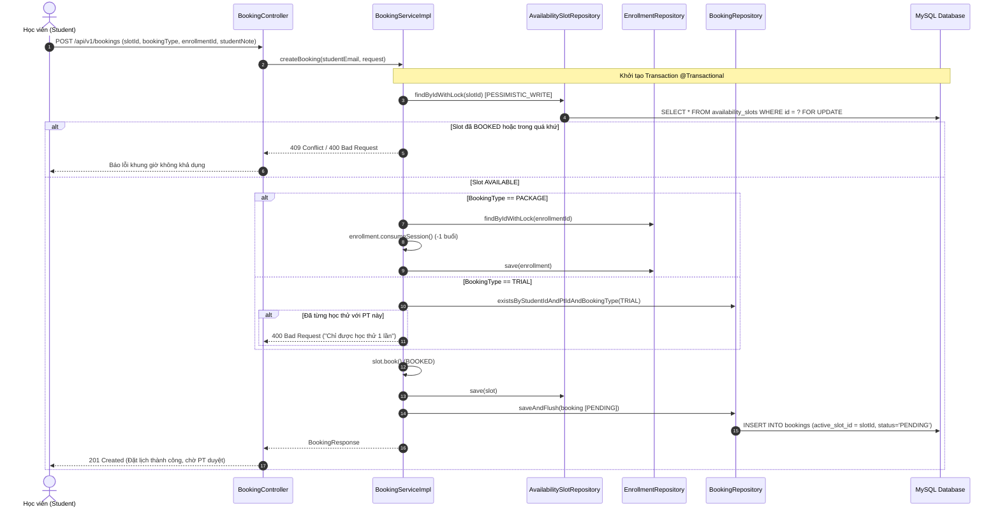
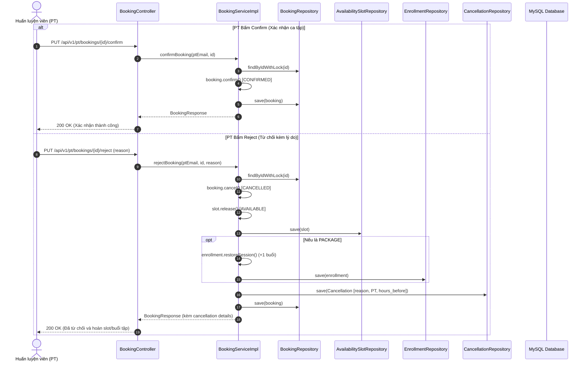

# Tài Liệu Đặc Tả Kiến Trúc & Nghiệp Vụ Luồng Booking (Milestone 6)

**Dự án:** PT-Connect  
**Giai đoạn:** Milestone 6: Luồng Booking – Trái tim hệ thống (Hạn chót: 28/10/2026)  
**Phân công thực hiện:**
* **Huy:** `POST /bookings` (TRIAL và PACKAGE) với `@Transactional`, `PESSIMISTIC_WRITE`, 409 khi trùng; `PUT /pt/bookings/{id}/confirm` và `/reject` (reject ghi `cancellations`, trả buổi, trả slot); trang PT: Booking chờ duyệt (`frontend/pages/pt.py`).
* **Hưng:** `GET /bookings/my` (lọc theo trạng thái) và `GET /pt/bookings` với `BookingResponse` DTO (ghép tên PT/Student, thời gian, địa điểm); phân quyền RBAC và chặn xem booking của người khác.
* **Hiệu:** Trang Student: Đặt lịch (chọn TRIAL/PACKAGE + hợp đồng), Lịch của tôi (chờ duyệt / sắp tới / lịch sử); API và giao diện đổi avatar (`PUT /users/avatar`).
* **Thắng:** `Enrollment.consumeSession()` / `restoreSession()` và khóa bi quan đa luồng; kiểm thử chống đặt trùng lịch.
* **Thành:** Bộ test tự động `frontend/tools/tests/test_booking.py` (10/10 PASS), bằng chứng SQL `docs/db-evidence-m6.md`, bộ sưu tập Postman.

---

## 1. Tổng Quan Kiến Trúc & Cơ Chế Chống Đặt Trùng

Milestone 6 là **trái tim nghiệp vụ** của nền tảng PT-Connect, điều phối tương tác trực tiếp giữa Học viên (Student) và Huấn luyện viên (PT).

### 1.1. Luồng Trạng Thái Ca Tập (Booking State Machine)

```
        ┌────────────────────────────────────────────────────────┐
        │  Student đặt lịch (TRIAL hoặc PACKAGE)                  │
        │  - Khóa bi quan slot (PESSIMISTIC_WRITE)                │
        │  - Trừ 1 buổi tập khả dụng (PACKAGE)                   │
        │  - Slot chuyển sang BOOKED                              │
        └──────────────────────────┬─────────────────────────────┘
                                   │
                                   ▼
                         ┌───────────────────┐
                         │      PENDING      │
                         │   (Chờ PT duyệt)  │
                         └─────────┬─────────┘
                                   │
                  ┌────────────────┴────────────────┐
                  │                                 │
     PT Confirm   ▼                    PT Reject    ▼
        ┌───────────────────┐             ┌───────────────────┐
        │     CONFIRMED     │             │     CANCELLED     │
        │  (Ca tập sắp tới) │             │ (Hoàn slot + buổi)│
        └───────────────────┘             └───────────────────┘
```

### 1.2. Cơ Chế Chống Đặt Trùng Hai Lớp (Two-Layer Anti-Double-Booking Protection)

Để đảm bảo không bao giờ xảy ra tình trạng hai học viên đặt cùng một khung giờ của PT (Double-Booking):
1. **Lớp 1 (Application Level - Khóa bi quan JPA):**
   * Trong phương thức `@Transactional createBooking`, truy vấn slot sử dụng `@Lock(LockModeType.PESSIMISTIC_WRITE)`.
   * Giao dịch đầu tiên sẽ giữ độc quyền khóa dòng (Row-level Lock) trên bảng `availability_slots` thông qua câu lệnh SQL `SELECT ... FOR UPDATE`. Giao dịch thứ hai cố gắng đọc dòng slot này sẽ bị chặn (Blocked) cho tới khi giao dịch đầu commit.
   * Khi giao dịch thứ hai được giải phóng, nó kiểm tra `slot.getStatus() != SlotStatus.AVAILABLE` và ngay lập tức ném ra ngoại lệ `BookingConflictException` (HTTP 409 Conflict).
2. **Lớp 2 (Database Level - Cột sinh ảo Virtual Stored Generated Column & Unique Constraint):**
   * Bảng `bookings` có cột `active_slot_id`:
     ```sql
     active_slot_id BIGINT GENERATED ALWAYS AS (
       IF(status IN ('PENDING', 'CONFIRMED', 'COMPLETED'), slot_id, NULL)
     ) STORED,
     UNIQUE KEY uq_active_slot (active_slot_id)
     ```
   * Nếu có bất kỳ race condition nào vượt qua được lớp ứng dụng, MySQL sẽ kích hoạt ràng buộc duy nhất `uq_active_slot`, ném ra lỗi `DataIntegrityViolationException` và được `GlobalExceptionHandler` bắt, chuẩn hóa thành mã lỗi HTTP **409 Conflict**.

### 1.3. Tính Đóng Gói Nghiệp Vụ (Encapsulation)

* **`Enrollment.consumeSession()`**: Kiểm tra hợp đồng `ACTIVE`, `remainingSessions > 0` và trừ 1 buổi tập.
* **`Enrollment.restoreSession()`**: Hoàn trả 1 buổi tập khi PT từ chối (Reject), đảm bảo `remainingSessions <= totalSessions`.
* **`AvailabilitySlot.book()`** và **`release()`**: Tự đóng gói chuyển trạng thái giữa `AVAILABLE` và `BOOKED`.

---

## 2. Sơ Đồ Tuần Tự (Sequence Diagrams)

### 2.1. Học Viên Đặt Lịch Ca Tập (POST /api/v1/bookings)



### 2.2. Huấn Luyện Viên Phê Duyệt hoặc Từ Chối Đơn Đặt Lịch



---

## 3. Danh Sách Endpoint Chi Tiết

### 3.1. Phía Học Viên (Student)

#### 1. Đặt lịch ca tập (`POST /api/v1/bookings`)
* **Quyền:** `STUDENT`
* **Mô tả:** Đặt lịch tập theo gói khóa học (`PACKAGE`) hoặc buổi học thử (`TRIAL`).
* **Request Body (PACKAGE):**
  ```json
  {
    "slotId": 101,
    "bookingType": "PACKAGE",
    "enrollmentId": 25,
    "studentNote": "Mong muốn tập trung bài Squat và Deadlift"
  }
  ```
* **Request Body (TRIAL):**
  ```json
  {
    "slotId": 102,
    "bookingType": "TRIAL",
    "studentNote": "Đánh giá thể lực buổi đầu"
  }
  ```
* **Response (201 Created):**
  ```json
  {
    "status": 201,
    "message": "Đặt lịch ca tập thành công (chờ Huấn luyện viên phê duyệt)",
    "data": {
      "id": 15,
      "studentId": 2,
      "studentName": "Nguyen Student",
      "studentEmail": "student.a@ptconnect.vn",
      "studentPhone": "0900000001",
      "ptId": 1,
      "ptName": "Le Hoang C",
      "ptPhone": "0900000003",
      "slotId": 101,
      "startTime": "2026-11-20T09:00:00",
      "endTime": "2026-11-20T10:30:00",
      "bookingType": "PACKAGE",
      "status": "PENDING",
      "sessionFee": 300000.00,
      "studentNote": "Mong muốn tập trung bài Squat và Deadlift",
      "trainingLocation": "Cali Fitness Cầu Giấy",
      "enrollmentId": 25,
      "courseTitle": "Gói Tăng Cơ Giảm Mỡ 12 Buổi",
      "createdAt": "2026-10-22T13:50:00"
    }
  }
  ```

#### 2. Lấy danh sách lịch tập của tôi (`GET /api/v1/bookings/my`)
* **Quyền:** `STUDENT`
* **Query Parameters:** `status` (Tùy chọn: `PENDING`, `CONFIRMED`, `COMPLETED`, `CANCELLED`)
* **Response (200 OK):** Mảng danh sách `BookingResponse` của học viên đang đăng nhập.

#### 3. Xem chi tiết đơn đặt lịch (`GET /api/v1/bookings/{id}`)
* **Quyền:** `STUDENT`, `PT`, `ADMIN` (Hệ thống kiểm tra chặn người dùng xem booking của người khác).
* **Response (200 OK):** Thông tin chi tiết `BookingResponse`.

---

### 3.2. Phía Huấn Luyện Viên (PT)

#### 4. Danh sách ca tập của Huấn luyện viên (`GET /api/v1/pt/bookings`)
* **Quyền:** `PT`
* **Query Parameters:** `status` (Mặc định hoặc tùy chọn: `PENDING`, `CONFIRMED`, `COMPLETED`, `CANCELLED`)
* **Response (200 OK):** Mảng danh sách ca tập học viên đã đặt cùng PT.

#### 5. Xác nhận ca tập (`PUT /api/v1/pt/bookings/{id}/confirm`)
* **Quyền:** `PT`
* **Mô tả:** Phê duyệt đơn đặt lịch ca tập (`PENDING` -> `CONFIRMED`).
* **Response (200 OK):**
  ```json
  {
    "status": 200,
    "message": "Xác nhận ca tập thành công",
    "data": {
      "id": 15,
      "status": "CONFIRMED"
    }
  }
  ```

#### 6. Từ chối ca tập (`PUT /api/v1/pt/bookings/{id}/reject`)
* **Quyền:** `PT`
* **Mô tả:** Từ chối đơn đặt lịch (`PENDING` -> `CANCELLED`). Khung giờ tự động trả về `AVAILABLE`, hoàn trả 1 buổi tập vào hợp đồng, ghi nhận nhật ký vào bảng `cancellations`.
* **Request Body:**
  ```json
  {
    "reason": "Huấn luyện viên bận lịch công tác đột xuất"
  }
  ```
* **Response (200 OK):**
  ```json
  {
    "status": 200,
    "message": "Đã từ chối đơn đặt lịch và hoàn lại buổi tập",
    "data": {
      "id": 15,
      "status": "CANCELLED",
      "cancellationReason": "Huấn luyện viên bận lịch công tác đột xuất",
      "cancelledByRole": "PT"
    }
  }
  ```

---

### 3.3. Cập Nhật Ảnh Đại Diện Người Dùng (Hiệu)

#### 7. Cập nhật ảnh đại diện (`PUT /api/v1/users/avatar`)
* **Quyền:** Tất cả tài khoản đã đăng nhập (`STUDENT`, `PT`, `ADMIN`).
* **Request Body:**
  ```json
  {
    "avatarUrl": "https://images.unsplash.com/photo-1535713875002-d1d0cf377fde?w=400"
  }
  ```
* **Response (200 OK):** Trả về `UserDTO` đã cập nhật `avatarUrl` mới nhất.

---

## 4. Bảng Mã Trạng Thái HTTP

| HTTP Code | Định nghĩa | Trường hợp xảy ra |
| :--- | :--- | :--- |
| `200 OK` | Thành công | Xem danh sách lịch, duyệt ca, từ chối ca, đổi avatar. |
| `201 Created` | Tạo thành công | Đặt lịch ca tập thành công (`POST /bookings`). |
| `400 Bad Request` | Lỗi nghiệp vụ dữ liệu | Đặt học thử lần 2, hết buổi tập, hợp đồng hết hạn, sai học viên. |
| `401 Unauthorized` | Chưa đăng nhập | Không có JWT Bearer token hoặc token hết hạn. |
| `403 Forbidden` | Sai phân quyền | Học viên cố tình gọi API phê duyệt lịch của PT. |
| `404 Not Found` | Không tìm thấy | ID khung giờ, ID hợp đồng hoặc ID booking không tồn tại. |
| `409 Conflict` | Xung đột đồng thời | Khung giờ đã bị học viên khác đặt trước (Chống đặt trùng). |
| `500 Server Error`| Lỗi máy chủ | Lỗi không mong muốn trong quá trình xử lý giao dịch. |
