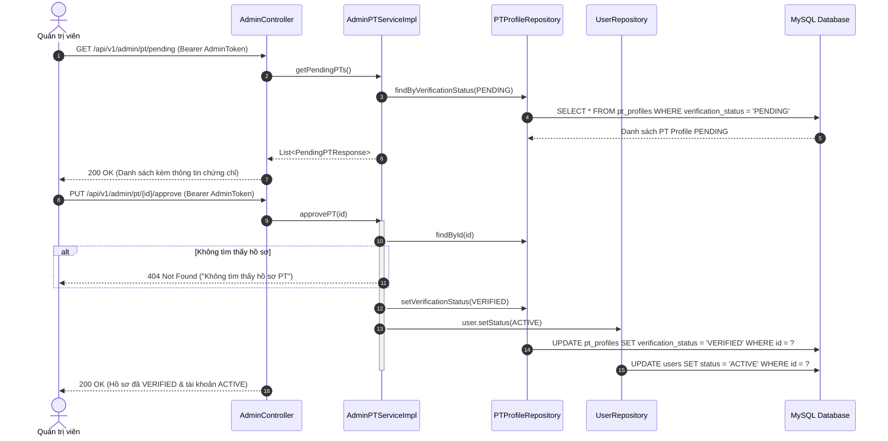
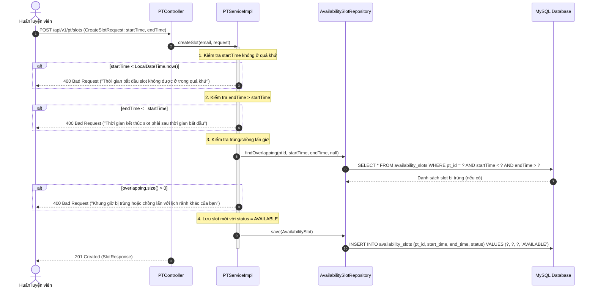

# Tài Liệu Đặc Tả Kiến Trúc & Nghiệp Vụ Chức Năng PT (Huấn Luyện Viên) - Milestone 4

**Dự án:** PT-Connect  
**Tác giả phụ trách:** Thành  
**Phạm vi:** Milestone 4 – Hồ sơ Huấn luyện viên (PT Profile), Quản lý khóa học (Courses), Khung giờ rảnh (Availability Slots) và Quản trị viên duyệt PT (Admin Approval).

---

## 1. Tổng Quan Nghiệp Vụ Milestone 4

Milestone 4 thiết lập toàn bộ nền tảng nghiệp vụ phía Huấn luyện viên cá nhân (PT) và phân hệ Quản trị viên (Admin) xét duyệt hồ sơ:

1. **Hồ sơ năng lực PT (`pt_profiles`):**
   - Cho phép PT xem và cập nhật thông tin: tiểu sử giới thiệu (`bio`), số năm kinh nghiệm (`experienceYears >= 0`), địa điểm nhận dạy (`availableLocations`), chính sách phụ thu (`locationPricingNote`) và chứng chỉ (`certificateUrls` dạng JSON).
   - Điểm đánh giá (`averageRating`) và tổng đánh giá (`totalReviews`) được bảo vệ chỉ đọc (sẽ do MySQL Trigger tự động tính toán ở Milestone 7).
2. **Quản lý khóa học trọn gói (`courses`):**
   - PT tạo các gói tập cố định với quy tắc: tổng số buổi `totalSessions > 0`, thời hạn `validityDays > 0`, học phí `basePrice >= 0`.
   - Khóa học chỉ bán trọn gói, không bán lẻ từng buổi.
   - PT có quyền chuyển đổi trạng thái `ACTIVE` (đang mở bán) và `INACTIVE` (ngưng bán). Không được phép xóa khóa học đã có hợp đồng của học viên.
3. **Quản lý khung giờ rảnh (`availability_slots`):**
   - PT thiết lập lịch trống để học viên chủ động đặt lịch tập ở Milestone 6.
   - **Ràng buộc nghiệp vụ bắt buộc:**
     - Không tạo slot trong quá khứ (`startTime >= now()`).
     - Giờ kết thúc phải sau giờ bắt đầu (`endTime > startTime`).
     - Không trùng lặp hoặc chồng lấn thời gian với các slot khác của chính PT (`findOverlapping`).
     - Trạng thái khởi tạo mặc định là `AVAILABLE`.
     - Chỉ cho phép xóa slot đang `AVAILABLE` và chưa từng có học viên đặt lịch (`bookings`).
4. **Quản trị viên xét duyệt PT (`Admin Approval`):**
   - Khi PT đăng ký mới ở Milestone 3, tài khoản có `users.status = PENDING` và `pt_profiles.verification_status = PENDING`.
   - Admin truy xuất danh sách chờ duyệt kèm link chứng chỉ bằng cấp (`GET /api/v1/admin/pt/pending`).
   - Khi Admin bấm **Duyệt (`approve`)**: `verificationStatus = VERIFIED` và `users.status = ACTIVE`. PT bắt đầu đủ điều kiện hiển thị trên danh sách tìm kiếm của học viên.
   - Khi Admin bấm **Từ chối (`reject`)**: `verificationStatus = REJECTED` và `users.status` giữ `PENDING`.

---

## 2. Sơ Đồ Tuần Tự (Sequence Diagrams)

### 2.1. Sơ đồ tuần tự: Quản trị viên phê duyệt hồ sơ PT



### 2.2. Sơ đồ tuần tự: PT tạo khung giờ rảnh (Availability Slot)



---

## 3. Danh Mục Chi Tiết API Endpoints (Milestone 4)

### 3.1. Nhóm API Huấn Luyện Viên (PT) - Yêu cầu Role `PT`

| Method | Endpoint | Quyền | Mô tả |
| :--- | :--- | :--- | :--- |
| `GET` | `/api/v1/pt/profile` | `PT` | Xem thông tin hồ sơ của chính mình (kèm chứng chỉ, đánh giá) |
| `PUT` | `/api/v1/pt/profile` | `PT` | Cập nhật hồ sơ năng lực (`bio`, kinh nghiệm, địa điểm, chứng chỉ) |
| `POST` | `/api/v1/pt/courses` | `PT` | Tạo khóa học huấn luyện trọn gói mới |
| `GET` | `/api/v1/pt/courses` | `PT` | Lấy danh sách toàn bộ khóa học của chính mình |
| `PUT` | `/api/v1/pt/courses/{id}` | `PT` | Chỉnh sửa nội dung hoặc chuyển đổi trạng thái `ACTIVE` / `INACTIVE` |
| `DELETE` | `/api/v1/pt/courses/{id}` | `PT` | Xóa khóa học (chặn nếu đã có hợp đồng học viên đăng ký) |
| `POST` | `/api/v1/pt/slots` | `PT` | Tạo khung giờ rảnh mới (bảo đảm 3 quy tắc thời gian) |
| `GET` | `/api/v1/pt/slots` | `PT` | Xem danh sách các khung giờ rảnh đã tạo |
| `DELETE` | `/api/v1/pt/slots/{id}` | `PT` | Xóa khung giờ rảnh (chỉ xóa được slot `AVAILABLE` chưa có booking) |

### 3.2. Nhóm API Quản Trị Viên (Admin) - Yêu cầu Role `ADMIN`

| Method | Endpoint | Quyền | Mô tả |
| :--- | :--- | :--- | :--- |
| `GET` | `/api/v1/admin/pt/pending` | `ADMIN` | Lấy danh sách PT đang ở trạng thái chờ phê duyệt (`PENDING`) |
| `PUT` | `/api/v1/admin/pt/{id}/approve` | `ADMIN` | Phê duyệt hồ sơ PT (`VERIFIED` và kích hoạt tài khoản `ACTIVE`) |
| `PUT` | `/api/v1/admin/pt/{id}/reject` | `ADMIN` | Từ chối hồ sơ PT (`REJECTED`, tài khoản giữ `PENDING`) |

---

## 4. Đặc Tả Dữ Liệu Request / Response Mẫu

### 4.1. Cập nhật hồ sơ PT: `PUT /api/v1/pt/profile`

**Request Body:**
```json
{
  "bio": "Huấn luyện viên cử tạ và thể hình chuyên nghiệp 6 năm kinh nghiệm",
  "experienceYears": 6,
  "availableLocations": "Phòng Cali Cầu Giấy; FitZone Thanh Xuân",
  "locationPricingNote": "Phụ thu 10% tại nhà học viên",
  "certificateUrls": "[\"https://cdn.ptconnect.vn/certs/cert_hlv_cap1.pdf\"]"
}
```

**Response 200 OK:**
```json
{
  "timestamp": "2026-10-21T15:00:00Z",
  "status": 200,
  "message": "Cập nhật hồ sơ Huấn luyện viên thành công",
  "data": {
    "id": 1,
    "userId": 3,
    "fullName": "Le Hoang C",
    "email": "pt.hoangc@ptconnect.vn",
    "phone": "0900000003",
    "experienceYears": 6,
    "availableLocations": "Phòng Cali Cầu Giấy; FitZone Thanh Xuân",
    "verificationStatus": "VERIFIED",
    "userStatus": "ACTIVE"
  }
}
```

### 4.2. Tạo khóa học: `POST /api/v1/pt/courses`

**Request Body:**
```json
{
  "title": "Gói Giảm Mỡ Cấp Tốc 12 Buổi",
  "description": "Giáo án HIIT kết hợp thực đơn dinh dưỡng định lượng",
  "totalSessions": 12,
  "validityDays": 30,
  "basePrice": 3600000.0
}
```

**Response 201 Created:**
```json
{
  "timestamp": "2026-10-21T15:00:00Z",
  "status": 201,
  "message": "Tạo khóa học thành công",
  "data": {
    "id": 10,
    "ptId": 1,
    "ptName": "Le Hoang C",
    "title": "Gói Giảm Mỡ Cấp Tốc 12 Buổi",
    "totalSessions": 12,
    "validityDays": 30,
    "basePrice": 3600000.0,
    "status": "ACTIVE"
  }
}
```

### 4.3. Tạo khung giờ rảnh: `POST /api/v1/pt/slots`

**Request Body:**
```json
{
  "startTime": "2026-10-25T09:00:00",
  "endTime": "2026-10-25T10:00:00"
}
```

**Response 201 Created:**
```json
{
  "timestamp": "2026-10-21T15:00:00Z",
  "status": 201,
  "message": "Tạo khung giờ rảnh thành công",
  "data": {
    "id": 100,
    "ptId": 1,
    "startTime": "2026-10-25T09:00:00",
    "endTime": "2026-10-25T10:00:00",
    "status": "AVAILABLE"
  }
}
```

---

## 5. Danh Sách Mã Lỗi Phổ Biến (Error Handling Matrix)

| Mã HTTP | Tình huống xảy ra | Nội dung lỗi trả về |
| :--- | :--- | :--- |
| `400 Bad Request` | Tạo slot có giờ bắt đầu ở quá khứ | `"Thời gian bắt đầu slot không được ở trong quá khứ"` |
| `400 Bad Request` | Tạo slot có giờ kết thúc <= giờ bắt đầu | `"Thời gian kết thúc slot phải sau thời gian bắt đầu"` |
| `400 Bad Request` | Tạo slot trùng/chồng lấn với slot khác của PT | `"Khung giờ bị trùng hoặc chồng lấn với lịch rảnh khác của bạn"` |
| `400 Bad Request` | Tạo khóa học có `totalSessions <= 0` | `"Tổng số buổi học phải lớn hơn 0"` |
| `400 Bad Request` | Xóa slot đã có học viên đặt lịch | `"Không thể xóa khung giờ đã có học viên đặt lịch"` |
| `400 Bad Request` | Xóa khóa học đã có hợp đồng đăng ký | `"Khóa học đã có hợp đồng học viên đăng ký, chỉ có thể ngưng bán"` |
| `401 Unauthorized` | Không gửi Bearer Token hoặc token hết hạn | `"Unauthorized"` |
| `403 Forbidden` | Học viên (STUDENT) gọi API PT hoặc Admin | `"Access Denied"` (Ghi log Security Denial) |
| `404 Not Found` | Truy xuất khóa học / slot / hồ sơ không tồn tại | `"Không tìm thấy ... với ID: ..."` |

---

## 6. Định Hướng DTO Cho Milestone 5 (Student Flow Preparation)

Để chuẩn bị cho Milestone 5 (Học viên xem danh sách PT, tìm kiếm, nạp tiền ví, mua khóa), nhóm API Student (Mục 7.2) thống nhất các DTO sau:

1. **`PTPublicDTO` (`GET /api/v1/pt-profiles`):**
   - Ẩn toàn bộ thông tin nhạy cảm: không trả `certificate_urls`, không trả mật khẩu hoặc thông tin cá nhân nội bộ.
   - Trả về: `id`, `fullName`, `avatarUrl`, `bio`, `experienceYears`, `availableLocations`, `averageRating`, `totalReviews`, `lowestPrice`.
2. **`PTDetailResponse` (`GET /api/v1/pt-profiles/{id}`):**
   - Trả về chi tiết hồ sơ công khai, danh sách các khóa học `ACTIVE` và các slot rảnh `AVAILABLE` trong tương lai.
3. **`PurchaseCourseRequest` (`POST /api/v1/enrollments`):**
   - `courseId`, `trainingLocation`, `paymentMethod` ("WALLET").
   - Backend chạy Transaction: Trừ ví `wallets` → Tạo hợp đồng `enrollments` (`remaining = total`) → Tạo `payments` (`PURCHASE_PACKAGE`).
