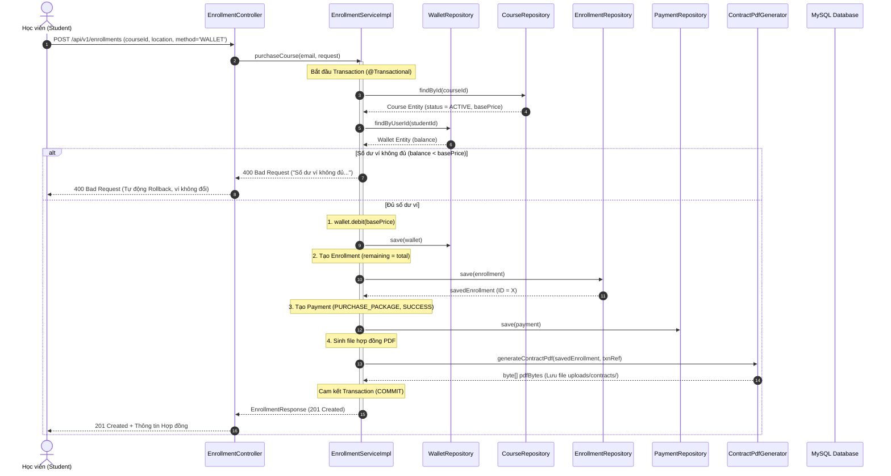

# Tài Liệu Đặc Tả Kiến Trúc & Nghiệp Vụ Chức Năng Student (Học Viên) - Milestone 5

**Dự án:** PT-Connect  
**Phụ trách theo phân công Milestone 5:**
* **Hiệu:** `GET /pt-profiles?name=`, `/pt-profiles/{id}`, `/{id}/courses`; Streamlit: Danh sách PT dạng lưới, tìm theo tên, Chi tiết PT.
* **Thắng:** `POST /wallet/topup`, `GET /wallet`, `POST /enrollments` (Transaction + sinh hợp đồng PDF + `payments`), `GET /enrollments/my`; trang Student: Ví, Mua khóa.
* **Hưng:** Phân tách `PTPublicDTO` / `PTPrivateDTO` (Student không thấy chứng chỉ); `GET /admin/users`, trang Admin: Người dùng; test phân quyền cho API mới.
* **Huy:** `GET /pt-profiles/{id}/slots` chỉ trả slot AVAILABLE trong tương lai; viết nháp `BookingService` và test đơn vị cho logic kiểm tra đặt lịch (chuẩn bị M6).
* **Thành:** Test mua khóa (thiếu tiền 400, thành công 201), bằng chứng SQL: rollback không để lại enrollment/payment rác; cập nhật tài liệu.

---

## 1. Tổng Quan Nghiệp Vụ Milestone 5

Milestone 5 hoàn thiện toàn bộ luồng nghiệp vụ cốt lõi dành cho **Học viên (Student)** từ bước khám phá, tìm kiếm Huấn luyện viên đến nạp tiền ví nội bộ và ký kết hợp đồng mua khóa học:

1. **Khám phá & Tìm kiếm Huấn Luyện Viên (`GET /api/v1/pt-profiles`):**
   * Chỉ hiển thị các PT đã được Admin phê duyệt (`verification_status = VERIFIED`) và tài khoản đang hoạt động (`users.status = ACTIVE`).
   * Hỗ trợ tìm kiếm theo tên không phân biệt hoa thường (`?name=...`). Nếu không có PT phù hợp, trả về mảng rỗng `[]` (HTTP 200).
   * **Bảo vệ quyền riêng tư (`PTPublicDTO`):** Tuyệt đối không làm lộ chứng chỉ nghề nghiệp (`certificate_urls`), mật khẩu băm hay thông tin nội bộ của PT.

2. **Hồ sơ chi tiết, Khóa học và Khung giờ rảnh:**
   * `GET /api/v1/pt-profiles/{id}`: Hồ sơ năng lực công khai, số năm kinh nghiệm, khu vực nhận dạy và chính sách phụ thu giá.
   * `GET /api/v1/pt-profiles/{id}/courses`: Danh sách các khóa học đang mở bán (`status = ACTIVE`).
   * `GET /api/v1/pt-profiles/{id}/slots`: Chỉ trả về các khung giờ rảnh ở trạng thái `AVAILABLE` và có thời gian bắt đầu trong tương lai (`startTime > now()`).

3. **Ví điện tử nội bộ & Nạp tiền mô phỏng (`wallets` & `payments`):**
   * `GET /api/v1/wallet`: Xem số dư khả dụng, số dư đóng băng tiền cọc (locked balance) và toàn bộ lịch sử giao dịch.
   * `POST /api/v1/wallet/topup`: Nạp tiền mô phỏng. Bắt buộc số tiền nạp `amount > 0` (400 Bad Request nếu nạp số âm/bằng 0). Khi thành công, cộng tiền vào ví thông qua phương thức đóng gói `wallet.credit(amount)` và ghi bản ghi `payments` loại `TOPUP`.

4. **Giao dịch Mua Khóa Học Nguyên Tử (`@Transactional POST /api/v1/enrollments`):**
   * **Kiểm tra nghiệp vụ:** Khóa học phải tồn tại và `ACTIVE`, địa điểm tập luyện không được để trống, ví học viên phải đủ số dư thanh toán (`balance - lockedBalance >= basePrice`).
   * **Tính nguyên tử (Atomic Transaction):** Toàn bộ quy trình diễn ra trong 1 transaction duy nhất:
     1. Trừ tiền ví học viên: `wallet.debit(coursePrice)`.
     2. Khởi tạo hợp đồng `enrollments`: thiết lập `total_sessions`, kho buổi ban đầu `remaining_sessions = total_sessions`, ngày bắt đầu hôm nay và hạn sử dụng theo `validity_days`.
     3. Ghi nhận giao dịch tài chính `payments`: loại `PURCHASE_PACKAGE`, phương thức `WALLET`, trạng thái `SUCCESS`, mã giao dịch duy nhất `TXN_BUY_...`.
     4. Tự động sinh file Hợp đồng Dịch vụ Huấn luyện Cá nhân chuẩn định dạng PDF điện tử (`ContractPdfGenerator`) và lưu trữ cho học viên tải về.
     5. **Cơ chế Rollback:** Nếu bất kỳ bước nào thất bại (hoặc số dư thiếu), hệ thống tự động hoàn nguyên 100%, không trừ ví, không để lại bản ghi rác.

---

## 2. Sơ Đồ Tuần Tự (Sequence Diagram)

### Luồng Giao Dịch Mua Khóa Học & Ký Hợp Đồng PDF



---

## 3. Danh Sách Endpoint Nhóm Student (Milestone 5)

| Method | Endpoint | Quyền (Role) | Mô tả & Ràng buộc nghiệp vụ | Mã phản hồi |
| :--- | :--- | :--- | :--- | :--- |
| `GET` | `/api/v1/pt-profiles` | `STUDENT`, `PT`, `ADMIN` | Lấy danh sách PT `VERIFIED` & `ACTIVE`. Query `?name=` tìm kiếm theo tên. | `200 OK` |
| `GET` | `/api/v1/pt-profiles/{id}` | `STUDENT`, `PT`, `ADMIN` | Chi tiết hồ sơ PT công khai (`PTPublicDTO`), ẩn chứng chỉ. | `200 OK`, `404 Not Found` |
| `GET` | `/api/v1/pt-profiles/{id}/courses` | `STUDENT`, `PT`, `ADMIN` | Danh sách khóa học `ACTIVE` của PT. | `200 OK`, `404 Not Found` |
| `GET` | `/api/v1/pt-profiles/{id}/slots` | `STUDENT`, `PT`, `ADMIN` | Khung giờ rảnh `AVAILABLE` trong tương lai (`startTime > now()`). | `200 OK`, `404 Not Found` |
| `GET` | `/api/v1/wallet` | `STUDENT`, `PT` | Xem số dư ví và toàn bộ lịch sử giao dịch (`PaymentResponse`). | `200 OK` |
| `POST` | `/api/v1/wallet/topup` | `STUDENT` | Nạp tiền ví mô phỏng (`amount > 0`). Sinh `TXN_TOPUP_...`. | `200 OK`, `400 Bad Request` |
| `POST` | `/api/v1/enrollments` | `STUDENT` | Mua khóa học trọn gói, chạy Transaction trừ ví và sinh hợp đồng PDF. | `201 Created`, `400 Bad Request` |
| `GET` | `/api/v1/enrollments/my` | `STUDENT` | Danh sách hợp đồng đã ký của học viên hiện tại và số buổi còn lại. | `200 OK` |
| `GET` | `/api/v1/enrollments/{id}` | `STUDENT`, `PT`, `ADMIN` | Xem chi tiết 1 hợp đồng (chặn xem chéo của học viên khác). | `200 OK`, `403 Forbidden` |
| `GET` | `/api/v1/enrollments/{id}/contract` | `STUDENT`, `PT`, `ADMIN` | Tải file hợp đồng PDF điện tử (`application/pdf`). | `200 OK`, `403 Forbidden` |
| `GET` | `/api/v1/admin/users` | `ADMIN` | Admin quản lý người dùng, hỗ trợ lọc `?role=STUDENT`. | `200 OK`, `403 Forbidden` |

---

## 4. Mô Hình Dữ Liệu (DTO Contracts)

### 4.1. `PTPublicDTO` (Hồ sơ PT công khai cho Student)
```json
{
  "id": 1,
  "userId": 3,
  "fullName": "Le Hoang C",
  "email": "pt.hoangc@ptconnect.vn",
  "phone": "0900000003",
  "avatarUrl": null,
  "bio": "Huấn luyện viên chuyên sâu về giảm cân, điều chỉnh tư thế và thể hình chuẩn.",
  "experienceYears": 5,
  "availableLocations": "Phòng Cali Cầu Giấy; FitZone Thanh Xuân; Nhận dạy tại nhà học viên",
  "locationPricingNote": "Tập tại phòng Cali giá chuẩn; Dạy tại nhà học viên phụ thu 20% tiền đi lại",
  "averageRating": 4.90,
  "totalReviews": 10,
  "lowestPrice": 10800000.00,
  "verificationStatus": "VERIFIED"
}
```

### 4.2. `TopupRequest` & `PurchaseCourseRequest`
```json
// POST /api/v1/wallet/topup
{
  "amount": 5000000.0,
  "paymentMethod": "BANK_TRANSFER"
}

// POST /api/v1/enrollments
{
  "courseId": 1,
  "trainingLocation": "Cali Fitness Cầu Giấy",
  "paymentMethod": "WALLET"
}
```

### 4.3. `EnrollmentResponse`
```json
{
  "id": 2,
  "studentId": 1,
  "studentName": "Nguyen Van A",
  "studentEmail": "student.a@ptconnect.vn",
  "courseId": 1,
  "courseTitle": "Gói Giảm Mỡ Chuyên Sâu 12 Tuần",
  "ptId": 1,
  "ptName": "Le Hoang C",
  "trainingLocation": "Cali Fitness Cầu Giấy",
  "finalPrice": 10800000.00,
  "totalSessions": 36,
  "remainingSessions": 36,
  "startDate": "2026-10-21",
  "endDate": "2027-01-19",
  "contractUrl": "/api/v1/enrollments/2/contract",
  "status": "ACTIVE",
  "createdAt": "2026-10-21T13:46:52"
}
```
