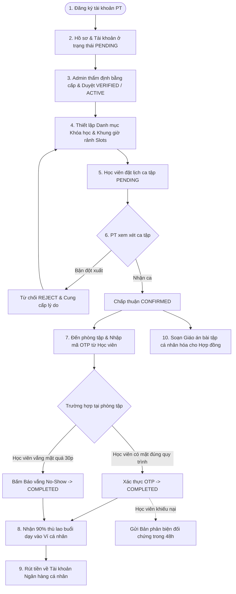

# 🏋️ TÀI LIỆU NGHIỆP VỤ CHI TIẾT DÀNH CHO HUẤN LUYỆN VIÊN CÁ NHÂN (PT)
> **Hệ thống:** Nền tảng kết nối Huấn luyện viên cá nhân & Học viên (PT-Connect)  
> **Vai trò:** Huấn luyện viên thể hình cá nhân (Personal Trainer - PT)  
> **Mục tiêu tài liệu:** Cung cấp tài liệu nghiệp vụ chi tiết, đầy đủ 100% về toàn bộ quy trình vận hành, thẩm định bằng cấp, mở lịch dạy, tạo gói khóa học, duyệt ca, đối soát tài chính, điểm danh OTP, biên soạn giáo án và quy chế ứng xử của Huấn luyện viên trên nền tảng.

---

## 📌 MỤC LỤC

1. [Tổng quan vai trò Huấn luyện viên & Hành trình phát triển (PT Journey)](#1-tổng-quan-vai-trò-huấn-luyện-viên--hành-trình-phát-triển)
2. [Nghiệp vụ Đăng ký & Quy trình Thẩm định Hồ sơ Năng lực (Admin Verification)](#2-nghiệp-vụ-đăng-ký--quy-trình-thẩm-định-hồ-sơ-năng-lực)
3. [Nghiệp vụ Quản lý Hồ sơ Chuyên môn & Danh mục Địa điểm Huấn luyện](#3-nghiệp-vụ-quản-lý-hồ-sơ-chuyên-môn--danh-mục-địa-điểm-huấn-luyện)
4. [Nghiệp vụ Quản lý Khóa học & Thiết kế Gói tập luyện (Course Management)](#4-nghiệp-vụ-quản-lý-khóa-học--thiết-kế-gói-tập-luyện)
5. [Nghiệp vụ Quản lý Khung giờ Làm việc Rảnh (Availability Slots)](#5-nghiệp-vụ-quản-lý-khung-giờ-làm-việc-rảnh)
6. [Nghiệp vụ Tiếp nhận, Phê duyệt & Từ chối Ca tập của Học viên](#6-nghiệp-vụ-tiếp-nhận-phê-duyệt--từ-chối-ca-tập-của-học-viên)
7. [Chính sách Hủy lịch tập & Chế tài Phạt / Đền bù đối với Huấn luyện viên](#7-chính-sách-hủy-lịch-tập--chế-tài-phạt--đền-bù-đối-với-huấn-luyện-viên)
8. [Quy chuẩn Điểm danh hai chiều qua OTP & Nghiệp vụ Báo vắng mặt (No-Show)](#8-quy-chuẩn-điểm-danh-hai-chiều-qua-otp--nghiệp-vụ-báo-vắng-mặt-no-show)
9. [Nghiệp vụ Xây dựng & Cá nhân hóa Giáo án Huấn luyện (Workout Plans)](#9-nghiệp-vụ-xây-dựng--cá-nhân-hóa-giáo-án-huấn-luyện)
10. [Nghiệp vụ Tài chính, Thu nhập 90% & Lệnh Rút tiền về Ngân hàng](#10-nghiệp-vụ-tài-chính-thu-nhập-90--lệnh-rút-tiền-về-ngân-hàng)
11. [Kênh Nhắn tin 1-1 hỗ trợ Học viên & Quản lý Đánh giá Sao](#11-kênh-nhắn-tin-1-1-hỗ-trợ-học-viên--quản-lý-đánh-giá-sao)
12. [Trung tâm Trọng tài, Phản biện 48 giờ & Bảo vệ Thù lao PT](#12-trung-tâm-trọng-tài-phản-biện-48-giờ--bảo-vệ-thù-lao-pt)
13. [Bộ quy tắc ứng xử & Đạo đức nghề nghiệp chuẩn mực của Huấn luyện viên](#13-bộ-quy-tắc-ứng-xử--đạo-đức-nghề-nghiệp-chuẩn-mực-của-huấn-luyện-viên)

---

## 1. TỔNG QUAN VAI TRÒ HUẤN LUYỆN VIÊN & HÀNH TRÌNH PHÁT TRIỂN

### 1.1. Vị thế và Quyền lợi Huấn luyện viên trên PT-Connect
Huấn luyện viên cá nhân (`PT`) là đối tác cung cấp dịch vụ huấn luyện thể hình chuyên nghiệp trên sàn PT-Connect. Khác với việc dạy tự do ngoài phòng gym truyền thống (dễ bị học viên bùng lịch không đền bù, quỵt nợ tiền gói tập), PT-Connect mang lại cho Huấn luyện viên:
* **Đảm bảo 100% dòng tiền thù lao**: Học viên bắt buộc phải ký hợp đồng và trả tiền khóa học vào hệ thống trước khi đặt lịch. PT chắc chắn nhận được thù lao sau khi hoàn thành buổi dạy.
* **Cơ chế đền bù khi học viên bùng lịch**: Nếu học viên hủy lịch sát giờ ($< 24h$) hoặc vắng mặt không báo trước (No-Show), PT vẫn được hưởng đủ thù lao buổi dạy để bù đắp thời gian và công sức chờ đợi.
* **Tự chủ thời gian và biểu phí**: Tự tạo các gói tập (số buổi, học phí, thời hạn), tự do mở các khung giờ rảnh trong tuần phù hợp với lịch sinh hoạt cá nhân.
* **Xây dựng thương hiệu uy tín lâu dài**: Điểm đánh giá trung bình từ 1-5 sao và phản hồi thực tế của học viên được cập nhật tự động lên hệ thống, giúp thu hút học viên mới mà không cần tốn chi phí quảng cáo.

### 1.2. Sơ đồ Hành trình của Huấn luyện viên (PT End-to-End Journey)

---

## 2. NGHIỆP VỤ ĐĂNG KÝ & QUY TRÌNH THẨM ĐỊNH HỒ SƠ NĂNG LỰC

Nhằm bảo vệ uy tín nền tảng và sự an toàn của học viên, PT-Connect áp dụng quy trình kiểm duyệt nghiêm ngặt đối với mọi Huấn luyện viên trước khi cho phép hoạt động công khai.

### 2.1. Quy trình Đăng ký & Khởi tạo tài khoản PT
1. **Thông tin khai báo ban đầu**:
   * Họ và tên, Email duy nhất, Số điện thoại duy nhất, Mật khẩu bảo mật (mã hóa BCrypt).
   * Tiểu sử giới thiệu năng lực bản thân (Bio).
   * Số năm kinh nghiệm làm việc thực tế trong ngành thể hình (bắt buộc $\ge 0$).
   * Danh mục các khu vực / quận huyện / phòng tập nhận dạy.
   * Ghi chú chính sách phụ thu di chuyển (nếu dạy phòng ngoài hoặc tại nhà).
   * Đường dẫn tải lên bằng cấp, chứng chỉ thể hình chuyên nghiệp (ví dụ: NASM, ACE, ISSA, Bằng Đại học TDTT...).
2. **Trạng thái khởi tạo của tài khoản**:
   * Tài khoản người dùng (`User`): Được tạo ở trạng thái **`PENDING`** (Chờ duyệt).
   * Bản ghi Hồ sơ Huấn luyện viên (`PTProfile`): Được tạo liên kết với tài khoản, trạng thái kiểm duyệt là **`PENDING`**, điểm đánh giá khởi điểm là `0.0 sao`, tổng số review là `0`.
   * Ví điện tử (`Wallet`): Hệ thống tự động tạo ví cho PT với số dư ban đầu `0 VNĐ`, trạng thái `ACTIVE`.
3. **Giới hạn quyền hạn khi đang `PENDING`**:
   * PT chưa được hiển thị trên danh sách công khai cho học viên tìm kiếm.
   * PT chưa được phép mở các khung giờ rảnh (`AvailabilitySlots`) để đón học viên.
   * PT chỉ có thể đăng nhập để xem thông báo hồ sơ đang được kiểm duyệt hoặc cập nhật lại thông tin cá nhân.

### 2.2. Quy trình Thẩm định của Ban Quản Trị (Admin Verification)
Ban Quản Trị mở xem xét hồ sơ của PT trong bảng điều khiển Admin:
* **Hành động Duyệt (`APPROVE`)**:
  * Trạng thái hồ sơ chuyển thành **`VERIFIED`**.
  * Tài khoản người dùng của PT chuyển thành **`ACTIVE`**.
  * PT chính thức được kích hoạt trên hệ thống, xuất hiện nổi bật trên giao diện "Khám Phá PT", và bắt đầu được phép mở khung giờ rảnh, tạo khóa học.
* **Hành động Từ chối (`REJECT`)**:
  * Áp dụng khi bằng cấp giả mạo, thông tin không đạt yêu cầu.
  * Hồ sơ chuyển sang trạng thái **`REJECTED`**, tài khoản chuyển thành **`SUSPENDED`**, vĩnh viễn không hiển thị trên sàn.

---

## 3. NGHIỆP VỤ QUẢN LÝ HỒ SƠ CHUYÊN MÔN & DANH MỤC ĐỊA ĐIỂM HUẤN LUYỆN

Sau khi được phê duyệt kích hoạt, PT có thể chủ động cập nhật hồ sơ để gia tăng sức hút đối với học viên tiềm năng.

### 3.1. Các trường thông tin trong Hồ sơ PT
* **Ảnh đại diện chuyên nghiệp (`avatarUrl`)**: Ảnh thẻ hoặc ảnh thể hình tác phong nghiêm túc (định dạng JPG, PNG, WEBP, tối đa 5MB).
* **Tiểu sử (Bio)**: Giới thiệu thế mạnh cá nhân, triết lý huấn luyện, danh sách học viên từng biến đổi thể hình thành công.
* **Số năm kinh nghiệm (`experienceYears`)**: Thể hiện thâm niên nghề nghiệp ($\ge 0$).
* **Chứng chỉ chuyên môn (`certificateUrl`)**: Bổ sung các chứng chỉ mới đạt được để Admin tái kiểm tra.
* **Chính sách phụ thu di chuyển (`travelPolicy`)**: Quy định rõ nếu học viên yêu cầu dạy tại nhà hoặc phòng gym không thuộc danh sách liên kết thì phụ thu bao nhiêu tiền xăng xe/vé vào cửa (ví dụ: *Phụ thu vé vào phòng tập 50k nếu tập tại California Fitness*).
* **Danh sách khu vực / phòng tập nhận dạy (`PTLocation`)**: Liệt kê các địa điểm mà PT sẵn sàng nhận ca (ví dụ: Quận Cầu Giấy, Quận Thanh Xuân, FitZone Gym, California Centuryon...).

### 3.2. Hiển thị Điểm Đánh giá Sao & Phản hồi
* Điểm trung bình cộng (`average_rating`, từ 0.00 đến 5.00 sao) và tổng số lượt đánh giá (`total_reviews`) được cập nhật tự động qua MySQL Database Trigger mỗi khi có học viên gửi đánh giá mới.
* PT không có quyền tự ý sửa hoặc xóa đánh giá của học viên. Nếu có đánh giá xúc phạm hoặc bịa đặt, PT phải khiếu nại lên Admin để xử lý.

---

## 4. NGHIỆP VỤ QUẢN LÝ KHÓA HỌC & THIẾT KẾ GÓI TẬP LUYỆN

PT tự do thiết kế các gói khóa học phục vụ cho từng đối tượng học viên (ví dụ: Gói Giảm mỡ cấp tốc 12 buổi, Gói Tăng cơ toàn diện 24 buổi, Gói Siết cơ thi đấu 36 buổi...).

### 4.1. Cấu trúc Thuộc tính của một Khóa học (`Course`)
* **Tên khóa học (`title`)**: Tên gói tập rõ ràng, thu hút.
* **Mô tả chi tiết (`description`)**: Mục tiêu khóa học, đối tượng phù hợp, quyền lợi dinh dưỡng và giáo án đi kèm.
* **Tổng số buổi tập (`total_sessions`)**: Bắt buộc là số nguyên $> 0$ (thường là 12, 24, 36 buổi).
* **Thời hạn sử dụng gói (`validity_days`)**: Bắt buộc $> 0$ ngày (ví dụ: 30 ngày cho gói 12 buổi, 60 ngày cho gói 24 buổi, 90 ngày cho gói 36 buổi).
* **Giá niêm yết chuẩn (`base_price`)**: Bắt buộc $\ge 0$ VNĐ (được định dạng chính xác qua `BigDecimal`).
* **Trạng thái khóa học**:
  * `ACTIVE`: Đang mở bán, hiển thị cho học viên bấm mua.
  * `INACTIVE`: Tạm ngừng nhận học viên mới.

### 4.2. Quy tắc Sửa & Ràng buộc An toàn khi Xóa Khóa học
* **Quy tắc Sửa khóa học**:
  * PT có thể chỉnh sửa mô tả, giá bán, số buổi của khóa học.
  * Việc sửa đổi này chỉ có hiệu lực với các học viên mua mới sau thời điểm sửa.
  * Toàn bộ các Hợp đồng (`Enrollment`) đã ký trước đó vẫn giữ nguyên giá bán và số buổi đã cam kết ban đầu, không bị ảnh hưởng.
* **Ràng buộc An toàn Nghiêm ngặt khi Xóa Khóa học (Delete Constraint)**:
  * Nếu khóa học chưa có bất kỳ học viên nào đăng ký: PT được phép xóa bỏ khỏi hệ thống.
  * **Nếu khóa học đã có ít nhất một học viên đăng ký hợp đồng** (kể cả hợp đồng đã hoàn thành trong quá khứ): Hệ thống **nghiêm cấm xóa cứng** bản ghi khóa học khỏi cơ sở dữ liệu để bảo vệ lịch sử thanh toán và tính toàn vẹn của hợp đồng pháp lý. Thay vào đó, PT chỉ được phép chuyển trạng thái sang `INACTIVE` (ẩn khỏi danh sách hiển thị trên sàn).

---

## 5. NGHIỆP VỤ QUẢN LÝ KHUNG GIỜ LÀM VIỆC RẢNH (AVAILABILITY SLOTS)

Học viên chỉ có thể đặt lịch vào các khung giờ mà PT đã chủ động mở sẵn. Do đó, PT cần xây dựng thời gian biểu hợp lý.

### 5.1. Quy tắc Thiết lập Khung giờ rảnh
* Mỗi slot làm việc bao gồm: Thời điểm bắt đầu (`startTime`) và Thời điểm kết thúc (`endTime`).
* **Các ràng buộc kiểm tra hợp lệ**:
  1. Giờ kết thúc bắt buộc phải sau giờ bắt đầu ($endTime > startTime$).
  2. Thời điểm bắt đầu không được nằm trong quá khứ so với thời điểm tạo ($startTime > now$).
  3. **Chống chồng lấn khung giờ (Overlap Validation)**: Trong cùng một PT, thời gian của slot mới không được phép giao cắt hoặc trùng lặp với bất kỳ slot nào đã tồn tại trước đó.
* Khung giờ mới tạo luôn có trạng thái mặc định là **`AVAILABLE`** (Sẵn sàng nhận lịch).

### 5.2. Vòng đời Trạng thái Khung giờ (`AvailabilitySlot`)
* `AVAILABLE`: Khung giờ mở rảnh, đang chờ học viên vào đặt.
* `BOOKED`: Khung giờ đã có học viên gửi yêu cầu đặt lịch (đang `PENDING` hoặc `CONFIRMED`).
* Khi ca tập bị hủy hoặc PT từ chối: Khung giờ tự động được hoàn trả về **`AVAILABLE`** để đón học viên khác.
* Khi ca tập hoàn thành (`COMPLETED`): Khung giờ được lưu vết lịch sử hoàn tất.

### 5.3. Quy tắc Xóa Khung giờ của PT
* PT chỉ có quyền xóa một khung giờ rảnh khi slot đó đang ở trạng thái **`AVAILABLE`**.
* Nếu slot đó đang ở trạng thái `BOOKED` (đang có ca tập chờ duyệt `PENDING` hoặc đã duyệt `CONFIRMED`), hệ thống kiên quyết ngăn chặn thao tác xóa để bảo vệ quyền lợi lịch trình của học viên.

---

## 6. NGHIỆP VỤ TIẾP NHẬN, PHÊ DUYỆT & TỪ CHỐI CA TẬP CỦA HỌC VIÊN

Khi học viên đặt lịch (Học thử hoặc Gói khóa học), ca tập được gửi tới mục quản lý lịch của PT.

### 6.1. Quy trình Tiếp nhận Ca tập
* Ca tập mới tạo luôn ở trạng thái **`PENDING`** (Chờ HLV phê duyệt).
* PT xem thông tin ca tập:
  * Tên học viên, số điện thoại, ghi chú thể trạng của học viên (`studentNote`).
  * Loại ca tập: `TRIAL` (Học thử 0đ) hoặc `PACKAGE` (Theo gói hợp đồng).
  * Khung giờ tập và địa điểm cam kết trong hợp đồng.
* **Thời hạn phản hồi cam kết**: PT nên phản hồi duyệt hoặc từ chối ca tập trong vòng tối đa **12 - 24 giờ** kể từ lúc học viên gửi yêu cầu.

### 6.2. Phê duyệt Ca tập (`APPROVE`)
* PT nhấn **"Xác nhận ca tập"**.
* Ca tập chuyển trạng thái từ `PENDING` $\rightarrow$ **`CONFIRMED`**.
* Ca tập chính thức có hiệu lực trên hệ thống. Cả hai bên chuẩn bị có mặt tại phòng tập đúng giờ đã hẹn.

### 6.3. Từ chối Ca tập (`REJECT`)
Áp dụng khi PT bận việc đột xuất, trùng lịch cá nhân ngoài sàn hoặc có lý do chính đáng:
* PT nhấn **"Từ chối ca tập"** và **bắt buộc phải nhập lý do từ chối** (`reason`).
* **Xử lý tự động của hệ thống**:
  * Ca tập chuyển trạng thái từ `PENDING` $\rightarrow$ **`CANCELLED`**.
  * Khung giờ làm việc (`AvailabilitySlot`) được tự động giải phóng về lại **`AVAILABLE`**.
  * **Hoàn trả buổi tập cho học viên**: Nếu là ca theo gói (`PACKAGE`), hệ thống hoàn trả ngay 1 buổi tập vào kho hợp đồng của học viên ($remaining\_sessions = remaining\_sessions + 1$).
  * **Không phạt tài chính**: Từ chối ca khi đang ở trạng thái `PENDING` không làm phát sinh bất kỳ khoản tiền phạt nào cho PT.

---

## 7. CHÍNH SÁCH HỦY LỊCH TẬP & CHẾ TÀI PHẠT / ĐỀN BÙ ĐỐI VỚI HUẤN LUYỆN VIÊN

PT-Connect bảo vệ tính kỷ luật nghề nghiệp và sự tôn trọng lịch trình của đôi bên thông qua mốc thời gian đối soát chuẩn **24 giờ trước thời điểm bắt đầu ca tập**:

$$\Delta t = \text{Thời điểm bắt đầu ca tập} - \text{Thời điểm bấm Hủy}$$

### 7.1. Bảng Quy tắc Hủy ca chi tiết đối với Huấn luyện viên

| Tình huống hủy ca | Trạng thái ca | Thời điểm hủy ($\Delta t$) | Buổi học của Học viên | Chế tài tài chính đối với PT | Quyền lợi tài chính của PT |
| :--- | :--- | :--- | :--- | :--- | :--- |
| **PT Từ chối ca** | `PENDING` | Bất kỳ lúc nào | Hoàn 1 buổi | **Không bị phạt** | Không có thù lao. |
| **PT Hủy ca đã duyệt** | `CONFIRMED` | Trước $\ge 24$ giờ | Hoàn 1 buổi | **Không bị phạt** | Không có thù lao (ghi vết lịch sử hủy). |
| **PT Hủy ca đã duyệt** | `CONFIRMED` | Sát giờ $< 24$ giờ | Hoàn 1 buổi | **Phạt trừ 100% tiền buổi học** từ ví PT | **Mất tiền phạt:** Chuyển 100% đền bù vào ví học viên. |
| **Học viên hủy ca** | `CONFIRMED` | Trước $\ge 24$ giờ | Hoàn 1 buổi | Không bị phạt | **Được nhận 50% tiền buổi đền bù** từ ví học viên. |
| **Học viên hủy ca** | `CONFIRMED` | Sát giờ $< 24$ giờ | Mất buổi | Không bị phạt | **Hưởng 90% thù lao buổi dạy** (sàn thu 10% phí). |
| **Admin can thiệp** | Bất kỳ | Bất khả kháng | Khôi phục buổi | Không phạt | Không phát sinh đền bù đôi bên. |

### 7.2. Phân tích chi tiết các tình huống Huấn luyện viên Hủy

#### Tình huống 1: PT hủy ca đã duyệt (`CONFIRMED`) trước $\ge 24$ giờ
* Áp dụng khi PT có việc bận đột xuất nhưng có ý thức thông báo trước sớm.
* Học viên được hoàn trả 1 buổi tập vào kho hợp đồng để đặt ca khác.
* Khung giờ được giải phóng. PT không bị trừ tiền phạt, nhưng hệ thống ghi nhận lịch sử hủy ca vào hồ sơ phân tích tỷ lệ hủy của HLV.

#### Tình huống 2: PT tự ý hủy ca đã duyệt (`CONFIRMED`) sát giờ ($< 24$ giờ)
* **Mức độ vi phạm**: Đây là hành vi vi phạm cam kết nghiêm trọng, làm đảo lộn lịch trình công việc của học viên.
* **Xử lý quyền lợi học viên**: Học viên được hoàn trả 1 buổi tập vào hợp đồng. Đồng thời học viên được nhận **100% tiền đền bù buổi học** ($100\% \times sessionFee$) vào ví cá nhân.
* **Chế tài xử phạt PT**: Hệ thống **phạt trừ trực tiếp 100% tiền buổi học** ($100\% \times sessionFee$) từ ví của PT. Nếu số dư ví không đủ, ví PT sẽ bị ghi nhận số dư âm hoặc bị đóng băng quyền rút tiền cho đến khi bù đủ tiền phạt.

#### Tình huống 3: Quyền lợi của PT khi Học viên hủy ca
* **Nếu học viên hủy trước $\ge 24$ giờ**: PT được hệ thống cộng **50% giá trị buổi học** vào ví để bù đắp công sức đã xếp lịch và giữ chỗ.
* **Nếu học viên hủy sát giờ $< 24$ giờ**: Buổi học được xem như đã hoàn tất nghĩa vụ trả lương. PT được giải ngân **90% giá trị buổi học** vào ví (sau khi trừ 10% phí dịch vụ sàn).

---

## 8. QUY CHUẨN ĐIỂM DANH HAI CHIỀU QUA OTP & NGHIỆP VỤ BÁO VẮNG MẶT (NO-SHOW)

Hệ thống chấm công bằng mã OTP bảo mật do Học viên độc quyền khởi tạo, loại bỏ triệt để tình trạng chấm công khống hoặc gian lận ca dạy ăn tiền của PT.

### 8.1. Quy trình Tiếp nhận & Xác thực Mã OTP Linh hoạt
1. **Thời điểm mở điểm danh**:
   * Chỉ thực hiện khi ca tập đang ở trạng thái **`CONFIRMED`**.
   * Nút điểm danh của học viên chỉ mở trong khung giờ vàng: **trước tối đa 15 phút** so với giờ bắt đầu ca tập ($now \ge startTime - 15\text{ phút}$).
2. **Tiếp nhận mã OTP từ Học viên theo hình thức tập**:
   * **Nếu dạy trực tiếp (Tại phòng gym hoặc nhà học viên)**: Học viên mở mã OTP 6 số trên điện thoại và đọc/cho PT xem trực tiếp.
   * **Nếu hướng dẫn tự tập tại nhà (Kèm cặp online/từ xa theo giáo án)**: Sau khi học viên hoàn thành ca tập theo đúng giáo án, học viên có thể gửi mã OTP cho PT qua **Chatbox 1-1 nội bộ của sàn**.
3. **Xác nhận OTP trên máy của PT**:
   * PT mở màn hình quản lý ca tập, bấm **"Xác nhận OTP"**, nhập mã 6 số và gửi lên hệ thống.
   * Nếu mã nhập sai hoặc đã quá 30 phút hiệu lực: Hệ thống từ chối và cảnh báo lỗi.
   * Nếu mã chính xác:
     * Cả hai trường `ptConfirmed = true` và `studentConfirmed = true` được cập nhật đồng thời.
     * Ca tập chuyển trạng thái sang **`COMPLETED`** (Hoàn thành trọn vẹn).
     * **Tự động giải ngân**: Hệ thống lập tức kích hoạt thanh toán tự động, chuyển **90% thù lao buổi dạy** vào ví của PT.

### 8.2. Nghiệp vụ Xử lý Học viên Vắng mặt (No-Show)
* **Tình huống**: Đến giờ tập nhưng học viên không có mặt, không trả lời tin nhắn/điện thoại và không đưa ra lý do chính đáng.
* **Thời gian chờ bắt buộc**: PT phải chờ tối thiểu **15 đến 30 phút** sau giờ bắt đầu ca tập.
* **Thao tác Báo vắng**:
  * PT bấm nút **"Đánh dấu Học viên Vắng mặt (No-Show / ABSENT)"** trên giao diện duyệt ca.
  * Bắt buộc nhập giải trình chi tiết về việc đã liên hệ và chờ đợi học viên.
* **Hệ thống tự động thực thi**:
  * Trạng thái điểm danh ghi nhận: `ABSENT` (`studentConfirmed = false`, `ptConfirmed = true`).
  * Ca tập chuyển sang trạng thái **`COMPLETED`**.
  * **Bảo vệ quyền lợi PT**: Học viên bị mất buổi tập này trong hợp đồng, và **PT vẫn được nhận đủ 90% thù lao buổi dạy** vào ví cá nhân để bù đắp công sức chờ đợi.

### 8.3. Cảnh báo & Ràng buộc Đạo đức nghề nghiệp
* ❌ **Tuyệt đối nghiêm cấm**: Ép buộc học viên gửi mã OTP trước giờ tập hoặc đòi mã OTP khi chưa hoàn thành buổi dạy. Mọi tranh chấp điểm danh sẽ được đối soát qua lịch sử log chatbox và camera phòng tập; HLV vi phạm sẽ bị khóa tài khoản và xử phạt 100% tiền ca vi phạm.

---

## 9. NGHIỆP VỤ XÂY DỰNG & CÁ NHÂN HÓA GIÁO ÁN HUẤN LUYỆN (WORKOUT PLANS)

Một Huấn luyện viên chuyên nghiệp bắt buộc phải có giáo án khoa học, bài bản cho từng học viên.

### 9.1. Nguyên tắc Ràng buộc theo Hợp đồng (`Enrollment-Bound Plan`)
* Mỗi giáo án huấn luyện (`WorkoutPlan`) **bắt buộc phải gắn liền với một Hợp đồng cụ thể** (`enrollment_id NOT NULL`).
* PT không được tạo giáo án chung chung vô định danh. Chỉ sau khi học viên ký hợp đồng và mua gói thành công, PT mới tiến hành lập kế hoạch giáo án cho học viên đó.

### 9.2. Cấu trúc Giáo án & Chi tiết Bài tập (`Workouts`)
1. **Thông tin Giáo án (`WorkoutPlan`)**:
   * Tiêu đề giáo án (ví dụ: *Giáo án Tăng cơ Giảm mỡ 8 tuần cho Học viên Nguyễn Văn A*).
   * Mục tiêu huấn luyện cụ thể (ví dụ: *Giảm 3% mỡ cơ thể, squat đạt mốc 100kg*).
   * Thời gian áp dụng: Ngày bắt đầu và ngày kết thúc (phải nằm trong thời hạn của Hợp đồng).
2. **Chi tiết từng Bài tập (`Workout`)**:
   * Tên bài tập: Barbell Bench Press, Roman Deadlift, Lat Pulldown, Bicep Curls...
   * Nhóm cơ mục tiêu tác động: Ngực, Lưng xô, Đùi trước, Mông đùi sau, Vai, Tay trước/sau, Cơ bụng/Core.
   * Khối lượng vận động:
     * Số hiệp tập (`sets` $> 0$).
     * Số lần lặp lại mỗi hiệp (`reps` $> 0$).
     * Mức tạ đề xuất (`weightKg`).
     * Thời gian nghỉ giữa các hiệp (`restSeconds` $\ge 0$).
   * Đường dẫn video clip kỹ thuật (`videoDemoUrl`): PT cung cấp video thị phạm chuẩn động tác để học viên xem trước và tự tập chuẩn xác, hạn chế tối đa nguy cơ chấn thương thể thao.

### 9.3. Quyền hạn Biên soạn & Chỉnh sửa
* Duy nhất PT phụ trách Hợp đồng đó mới có quyền thêm mới, cập nhật thông số hoặc xóa các bài tập trong giáo án.
* Học viên và Admin có quyền xem toàn bộ nội dung giáo án để phục vụ việc tập luyện và giám sát chất lượng.

---

## 10. NGHIỆP VỤ TÀI CHÍNH, THU NHẬP 90% & LỆNH RÚT TIỀN VỀ NGÂN HÀNG

### 10.1. Cơ chế Phân chia Doanh thu (90/10 Split Policy)
Hệ thống vận hành theo nguyên tắc sàn kết nối minh bạch:
* **90% Thù lao ca tập**: Chuyển trả vào Ví điện tử của PT (`PaymentType.EARNING`).
* **10% Phí dịch vụ sàn**: Thu về Quỹ vận hành của Admin phục vụ chi phí máy chủ, tiếp thị và quỹ bảo hiểm/trọng tài.
* **Công thức tính thù lao mỗi buổi**:
  $$Tiền\_buổi = \frac{Giá\_trị\_hợp\_đồng}{Tổng\_số\_buổi}$$
  $$Thù\_lao\_PT = 90\% \times Tiền\_buổi$$
* Tiền được mở khóa cộng vào ví khả dụng của PT ngay tại thời điểm xác nhận OTP ca tập thành công.

### 10.2. Lệnh Rút tiền về Tài khoản Ngân hàng (Withdrawal)
PT có thể tạo lệnh rút thu nhập về tài khoản ngân hàng cá nhân:
* **Điều kiện thực hiện**:
  1. Ví của PT ở trạng thái `ACTIVE` (không bị đóng băng do tranh chấp).
  2. **Hạn mức rút tối thiểu**: $\ge 50.000$ VNĐ / lần rút.
  3. Số tiền rút $\le (balance - locked\_balance)$ (không vượt quá số dư khả dụng).
  4. Cung cấp chính xác: Tên ngân hàng thụ hưởng, Số tài khoản ngân hàng, Tên chủ tài khoản.
* Khi thỏa mãn, hệ thống khấu trừ tiền khỏi ví và tạo bản ghi `Payment` loại `WITHDRAW`, trạng thái `SUCCESS`, mã tham chiếu `TXN_WD_YYYYMMDD_XXXXXXXX`.

---

## 11. KÊNH NHẮN TIN 1-1 HỖ TRỢ HỌC VIÊN & QUẢN LÝ ĐÁNH GIÁ SAO

### 11.1. Kênh Chat Trực tiếp 1-1
* PT có thể trò chuyện trực tiếp với các học viên đã đăng ký học thử hoặc có hợp đồng.
* Hỗ trợ giải đáp các thắc mắc về chế độ ăn uống, nhắc nhở học viên chuẩn bị trước buổi tập, thông báo nếu có sự cố kẹt xe đến muộn vài phút.
* Toàn bộ lịch sử trò chuyện được lưu trữ làm căn cứ đối soát khi xảy ra tranh chấp.

### 11.2. Theo dõi & Cải thiện Điểm Đánh giá Sao
* Mỗi khi học viên gửi đánh giá sau ca tập hoàn thành, số sao và lời nhận xét sẽ hiển thị công khai trên hồ sơ của PT.
* Điểm sao trung bình cao ($\ge 4.8$ sao) sẽ được hệ thống ưu tiên đề xuất lên đầu trang tìm kiếm.
* PT duy trì thái độ chuẩn mực, đúng giờ và nhiệt tình để tối đa hóa số lượng đánh giá 5 sao.

---

## 12. TRUNG TÂM TRỌNG TÀI, PHẢN BIỆN 48 GIỜ & BẢO VỆ THÙ LAO PT

Khi học viên gửi khiếu nại (về ca tập hoặc yêu cầu hủy hợp đồng), Huấn luyện viên được pháp luật của nền tảng bảo vệ thông qua cơ chế phản biện dân chủ.

### 12.1. Quy chế Phản biện Trọng tài 48 giờ (Anti-Arbitrary Clause)
* **Bảo vệ PT chống phán quyết một chiều**: Trong vòng **48 giờ** kể từ lúc học viên gửi đơn khiếu nại, Admin **bị hệ thống chặn không được ra phán quyết** nếu PT chưa gửi bản phản biện (trừ trường hợp khẩn cấp có giải trình đặc biệt).
* **Quyền nộp Bản phản biện đối chứng (`counter_statement`)**:
  * PT nhận thông báo khiếu nại tại Trung tâm Tranh chấp.
  * PT có thời hạn 48 giờ để soạn thảo nội dung giải trình và tải lên các bằng chứng đối chất: Ảnh chụp màn hình tin nhắn hẹn giờ, nhật ký cuộc gọi, hình ảnh camera phòng tập xác nhận đã có mặt.

### 12.2. Các Phán quyết Bảo vệ Quyền lợi Huấn luyện viên
1. **Xử thắng cho Huấn luyện viên (`PAID_PT`)**:
   * *Trường hợp*: Học viên khiếu nại vô căn cứ hoặc vu khống; PT chứng minh đã đến đúng giờ và làm việc chuẩn mực.
   * *Thực thi*: Ca tập được xác nhận hợp lệ chuyển sang `COMPLETED`, hệ thống giải ngân **90% thù lao buổi dạy** vào ví của PT; khấu trừ dứt điểm buổi tập của học viên.
2. **Thanh lý toàn bộ Hợp đồng & Thanh toán thù lao PT (`CANCEL_CONTRACT_PAID_PT`)**:
   * *Trường hợp*: Học viên bùng lịch kéo dài, "biến mất" (Ghosting) không liên lạc được quá 14 ngày, hoặc có hành vi quấy rối, xúc phạm PT.
   * *Thực thi*: Hợp đồng bị hủy bỏ, hệ thống quyết toán **toàn bộ số tiền các buổi còn lại trong hợp đồng chi trả cho PT** để bảo vệ thời gian lao động đã cam kết của HLV.
3. **Hòa giải Bất khả kháng (`RESOLVED_FORCE_MAJEURE`)**:
   * Áp dụng khi phòng gym đóng cửa đột xuất hoặc thiên tai; khôi phục buổi tập cho học viên, ca tập hủy bỏ và không phạt tiền PT.

---

## 13. BỘ QUY TẮC ỨNG XỬ & ĐẠO ĐỨC NGHỀ NGHIỆP CHUẨN MỰC CỦA HUẤN LUYỆN VIÊN

Là người đại diện cho chuyên môn và hình ảnh của nền tảng PT-Connect, Huấn luyện viên bắt buộc phải tuân thủ nghiêm ngặt Bộ quy tắc sau:

### 13.1. Chuẩn mực Sư phạm & Tác phong Nghề nghiệp
* ⏰ **Đúng giờ tuyệt đối**: Có mặt tại phòng tập trước giờ hẹn ít nhất 10 phút để chuẩn bị dụng cụ và kiểm tra khu vực tập luyện.
* 👔 **Trang phục thể thao chỉn chu**: Mặc đồng phục thể thao gọn gàng, sạch sẽ, mang giày thể thao chuyên dụng.
* 📋 **Tận tâm chuyên môn**: Luôn quan sát sát sao học viên trong suốt buổi tập, hỗ trợ đỡ tạ an toàn (Spotting), không sử dụng điện thoại làm việc riêng khi đang dạy.
* 🛡️ **Tôn trọng ranh giới cá nhân**: Giữ khoảng cách chuẩn mực, nghiêm cấm mọi hành vi động chạm nhạy cảm, quấy rối bằng lời nói hay hành động cơ thể. Luôn hỏi ý kiến học viên trước khi điều chỉnh tư thế chạm cơ thể.

### 13.2. CÁC ĐIỀU CẤM KỴ TUYỆT ĐỐI
* ❌ **CẤM NHẬN TIỀN VÀ GIAO DỊCH NGẦM NGOÀI HỆ THỐNG**:
  * Nghiêm cấm Huấn luyện viên gạ gẫm học viên chuyển khoản ngân hàng riêng hoặc đưa tiền mặt để "bớt phí sàn" hay "bán buổi ngoài".
  * **Hậu quả**: Khi phát hiện, tài khoản của Huấn luyện viên sẽ bị **khóa vĩnh viễn**, tịch thu toàn bộ số dư ký quỹ trên hệ thống và đưa vào danh sách đen của ngành thể hình.
* ❌ **CẤM ĐIỂM DANH KHỐNG VÀ ĐÒI MÃ OTP KHI CHƯA HOÀN THÀNH BUỔI DẠY**:
  * Nghiêm cấm Huấn luyện viên yêu cầu học viên gửi mã OTP trước giờ tập hoặc khi chưa hoàn thành trọn vẹn việc hướng dẫn buổi tập. Mọi hành vi gian lận chấm công khống sẽ bị khóa tài khoản tối thiểu 30 ngày và phạt 100% tiền ca vi phạm.
* ❌ **CẤM TỰ Ý BÙNG LỊCH HOẶC HỦY SÁT GIỜ LIÊN TỤC**:
  * Huấn luyện viên có tỷ lệ hủy ca sát giờ $> 10\%$ sẽ bị hệ thống tự động ẩn hồ sơ khỏi trang tìm kiếm và đưa vào diện thanh tra kỷ luật.

---
*Tài liệu được ban hành chính thức bởi Ban Quản Trị PT-Connect. Huấn luyện viên có trách nhiệm nắm vững và thực thi nghiêm túc mọi điều khoản.*
