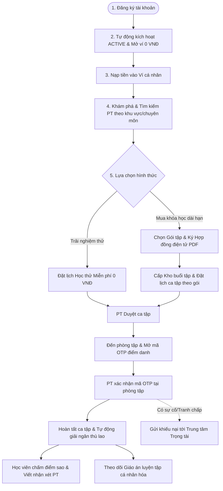
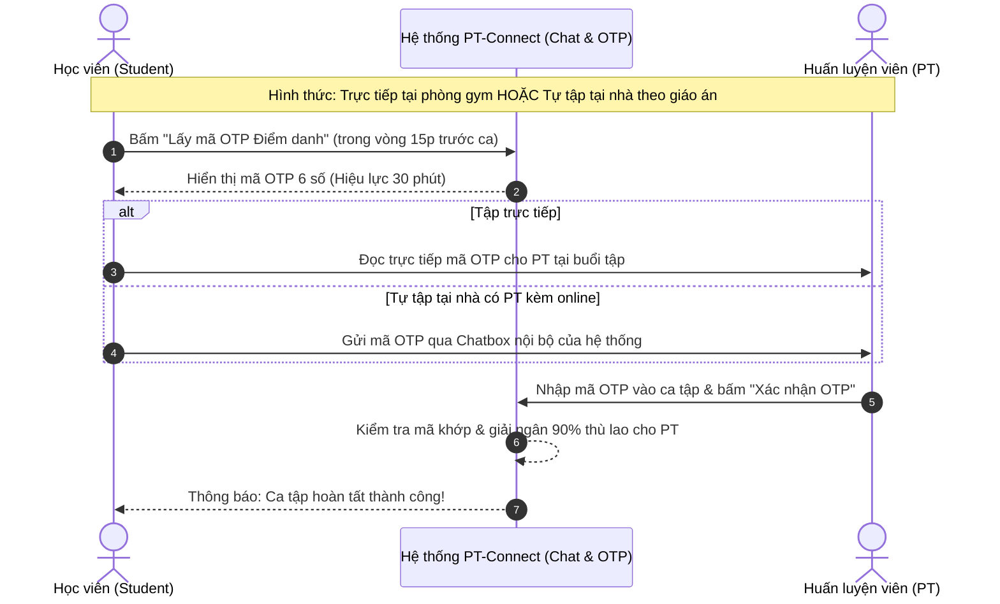

# 📘 TÀI LIỆU NGHIỆP VỤ CHI TIẾT DÀNH CHO HỌC VIÊN (STUDENT)
> **Hệ thống:** Nền tảng kết nối Huấn luyện viên cá nhân & Học viên (PT-Connect)  
> **Vai trò:** Học viên thể hình (Student)  
> **Mục tiêu tài liệu:** Cung cấp tài liệu nghiệp vụ chi tiết, đầy đủ 100% về toàn bộ quyền lợi, trách nhiệm, quy trình thao tác, điều kiện logic, công thức tài chính và các quy định chế tài áp dụng cho Học viên trong hệ thống.

---

## 📌 MỤC LỤC

1. [Tổng quan vai trò Học viên & Hành trình trải nghiệm (User Journey)](#1-tổng-quan-vai-trò-học-viên--hành-trình-trải-nghiệm)
2. [Nghiệp vụ Đăng ký, Đăng nhập & Hồ sơ cá nhân](#2-nghiệp-vụ-đăng-ký-đăng-nhập--hồ-sơ-cá-nhân)
3. [Nghiệp vụ Quản lý Ví điện tử & Dòng tiền Học viên](#3-nghiệp-vụ-quản-lý-ví-điện-tử--dòng-tiền-học-viên)
4. [Nghiệp vụ Khám phá PT & Đăng ký Buổi học thử (Trial)](#4-nghiệp-vụ-khám-phá-pt--đăng-ký-buổi-học-thử-trial)
5. [Nghiệp vụ Mua khóa học & Ký kết Hợp đồng điện tử (E-Contract)](#5-nghiệp-vụ-mua-khóa-học--ký-kết-hợp-đồng-điện-tử-e-contract)
6. [Nghiệp vụ Đặt lịch tập theo Gói Khóa học (Package Booking)](#6-nghiệp-vụ-đặt-lịch-tập-theo-gói-khóa-học-package-booking)
7. [Chính sách Hủy lịch tập & Quy chế Phạt / Đền bù Học viên](#7-chính-sách-hủy-lịch-tập--quy-chế-phạt--đền-bù-học-viên)
8. [Quy trình Điểm danh hai chiều qua OTP tại Phòng tập & Xử lý Vắng mặt](#8-quy-trình-điểm-danh-hai-chiều-qua-otp-tại-phòng-tập--xử-lý-vắng-mặt)
9. [Nghiệp vụ Đánh giá, Nhận xét & Chấm điểm Sao HLV](#9-nghiệp-vụ-đánh-giá-nhận-xét--chấm-điểm-sao-hlv)
10. [Nghiệp vụ Theo dõi Giáo án luyện tập cá nhân hóa](#10-nghiệp-vụ-theo-dõi-giáo-án-luyện-tập-cá-nhân-hóa)
11. [Kênh Nhắn tin trao đổi trực tiếp 1-1 với Huấn luyện viên](#11-kênh-nhắn-tin-trao-đổi-trực-tiếp-1-1-với-huấn-luyện-viên)
12. [Trung tâm Trọng tài, Khởi kiện & Bảo vệ quyền lợi Học viên](#12-trung-tâm-trọng-tài-khởi-kiện--bảo-vệ-quyền-lợi-học-viên)
13. [Bộ quy tắc ứng xử & Các điều cấm kỵ dành cho Học viên](#13-bộ-quy-tắc-ứng-xử--các-điều-cấm-kỵ-dành-cho-học-viên)

---

## 1. TỔNG QUAN VAI TRÒ HỌC VIÊN & HÀNH TRÌNH TRẢI NGHIỆM

### 1.1. Vị thế và Quyền lợi cốt lõi của Học viên
Học viên (`STUDENT`) là người mua dịch vụ huấn luyện thể hình cá nhân (1-kèm-1) trên nền tảng PT-Connect. Khác với mô hình phòng gym truyền thống thường yêu cầu đóng tiền cục bộ một lần và đối mặt với rủi ro PT bỏ rơi, PT-Connect bảo vệ quyền lợi tối đa cho Học viên thông qua:
* **Bảo vệ tài chính qua cơ chế giữ tiền an toàn**: Tiền học phí đóng vào gói không bị chuyển ngay cho PT, mà được hệ thống giữ lại và chỉ giải ngân từng buổi sau khi học viên xác nhận điểm danh bằng OTP.
* **Hợp đồng điện tử minh bạch**: Mỗi gói khóa học mua thành công đều sinh một bản Hợp đồng PDF có mã đối soát ngân quỹ, quy định địa điểm tập cố định và cam kết số buổi.
* **Quyền chấm điểm & Phản hồi công khai**: Học viên được đánh giá chất lượng từ 1-5 sao sau mỗi buổi tập hoàn thành.
* **Cơ chế trọng tài công bằng**: Có quyền khiếu nại lên Ban Quản Trị khi PT bùng lịch, đi muộn, hoặc chất lượng dạy kém cam kết, với quy chế hòa giải và bồi hoàn rõ ràng.

### 1.2. Sơ đồ Hành trình Học viên (Student End-to-End Journey)

---

## 2. NGHIỆP VỤ ĐĂNG KÝ, ĐĂNG NHẬP & HỒ SƠ CÁ NHÂN

### 2.1. Đăng ký tài khoản Học viên (Registration)
* **Quy tắc duy nhất (Uniqueness)**: Email và Số điện thoại của học viên phải là duy nhất trên toàn hệ thống.
* **Bảo mật mật khẩu**: Mật khẩu được mã hóa an toàn qua thuật toán BCrypt trước khi lưu vào cơ sở dữ liệu.
* **Kích hoạt tự động**: Khi đăng ký với vai trò `STUDENT`:
  * Tài khoản được cấp trạng thái hoạt động ngay lập tức: `status = ACTIVE`.
  * Không cần qua khâu xét duyệt hồ sơ như PT.
  * Hệ thống tự động tạo một Ví điện tử cá nhân (`Wallet`) liên kết với tài khoản, số dư ban đầu `balance = 0 VNĐ`, `locked_balance = 0 VNĐ`, tiền tệ chuẩn `VND`, trạng thái ví `ACTIVE`.

### 2.2. Đăng nhập & Kiểm soát phiên (Login & Security)
* Đăng nhập bằng `Email` và `Mật khẩu`.
* **Kiểm tra trạng thái**:
  * Nếu `ACTIVE`: Cấp mã truy cập bảo mật (JWT Token) để học viên thực hiện các thao tác trên hệ thống.
  * Nếu `SUSPENDED` (Tài khoản bị khóa do vi phạm kỷ luật hoặc gian lận): Hệ thống chặn truy cập và thông báo tài khoản bị đình chỉ, yêu cầu liên hệ Quản trị viên.
* **Phân quyền dữ liệu**: Học viên chỉ có thể truy vấn và thao tác trên ví tiền, hợp đồng, lịch tập, khiếu nại và tin nhắn của chính mình.

### 2.3. Cập nhật hồ sơ & Ảnh đại diện (Profile & Avatar)
* Học viên có thể cập nhật: Họ tên (`fullName`), Số điện thoại (`phoneNumber`), Ảnh đại diện (`avatarUrl`).
* Khi thay đổi số điện thoại, hệ thống kiểm tra chống trùng lặp với người dùng khác.
* Tải ảnh đại diện: Hỗ trợ tệp ảnh chuẩn (JPEG, PNG, WEBP, GIF), dung lượng tối đa 5MB.

---

## 3. NGHIỆP VỤ QUẢN LÝ VÍ ĐIỆN TỬ & DÒNG TIỀN HỌC VIÊN

Mọi giao dịch thanh toán trong hệ thống đều thông qua Ví điện tử nội bộ nhằm bảo đảm an toàn và tự động hóa tuyệt đối.

### 3.1. Cấu trúc Số dư Ví
* `balance`: Tổng số dư tiền thực tế hiện có trong ví.
* `locked_balance`: Số dư tiền đang bị đóng băng tạm thời (mặc định $\ge 0$).
* **Số dư khả dụng để thanh toán hoặc rút tiền** = `balance - locked_balance`.
* Mọi phép toán cộng trừ tiền tệ đều được xử lý với độ chính xác tuyệt đối qua `BigDecimal`.

### 3.2. Nghiệp vụ Nạp tiền ví (Top-up)
* Học viên nạp tiền vào ví qua hình thức: Chuyển khoản ngân hàng (`BANK_TRANSFER`) hoặc Quét mã thanh toán.
* **Quy tắc**:
  * Số tiền nạp bắt buộc phải $> 0$ VNĐ.
  * Tiền được cộng trực tiếp vào số dư khả dụng ngay khi giao dịch thành công.
  * Sinh mã tham chiếu duy nhất: `TXN_TOPUP_YYYYMMDD_XXXXXXXX`.
  * Trạng thái giao dịch: `SUCCESS`.

### 3.3. Nghiệp vụ Rút tiền ví (Withdrawal)
Học viên có quyền rút số dư khả dụng về tài khoản ngân hàng cá nhân bất kỳ lúc nào nếu đáp ứng đủ các điều kiện:
1. **Trạng thái ví**: Ví phải ở trạng thái hoạt động (`ACTIVE`). Nếu ví bị đóng băng (`FROZEN`), lệnh rút tiền bị từ chối.
2. **Hạn mức rút tối thiểu**: Số tiền yêu cầu rút bắt buộc phải $\ge 50.000$ VNĐ / lần rút.
3. **Kiểm tra số dư khả dụng**: Số tiền rút phải $\le (balance - locked\_balance)$. Nếu số tiền rút vượt quá số dư khả dụng, hệ thống lập tức báo lỗi không đủ số dư.
4. **Thông tin ngân hàng**: Cung cấp đầy đủ: Tên ngân hàng thụ hưởng, Số tài khoản ngân hàng, Tên chủ tài khoản hợp lệ.
* Khi thành công: Hệ thống khấu trừ tiền trong ví, tạo bản ghi `Payment` loại `WITHDRAW`, sinh mã `TXN_WD_YYYYMMDD_XXXXXXXX`.

---

## 4. NGHIỆP VỤ KHÁM PHÁ PT & ĐĂNG KÝ BUỔI HỌC THỬ (TRIAL)

### 4.1. Khám phá & Tìm kiếm Huấn luyện viên
* Giao diện "Khám Phá PT" chỉ hiển thị các PT đã được Ban Quản Trị phê duyệt chính thức (tài khoản `ACTIVE` và hồ sơ `VERIFIED`).
* Bộ lọc đa năng:
  * Theo tên Huấn luyện viên.
  * Theo khu vực quận huyện / địa điểm nhận dạy (ví dụ: Cầu Giấy, Thanh Xuân, Đống Đa...).
  * Theo chuyên môn huấn luyện (Giảm cân, Tăng cơ, Boxing, Yoga, Phục hồi chức năng...).
  * Theo đánh giá sao trung bình (`average_rating` từ 1.0 đến 5.0 sao).
* Xem thông tin chi tiết của PT:
  * Tiểu sử (Bio), số năm kinh nghiệm thực tế.
  * Bằng cấp, chứng chỉ thể hình quốc tế/quốc gia.
  * Bảng giá niêm yết các gói khóa học.
  * Chính sách phụ thu di chuyển (nếu dạy tại phòng ngoài hoặc tại nhà).
  * Lịch sử nhận xét và số sao từ các học viên trước.

### 4.2. Quy chế Đặt lịch Học thử Miễn phí (Single Trial Rule)
Nhằm giúp học viên yên tâm trải nghiệm phong cách huấn luyện trước khi quyết định mua gói dài hạn:
* **Học phí ca tập thử**: Hoàn toàn miễn phí (`sessionFee = 0 VNĐ`).
* **Không cần ký hợp đồng**: Trường `enrollmentId = NULL`.
* **Quy tắc giới hạn nghiêm ngặt (Single Trial Rule)**:
  * Mỗi học viên **chỉ được phép đặt lịch tập thử tối đa 1 lần duy nhất với mỗi Huấn luyện viên**.
  * Hệ thống kiểm tra trong lịch sử đặt ca (`bookings`), nếu học viên đã từng có ca tập thử (dù ở trạng thái `PENDING`, `CONFIRMED` hay `COMPLETED`) với PT này, hệ thống sẽ chặn tuyệt đối và yêu cầu học viên mua khóa học chính thức nếu muốn tiếp tục tập luyện.
* **Quy trình đặt thử**:
  1. Học viên chọn 1 khung giờ rảnh (`AVAILABLE`) của PT.
  2. Điền ghi chú mục tiêu thể trạng cá nhân (`studentNote`).
  3. Hệ thống tạo ca tập với trạng thái ban đầu là `PENDING`.
  4. Chờ PT chấp thuận (`CONFIRMED`) hoặc từ chối (`CANCELLED`).

---

## 5. NGHIỆP VỤ MUA KHÓA HỌC & KÝ KẾT HỢP ĐỒNG ĐIỆN TỬ (E-CONTRACT)

### 5.1. Quy trình Mua khóa học & Thanh toán khép kín
Khi học viên quyết định tập luyện dài hạn cùng PT, toàn bộ quy trình mua gói và ký hợp đồng diễn ra khép kín trong một giao dịch an toàn (`@Transactional`):
1. **Kiểm tra trạng thái khóa học**: Gói tập phải đang ở trạng thái `ACTIVE` (đang mở bán).
2. **Quy tắc chống mua chồng gói chưa học xong (Active Enrollment Conflict Check)**:
   * Nếu học viên hiện đang có một hợp đồng `ACTIVE` với chính khóa học này mà vẫn còn buổi học chưa hoàn thành (`remainingSessions > 0`), hệ thống sẽ **từ chối giao dịch**.
   * *Mục đích*: Ngăn chặn việc học viên bấm nhầm mua nhiều lần, hoặc để tồn đọng quá nhiều buổi tập quá hạn gây tranh chấp biểu phí. Học viên phải học hết gói cũ trước khi mua gói tiếp theo.
3. **Cam kết Địa điểm tập cố định (`trainingLocation`)**:
   * Học viên bắt buộc phải chọn hoặc điền địa điểm tập cố định duy nhất (ví dụ: *FitZone Thanh Xuân*, *Cali Cầu Giấy*).
   * Địa điểm này được in cố định vào Hợp đồng pháp lý và không được tự ý đổi nhằm tránh xung đột về chi phí đi lại giữa học viên và HLV.
4. **Thanh toán qua ví điện tử**:
   * Hệ thống kiểm tra số dư khả dụng của học viên.
   * Nếu số dư khả dụng $< Giá\_khóa\_học$: Giao dịch lập tức bị hủy bỏ, thông báo học viên nạp thêm tiền.
   * Nếu đủ tiền: Hệ thống trừ chính xác tiền khóa học khỏi ví học viên, ghi nhận giao dịch `PURCHASE_PACKAGE` (mã `TXN_BUY_YYYYMMDD_XXXXXXXX`).

### 5.2. Khởi tạo Hợp đồng & Cơ chế Kho buổi tập (Session Inventory)
* **Khởi tạo bản ghi Hợp đồng (`Enrollment`)**:
  * Tổng số buổi (`total_sessions`): Bằng số buổi cam kết của gói (ví dụ: 12, 24, 36 buổi).
  * Kho buổi khả dụng (`remaining_sessions`): Khởi tạo bằng đúng `total_sessions`.
  * Ngày bắt đầu (`start_date`): Ngày mua thành công.
  * Ngày kết thúc (`end_date`): Bằng $Ngày\_bắt\_đầu + validity\_days$ của khóa học.
  * Trạng thái hợp đồng: `ACTIVE`.

### 5.3. Tự động Xuất Hợp đồng điện tử PDF (E-Contract)
* Hệ thống tự động tạo một tệp Hợp đồng điện tử PDF chuẩn pháp lý.
* **Nội dung hợp đồng gồm**:
  * Mã hợp đồng duy nhất, ngày ký kết điện tử, mã giao dịch tài chính đối soát (`transactionRef`).
  * **Bên A (Học viên)**: Họ tên, Email, Số điện thoại.
  * **Bên B (Huấn luyện viên)**: Họ tên, Email, Số điện thoại, Bằng cấp chuyên môn.
  * Tên gói khóa học, tổng số buổi, học phí thực tế đã thanh toán.
  * Địa điểm tập luyện cam kết cố định.
  * Thời hạn hiệu lực hợp đồng (Ngày bắt đầu $\rightarrow$ Ngày hết hạn).
  * Các điều khoản cam kết: Chính sách đối soát 24h khi hủy lịch, nghĩa vụ điểm danh OTP, chế tài xử lý vi phạm.
* Tệp PDF được lưu trữ an toàn, học viên có thể xem và tải về máy từ mục **"Khóa Của Tôi"** bất kỳ lúc nào.

---

## 6. NGHIỆP VỤ ĐẶT LỊCH TẬP THEO GÓI KHÓA HỌC (PACKAGE BOOKING)

### 6.1. Điều kiện tiên quyết để Học viên đặt lịch
Để đặt được 1 buổi tập theo gói (`BookingType.PACKAGE`), học viên phải thỏa mãn đồng thời các điều kiện sau:
1. Có Hợp đồng (`Enrollment`) với PT ở trạng thái `ACTIVE`.
2. Hợp đồng chưa hết hạn: Ngày hiện tại $\le end\_date$ của hợp đồng.
3. Khung giờ ca tập dự kiến phải nằm trong thời hạn hợp đồng: $Slot.startTime \le end\_date$.
4. Kho buổi tập còn lại phải $> 0$ (`remaining_sessions > 0`).

### 6.2. Cơ chế Khóa bi quan chống tranh chấp lịch (Pessimistic Locking)
Khi nhiều học viên cùng truy cập và bấm đặt cùng 1 khung giờ rảnh của PT tại cùng một tích tắc:
* Hệ thống áp dụng khóa bi quan (`SELECT ... FOR UPDATE`) khóa chặt dòng dữ liệu khung giờ (`AvailabilitySlot`).
* Yêu cầu đến sau buộc phải chờ giao dịch trước hoàn thành. Nếu slot đã chuyển sang `BOOKED`, yêu cầu sau sẽ bị từ chối với lỗi xung đột lịch.
* **Kiểm tra chống trùng lịch của chính Học viên**: Hệ thống kiểm tra học viên không được có bất kỳ ca tập nào khác (đang `PENDING` hoặc `CONFIRMED`) trùng giờ hoặc giao cắt với khung giờ đang chọn.

### 6.3. Khấu trừ Kho buổi tập & Trạng thái Ca tập
* **Tạm trừ buổi tập ngay khi đặt**:
  * Hệ thống lập tức trừ 1 buổi tập trong kho hợp đồng:  
    $$remaining\_sessions = remaining\_sessions - 1$$
  * Giá trị buổi tập được ghi nhận vào ca:  
    $$sessionFee = \frac{Giá\_hợp\_đồng}{Tổng\_số\_buổi}$$
  * Khung giờ chuyển trạng thái sang `BOOKED`.
  * Bản ghi ca tập (`Booking`) được khởi tạo với trạng thái ban đầu là **`PENDING`** (Chờ Huấn luyện viên phê duyệt).
* **Phản hồi từ PT**:
  * **Nếu PT Duyệt (`APPROVE`)**: Ca tập chuyển sang **`CONFIRMED`**. Học viên chuẩn bị đến tập theo lịch.
  * **Nếu PT Từ chối (`REJECT`)**: Ca tập chuyển sang **`CANCELLED`**. Khung giờ được giải phóng về `AVAILABLE`. Hệ thống **hoàn trả ngay 1 buổi tập** vào kho hợp đồng của học viên ($remaining\_sessions = remaining\_sessions + 1$). Học viên không chịu bất kỳ chi phí hay thiệt hại nào.

---

## 7. CHÍNH SÁCH HỦY LỊCH TẬP & QUY CHẾ PHẠT / ĐỀN BÙ HỌC VIÊN

PT-Connect áp dụng công thức đối soát tự động theo mốc thời gian chuẩn **24 giờ trước thời điểm bắt đầu ca tập**:

$$\Delta t = \text{Thời điểm bắt đầu ca tập} - \text{Thời điểm bấm Hủy}$$

### 7.1. Bảng Quy tắc Xử lý Hủy ca đối với Học viên

| Trạng thái ca khi hủy | Mốc thời gian hủy ($\Delta t$) | Quyền lợi số buổi hợp đồng | Chế tài tài chính đối với Học viên | Ghi chú quyền lợi |
| :--- | :--- | :--- | :--- | :--- |
| **`PENDING`** (Chờ duyệt) | Bất kỳ lúc nào | **✓ Hoàn trả 1 buổi** | **Không mất phí, không phạt** | Khung giờ trả về `AVAILABLE`. |
| **`CONFIRMED`** (Đã duyệt) | Báo trước $\ge 24$ giờ | **✓ Hoàn trả 1 buổi** | **Phạt 50% tiền buổi học** từ ví | Đền bù 50% cho PT vì đã giữ chỗ. |
| **`CONFIRMED`** (Đã duyệt) | Sát giờ $< 24$ giờ | **✕ MẤT BUỔI (Không hoàn)** | **100% tiền buổi được giải ngân** | PT hưởng 90%, sàn thu 10% phí. |
| **`CONFIRMED`** (HLV hủy sát giờ) | HLV hủy sát giờ $< 24$h | **✓ Hoàn trả 1 buổi** | **Được nhận thêm 100% tiền buổi đền bù** | Tiền đền bù cộng trực tiếp vào ví học viên. |
| **Ca bất khả kháng** | Admin can thiệp hủy | **✓ Khôi phục 1 buổi** | **Không phạt đôi bên** | Cần giấy xác nhận y tế/sự cố. |

### 7.2. Giải thích chi tiết các trường hợp Học viên Hủy

#### Trường hợp 1: Học viên hủy ca đang chờ duyệt (`PENDING`)
* Do PT chưa xếp lịch chính thức, học viên có toàn quyền hủy bất kỳ lúc nào.
* Hệ thống hoàn trả ngay 1 buổi vào hợp đồng của học viên. Không phát sinh phí phạt.

#### Trường hợp 2: Học viên hủy ca đã duyệt (`CONFIRMED`) trước $\ge 24$ giờ
* **Ý nghĩa**: Học viên có ý thức báo trước đủ sớm, PT vẫn kịp sắp xếp thời gian làm việc khác.
* **Buổi tập**: Học viên **được hoàn trả 1 buổi tập** vào kho hợp đồng để đặt lại ca khác.
* **Phạt tài chính**: Do PT đã cam kết giữ chỗ, hệ thống phạt trừ **50% giá trị buổi học** ($50\% \times sessionFee$) từ ví học viên để đền bù tổn thất cho PT.

#### Trường hợp 3: Học viên hủy ca đã duyệt (`CONFIRMED`) sát giờ ($< 24$ giờ)
* **Ý nghĩa**: Hủy cận giờ khiến PT không thể nhận học viên khác, lãng phí thời gian và chi phí chuẩn bị của PT.
* **Buổi tập**: Học viên **bị mất buổi tập này** (không được hoàn lại vào hợp đồng).
* **Tài chính**: Buổi học được xem như đã hoàn tất nghĩa vụ thanh toán: Toàn bộ tiền buổi học ($sessionFee$) được giải ngân (90% chuyển vào ví của PT, 10% sàn thu phí dịch vụ).

#### Trường hợp 4: Huấn luyện viên tự ý hủy ca sát giờ ($< 24$ giờ)
* Nhằm bảo vệ quyền lợi và tôn trọng thời gian của học viên:
  * Học viên được hoàn trả 1 buổi tập vào hợp đồng.
  * Học viên được nhận **100% giá trị một buổi học** ($100\% \times sessionFee$) đền bù trực tiếp vào ví cá nhân từ khoản phạt thu của PT.

---

## 8. QUY TRÌNH ĐIỂM DANH HAI CHIỀU QUA OTP LINH HOẠT (TẠI PHÒNG HOẶC TỰ TẬP TẠI NHÀ)

Hệ thống loại bỏ hoàn toàn cơ chế điểm danh một chiều để bảo vệ học viên, triệt tiêu nguy cơ PT tự ý bấm hoàn thành khống để trục lợi tiền buổi tập.

### 8.1. Nguyên tắc Cốt lõi: Độc quyền Tạo mã OTP thuộc về Học viên
* **Học viên là người nắm giữ "Chìa khóa giải ngân"**: Hệ thống chỉ cho phép Học viên bấm nút sinh mã OTP trong khung giờ ca tập. PT tuyệt đối không có quyền tự kích hoạt hoàn tất ca tập.
* **Thời điểm mở mã OTP (Khung giờ vàng)**: Chỉ được mở **trước tối đa 15 phút** so với giờ bắt đầu ca tập ($now \ge startTime - 15\text{ phút}$). Mã gồm 6 chữ số ngẫu nhiên, tự hủy sau 30 phút.
* **Linh hoạt theo hình thức tập luyện**:
  * **Tập trực tiếp (Tại phòng gym hoặc PT đến nhà)**: Hai bên gặp mặt trực tiếp, học viên đọc hoặc cho PT xem mã OTP hiển thị trên màn hình.
  * **Tự tập tại nhà (Có PT kèm cặp / hướng dẫn từ xa theo giáo án)**: Sau khi hoàn thành bài tập dưới sự đôn đốc của PT, học viên có thể gửi mã OTP cho PT qua **Chatbox 1-1 nội bộ của hệ thống** để PT nhập xác thực ca tập.

### 8.2. Quy trình Điểm danh qua OTP

1. **Bước 1 (Học viên lấy mã OTP)**:
   * Khi đến giờ tập, học viên vào mục **"Lịch Của Tôi"** $\rightarrow$ chọn ca tập $\rightarrow$ bấm **"Lấy mã OTP Điểm danh"**.
   * Hệ thống sinh mã OTP ngẫu nhiên 6 chữ số (hiệu lực 30 phút).
   * Phân loại:
     * Nếu lấy mã trong khoảng từ $startTime - 15\text{ phút}$ đến $startTime + 15\text{ phút}$: Ghi nhận **Đúng giờ (`PRESENT`)**.
     * Nếu lấy mã sau giờ bắt đầu quá 15 phút: Ghi nhận **Đến muộn (`LATE`)**.
2. **Bước 2 (Cung cấp mã cho PT)**:
   * Đọc trực tiếp hoặc gửi qua Chatbox nội bộ của sàn.
   * PT nhập mã vào giao diện duyệt ca của mình để xác thực.
3. **Bước 3 (Hoàn tất ca & Giải ngân)**:
   * Ngay khi PT nhập đúng mã OTP: Ca tập lập tức chuyển trạng thái sang **`COMPLETED`**.
   * Hệ thống tự động trích 90% thù lao buổi dạy vào ví PT và 10% hoa hồng vào ví Admin.
   * Mã OTP được thu hồi ngay lập tức để chống tái sử dụng.
   * **Bảo vệ chống gian lận**: Nếu PT không hướng dẫn, không dạy hoặc vắng mặt, học viên giữ lại mã OTP $\rightarrow$ PT hoàn toàn không thể lấy được tiền buổi học.

### 8.3. Xử lý trường hợp Học viên Vắng mặt (No-Show)
* Nếu quá 15-30 phút kể từ giờ bắt đầu ca tập mà học viên không có mặt và không hề liên lạc xin dời lịch:
  * PT có quyền bấm nút **"Đánh dấu Học viên Vắng mặt (ABSENT)"** kèm lý do.
  * Ca tập được hệ thống đánh dấu hoàn tất (`COMPLETED`).
  * **Hậu quả đối với học viên**: Học viên **bị mất buổi tập đó** trong hợp đồng; tiền buổi học vẫn được giải ngân trả cho PT để đền bù thời gian chờ đợi.

---

## 9. NGHIỆP VỤ ĐÁNH GIÁ, NHẬN XÉT & CHẤM ĐIỂM SAO HLV

### 9.1. Điều kiện gửi Đánh giá (Review Rules)
* Chỉ chính học viên sở hữu ca tập mới có quyền viết đánh giá cho PT của ca đó.
* **Ràng buộc hoàn thành**: Ca tập bắt buộc phải ở trạng thái **`COMPLETED`** mới được mở tính năng đánh giá.
* **Ràng buộc duy nhất (1-1 Constraint)**: Mỗi ca tập hoàn thành chỉ được phép gửi đánh giá **đúng 1 lần duy nhất** (ràng buộc `booking_id UNIQUE`). Không thể gửi lặp lại để spam.
* Thang điểm đánh giá: Từ **1 đến 5 sao** (sao nguyên) kèm nội dung nhận xét chi tiết về tác phong, chuyên môn và thái độ của PT.

### 9.2. Cơ chế Tự động Tính sao qua Database Trigger
* Ngay khi học viên bấm gửi đánh giá, Trigger tầng Database sẽ tự động kích hoạt tính lại:
  * Điểm sao trung bình: $average\_rating = \text{ROUND}(\text{AVG}(rating), 2)$.
  * Tổng số lượt đánh giá: $total\_reviews = \text{COUNT}(rating)$.
* Hai chỉ số này cập nhật ngay lập tức vào hồ sơ của PT, giúp cộng đồng học viên khác nhìn thấy uy tín thực tế của HLV.

---

## 10. NGHIỆP VỤ THEO DÕI GIÁO ÁN LUYỆN TẬP CÁ NHÂN HÓA

### 10.1. Giáo án gắn liền với Hợp đồng (Enrollment-Bound Plan)
* Nhằm đảm bảo lộ trình tập luyện khoa học, mỗi học viên khi mua khóa học sẽ được PT phụ trách thiết kế riêng một Giáo án huấn luyện cá nhân hóa (`WorkoutPlan`) dựa trên thể trạng và mục tiêu cam kết.
* Học viên có thể truy cập mục **"Giáo Án Của Tôi"** để theo dõi lộ trình bài tập theo từng tuần.

### 10.2. Cấu trúc bài tập học viên được xem
* **Thông tin lộ trình**: Tiêu đề giáo án, mục tiêu cụ thể (ví dụ: *Tăng 2kg cơ bắp, giảm mỡ vòng eo trong 4 tuần*), thời hạn áp dụng.
* **Chi tiết từng bài tập (`Workouts`)**:
  * Tên bài tập (Bench Press, Squat, Deadlift, Plank...).
  * Nhóm cơ tác động chính (Ngực, Lưng, Chân mông, Vai, Tay, Bụng/Core).
  * Khối lượng vận động chuẩn: Số hiệp (`sets`), số lần lặp mỗi hiệp (`reps`), mức tạ gợi ý (`weightKg`), thời gian nghỉ phục hồi (`restSeconds`).
  * Đường dẫn video hướng dẫn chuẩn form động tác (`videoDemoUrl`): Học viên có thể xem video mẫu để tự ôn luyện động tác chuẩn, tránh sai form gây chấn thương.

---

## 11. KÊNH NHẮN TIN TRAO ĐỔI TRỰC TIẾP 1-1 VỚI HUẤN LUYỆN VIÊN

### 11.1. Mục đích kết nối
Hệ thống tích hợp cửa sổ chat 1-1 trực tiếp giữa Học viên và Huấn luyện viên nhằm:
* Hẹn giờ, xác nhận địa điểm tập trước mỗi buổi.
* Trao đổi chế độ dinh dưỡng, nhắc nhở bài tập về nhà.
* Báo trước sự cố đến muộn vài phút để PT chủ động chờ.

### 11.2. Quy tắc hoạt động
* Học viên có thể mở trò chuyện với các PT mà mình đã từng đặt lịch hoặc đang có hợp đồng.
* Hộp thoại hiển thị trạng thái tin nhắn chưa đọc theo thời gian thực.
* Toàn bộ lịch sử trò chuyện được lưu trữ làm bằng chứng đối soát nếu có phát sinh tranh chấp.

---

## 12. TRUNG TÂM TRỌNG TÀI, KHỞI KIỆN & BẢO VỆ QUYỀN LỢI HỌC VIÊN

Khi xảy ra bất đồng hoặc PT vi phạm cam kết mà hai bên không thể tự thương lượng, Học viên có quyền nộp đơn khiếu nại lên Ban Quản Trị thông qua **Trung tâm Phân xử Trọng tài**.

### 12.1. Các trường hợp Học viên có quyền Khiếu nại
1. **Khiếu nại ca tập đơn lẻ**:
   * HLV vắng mặt không báo trước (No-Show).
   * HLV đến muộn quá 15 phút hoặc cắt xén thời lượng ca tập.
   * HLV yêu cầu đọc mã OTP từ xa khi chưa gặp mặt.
   * HLV có thái độ xúc phạm, thiếu văn hóa hoặc quấy rối.
2. **Khiếu nại yêu cầu Hủy toàn bộ Hợp đồng & Hoàn tiền**:
   * HLV liên tục từ chối hoặc không mở lịch dạy làm trôi hạn hợp đồng.
   * HLV dạy sai lệch nghiêm trọng so với cam kết chuyên môn.
   * Học viên gặp sự cố chấn thương, tai nạn y tế bất khả kháng (có giấy viện xác nhận).

### 12.2. Quy trình Khiếu nại & Quy chế Trọng tài 48 giờ
1. **Khởi tạo đơn khiếu nại**: Học viên chọn ca tập hoặc hợp đồng tương ứng, chọn lý do khiếu nại và tải lên bằng chứng chứng minh (ảnh chụp tin nhắn, biên lai phòng gym, phiếu khám bệnh).
2. **Thời hạn phản biện 48 giờ**: Đơn khiếu nại được tiếp nhận. PT có thời hạn tối đa 48 giờ để gửi bản phản biện và chứng cứ đối ứng. Trong thời gian này, Admin không được phán quyết độc đoán (trừ trường hợp khẩn cấp).
3. **Bổ sung bằng chứng**: Nếu Admin yêu cầu, học viên có thể nộp thêm tài liệu xác minh.
4. **Phán quyết Trọng tài bảo vệ Học viên**:
   * **Nếu xử thắng cho Học viên (`REFUND_STUDENT`)**:
     * Hoàn trả **100% học phí buổi tập** vào ví của học viên.
     * Khôi phục lại 1 buổi tập vào hợp đồng.
     * Hủy bỏ ca tập vi phạm, cảnh cáo hoặc xử phạt PT.
   * **Nếu chấp thuận Hủy toàn bộ Hợp đồng (`CANCEL_CONTRACT_REFUND_STUDENT`)**:
     * Hợp đồng chuyển sang trạng thái `CANCELLED`.
     * Tự động hoàn trả tiền các buổi chưa tập vào ví học viên theo tỷ lệ:  
       $$Tiền\_hoàn = Giá\_hợp\_đồng \times \frac{Số\_buổi\_chưa\_tập}{Tổng\_số\_buổi\_hợp\_đồng}$$
     * Tự động hủy toàn bộ các ca tập trong tương lai thuộc hợp đồng này.
   * **Nếu hòa giải Bất khả kháng (`RESOLVED_FORCE_MAJEURE`)**:
     * Khôi phục lại buổi tập cho học viên, không áp dụng phạt tài chính đối với cả hai bên.

---

## 13. BỘ QUY TẮC ỨNG XỬ & CÁC ĐIỀU CẤM KỴ DÀNH CHO HỌC VIÊN

Nhằm duy trì môi trường tập luyện văn minh, an toàn và chuyên nghiệp, mọi học viên tham gia nền tảng PT-Connect bắt buộc phải tuân thủ:

### 13.1. Quy tắc ứng xử văn minh
* ⏰ **Đúng giờ**: Có mặt tại phòng tập trước 5-10 phút để thay trang phục và khởi động làm quen máy móc.
* 👟 **Trang phục thể thao**: Mặc quần áo thể thao gọn gàng, đi giày tập sạch sẽ theo đúng nội quy phòng gym.
* 🤝 **Hợp tác & Trung thực**: Khai báo trung thực tiền sử chấn thương, bệnh lý tim mạch, cơ xương khớp cho PT trước khi bước vào tập luyện.
* ⭐ **Đánh giá khách quan**: Chấm sao và nhận xét công tâm dựa trên buổi tập thực tế, không dùng ngôn từ thô tục, bôi nhọ danh dự người khác.

### 13.2. CÁC HÀNH VI NGHIÊM CẤM TUYỆT ĐỐI
* ❌ **CẤM GIAO DỊCH NGOÀI HỆ THỐNG**: Tuyệt đối không chuyển khoản cá nhân hay thanh toán tiền mặt trực tiếp cho PT để "mua thêm buổi" ngoài nền tảng. Khi giao dịch ngoài sàn, hệ thống **từ chối 100% trách nhiệm bảo vệ dòng tiền, hòa giải và đền bù** khi xảy ra lừa đảo hoặc bùng lịch.
* ❌ **CẤM ĐƯA MÃ OTP KHI CHƯA TẬP HOẶC CHẤM CÔNG KHỐNG**: Tuyệt đối không gửi mã OTP cho PT khi ca tập chưa diễn ra hoặc khi PT không có mặt hướng dẫn. Việc trao đổi mã OTP qua Chatbox nội bộ chỉ được phép thực hiện khi ca tập thực tế (tại nhà/từ xa) đã hoàn thành đạt yêu cầu.
* ❌ **CẤM TẠO TÀI KHOẢN ẢO (CLONE) ĐỂ TRỤC LỢI HỌC THỬ**: Nghiêm cấm dùng nhiều số điện thoại ảo để liên tục đăng ký học thử miễn phí nhiều lần với các PT. Hệ thống phát hiện sẽ lập tức đưa vào danh sách đen (Blacklist).

---
*Tài liệu được ban hành chính thức bởi Ban Quản Trị PT-Connect. Học viên cần đọc kỹ và tuân thủ để bảo vệ tối đa quyền lợi của bản thân.*
